Topic:

Subfield

Def.: 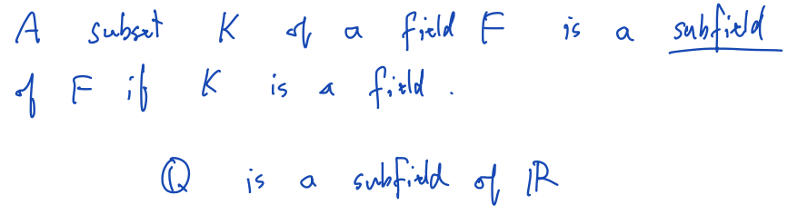

Complex field

Def.: 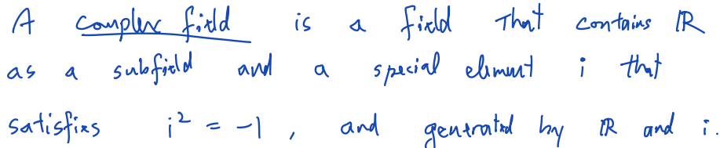

Model 1 – Complex number as a point

Unit: (1, 0)

Zero: (0, 0)

Imaginary unit: (0, 1)

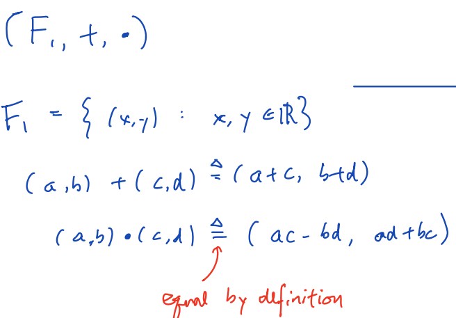

Model 2 – Complex number as a matrix

Unit: 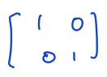

Zero: 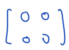

Imaginary unit: 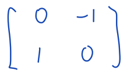

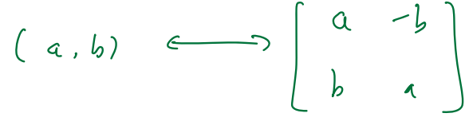

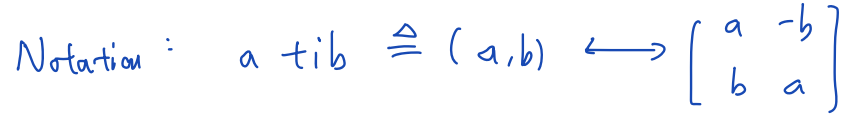

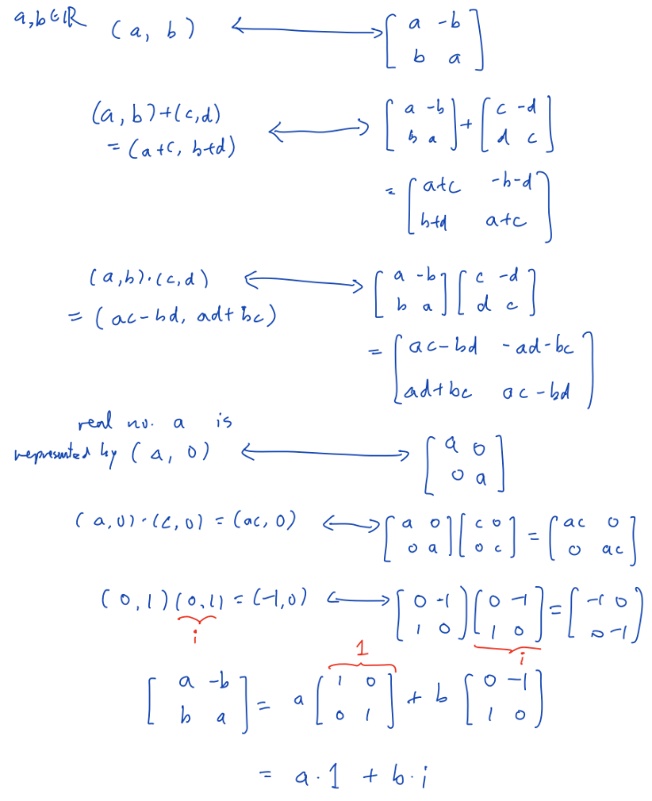

L2

Topic: Multiplication, division, power / roo

$`z = x + i \cdot y,\ \ \ \ \ then\ Re(z) = x,\ Im(z) = y`$

The modulus / absolute value / radius: $`\sqrt{x^{2} + y^{2}}`$

Argument / phase / angle: defined up to an integer multiple of 2π

Conjugate: $`z^{*} = x - iy`$

Properties: 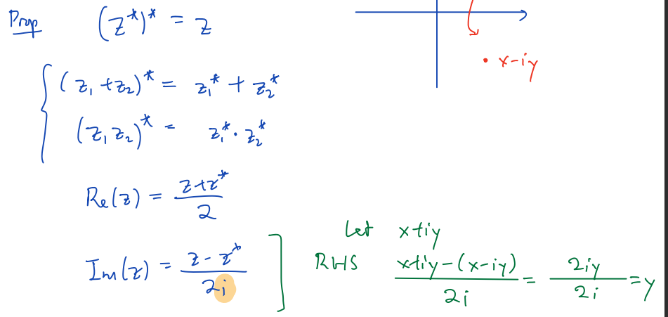

Remarks: Im(z)∈ℝ ; z · z\* = \|z\|^2 = x^2 + y^2

Properties:

1\. $`\left| z_{1}{\cdot z}_{2} \right| = \left| z_{1} \right| \cdot \left| z_{2} \right|`$

2\. $`\left\{ \begin{array}{r}
z_{1} = r_{1}\cos\theta_{1} + i \cdot r_{1}\sin\theta_{1} \\
z_{2} = r_{2}\cos\theta_{2} + i \cdot r_{2}\sin\theta_{2}
\end{array} \right.\`$ ⇒ $`z_{1} \cdot z_{2} = r_{1} \cdot r_{2} \cdot \left( \cos\left( \mathbf{\theta}_{\mathbf{1}}\mathbf{+}\mathbf{\theta}_{\mathbf{2}} \right) + i \cdot \sin\left( \mathbf{\theta}_{\mathbf{1}}\mathbf{+}\mathbf{\theta}_{\mathbf{2}} \right) \right)`$

($`\mathbf{z}^{\mathbf{n}}\mathbf{\  = \ }\mathbf{r}^{\mathbf{n}}\mathbf{\cdot (\cos}\left( \mathbf{n}\mathbf{\theta} \right)\mathbf{+ i \cdot \sin}\left( \mathbf{n\theta} \right)`$)

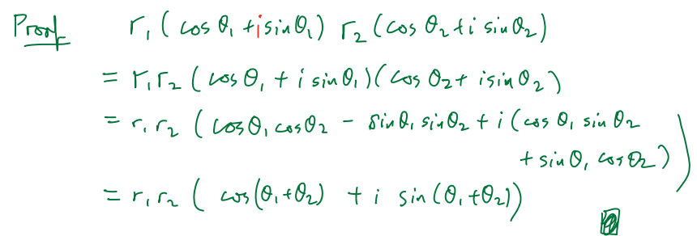

De Moivre Formula

$`\forall n \in \mathbb{Z,\ }\left( \cos\theta + i \cdot \sin\theta \right)^{n} = \cos(n\theta) + i \cdot \sin(n\theta)`$

Proof: ……

The nth root of a complex number

Given $`z^{n} = z_{0}`$, find $`z`$

E.g. 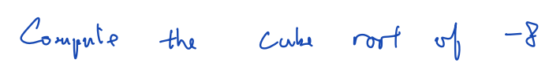

**Suppose that z=r(cosθ+i·sinθ) is a solution**

Then $`\left( r(cos\theta + i \cdot sin\theta) \right)^{3} = - 8`$

> ⇔ $`r^{3}(cos3\theta + i \cdot sin3\theta) = 8\left( \cos(\pi + 2k\pi) + i \cdot \sin(\pi + 2k\pi) \right),\ (k \in \mathbb{Z)}`$

⇒ $`r^{3} = - 8`$<u>,</u> $`3\theta = \pi + 2k\pi`$

⇒ $`r = - 2`$, $`\theta = \frac{\pi}{3} + \frac{2}{3}k\pi`$

L3

Topic: Complex division, principal argument, point at infinity, Riemann sphere

Order in complex number does not exist （复数无法比较大小）

（Proof: 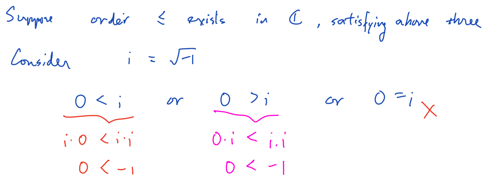）

Colinear

(E.g. (?) )

Given 3 pt.’s (a,b), (c,d), (e,f)

they are colinear

① ⇔ $`\frac{d - b}{c - a} = \frac{f - d}{e - c}`$

② ⇔ 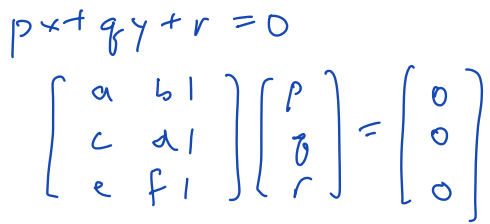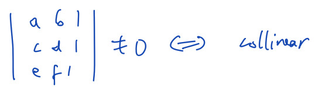

Principal argument

Fix the argument in the interval either **<u>\[0,2π) or (-π, π\]</u>**

Notation: **<u>Arg(z)</u>**

E.g.: 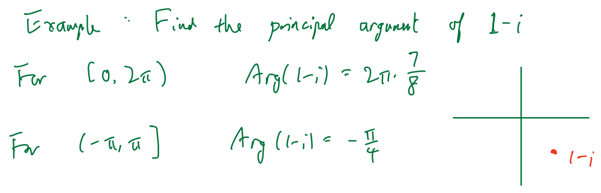

$`Arg\left( \frac{z_{1}}{z_{2}} \right) = \left( Arg\left( z_{1} \right) - Arg\left( z_{2} \right) \right)\ \ \ \ (?)\ mod\ 2\pi`$

$`\exists k \in \mathbb{Z,\ \ }s.t.\ \ Arg\left( \frac{z_{1}}{z_{2}} \right) - \left( Arg\left( z_{1} \right) - Arg\left( z_{2} \right) \right) = 2\pi k`$

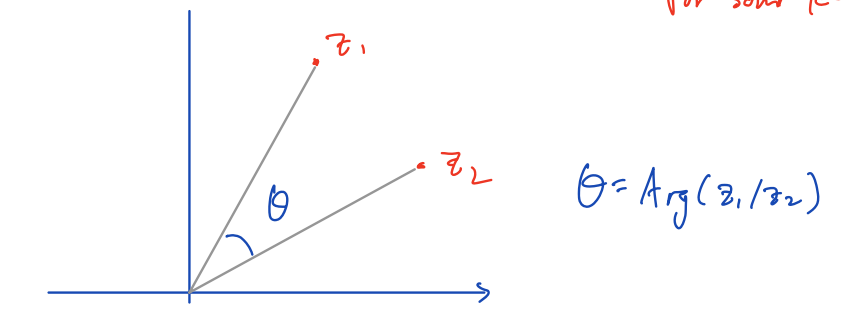

Given 3 pt.’s in complex plane: z_1, z_2, z_3

They’re **<u>colinear</u>**

⇔ $`\arg\left( \frac{z_{1} - z_{2}}{z_{3} - z_{2}} \right) = 0\ or\ \pi\ \ \ \ (\ \lbrack 0,2\pi)\ or\ ( - \pi,\pi\rbrack\ )`$

⇔ $`imag\left( \frac{z_{1} - z_{2}}{z_{3} - z_{2}} \right) = 0`$

Inverse function (?)

……

Linear fractional transformation (LFT)

(translation) $`f(z) = z + b,\ b \in \mathbb{C}`$

(rotation) $`f(z) = z\left( \cos\theta + i \cdot sin\theta \right)`$

(dilation) $`f(z) = r \cdot z,\ r \in \mathbb{R}`$

(inversion) $`f(z) = \frac{1}{z}`$

translation: $`f(z) = \frac{a \cdot z + b}{c \cdot z + d}`$, $`a,\ \ b,\ \ c,\ \ d \in \mathbb{C,\ (}a \cdot d - b \cdot c) \neq 0`$

(LFT: linear fractional transformations)

Every (?)LFT can be expressed in terms of (?) ……

If c=0: 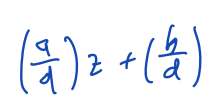

If c≠0: 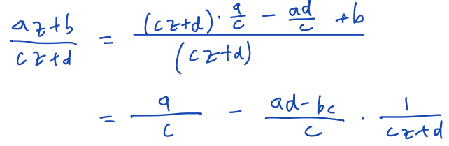

Riemann sphere

For $`f(z) = \frac{1}{z}`$

WT: define ……(?) ∞

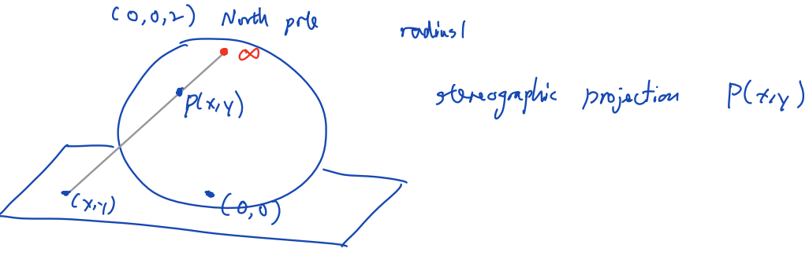

L4

Topic : Linear functional transformation (又：Möbius transformation), properties LFT

Extended complex plane

Def.: $`\mathbb{C} \cup \{\infty\}`$

Notation: 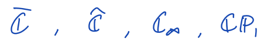

（（？） affine function 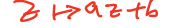）

……

L5

Topic: Complex sequence,series, complex exp function, Euler’s formula

(definition) $`\mathbf{\exp}\left( \mathbf{z} \right)\mathbf{=}\mathbf{e}^{\mathbf{z}}\mathbf{=}\sum_{\mathbf{k = 0}}^{\mathbf{\infty}}\frac{\mathbf{z}^{\mathbf{k}}}{\mathbf{k!}}`$

(theorem (Brown & Churchill)) $`\mathbf{e}^{\mathbf{z}}\mathbf{=}\mathbf{e}^{\mathbf{x}}\left( \mathbf{cosy}\mathbf{+}\mathbf{i}\mathbf{\cdot}\mathbf{siny} \right)\mathbf{\ \ \ \ }(z = x + i \cdot y)`$

Complex plane as a (?)metric(?) space

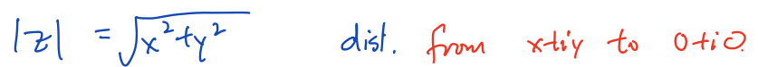

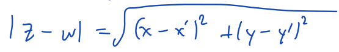

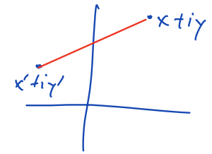

Triangle inequality

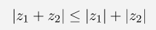 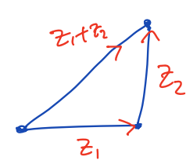

Open disc centered at z_0 wiith radius r

Def.: 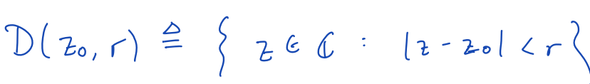

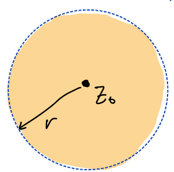

Open set S

Def.: a set S is open

⇔ $`\forall z_{0} \in S,\ \exists r > 0,\`$

$`s.t.\ D\left( z_{0},r \right) \subseteq S`$

Digression

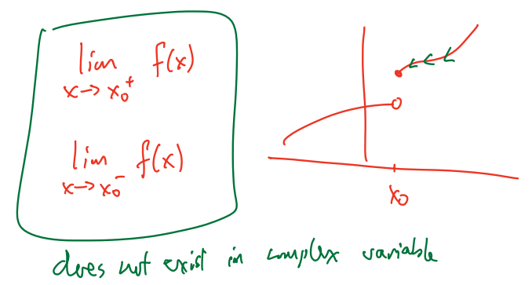

Open disc centered at ∞

Def.: 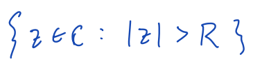, ∀positive number R

(?) 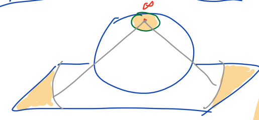

Sequence

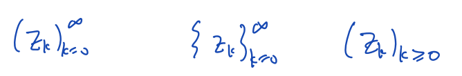

A sequence $`\left( z_{k} \right)_{k = 0}^{\infty}`$ converges to L∈ℂ

⇔ $`\forall\varepsilon > 0,\ \exists N \in \mathbb{N}`$

s.t. $`\forall k \geq N,\ \ \left| z_{k} - L \right| < \varepsilon`$

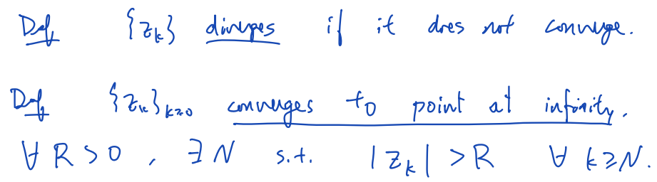

Properties:

$`\left( z_{k} \right)_{k = 0}^{}`$ converges to L∈ℂ

⇔ $`\left\{ \begin{array}{r}
\left( Re(z_{k}) \right)_{k \geq 0}^{\infty}\ converges\ to\ Re(L) \\
\left( Im(z_{k}) \right)_{k \geq 0}^{\infty}\ converges\ to\ Im(L)
\end{array} \right.\`$

A sequence $`\left( z_{k} \right)_{k = 0}^{\infty}`$ is Cauchy

⇔ 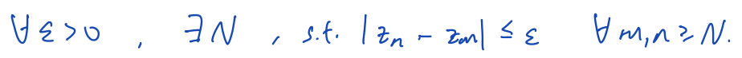

Properties:

① a sequence is Cauchy ⇔ the sequence is convergent

② 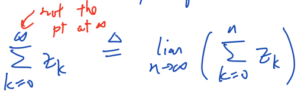

③ $`\left( z_{k} \right)_{k = 0}^{}`$ converges ⇐ 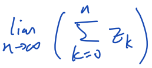 exists

E.g.:

(nth term test) 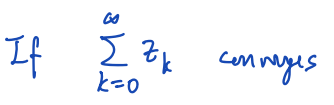 ⇒ 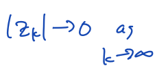

(absolute convergent test) 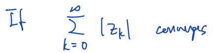 ⇒ 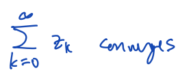

(limit ratio test) 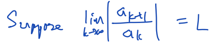

If L\>1 ⇒ then 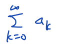 diverges

If L\<1 ⇒ then  converges absolutely

If L=1: no conclusion

E.g.: (?) 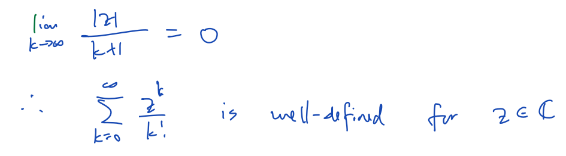(?)

A series is absolute convergence

⇒ any re-arrangement of the order of summation gives (???)some limit

$`e^{z}`$=exp(z) (notation)

Properties:

……

L6

Topic: Complex trigonometric function, complex log, complex power

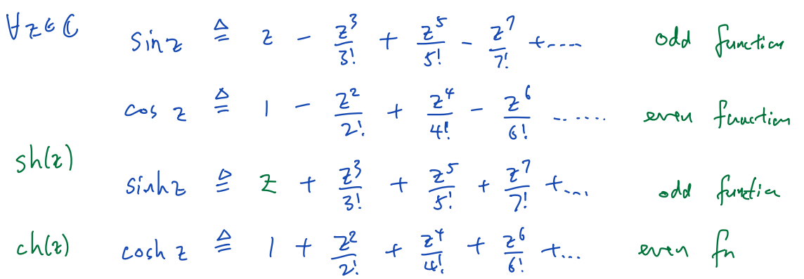

Euler: $`e^{i\theta} = \cos\theta + i \cdot \sin\theta`$

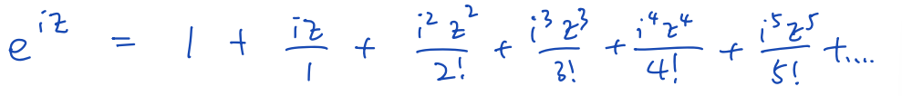

!! ($`e^{z} = e^{x} \cdot e^{iy} = e^{x} \cdot (\cos(y) + i \cdot \sin(y))`$)

!! ($`i = \cos\left( \frac{\pi}{2} \right) + i \cdot \sin\left( \frac{\pi}{2} \right) = e^{i\frac{\pi}{2}}`$)

Theorem: $`\forall z \in \mathbb{C},{\cos^{2}z + sin}^{2}{z = 1}`$

Proof:

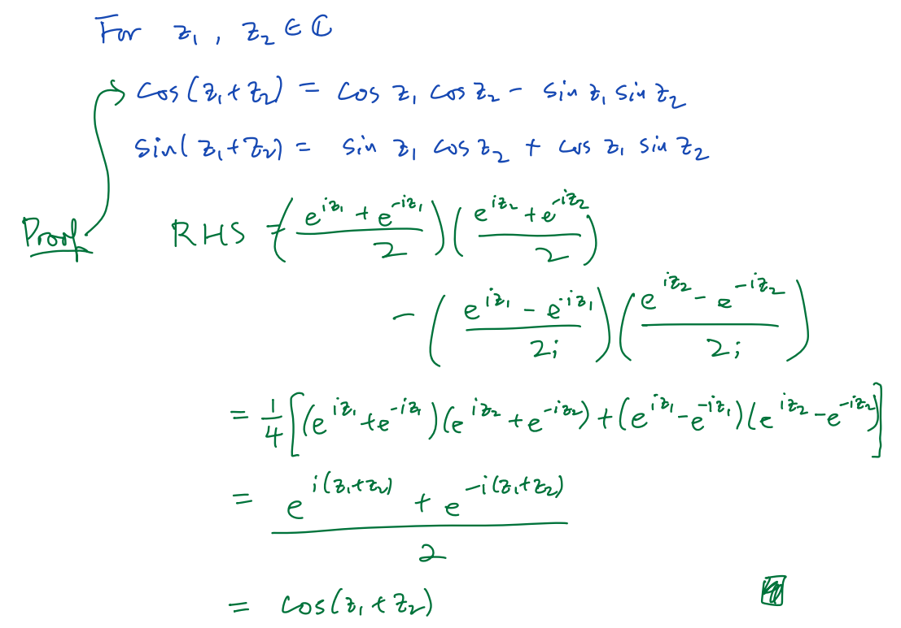

Complex log function

$`e^{z} = w\  \Leftrightarrow z = \log(w)\ \ \ \ (\forall w \in \mathbb{C})`$

Def.: $`\log(w) = \ln|w| + i \cdot \left( \arg(w) + 2\pi k \right)\ \ \ \ (k \in \mathbb{Z})`$

E.g.: Calculate $`\log(4i)`$

Write $`z = x + iy`$, want $`e^{z} = 4i`$

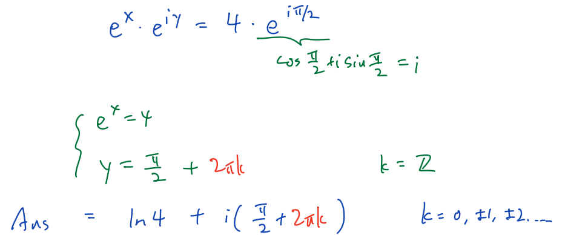 (!! 注意由sin/cos/tan 解 角度(θ，此处是y) 要加上 +2πk或+πk !! (k∈ℤ))

> Principal log function

Def.: $`Log(w) = ln|w| + i \cdot Arg(w)`$

Complex power

Def.: $`z^{w} \triangleq e^{w \cdot \log(z)}`$

E.g.: ……

> Principal value: $`e^{i \cdot \log(i)} = e^{- \ \frac{\pi}{2}}`$

Inverse trigonometric function

> E.g.: Find a complex number z, s.t. cos(z) = 3
>
> 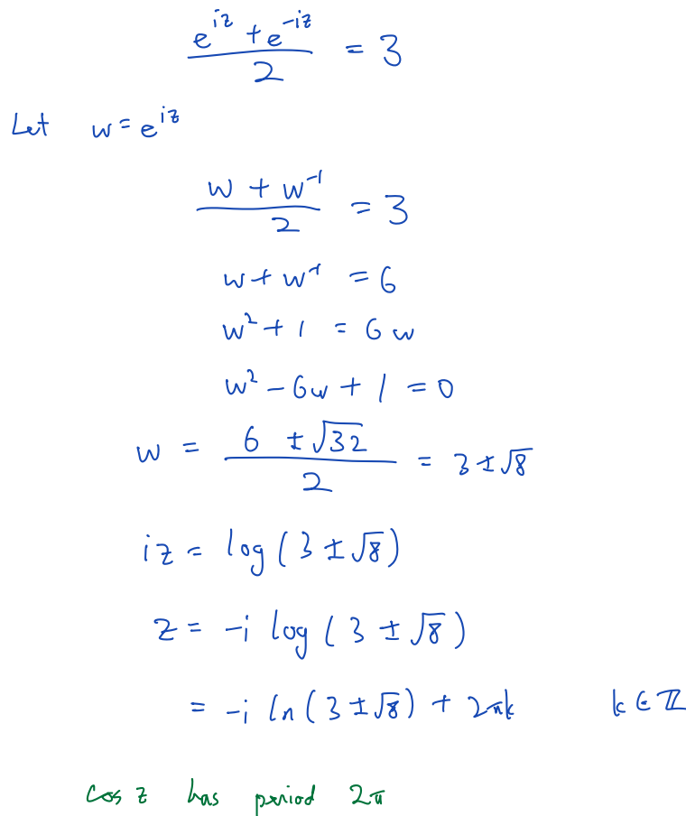

L7

Topic: Complex differentiable function, Cauchy-Riemann equation

Complex function

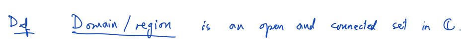

is <u>continuous at point (z_0)</u>\

is <u>continuous</u>

(图示，关于cont. at point)

(Example here)

Theorem: (ccf. 的 cont. 充要条件 ←→ 关于 实&虚 部)

（Complex function）

Is **complex <u>differentiable</u>** <u>at point (</u>$`z_{0} = x_{0} + i \cdot y_{0}`$<u>)</u>

> ⇔ $`\lim_{\Delta z \rightarrow 0}\frac{f\left( z_{0} + \Delta z \right) - f\left( z_{0} \right)}{\Delta z}\ exists`$
>
> ⇒ (必要条件) (Cauchy-Riemann equations)
>
> $`\left\{ \begin{array}{r}
> u_{x}(x_{0},y_{0}) = v_{y}(x_{0},y_{0}) \\
> u_{y}(x_{0},y_{0}) = - v_{x}(x_{0},y_{0})
> \end{array} \right.\`$ (u(x,y)为f的实部，v(x,y)为f的虚部)
>
> 证明：
>
> 

L8

Topic: Holomorphic functions, examples, properties, phase portrait/domain coloning, conformal property

Complex function f(z)

Is <u>holomorphic at point (z_0)</u>

⇔ ∃a neighborhood N,

> s.t. ∀z∈N, f(z) is <u>complex differentiable</u> at z

Is <u>holomorphic in a domain D</u>

⇔ ∀z_0∈D, f(z) is holomorphic at z_0

Theorem:

> $`f(z) = u(x,y) + i \cdot v(x,y)`$ is complex differentiable at the point $`z_{0} = x_{0} + y_{0}`$
>
> ⇐ $`\left\{ \begin{array}{r}
> \left( u(x,y),\ v(x,y) \right)\ is\ real\ differentiable\ at\ the\ point\ (x_{0},y_{0}) \\
> CR\ equations\ hold\ at\ z_{0}\left( \left\{ \begin{array}{r}
> u_{x}\left( x_{0},y_{0} \right) = v_{y}\left( x_{0},y_{0} \right) \\
> u_{y}\left( x_{0},y_{0} \right) = - v_{x}\left( x_{0},y_{0} \right)
> \end{array} \right.\  \right)
> \end{array} \right.\`$
>
> （……）（?）

Theorem:

$`f(z) = u(x,y) + i \cdot v(x,y)`$ is complex differentiable at the point $`z_{0} = x_{0} + y_{0}`$

⇐ $`\left\{ \begin{array}{r}
u_{x},u_{y},v_{x},v_{y}\ are\ \mathbf{well - defined}\ at\ the\ point\ \left( x_{0},y_{0} \right) \\
u_{x},u_{y},v_{x},v_{y}\ are\ \mathbf{continuous}\ in\ \mathbf{a\ neighborhood}\ of\ the\ point\ \left( x_{0},y_{0} \right) \\
CR\ equations\ hold\ at\ z_{0}\left( \left\{ \begin{array}{r}
u_{x}\left( x_{0},y_{0} \right) = v_{y}\left( x_{0},y_{0} \right) \\
u_{y}\left( x_{0},y_{0} \right) = - v_{x}\left( x_{0},y_{0} \right)
\end{array} \right.\  \right)
\end{array} \right.\`$

E.g. …… (??)

Complex function f(z)

Is <u>entire</u>

⇔ ∀z∈ℂ, f is complex differentiable at z

> E.g. ……

Differentiation rules

(f, g are complex differentiable functions)

$`\left( f(z) + g(z) \right)' = f'(z) + g'(z)`$

$`\left( f(z) \cdot g(z) \right)' = f'(z) \cdot g(z) + f(z) \cdot g'(z)`$

$`\left( \frac{f(z)}{g(z)} \right)' = \frac{f'(z) \cdot g(z) - f(z) \cdot g'(z)}{g(z)^{2}}`$

$`\left( a \cdot f(z) \right)' = a \cdot f'(z)`$

$`\left( f\left( g(z) \right) \right)' = f'\left( g(z) \right) \cdot g'(z)`$

$`\left( z^{n} \right)' = n \cdot z^{n - 1}`$ (Proof: using mathematical induction)

L9

Topic: Conformed property, harmonic functions, connection to PDE

Remark: Derivative at the point at infinite ∞

( ?)

Conformal property / angle-preserving property

$`\left\{ \begin{array}{r}
f\ is\ differentiable\ at\ z_{0}\ (z_{0} \in \mathbb{C)} \\
f'\left( z_{0} \right) \neq 0
\end{array} \right.\`$

> ⇒ f is conformal (or: angle-reserving) at $`z_{0}`$
>
> ⇒ $`\arg\left( \frac{\frac{d}{dt}f\left( \gamma_{2}'\left( t_{2} \right) \right)}{\frac{d}{dt}f\left( \gamma_{1}'\left( t_{1} \right) \right)} \right) = \arg\left( \frac{f'\left( \gamma_{2}\left( t_{2} \right) \right)}{f'\left( \gamma_{1}\left( t_{1} \right) \right)} \right) = \arg\left( \frac{\gamma_{2}'\left( t_{2} \right)}{\gamma_{1}'\left( t_{1} \right)} \right) = \theta`$

Explain:

通过$`z_{0}`$画两条参数曲线$`\gamma_{1}(t)`$和$`\gamma_{2}(t)`$

> $`\gamma_{1}(t)`$和$`\gamma_{2}(t)`$在$`z_{0}`$处的切线之间的角度是$`arg(\frac{\gamma_{2}'\left( t_{2} \right)}{\gamma_{1}'\left( t_{1} \right)})`$，设为θ
>
> $`\gamma_{1}'(t),\ \gamma_{2}'(t) \neq 0\  \Rightarrow \ \theta\ is\ well - defined`$
>
>  (此处幅角argument；此处co-domain
>
> (???)
>
> （Angle-Preserving (?):共形映射保留两条相交曲线之间的角度。如果两条曲线在一个点相交并形成一定角度，则在对两条曲线应用共形函数后，它们仍将相交并在函数下该点的图像处形成相同的角度。这并不意味着变换后的曲线看起来完全相同;它们可能会被拉伸或压扁，但它们之间的角度保持不变。
>
> Scale Factor (?): 虽然等角贴图保留了角度，但它们可能会局部缩放或扭曲形状。但是，它们在某个点上是一致的，这意味着该点的比例因子在所有方向上都是相同的。）
>
> （共形性质解释了为什么共轭函数 $`f(z) = \overline{z}`$ **不**是处处可微的。共轭函数在几何上是一个反射，而反射逆转了角度的方向。）

Conformally equivalent

2 regions R_1 & R_2 are <u>conformally equivalent</u>

⇔ ∃a bijective holomorphic map f(z): R_1→R_2

Phase portrait / domain coloring

通过将复函数在平面上的幅角与颜色光谱相联系，来绘制复函数的幅角。这里的颜色对应于幅角的范围 \[0, 2π\]。亮度对应于复函数的大小。暗点意味着函数值为零。明亮的颜色指示函数大小较大的区域。我们以恒等函数的相位图像作为参考

Harmonic function

Def.: …… is twice diff. & partial derivatives are cont.

Laplace equation

L10

Topic: Vector & covector, tangent space & cotangent space, differential form, complex differentia form, $`dz`$, $`d\overline{z}`$, $`\frac{\partial}{\partial z}`$, $`\frac{\partial}{\partial\overline{z}}`$

Vector:

Position vector:

Vector space

Def.: A collection of objects with addition and scalar multiplication, satisfying some axioms

$`\left( \vec{p},\vec{v} \right)`$

Def.: a vector $`\vec{v}`$ that emanates from $`\vec{p}`$

> 

Notation: Write $`\left( \vec{p},\vec{v} \right)`$ as $`{\vec{v}}_{\vec{p}}`$

Tangent space

Def.: For ∀vector **p**,

Tangent space $`T_{\vec{p}} \triangleq \{\left( \vec{p},\vec{v} \right)\ :\ \vec{v} \in \mathbb{R}^{2}\}`$

and

$`\left( \vec{p},\overrightarrow{v_{1}} \right) + \left( \vec{p},{\vec{v}}_{2} \right) \triangleq \left( \vec{p},{\overrightarrow{v_{1}} + \vec{v}}_{2} \right)`$

$`a \cdot \left( \vec{p},\vec{v} \right) \triangleq \left( \vec{p},a\vec{v} \right)`$

If $`\vec{p} \neq \vec{q}`$ ⇒ then $`T_{\vec{p}} \neq T_{\vec{q}}`$

E.g.: ……

Vector field

Def.: a function that selects a vector $`{\vec{v}}_{\vec{p}}`$ for every $`\vec{p}`$

E.g.: 

Linear functional/covector

Def.: Let $`T_{\vec{p}}^{*}`$ be the <u>dual space</u> of $`T_{\vec{p}}`$,

then every element of $`T_{\vec{p}}^{*}`$ is linear functional/covector

(functional: a function whose input is a vector and output is a scalar)

E.g.: 

Directional derivative

Def.: $`f(x,y)\`$is a differentiable function

在$`\left( re_{1} + se_{2} \right)_{\vec{p}}`$上求<u>directional derivative</u> :

$`\lim_{h \rightarrow 0}{\frac{f(x + r \cdot h,y + s \cdot h)}{h} = f_{x} \cdot r + f_{y} \cdot s = (\nabla f)_{\vec{p}} \cdot \left( re_{1} + se_{2} \right)_{\vec{p}}}`$

Then we can **define**: $`\Phi_{f}({\vec{v}}_{\vec{p}}) \triangleq (\nabla f)_{\vec{p}} \cdot ({\vec{v}}_{\vec{p}})`$

E.g.: 

Differential form (?)

Def.: a function that selects a linear functional at every point.

Ex: 

$`({df)}_{\vec{p}}`$

> Def.: a linear functional at $`\vec{p}`$, defined by $`(\nabla f)_{\vec{p}} \cdot ({\vec{v}}_{\vec{p}})`$ for $`\forall(?){\vec{v}}_{\vec{p}} \in T_{\vec{p}}`$

(IF $`\vec{p}`$ is fixed, then the subscript(下标) $`\vec{p}`$ 就不写了)

E.g.: 

Complex-valued differential form

( ?  ?)

($`E.g.:\ Let\ f(z) = z^{2},\ then\ u(x,y) = x^{2} - y^{2},\ v(x,y) = 2xy`$)

$`du = u_{x}dx + u_{y}dy`$

$`dv = v_{x}dx + v_{y}dy`$

Def.: $`df = du + idv`$

$`(dz)_{\vec{p}} = (dx)_{\vec{p}} + i(dy)_{\vec{p}}`$

$`\left( d\overline{z} \right)_{\vec{p}} = (dx)_{\vec{p}} - i(dy)_{\vec{p}}`$

$`(dx)_{\vec{p}} = \frac{dz + d\overline{z}}{2}`$

$`(dy)_{\vec{p}} = \frac{dz - d\overline{z}}{2}`$

$`df =`$……

$`= \left( u_{x} + iv_{x} \right)dx + \left( u_{y} + iv_{y} \right)dy`$

$`= \frac{\partial f}{\partial x}\left( \frac{dz + d\overline{z}}{2} \right) + \frac{\partial f}{\partial y}\left( \frac{dz - d\overline{z}}{2} \right)`$

=$`\frac{1}{2}\left( \frac{\partial}{\partial x}f - i\frac{\partial}{\partial y}f \right)dz + \frac{1}{2}\left( \frac{\partial}{\partial x}f + i\frac{\partial}{\partial y}f \right)d\overline{z}`$

=$`\frac{\partial f}{\partial z}dz + \frac{\partial f}{\partial\overline{z}}d\overline{z}`$=$`df`$

$`\overline{\delta}`$-operator

Def.: $`\frac{1}{2}(\frac{\partial}{\partial x} + i\frac{\partial}{\partial y})`$

($`\overline{\delta}f = \frac{\partial f}{\partial z}`$)

Thm.: $`\left\{ \begin{array}{r}
u_{x} = v_{y} \\
u_{y} = - v_{x}
\end{array} \right.\`$ ⇔ $`\overline{\delta}f = 0`$

Proof: 

L11

Topic: Multi-valued func.; branch point, branch cut; Riemann surface; log(z), arg(z), $`\sqrt{z}`$

Let f(x,y) = x+iy

Then $`df = f_{x}\ dx + f_{y}dy = 2x\left( \frac{dz + d\overline{z}}{2} \right) + i(2y)2x\left( \frac{dz + d\overline{z}}{2i} \right) = (x + y)dz + (x - y)d\overline{z}`$

Also, from $`\frac{\partial}{\partial z} = \frac{1}{2}\left( \frac{\partial}{\partial x} - i\frac{\partial}{\partial y} \right)，\frac{\partial}{\partial\overline{z}} = \frac{1}{2}\left( \frac{\partial}{\partial x} + i\frac{\partial}{\partial y} \right)`$

$`\Rightarrow \frac{\partial f}{\partial z} = \frac{1}{2}\left( f_{x} - if_{y} \right) = \frac{1}{2}\left\lbrack 2x - i(i2y) \right\rbrack = x + y`$

$`\frac{\partial f}{\partial\overline{z}} = \frac{1}{2}\left( f_{x} + if_{y} \right) = \frac{1}{2}\left\lbrack 2x + i(2iy) \right\rbrack = x - y`$

Multi-valued func.

Def.: The **output** of a multi-valued func. is a **set**

Branch

Def.: A branch f of a multi-valued func. F is an ordinary func., s.t. f(z)∈F(z)

Path/Curve

Def.: A path/curve is a cont. mapping γ(t) from \[a, b\] to ℂ

A path is:

> Simple ⇔ ∄self-intensection
>
> Closed ⇔ γ(a)=γ(b)

Given multi-function F(z) & a curve γ(t),

for each point on γ(t), select a value from F(γ(t)),

> s.t. the values vary continuously

E.g.: ……

E.g. - Q: Travel along a path, assume that we have known the x, y coordinate and the distance traveled. Measure the angle relative to the origin.

 

Sol.: Suppose the robot only move in the right half-plane

Then we can use the $`\tan^{- 1}\frac{y}{x}`$. Let $`A(x + iy) = \tan^{- 1}\frac{y}{x}`$

If the robot only travel within a half-plane

……

L12

Topic: Winding number, derivative of multi-value func.

Use 2 sheets to cover ℂ ⇒ create a Riemann surface for $`\sqrt{z}`$

Consider the angle function/argument

Fact: Cannot pick a single cont. branch on ℂ \\ {0}

Suppose f(z) is a branch of the angle func.

1\. Pick a branch cut that prevent going around 0

2\. Construct a Riemann surface

(L11: → able to define a cont. angle func. in any half plane)

Ex.: ……

Change of angle in a path

Change of argument = f(z_2) – f(z_1)

f_1(z): the angle func. for the <u>first half plane</u>

> f_2(z): the angle func. for the <u>second half plane (the second half plane: contains z_1 → z_2)</u>

Change in angle = $`\left\lbrack f_{1}\left( z_{1} \right) - f_{1}\left( z_{2} \right) \right\rbrack + \lbrack f_{2}\left( z_{2} \right) - f_{2}\left( z_{1} \right)\rbrack`$

Winding number

Def.: the winding number **of a closed path** = total change in angle / 2π

**Winding number** is an **integer**

Ex. (3个 ……)

Inverse mapping theorem (from real analysis) (\_\_ .?) – (((for: )) derivative of inverse function)

Suppose $`\vec{g}'(x_{0},y_{0})`$ is invertible

$`\left\{ \begin{array}{r}
\exists open\ sets\ U,\ V,\ \ s.t.\ func.\ \ \vec{g}:U \rightarrow V\ is\ bij. \\
inverse\ of\ \vec{g}\ is\ diff. \\
\vec{g}\ is\ holo.
\end{array} \right.\`$ ⇒ $`{\vec{g}}'\left( z_{0} \right)\ is\ represented\ by\ \begin{bmatrix}
a & - b \\
b & a
\end{bmatrix}`$

($`\begin{bmatrix}
a & - b \\
b & a
\end{bmatrix}^{- 1}\  = \frac{1}{a^{2} + b^{2}}\begin{bmatrix}
a & b \\
 - b & a
\end{bmatrix} = \begin{bmatrix}
c & - d \\
d & c
\end{bmatrix}`$)

Ex. (1个 ……)

L13

Topic: Contour Integral

Line integral

Partition: $`a = t_{0} < t_{1} < \ldots < t_{n - 1} < t_{n} = b`$

Sum: 

Complex integral on real line

$`f:\lbrack a,b\rbrack \rightarrow \mathbb{C}`$

$`f(t) = u(t) + i \cdot v(t)`$

Ex. : 

Fouritr transform: $`\int_{- \infty}^{\infty}{f(t) \cdot e^{- i \cdot \omega \cdot t}\ dt}`$

((?)one-side) Laplace transform: $`\int_{0}^{\infty}{f(t) \cdot e^{- s \cdot t}\ dt},\ s \in \mathbb{C}`$

Complex contour(path) parametric representation

$`z(t) = x(t) + i \cdot y(t),\ t \in \lbrack a,b\rbrack`$

Suppose that $`z(t)\ is\ \mathbf{smooth}\  \Leftarrow \ \left\{ \begin{array}{r}
x(t),y(t)\ are\ C^{1}\ func. \\
\forall t \in (a,b),\ \ \left( x'(t),y'(t) \right) \neq 0
\end{array} \right.\`$

$`z(t)\ is\ \mathbf{piece - wise\ smooth}\  \Leftarrow z(t)\ is\ a\ \mathbf{concatenation}\left( \mathbf{串联} \right)\mathbf{\ }\ of\mathbf{\ smooth\ curves}`$

Ex. : 

Contour integral

Def.: $`\int_{C}^{}{f(z)\ dz} = \int_{a}^{b}{f\left( z(t) \right) \cdot z'(t)\ dt}\ \ \ \ \ \ \ \ (the\ " \cdot ":\ \ complex\ multiplication)`$

$`F(z) = u(x,y) + i \cdot v(x,y)`$

The path C is represented by $`z(t) = x(t) + i \cdot y(t),\ t \in \lbrack a,b\rbrack`$

Partition:

Ex.: 

Physical interpretation

Polya(?) vector field

L14

Topic: Independence of parameterization (always), path independence (depends on f(z) on D), primitive function / anti-derivative

Theorem: $`\int_{C}^{}{f(z)\ dz}\ is\ independent\ of\ parameterization`$

Proof:

()

**Notation**: When <u>**C** is a **closed curve**</u>, <u>write</u> $`\oint_{\mathbf{C}}^{}{\mathbf{f}\left( \mathbf{z} \right)\mathbf{\ dz}}`$

Negative/reverse of a curve

Def.: a curve that consists of the **same set of points**, but with **opposite direction**

**Notation: -C**

Theorem: $`\int_{- C}^{}{f(z)\ dz}\  = \  - \int_{C}^{}{f(z)\ dz}`$

Notation: $`\int_{C_{1} + C_{2}}^{}{f(z)\ dz} = \int_{C_{1}}^{}{f(z)\ dz} + \int_{C_{2}}^{}{f(z)\ dz}`$

E.g.: 

Primitive function / anti-derivative

Def.: $`func.\ \ F(z)\ is\ primitive\ function\ /\ anti - derivative\ of\ func.\ \ f(z)(def.\ on\ D)`$

$`\Leftarrow {\forall z \in D,\ \ F}'(z) = f(z)`$

Theorem: $`f(z)\ has\ primitive\ function\ in\ D`$

$`\Rightarrow \ \forall curve\ C \in D,\ \int_{C}^{}{f(z)\ dz} = F\left( z_{2} \right) - F\left( z_{1} \right)\ (z_{1}:C's\ start\ pt.;z_{2}:end\ pt.\ \ldots)`$

(piece-wise smooth path也能用此定理)

Proof:

(E.g.×2)

……

**L15**

Topic: ML inequality, Cauchy-Gorsat theorem for triangle, $`\frac{1}{\sqrt{2\pi}}\int_{}^{}{e^{- \frac{x^{2}}{2}} \cdot e^{- i \cdot t \cdot x}\ dx = e^{- \frac{t^{2}}{2}}}`$

Theorem:

$`\forall holo.\ \ func.\ \ f:D \rightarrow \mathbb{C,\ \ }\int_{C}^{}{f(z)\ dz}\ is\ independent\ of\ path\ \ (always:\ \forall path\ C)`$

> $`\Leftrightarrow \ \forall closed\ path\ C \subset D,\ \ \int_{C}^{}{f(z)\ dz = 0}`$

（在复积分的上下文中，术语“独立于路径”是指只要起点和终点相同，函数沿指定域中任何路径的积分值不依赖于所采用的特定路径的性质。）

Proof:

Evaluate $`\frac{1}{\sqrt{2\pi}}\int_{}^{}{e^{- \frac{x^{2}}{2}} \cdot e^{- i \cdot t \cdot x}\ dx = e^{- \frac{t^{2}}{2}}}`$

(已知：$`\int_{- \infty}^{\infty}e^{- x^{2}} = \sqrt{\pi}`$)

(以下是不严谨证明，严谨证明见L16)

√ $`\sqrt{2\pi} = \int_{- \infty}^{\infty}{e^{- \ \frac{x^{2}}{2}}\ dx = \int_{- \infty}^{\infty}{e^{- \ \frac{(x + 3)^{2}}{2}}\ dx}}`$ ()

$`= \int_{- \infty}^{\infty}{e^{- \ \frac{(x + it)^{2}}{2}}\ dx} = \int_{- \infty}^{\infty}{e^{- \ \frac{\left( x^{2} + 2 \cdot i \cdot x \cdot t - t^{2} \right)}{2}}\ dx}`$

$`\sqrt{2\pi} \cdot e^{- \ \frac{t^{2}}{2}} = \int_{- \infty}^{\infty}{e^{- \ \frac{x^{2}}{2}} \cdot e^{- i \cdot x \cdot t}\ dx}`$

$`e^{- \ \frac{t^{2}}{2}} = \frac{1}{\sqrt{2\pi}} \cdot \int_{- \infty}^{\infty}{e^{- \ \frac{x^{2}}{2}} \cdot e^{- i \cdot x \cdot t}\ dx}`$

Cauchy Theorem (1):

$`\left\{ \begin{array}{r}
f(z)\ is\ holo.\ \ in\ domain\ D \\
f'(z)\ is\ cont. \\
C\ is\ a\ simple\ closed\ curve\ in\ domain\ D
\end{array}\  \Rightarrow \  \right.\ \int_{C}^{}{f(z)\ dz} = 0`$

Proof:

Triangle inequality

$`complex - valued\ func.\ \ f(z)\ is\ cont.\ on\ \lbrack a,b\rbrack\  \Rightarrow \left| \int_{a}^{b}{f(t)\ dt} \right| \leq \int_{a}^{b}{\left| f(t) \right|\ dt}`$

Proof:

ML inequality

$`\left\{ \begin{array}{r}
\forall z \in curve\ C,\ \ \left| f(z) \right| \leq M \\
L\ is\ the\ length\ of\ curve\ C
\end{array} \right.\ \  \Rightarrow \left| \int_{C}^{}{f(z)\ dz} \right| \leq M \cdot L`$

Proof:

Length of a curve

Def.: L is the length of Curve C ⇔ $`L = \int_{a}^{b}{\sqrt{x'(t)^{2} + y'(t)^{2}}\ dt = \int_{a}^{b}{\left| z'(t) \right|\ dt}}`$

Cantor intersection theorem

$`\left\lbrack \left\{ K_{j} \right\}_{j = 1}^{\infty}\ is\ a\ seq.\ of\ sets,\ \ s.t.\ \forall j \in \mathbb{N,\ \ }\left\{ \begin{array}{r}
K_{j} \neq \Phi \\
K_{j}\ is\ compact \\
K_{j + 1} \subseteq K_{j}
\end{array} \right.\ \  \right\rbrack \Rightarrow \ (\bigcap_{j = 1}^{\infty}K_{j}) \neq \Phi`$

Cauchy-Goursat theorem for a triangle

domain D ∈ ℂ,

func. f: D→ℂ,

T is a triangle whose vertices and interior lie entirely within D (T ⊂ D),

\[**∂T: the boundary of (triangle) T**\]

$`func.\ \ f(z)\ is\ holo.\ in\ D\  \Rightarrow \ \int_{\partial T}^{}{f(z)\ dz} = 0`$

(Corollary: ... also **holds** for **rectangle**: )

Proof (of Cauchy-Goursat theorem for a triangle):

**L16**

Topic: Application to Gaussian pdf, local primitive, existence of primitive in convex set

Prove $`\frac{1}{\sqrt{2\pi}}\int_{}^{}{e^{- \frac{x^{2}}{2}} \cdot e^{- i \cdot t \cdot x}\ dx = e^{- \frac{t^{2}}{2}}}`$ (rigorous):

( (??) (concerning) the Fourier transform of a Gaussian function)

Note:

> Closed-form expression: 指<u>可以在**有限数量的标准运算**中**求值**的**数学表达式**</u>。这些运算通常包括加法、减法、乘法、除法，以及本身具有标准闭式表达式（如指数、对数、三角函数及其任何组合）的函数。
>
> $`\int_{}^{}{e^{- \frac{x^{2}}{2}}\ dx}`$ has no closed-form exp.
>
> (Non-closed form
>
> E.g.: )

Local Primitive

f(z) has local primitive in a domain D

> $`\Leftrightarrow \ (def.)\ \exists F(z):D \rightarrow \mathbb{C},\`$
>
> $`s.t.\ \forall z \in D,\ F’(z) = f(z)`$
>
> $`\Rightarrow \ \oint_{C}^{}{f(z)\ dz = 0}`$ 

Construction:

$`\forall z \in D,\ pick\ a\ \mathbf{contour\ }\mathbf{C}_{\mathbf{z}};let\ F(z) = \int_{C_{z}}^{}{f(z)\ dz}`$

Requirement(?): z_1 and z_2 are connected by line segment in D

$`F\left( z_{1} \right) = F\left( z_{2} \right) + \int_{z_{1} \rightarrow z_{2}}^{}{f(z)\ dz\ \ ((此积分为)\ (?)\ line\ sement)}`$

Thm.:

Open and connected set D ⊂ ℂ

> f: D→ℂ
>
> $`\left\{ \begin{array}{r}
> f(z)\ is\ cont.\ \ in\ D \\
> \left( \left\{ \begin{array}{r}
> z_{1}\ and\ z_{2}\ are\ connected\ by\ line\ segment\ in\ D \\
> F\left( z_{1} \right) = F\left( z_{2} \right) + \int_{z_{1} \rightarrow z_{2}}^{}{f(z)\ dz\ \ \left( (此积分为)\ (?)\ line\ sement \right)}
> \end{array} \right.\  \right)
> \end{array} \right.\`$

$`\Rightarrow F(z) = \int_{C_{z}}^{}{f(z)\ dz\ is\ a\ \mathbf{local}\mathbf{\ }\mathbf{primitive}\ of\ f(z)\ in\ D}`$

> Proof:
>
> 
>
> 
>
> 

Thm.:

domain D ⊂ C is a simply connected,

> 𝑓: 𝐷→𝐶 is cont.

$`\forall path\ C\ connecting\ z1,\ \ z2\ (in\ D)\ ,\ \int_{C}^{}{f(z)\ dz}\ is\ indep.\ of\ C`$

> $`\Leftrightarrow \ \exists func.\ \ F:D \rightarrow \mathbb{C,\ }`$
>
> $`s.t.\ \forall z \in \mathbb{C,\ \ }F'(z) = f(z)\ \ \ \ (F(z)\ (?)\ is\ a\ \mathbf{local\ primitive}\ of\ f(z)\ in\ D)`$
>
> Proof:
>
> 

Thm:

$`\left\{ \begin{array}{r}
\mathbf{set\ D}\  \subset \ \mathbb{C\ }is\ \mathbf{convex}\ and\ open\  \\
\ f:D \rightarrow \mathbb{C\ }is\ holo.\ \ \ \ \ (\forall holo.\ \ func.\ \ f:D \rightarrow \mathbb{C)}
\end{array} \right.\`$

> $`\Rightarrow \ \exists func.\ \ F:D \rightarrow \mathbb{C,\ }`$
>
> $`s.t.\ \forall z \in \mathbb{C,\ \ }F'(z) = f(z)\ \ \ \ (F(z)\ (?)\ is\ a\ \mathbf{local\ primitive}\ of\ f(z)\ in\ D)`$

Proof:

E.g.: 

A more general form of Cauchy theorem

Simply Connected Domain

> $`\left\{ \begin{array}{r}
> domain\ \mathbf{D}\ is\ \mathbf{simply\ connected} \\
> func.\ \ \mathbf{f:\ }\mathbf{D}\mathbf{\rightarrow}\mathbb{C}\ is\ \mathbf{holo}.\ \ in\ D \\
> curve\ \mathbf{C} \subset D\ is\ \mathbf{closed}
> \end{array} \right.\ \  \Rightarrow \ \oint_{C}^{}{f(z)\ dz} = 0`$

Simple Closed Curve

$`\left\{ \begin{array}{r}
curve\ \mathbf{C\ }is\ \mathbf{simple\ closed} \\
func.\ \ \mathbf{f:\ }\mathbf{C}\mathbf{\rightarrow}\mathbb{C}\ is\ \mathbf{holo}.
\end{array} \right.\ \  \Rightarrow \ \oint_{C}^{}{f(z)\ dz} = 0`$

Definitions and Additional Information:

Simple Curve

> Def.: A **curve** that does <u>**not** cross itself</u> and <u>**encloses** a simply connected area</u>.

Not Simple Curve

> Def.: A **curve** that <u>**crosses** itself</u> or does <u>**not** enclose a simply connected area</u>.

Star-Shaped Domain

> Def.: A domain D is star-shaped
>
> $`\Leftarrow \ \exists\ a\ base\ pt.\ \ z_{0},\`$
>
> $`s.t.\ \ \forall z \in D,\`$
>
> $`the\ line\ segment\ from\ z_{0}\ to\ z\ lies\ entirely\ within\ D.`$
>
> The primitive function F(z) in a domain with a star shape:
>
> Def.: F(z)=∫ z 0zf(t)dt where 𝑧0 is the base point and the path of integration is the line segment from 𝑧0 to 𝑧 within 𝐷.
>
> (This concept is used to ensure that certain types of domains, even if not simply connected, can allow integrals depending on a central point to be evaluated effectively.)

**L17**

Topic: Cauchy integral formula, Liouville thm., fundamental thm. of algebra, power series expansion

Cauchy integral formula

$`\left\{ \begin{array}{r}
domain\ D\ is\ convex \\
contour\ C \subset D\ is\ circuar \\
func.\ \ f:D \rightarrow \mathbb{C\ }is\ holo.\ 
\end{array}\  \Rightarrow \ \forall z \in C \right.\ ,\ f(z) = \frac{1}{2\pi i}\oint_{C}^{}{\frac{f(w)}{w - z}\ dw}`$

(f(w) only depends on the curve C)

> 

Proof (idea):

Proof:

Deformation thm.

$`\left\{ \begin{array}{r}
func.\ \ g(z):D \rightarrow \mathbb{C}\ is\ holo.\ \ in\ C_{1}\backslash\text{\{}center\ of\ C_{2}\} \\
contours\ C_{1},\ \ \ C_{2} \subset D\ are\ closed \\
C_{2}\ is\ entirely\ closed\ by\ C_{1}
\end{array} \right.\ \  \Rightarrow \ \oint_{C_{1}}^{}{g(z)\ dz} = \oint_{C_{2}}^{}{g(z)\ dz}`$

Proof:

E.g.:

Liouville thm.

$`\left\{ \begin{array}{r}
func.\ \ f\ is\ entire \\
f\ is\ bdd.\ \ on\mathbb{\ C\ (\exists}M \in \mathbb{R,\ \ \ }s.t.\ \ \forall z \in \mathbb{C,\ \ }\left| f(z) \right| \leq M)
\end{array} \right.\ \  \Rightarrow \ \forall z \in \mathbb{C,\ }f(z) = c\ is\ a\ constant)`$

Proof:

E.g.:

L18 Power series expansion

Topic: Existence of power series for holomorphic function ( ?) uniqueness

$`f(z) = \sum_{k = 0}^{\infty}{a_{k}z^{k}}`$

$`f(z)\ converges\ at\ z_{0} = a + ib\ \  \Rightarrow \ \ \ f(z)\ converges\ for\ \forall z\ where\ |z| < \sqrt{a^{2} + b^{2}}`$

$`f(z)\ diverges\ at\ z_{0} = a + ib\ \  \Rightarrow \ \ f(z)\ diverges\ for\ \forall z\ where\ |z| > \sqrt{a^{2} + b^{2}}`$

The region of convergence of d(z) has circular shape

The radius of convergence R is the radius of region l convergence **(??)**

Hadamard formula: $`R = \frac{1}{\lim_{k \rightarrow \infty}{\sup\left| a_{k} \right|^{\frac{1}{k}}}}`$

Thm.: $`f(z) = \sum_{k = 0}^{\infty}{a_{k} \cdot \left( z - z_{0} \right)^{k}}\ has\ radius\ of\ conv.\  > 0`$

$`\Rightarrow f'(z) = \sum_{k = 1}^{\infty}{{k \cdot a}_{k} \cdot z^{k - 1}}`$

Corollary: $`f(z) = \sum_{k = 0}^{\infty}{a_{k} \cdot \left( z - z_{0} \right)^{k}}\ is\ \infty - differentiable`$

Analytic

Def.: $`A\ function\ f(z)\ is\ \mathbf{analytic}\ at\ z_{0}`$

$`\Leftrightarrow \ \exists r,\ \ \ s.t.\ \ f(z) = \sum_{k = 0}^{\infty}{a_{k} \cdot \left( z - z_{0} \right)^{k}}\ for\ \forall z\ where\ \left| z - z_{0} \right| < r`$

$`A\ function\ f(z)\ is\ \mathbf{analytic}\ in\ domain\ D`$

$`\Leftrightarrow \ \forall z_{0} \in \mathbb{C},\ f(z)\ is\ analytic\ at\ z_{0}`$

Thm.: $`\left\{ \begin{array}{r}
f(z)\ is\ a\ complex\ function \\
f(z)\ is\ holomorphic\ at\ z_{0} \\
\exists r,\ \ \ s.t.\ \ f(z)\ is\ differentiable\ at\ \forall z\ where\ \left| z - z_{0} \right| \leq r
\end{array} \right.\`$

$`\Rightarrow \ \ f(z)\ is\ \mathbf{analytic}\ at\ z_{0}`$

$`\Leftrightarrow f(z) = \sum_{k = 0}^{\infty}{a_{k} \cdot \left( z - z_{0} \right)^{k}}\ for\ \forall z\ where\ \left| z - z_{0} \right| < r`$

$`with\ a_{k} = \frac{1}{2\pi i}\oint_{C}^{}{\frac{f(w)}{\left( w - z_{0} \right)^{k + 1}}\ dw}`$

Proof (non-rigorous):

Proof (rigorous):

> 
>
> 

Thm.:

(Usually: $`S = \left\{ z:0 < \left| z - z_{0} \right| < r \right\}`$)

$`\left\{ \begin{array}{r}
f(z) = \sum_{k = 0}^{\infty}{a_{k}\left( z - z_{0} \right)^{k}} \\
g(z) = \sum_{k = 0}^{\infty}{b_{k}\left( z - z_{0} \right)^{k}} \\
set\ S\mathbb{\subset C}\ has\ an\ accumulation\ point\ \ (\exists z_{0},\ \ s.t.\ \left( \ \forall\varepsilon > 0,\ \ \exists z \in S,\ \ s.t.\ 0 < \left| z - z_{0} \right| < \varepsilon \right)) \\
\forall z \in S,\ \ \ f(z) = g(z)
\end{array} \right.\`$

$`\Rightarrow \ \forall k,\ a_{k} = b_{k}`$

L19 Identity theorem

Topic: Uniqueness of coefficients of power series, CIF for derivative – application to real integral, Identity theorem, maximal modulus principal

Uniqueness of power series

Thm. 1

$`\left\{ \begin{array}{r}
h(z) = \sum_{n = 0}^{\infty}{c_{n}\left( z - z_{0} \right)^{n}} \\
\forall z\ where\ \left| z - z_{0} \right| < r,\ \ \ h(z) = 0
\end{array}\  \Rightarrow \forall n,\ \ c_{n} = 0 \right.\`$

Thm. 2

$`\left\{ \begin{array}{r}
h(z) = \sum_{n = 0}^{\infty}{c_{n}\left( z - z_{0} \right)^{n}} \\
\exists set\ S\mathbb{\subset C\ }has\ an\ accumulation\ point \\
\forall z \in S,\ \ \ h(z) = 0
\end{array} \right.\ \  \Rightarrow \forall n,\ \ c_{n} = 0`$

**……**

**……**

Identity theorem

$`\left\{ \begin{array}{r}
\ f(z)\ and\ g(z)\ are\ def.\ on\ domain\ D \\
\forall z \in D,\ \ f(z) = g(z)
\end{array} \right.\`$

> ⇒ $`f(z) = g(z)on\ a\ sequence\ of\ points\ that\ has\ an\ accumulation\ point\ in\ D`$

Proof:

(⇐)

(⇒: obvious)

……

**L20**

Topic: Maximum modulus principle, zero, zero order, (isolated) singularity

Thm.

$`\left\{ \begin{array}{r}
f(z)\ is\ holo.\ \ in\ D \\
\max_{z}\left( \left| f(z) \right| \right) = f\left( z_{0} \right)\ and\ z_{0} \in D
\end{array} \right.\ \  \Rightarrow \exists constant\ c \in \mathbb{C,\ \ }s.t.\ \ \forall z \in \mathbb{C,\ \ }f(z) = c`$

Proof:

> 

Zero

Def.: $`z_{0}\ is\ a\ \mathbf{zero}\ of\ f(z)\  \Leftrightarrow f\left( z_{0} \right) = 0`$

Thm.

𝑓 is a holomorphic (non-zero) function on a domain 𝐷⊆𝐶

> ⇒ the set of zeros of 𝑓 in 𝐷 has no accumulation point in 𝐷

Order

Def.: $`a\ \mathbf{zero}\ z_{0}\ of\ f(z)\ is\ of\ \mathbf{order\ m}`$

> $`\Leftrightarrow f(z) =`$
>
> (c_m≠0)

Singular point

Def.: $`z_{0}\ is\ a\ \mathbf{singular\ point}\ of\ f(z)\  \Leftrightarrow f\ is\ \mathbf{not}\ complex\ diff.\ \ at\ z_{0}`$

Isolated

Def.: $`a\ singular\ point\ z_{0}\ of\ f(z)\ is\ \mathbf{isolated}`$

> $`\Leftrightarrow \ \exists r,\ \ s.t.\ \ f\ is\ holo.\ \ in\ punctured\ disc\ 0 < \left| z - z_{0} \right| < r`$
>
> 

An isolated singular point $`z_{0}`$ is:

> Removable singularity
>
> $`\Leftrightarrow \ \exists r,\ \ s.t.\ f(z)\ is\ bdd.\ \ \left( \exists M,\ \ s.t.\ \ \left| f(z) \right| < M \right)\ in\ D\backslash\text{\{}z_{0}\},`$
>
> $`where\ D = \{ z \in \mathbb{C:\ \ }\left| z - z_{0} \right| < r\}`$

A pole

$`\Leftrightarrow \ \lim_{z \rightarrow z_{0}}{\left| f(z) \right| = \infty}`$

Essential singularity

$`\Leftrightarrow otherwise`$

E.g.:

**L21**

Topic: Cauchy theorem for function with singularity, removable singularity, pole order Lauraut series, residue

Cauchy theorem for functions with isolated singularities

$`\left\{ \begin{array}{r}
f\ is\ \mathbf{holo.}\ in\ D\ \mathbf{except}\ at\ the\ \mathbf{finite}\ number\ of\ \mathbf{singular\ points}\ z_{1},\ \ldots,\ z_{n} \\
C_{1},\ \ldots,\ C_{n}\ are\ simple\ \mathbf{closed}\ contours\ \mathbf{around}\ z_{1},\ \ldots,\ z_{n} \\
\forall i,\ \ C_{i}\ is\ \mathbf{in\ C}\ and\ does\ \mathbf{not}\ enclose\ \mathbf{any\ other}\ singular\ points
\end{array} \right.\`$

$`\Rightarrow \ \oint_{C}^{}{f(z)\ dz} = \oint_{C_{1}}^{}{f(z)\ dz} + \ldots + \oint_{C_{n}}^{}{f(z)\ dz} = \sum_{i = 1}^{n}{\oint_{C_{i}}^{}{f(z)\ dz}}`$

Proof:

> 

Removable singularity

Thm.

$`f(z)\ is\ \mathbf{holo.}\ \ and\ \mathbf{bdd.}\ \ \left( \exists M,\ \ s.t.\ \ \left| f(z) \right| \leq M \right)\ in\ D = \left\{ z \in \mathbb{C}:\ 0 < \left| z - z_{0} \right| < r \right\}`$

$`\Rightarrow \ \exists\tilde{f}(z)\ on\ D \cup \left\{ z \in \mathbb{C:\ }\left| z - z_{0} \right| = 0 \right\},`$

> $`where\ \left\{ \begin{array}{r}
> \forall z \in D,\ \ \tilde{\mathbf{f}}\left( \mathbf{z} \right)\mathbf{= f}\left( \mathbf{z} \right)\  \\
> \tilde{f}(z)\ is\ \mathbf{diff.}\ \ in\ D \cup \left\{ z \in \mathbb{C:\ }\left| z - z_{0} \right| = 0 \right\}
> \end{array} \right.\`$

Proof:

……

(?)

if 𝑧_0 is a pole of a holomorphic function 𝑓(𝑧)

then the reciprocal of 𝑓(𝑧), i.e., 1/𝑓(𝑧)​, has a removable singularity at 𝑧_0

Proof:

ss

Order of pole

Def.: the order of pole at z_0 = the order of zero of 1/f(z) at z_0

Laurent series

Def: $`\sum_{n = - \infty}^{\infty}{c_{n}\left( z - z_{0} \right)^{n}}`$

Convergence

A Laurent series $`\sum_{n = - \infty}^{\infty}{c_{n}\left( z - z_{0} \right)^{n}}`$ is conv.

⇔ $`\left\{ \begin{array}{r}
\ its\ principal\ part\ conv. \\
its\ analytic\ part\ conv.
\end{array} \right.\`$

Region of convergence

Thm.

$`\left\{ \begin{array}{r}
f(z)\ is\ holo.\ \ on\ R_{1} < \left| z - z_{0} \right| < R_{2} \\
\exists series\ \left\{ a_{k} \right\}_{k = \infty}^{\infty},\ \ \ s.t.\ \ f(z) = \sum_{k = - \infty}^{\infty}{a_{k}\left( z - z_{0} \right)^{k}}
\end{array} \right.\`$

$`\Rightarrow \ \forall k,\ a_{k} = \frac{1}{2\pi i}\oint_{C}^{}{\frac{f(z)}{\left( z - z_{0} \right)^{k + 1}}\ dz}`$

**L22**

Topic: Residue: define, compute, apply=

Singular point

Removable singularity: principal part=0

Pole: 

Simple pole: m=1

Double pole: m=2

Triple pole: m=3

Essential singularity: principal part里面有∞多个terms

Residue

Def.:

$`f(z) = \sum_{n = - \infty}^{\infty}{b_{k}\left( z - z_{0} \right)^{k}}`$

The residue of f(z) at z_0: $`Res\left( f,\ z_{0} \right) = b_{- 1}\ \ (见上)`$

Uniqueness of power series

$`f(z) = \sum_{n = - \infty}^{\infty}{b_{k}\left( z - z_{0} \right)^{k}}\ \ in\ \ R_{1} < \left| z - z_{0} \right| < R_{2}`$

$`\Rightarrow \forall k,\ b_{k} = \frac{1}{2\pi i}\oint_{C}^{}{\frac{f(z)}{\left( z - z_{0} \right)^{k + 1}}\ dz}`$

C is a closed curve in the annulus

Winding of C = 1

……

**L23**

Topic:

Semicircular contour

Deformation theorem

Principal value

Residue theorem

Thm.

Proof:

Residue theorem

Jordan Lemma

**L24**

Topic:

Singular point / branch point

Branch cut at positive real axis

Integral on a branch cut

**L25**

Topic: Winding number, argument principle, Rouche theorem

Winding number

Def.:

Lemma

Thm.

Thm. (Argument principle)

Corollary

Rouche theorem

**L26**

Topic: Morera theorem, locally uniform convergence, analytic continuation, application to Riemann zeta function

Identity theorem

Cauchy theorem

Morera theorem

Thm.

Thm.

Thm.

Analytic continuation by power series

Riemann hypothesis

**L27**

Topic:

E.g.: Compute ...

Sol. 1:

Sol. 2:

Sol. 3:

Fundamental theorem of algebra

Sol. 1:

Sol. 2:
