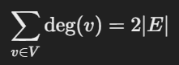
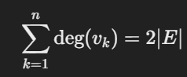
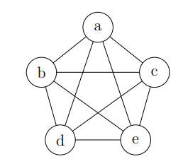
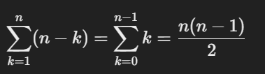

-Graph

Graphs

> 如果图既没有多重边也没有环路边，则称为简单图。
>
> 除非我们明确说明，否则“图”将始终是简单图。
>
> 我们假设图至少有一个节点，并且具有有限数量的边和节点。（大多数概念可以以合理的方式扩展到无限和非简单图。）

Degrees

节点 v 的度数（记作 deg(v)）是以 v 为端点的边的数量

如果允许自环，自环会被计算两次。

握手定理：每条边对两个节点的度数都有贡献。因此，所有节点的度数之和是边数的两倍  （由于 VVV 是有限的，我们也可以为节点命名为 v1,…,vn，然后写成：）

Complete graphs

Complete graphs (K_n)

n 个节点的完全图（简称 K_n​）是一个具有 n 个节点的图，其中每个节点都与其他所有节点相连。

K_5：

计算 K_n 中的边数：（K_n中的总）边数= 。可以从第一个节点的角度考虑。它与 n−1 个其他节点相连。如果我们看第二个节点，它增加了 n−2 条连接，依此类推。

Cycle graphs (C_n)：循环图

假设我们有 n 个节点，命名为 v1,…,vn ，其中 n≥3；

边连接 v_i 到 v_i+1​，再加上一条从 v_n​ 到 v_1 的额外边

Wheels (W_n)轮图

轮图 W_n​ 就像循环图 C_n​，只是它有一个额外的中心“枢纽”节点，连接所有其他节点。注意 W_n​ 有 n+1 个节点（不是 n 个节点）。它有 2n 条边。

Isomorphism 同构

环图 CnC_nCn​ 包含 2n2n2n 个不同的环路

一个图 GGG 是连通的，如果在图中每对节点之间都存在一条行走。我们之前的图例都是连通的
