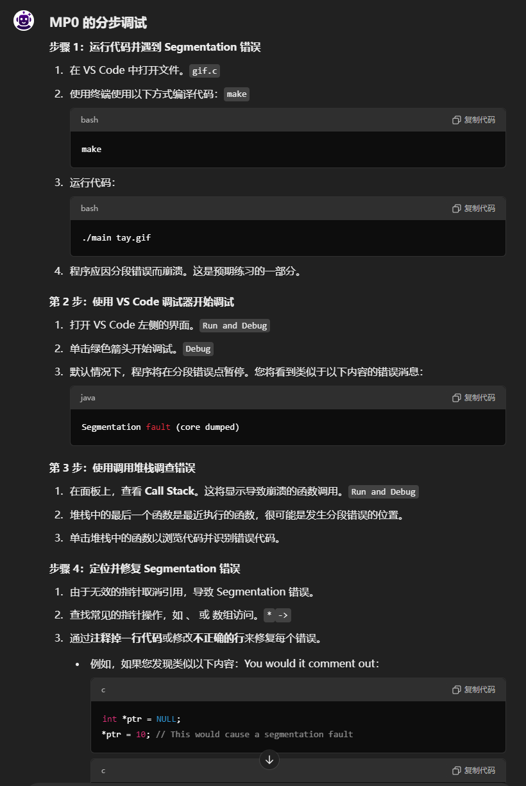
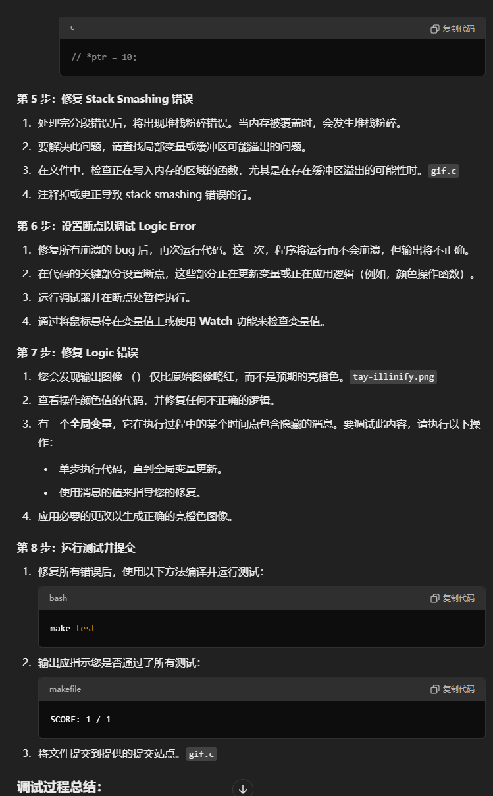
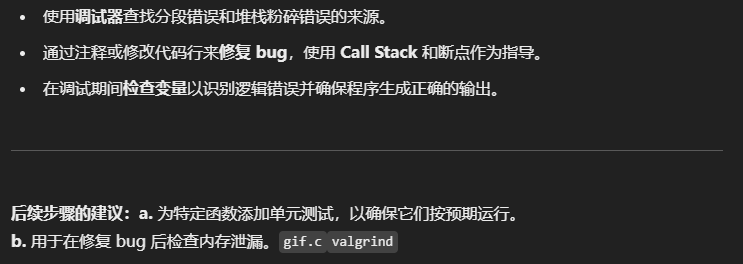
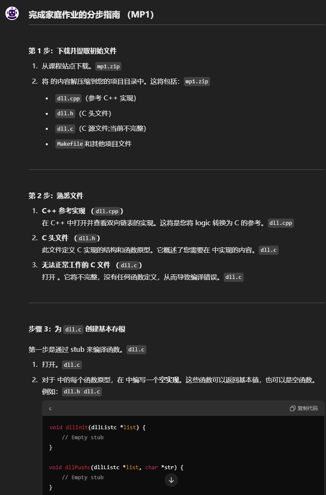
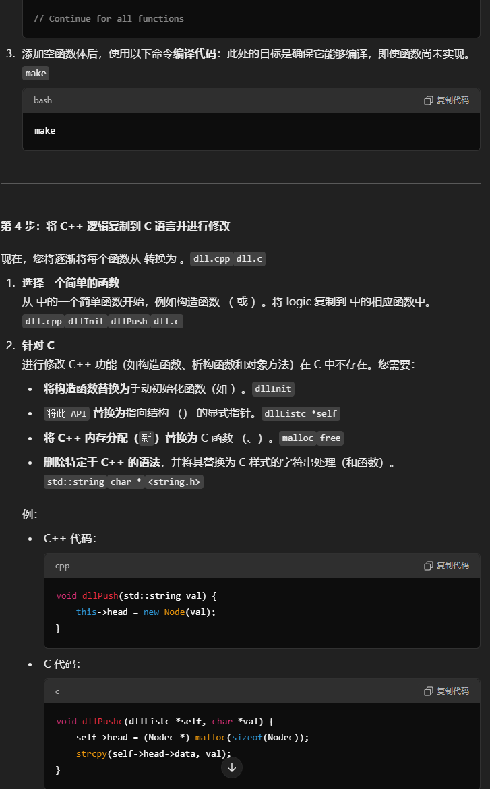
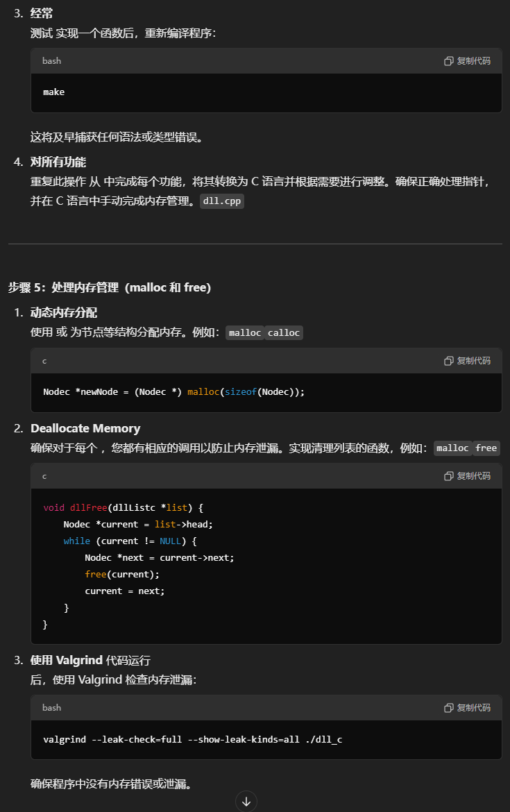
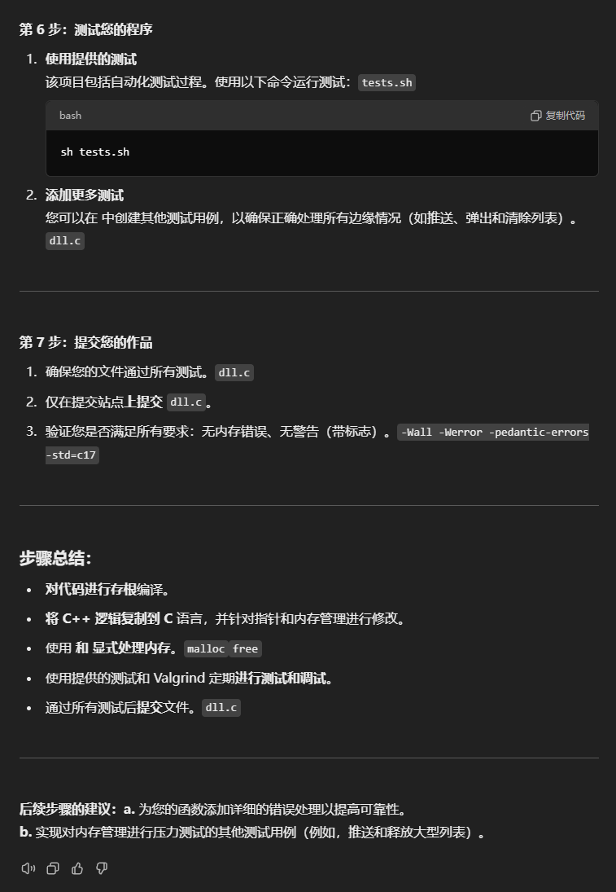

MP0

\### Step-by-Step Debugging for MP0

\*\*Step 1: Run the Code and Encounter a Segmentation Fault\*\*

1\. Open the \`gif.c\` file in VS Code.

2\. Use the terminal to compile the code using \`make\`:

\`\`\`bash

make

\`\`\`

3\. Run the code:

\`\`\`bash

./main tay.gif

\`\`\`

4\. The program should crash with a segmentation fault. This is expected as part of the exercise.

\*\*Step 2: Start Debugging with the VS Code Debugger\*\*

1\. Open the \`Run and Debug\` interface on the left side of VS Code.

2\. Click on the green \`Debug\` arrow to start debugging.

3\. By default, the program will pause at the point of the segmentation fault. You'll see an error message similar to:

\`\`\`

Segmentation fault (core dumped)

\`\`\`

\*\*Step 3: Use the Call Stack to Investigate the Error\*\*

1\. On the \`Run and Debug\` panel, look at the \*\*Call Stack\*\*. This will show you the function calls that led to the crash.

2\. The last function in the stack is the most recent one that was executed and is likely where the segmentation fault occurred.

3\. Click on the functions in the stack to navigate through the code and identify the faulty line.

\*\*Step 4: Locate and Fix Segmentation Faults\*\*

1\. The segmentation fault occurs due to invalid pointer dereferencing.

2\. Look for common pointer operations like \`\*\`, \`-\>\`, or array access.

3\. Fix each bug by \*\*commenting out a single line of code\*\* or \*\*modifying the incorrect line\*\*.

\- For example, if you find something like:

\`\`\`c

int \*ptr = NULL;

\*ptr = 10; // This would cause a segmentation fault

\`\`\`

You would comment it out:

\`\`\`c

// \*ptr = 10;

\`\`\`

\*\*Step 5: Fix Stack Smashing Bug\*\*

1\. Once you've handled the segmentation faults, there will be a stack smashing error. Stack smashing occurs when memory is overwritten.

2\. To fix this, look for issues where local variables or buffers might be overflowing.

3\. In the \`gif.c\` file, inspect the functions for areas where memory is being written, especially if there's a possibility of buffer overflow.

4\. Comment out or correct the line that causes the stack smashing error.

\*\*Step 6: Set Breakpoints to Debug the Logic Error\*\*

1\. After fixing all crashing bugs, run the code again. This time, the program will run without crashing, but the output will not be correct.

2\. Set breakpoints at key parts of the code where variables are being updated or logic is being applied (e.g., color manipulation functions).

3\. Run the debugger and pause execution at your breakpoints.

4\. Inspect variable values by hovering over them or using the \*\*Watch\*\* feature.

\*\*Step 7: Fix the Logic Error\*\*

1\. You'll find that the output image (\`tay-illinify.png\`) is only slightly redder than the original, not the bright orange intended.

2\. Look at the code that manipulates the color values, and fix any incorrect logic.

3\. There is a \*\*global variable\*\* that contains a hidden message at a certain point during execution. To debug this:

\- Step through the code until the global variable is updated.

\- Use the value of the message to guide your fix.

4\. Apply the necessary change to produce the correct bright orange image.

\*\*Step 8: Run Tests and Submit\*\*

1\. Once all bugs are fixed, compile and run the tests using:

\`\`\`bash

make test

\`\`\`

2\. The output should indicate whether you passed all tests:

\`\`\`

SCORE: 1 / 1

\`\`\`

3\. Submit the \`gif.c\` file to the provided submission site.

\### Summary of Debugging Process:

\- Use the \*\*debugger\*\* to locate the source of segmentation faults and stack smashing errors.

\- \*\*Fix bugs\*\* by commenting out or modifying lines of code, using the \*\*Call Stack\*\* and breakpoints for guidance.

\- \*\*Inspect variables\*\* during debugging to identify logic errors and ensure the program produces the correct output.

---

\*\*Suggestions for Next Steps:\*\*

\*\*a.\*\* Add unit tests for specific functions in \`gif.c\` to ensure they behave as expected.

\*\*b.\*\* Use \`valgrind\` to check for memory leaks after fixing the bugs.

MP1

\### Step-by-Step Guide to Completing Your Homework (MP1)

---

\*\*Step 1: Download and Extract Initial Files\*\*

1\. Download \`mp1.zip\` from the course site.

2\. Extract the contents of \`mp1.zip\` into your project directory. This will include:

\- \`dll.cpp\` (reference C++ implementation)

\- \`dll.h\` (C header file)

\- \`dll.c\` (C source file; currently incomplete)

\- \`Makefile\` and other project files

---

\*\*Step 2: Familiarize Yourself with the Files\*\*

1\. \*\*C++ Reference Implementation (\`dll.cpp\`)\*\*

Open \`dll.cpp\` and review the implementation of a doubly-linked list in C++. This will be your reference for converting the logic into C.

2\. \*\*C Header File (\`dll.h\`)\*\*

This file defines the structures and function prototypes for your C implementation. It gives you an outline of what you need to implement in \`dll.c\`.

3\. \*\*Non-Functioning C File (\`dll.c\`)\*\*

Open \`dll.c\`. It will be incomplete, without any function definitions, causing compilation errors.

---

\*\*Step 3: Create a Basic Stub for \`dll.c\`\*\*

The first step is to make \`dll.c\` compile by stubbing out the functions.

1\. Open \`dll.c\`.

2\. For each function prototype in \`dll.h\`, write an \*\*empty implementation\*\* in \`dll.c\`. These can either return basic values or be empty functions. For example:

\`\`\`c

void dllInit(dllListc \*list) {

// Empty stub

}

void dllPushc(dllListc \*list, char \*str) {

// Empty stub

}

// Continue for all functions

\`\`\`

3\. Once you have added empty function bodies, \*\*compile the code\*\* using the \`make\` command:

\`\`\`bash

make

\`\`\`

Your goal here is to ensure it compiles, even though the functions are not implemented yet.

---

\*\*Step 4: Copy C++ Logic to C and Modify\*\*

Now you will gradually convert each function from \`dll.cpp\` to \`dll.c\`.

1\. \*\*Pick a Simple Function\*\*

Start with a simple function from \`dll.cpp\`, like a constructor (\`dllInit\` or \`dllPush\`). Copy the logic into the corresponding function in \`dll.c\`.

2\. \*\*Modify for C\*\*

C++ features such as constructors, destructors, and object methods do not exist in C. You need to:

\- \*\*Replace constructors\*\* with manual initialization functions (like \`dllInit\`).

\- \*\*Replace \`this\`\*\* with an explicit pointer to the structure (\`dllListc \*self\`).

\- \*\*Replace C++ memory allocation (\`new\`)\*\* with C functions (\`malloc\`, \`free\`).

\- \*\*Remove C++-specific syntax\*\* like \`std::string\` and replace with C-style string handling (\`char \*\` and functions from \`\<string.h\>\`).

Example:

\- C++ code:

\`\`\`cpp

void dllPush(std::string val) {

this-\>head = new Node(val);

}

\`\`\`

\- C code:

\`\`\`c

void dllPushc(dllListc \*self, char \*val) {

self-\>head = (Nodec \*) malloc(sizeof(Nodec));

strcpy(self-\>head-\>data, val);

}

\`\`\`

3\. \*\*Test Frequently\*\*

After implementing a function, recompile the program:

\`\`\`bash

make

\`\`\`

This will catch any syntax or type errors early.

4\. \*\*Repeat for All Functions\*\*

Work through each function from \`dll.cpp\`, converting it into C and making adjustments as necessary. Ensure that pointers are correctly handled and that memory management is done manually in C.

---

\*\*Step 5: Handle Memory Management (malloc and free)\*\*

1\. \*\*Dynamic Memory Allocation\*\*

Use \`malloc\` or \`calloc\` to allocate memory for structures like nodes. For example:

\`\`\`c

Nodec \*newNode = (Nodec \*) malloc(sizeof(Nodec));

\`\`\`

2\. \*\*Deallocate Memory\*\*

Ensure that for every \`malloc\`, you have corresponding \`free\` calls to prevent memory leaks. Implement functions to clean up the list, such as:

\`\`\`c

void dllFree(dllListc \*list) {

Nodec \*current = list-\>head;

while (current != NULL) {

Nodec \*next = current-\>next;

free(current);

current = next;

}

}

\`\`\`

3\. \*\*Use Valgrind\*\*

Once your code runs, check for memory leaks using Valgrind:

\`\`\`bash

valgrind --leak-check=full --show-leak-kinds=all ./dll_c

\`\`\`

Ensure there are no memory errors or leaks in your program.

---

\*\*Step 6: Test Your Program\*\*

1\. \*\*Use Provided Tests\*\*

The project includes \`tests.sh\` to automate the testing process. Run the tests with:

\`\`\`bash

sh tests.sh

\`\`\`

2\. \*\*Add More Tests\*\*

You can create additional test cases in \`dll.c\` to ensure that all edge cases (like pushing, popping, and clearing the list) are handled correctly.

---

\*\*Step 7: Submit Your Work\*\*

1\. Ensure that your \`dll.c\` file passes all tests.

2\. \*\*Submit only \`dll.c\`\*\* on the submission site.

3\. Verify that you meet all the requirements: no memory errors, no warnings (with \`-Wall -Werror -pedantic-errors -std=c17\` flags).

---

\### Summary of Steps:

\- \*\*Stub the code\*\* to compile.

\- \*\*Copy C++ logic to C\*\*, and modify for pointers and memory management.

\- \*\*Handle memory\*\* explicitly with \`malloc\` and \`free\`.

\- \*\*Test and debug\*\* regularly using the provided tests and Valgrind.

\- \*\*Submit\*\* the \`dll.c\` file after passing all tests.

---

\*\*Suggestions for Next Steps:\*\*

\*\*a.\*\* Add detailed error handling to your functions for robustness.

\*\*b.\*\* Implement additional test cases that stress-test the memory management (e.g., pushing and freeing large lists).

