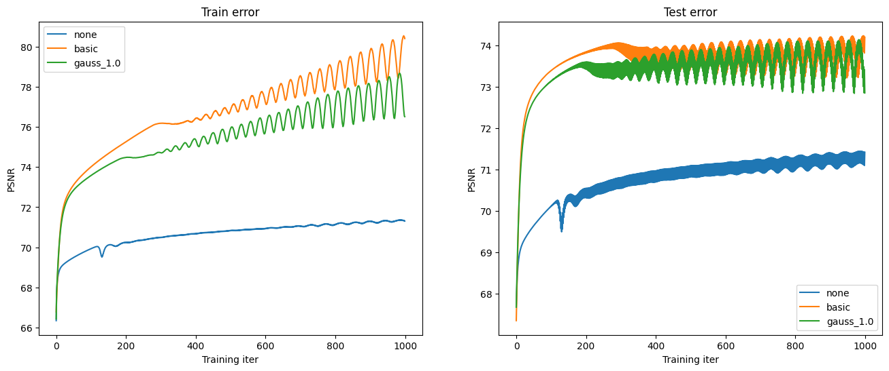
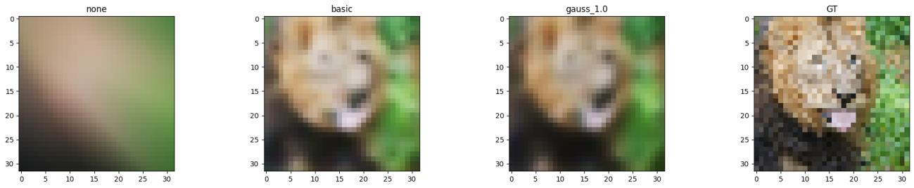
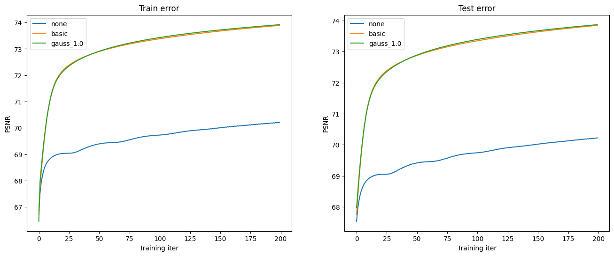
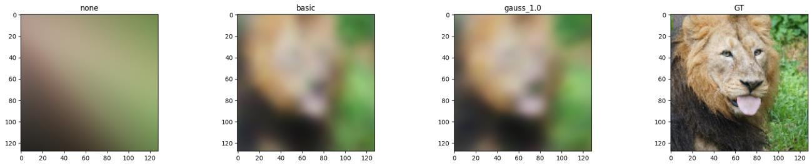
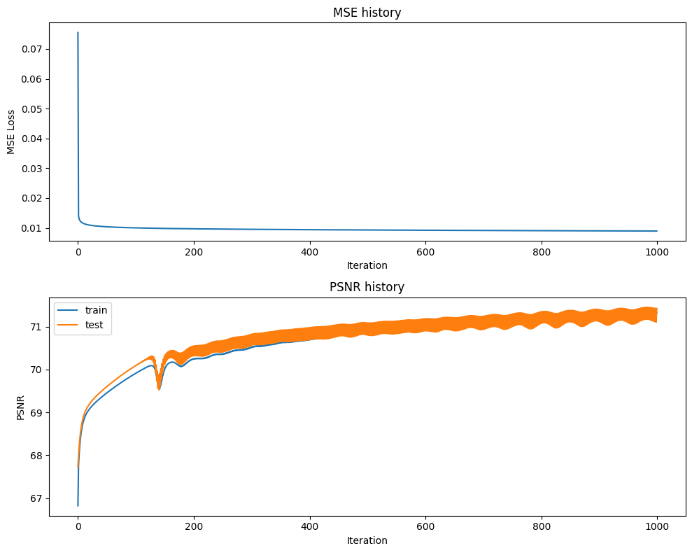
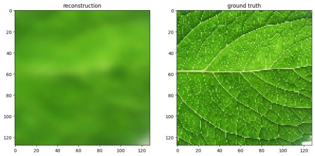
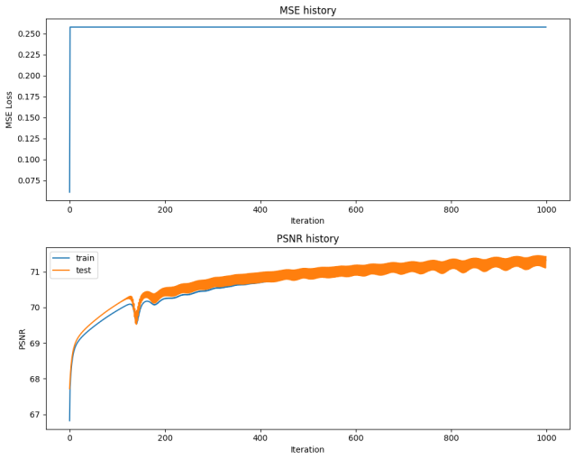

# MP2 Report

> Converted from [MP2-Report.pdf](MP2-Report.pdf).

## Assignment 2 Report

## Name(s): Yanjin Li NetID(s): yanjin2 In each the following parts, you should insert the following:

● Train/test loss plots ● Qualitative outputs for GT, No encoding, Basic Positional Encoding, and Fourier Feature

Encoding

**Part 1: Low resolution example**

**Part 2: High resolution example**

**Part 3: High resolution (image of your choice)**

(For this part, you can select an image of your choosing and show the performance of your model with the best hyperparameter settings and mapping functions from Part 2. You do not need to show results for all of the mapping functions.) Part 4: Discussion Briefly describe the hyperparameter settings you tried and any interesting implementation choices you made. lr: 1e-3, 1e-2, 5e-2, 1e-1, 5e-1, 0.6, 0.7 hidden_sizes: 128, 256, 512, 1024 num_layers_values: 2, 4, 6, 8 During hyperparameter search, used fewer epochs (200) to speed up experimentation. After identifying promising settings, trained longer (1000 epoches) for final results How did the different choices for coordinate mappings functions compare? None: Lower than other mappings Basic: Achieves high PSNR relatively quickly, much higher than none Gauss_1.0: Achieves higher PSNR, but provides limited help Do you make any interesting observations from the train and test plots? Both basic and gauss_1.0 converge to higher PSNR. This indicates that adding coordinate encoding helps the network learn details more effectively. What insights did you gain from your own image example (Part 3)? Gauss_1.0 is still far from being able to train and recognize detail edges. Part 5: Extra Credit (optional) Explain anything you did in detail and provide output images. Implemented Adam Optimizer

