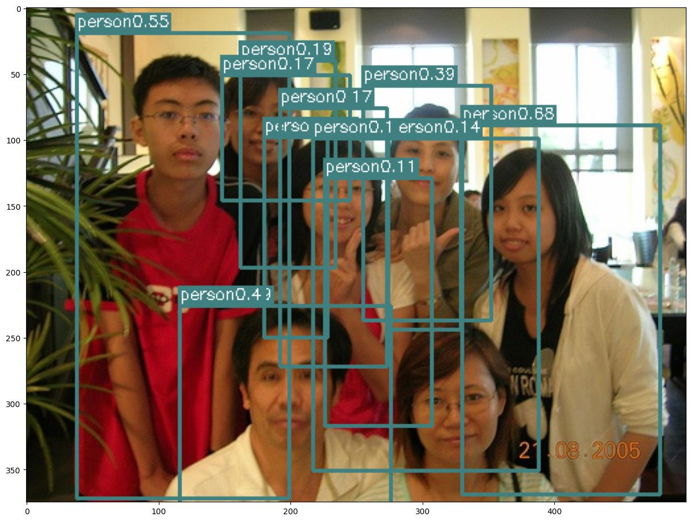

# MP4 Report

> Converted from [MP4-Report.pdf](MP4-Report.pdf).

## Assignment 4

Name(s): Yanjin Li NetID(s): yanjin2

## Object Detection by YOLO

1. My best mAP value on Kaggle : 0.512 2. Did you upload the final CSV file on Kaggle: Yes 3. My final loss value: 2.49252 4. What did not work in my code (if anything): N/A 5. Sample Images from my detector from PASCAL VOC:

**Extra Credit for YOLO :**

