Name(s): Yanjin Li

NetID(s): yanjin2

**Part 1: Single-Step Denoising UNet**

1.  A visualization of the noising process using 𝜎 = \[0.0, 0.2, 0.4, 0.5, 0.6, 0.8, 1.0\] (Figure 3)

> 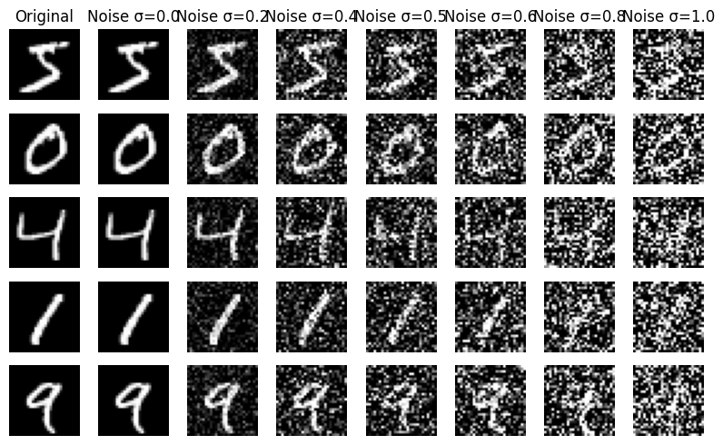

2.  A training loss curve plot every few iterations during the whole training process (Figure 4)

> 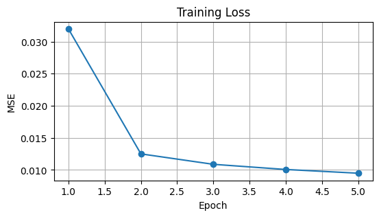

3.  Sample results on the test set after the first and the 5th epoch. (Figures 5 and 6)

> 1st:
>
> 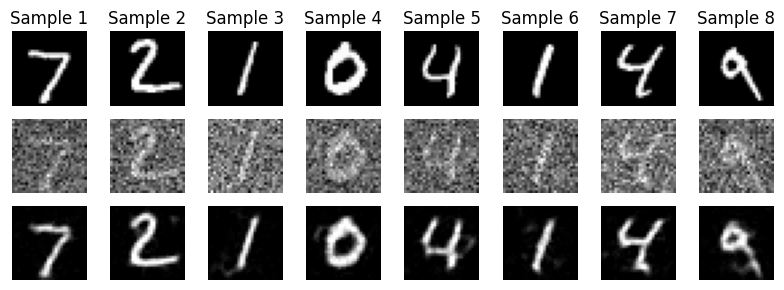
>
> 5th:
>
> 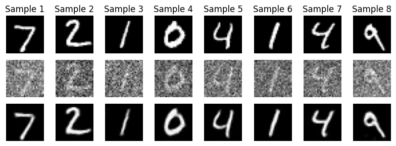

4.  Sample results on the test set with out-of-distribution noise levels after the model is trained. Keep the same image and vary 𝜎 = \[0.0, 0.2, 0.4, 0.5, 0.6, 0.8, 1.0\] (Figure 7)

> 𝜎 = 0.0
>
> 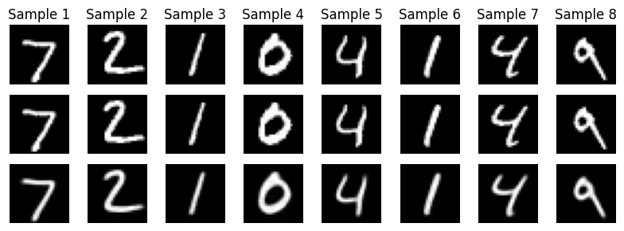
>
> 𝜎 = 0.2
>
> 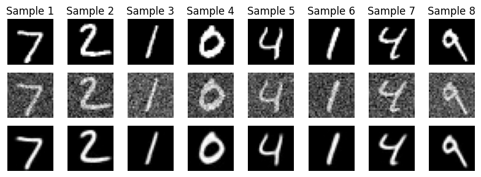
>
> 𝜎 = 0.4
>
> 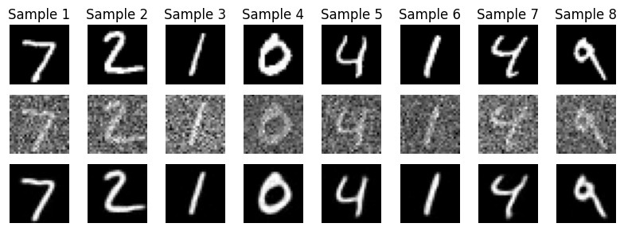
>
> 𝜎 = 0.5
>
> 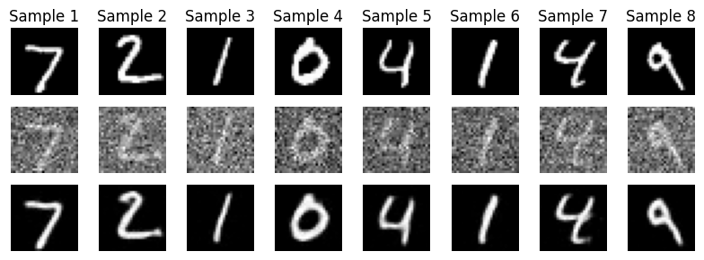
>
> 𝜎 = 0.6
>
> 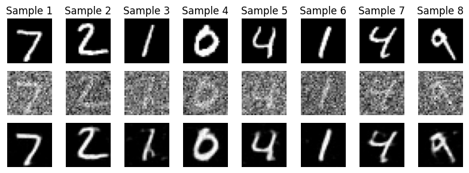
>
> 𝜎 = 0.8
>
> 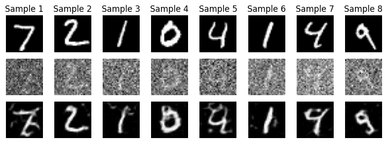
>
> 𝜎 = 1.0
>
> 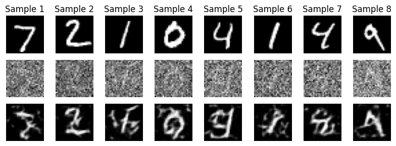

**Part 2.1-2.3: Time-conditioned UNet**

1.  A training loss curve plot for the time-conditioned UNet over the whole training process (Figure 10).

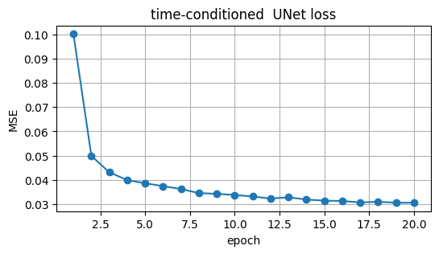

2.  Sampling results for the class-conditioned UNet after the 5th and the 20th epoch. Providing a GIF is optional and can be done as extra credit.

> 5th:
>
> 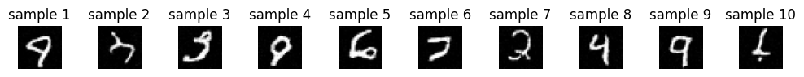
>
> 20th:
>
> 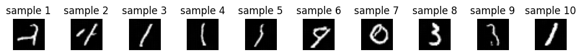

**Part 2.4-2.5: Class-conditioned UNet**

1.  A training loss curve plot for the class-conditioned UNet over the whole training process.

> 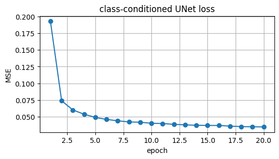

2.  Sampling results for the class-conditioned UNet after the 5th and the 20th epoch. Generate 4 instances of each digit as shown on the assignment page. Providing a GIF is optional and can be done as extra credit.

> 5th:
>
> 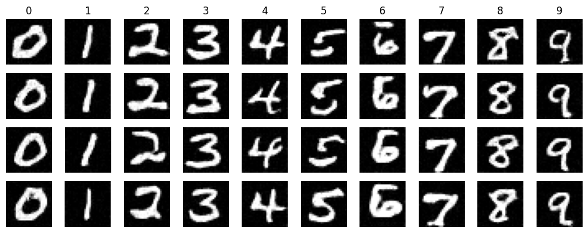
>
> 20th:
>
> 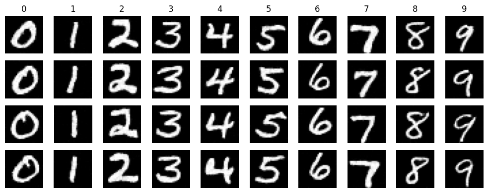

**Extra credit:**
