• The theoretical foundation of

computer science (Traditional foundation): Alan Turing

• Turing test

• The modern computer architecture is proposed by John von Neumann:

von Neumann architecture

COMPUTER HARDWARE

---Key components in a computer

• Central processing unit (CPU): execute your program. Similar to human

brain, very fast but not that smart

• Input device: take inputs from users or other devices

• Output device: output information to users or other devices

• Main memory: store data, fast and temporary storage

• Secondary memory: slower but large size, permanent storage

---Central Processing Unit

• A processor contains two units, a control unit (CU) and an arithmetic/logic unit (ALU)

• CU is used to fetch commands from the memory

• ALU contains the electric circuits which can execute commands

Memory/Storage

• High speed cache • Internal RAM

• Internal ROM • External RAM • Flash

• Hard disk

• The instructions expressed in binary

code is called **machine language**

Low level language – Assembly Language

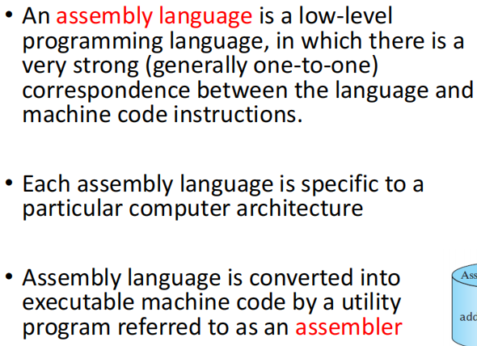

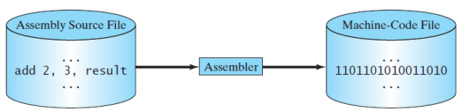

---C Language (1969 - 1973)

• high-level programming language

• Somewhere between assembly and other high level languages

• Provide powerful functionalities for low level memory manipulations, platform dependent

• Have the highest efficiency within high level languages

• Very widely used in low level applications

---C++ Language (1979)

• Inherent major features of C

• An object oriented programming language, supporting code reuse

• High efficiency and powerful in low level memory manipulation

• Still platform dependent

-Java Language (1995)

• general-purpose object oriented

• Platform independent

• Java is one of the most popular programming languages currently in use

---Python (1991)

• open source, object oriented

• Powerful libraries

• Powerful interfaces to integrate other programming languages

---Language efficiency v.s. development efficiency

• High level languages cannot be executed directly

• High level languages must be converted into low level languages first

• Lower level languages have higher language efficiency (they are faster

to run on a computer)

• Higher level languages have higher development efficiency (it is easier

to write programs in these languages)

• Interpreter (解释器) is a computer program that directly executes, i.e.

performs, instructions written in a programming or scripting

language, without previously compiling them into a machine language

program

• Compiler (编译器) is a computer program (or a set of programs)

that transforms source code written in a programming language (the

source language) into another computer language (the target

language), with the latter often having a binary form known as object

Code

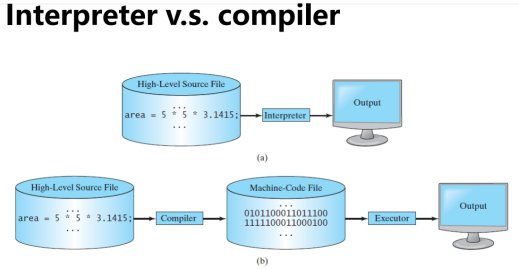

------------------------------------------------------------------------

Operating Systems

• The operating system (OS) is a low level program,

which provides all basic services for managing and

controlling a computer’s activities

• Applications are programs which are built based upon an OS

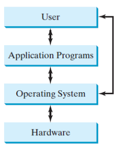

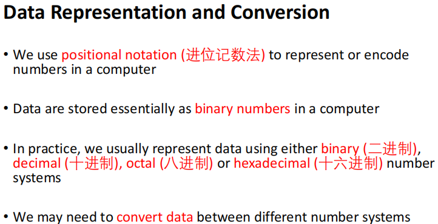

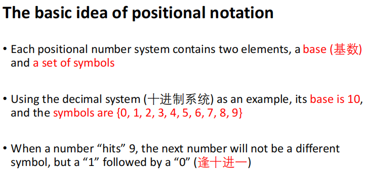

Decimal number system

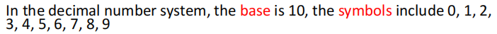

Binary number system

Hexadecimal number system

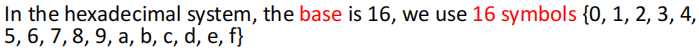

Octal number system

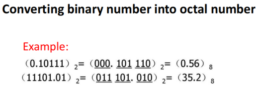

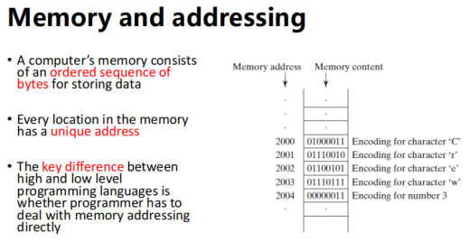

<u>-------------------------------------------------------</u>

Reserved words

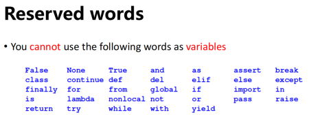

syntax patterns

Interactive

Script

Suffix

-Sequential flow

set up “paths” for the program to follow

-Conditional flow

-Loops (repeated steps) have iterative variables that change each time

through a loop

Often these iterative variables go through a sequence of numbers

Constants: Fixed values such as numbers and letters

String constants use ‘ or “

Rules for defining variables in Python

• Must start with a letter or underscore \_

• Can only contain letters, numbers and underscore

• Case sensitive

-assignment statement: an expression on the right hand + a variable

-the assignment operator (=)

-Cascaded assignment

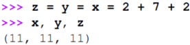

-Simultaneous assignment

Exchange values of 2 variables

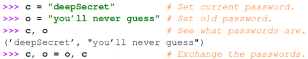

Asterisk (\*)

Operator precedence rules

•Highest to lowest precedence rule

Floor division

Augmented assignment

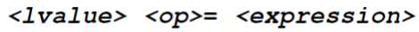

Parenthesis

Truncates

Conversion

-Bool()

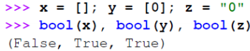

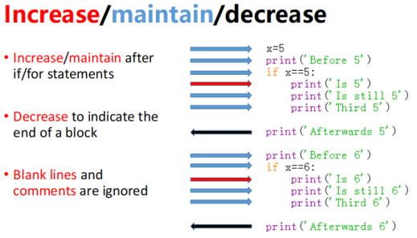

-Logical operators (not, and, or):

can be used to c<u>ombine several logical expressions</u> into <u>a single expression</u>

-Default argument

-Return multiple values

Simultaneous(adj.)同时的 assignment

A string is a sequence of characters

string literal

Concatenate

Index

square brackets

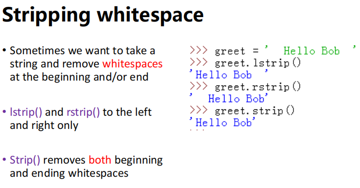

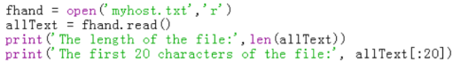

\>\>\>all_text = fhand.read()

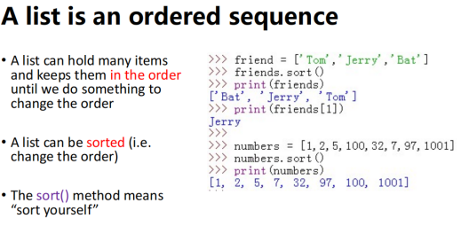\
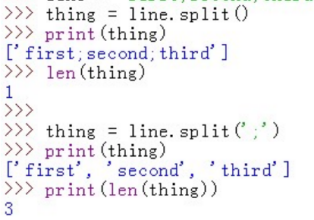

Delimiter

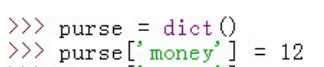

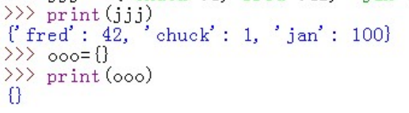

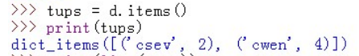

<u>----------------------------------------------------</u>

Parenthesis

Arguments

optional parameters

Void functions: functions do not return a value

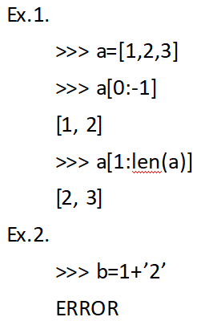“fruitful” functions: Functions that return values

Different variables may

share a name if they have

different scopes

·

---The <u>id</u> of an object is automatically assigned <u>a unique *integer*</u> by Python when the program is executed.

-The <u>id</u> for the object will not be changed during the execution of the program.

-The <u>type</u> for the object is determined by -Python according to <u>the *value* of the object</u>.

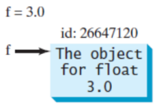A variable in Python is actually a reference to an object.

---You can perform operations on an object

-The operations are defined using functions

-The functions for the objects are called methods in Python

-Methods can only be invoked调用 from a specific object

---E<u>verything is an object</u> (number, string, etc). An <u>object</u> represents an entity in the real world that can be distinctly identified.

\[Key elements of an object\]

-An object’s <u>identity</u> is like a person’s ID. Python automatically assigns each object <u>a unique id</u> for identifying the object at runtime.

-An object’s <u>state</u> (also known as its <u>properties</u> or <u>attributes</u>) is represented by variables, called data fields.

-Python uses <u>methods</u> to define an object’s behavior (also known as its actions).

Recall that methods are defined as functions. You make an object perform an action by invoking a method on that object.

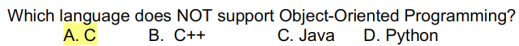

---Object oriented programing allows us to write program in a way that naturally match the problem that we are trying to solve

---An object is an <u>instance</u> of a class, and you can create many instances of a class

-Creating an instance of a class is referred to as <u>instantiation</u>

-The terms object and instance are often used interchangeably

---Objects of the same kind are defined by using a common class

-A class is a contract—also sometimes called a template or blueprint

--- Method \_\_init\_\_() is known as an initializer

---Create objects from the class with a <u>constructor</u>

-The <u>constructor</u> does two things

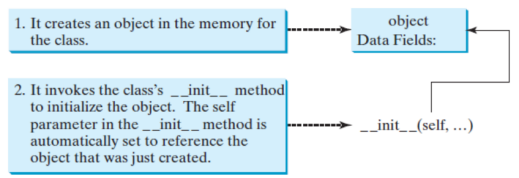

---The parameter <u>self</u> 引用了调用该方法的对象

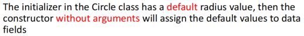

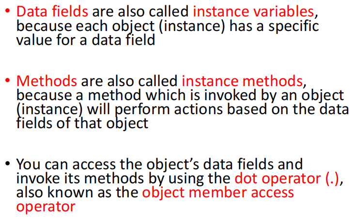

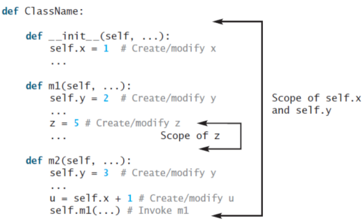

---私有方法&私有数据段 前+\_ \_

-Private data fields and methods can be accessed within a class, but they cannot be accessed outside the class

-Define some methods to allow access to private data fields

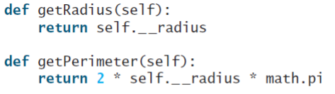

---<u>Abstraction</u> means separate the implementation of a part of code from the usage of that code

\-<u>Function abstraction</u> means separating the implementation of a function from its usage

Abstraction makes your code easy to maintain, debug and reuse

\-<u>Class abstraction</u> means separating class implementation from the use of a class

\-<u>Class encapsulation</u>: The details of implementation are encapsulated and

hidden from the user.

---Inheritance enables you to define a general class (a superclass) and later extend it to more specialized classes (subclasses)

-使用 super().xxx代替super(Class, self).xxx

---Sometimes it is necessary for the subclass to modify the implementation of a method defined in the superclass. This is referred to as <u>method overriding方法覆盖</u>

---当构造一个对象时，会自动调用\_\_new\_\_()方法。然后，该方法将调用\_\_init\_\_()方法来初始化该对象。通常，您只应该覆盖\_\_init\_\_()方法来初始化在新类中定义的数据字段

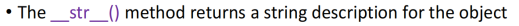

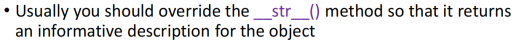

-子类继承父类的\_\_init\_\_方法：子类不重写\_\_init\_\_，实例化子类时，会自动调用父类定义的\_\_init\_\_执行

---Polymorphism: 意味着不同类的对象可以作为参数传递给同一个函数

-The <u>inheritance</u> relationship使子类能够从它的超类中继承成员。子类是其超类的specialization；子类的每个实例也是其超类的一个实例，反之亦然。因此，当两个对象共享一些公共成员时，它们都可以作为参数传递给同一个函数

---Dynamic binding: 一个方法可以在继承链上的几个类中实现，Python决定在运行时调用哪个方法

-Cn是对象类，如果o调用一个方法p，Python会按照这个顺序搜索C1, C2, ...，Cn-1和Cn中的方法p的实现，直到找到它

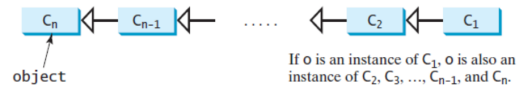

---The isinstance()函数可用于确定对象是否是类的实例

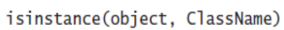

·

---A <u>data structure</u> is a systematic way of organizing and accessing data

-An <u>algorithm</u> is a step-by-step procedure for performing some task in a finite amount of time.

---The primary analysis of algorithms 包括characterizing the running times和space usage of algorithms and data structure operations

\-<u>Running time</u> is a natural measure of “goodness,” since time is a precious resource—computer solutions should run as fast as possible

\-<u>Space usage</u> is another major issue to consider when we design an algorithm, 因为我们只有有限的存储空间

---Experimental running times of two algorithms are difficult to directly compare unless the experiments are performed in the same hardware and software environments

-Experiments can be done only on a limited set of test inputs; hence, they leave out the running times of inputs not included in the experiment (and these inputs may be important)

---

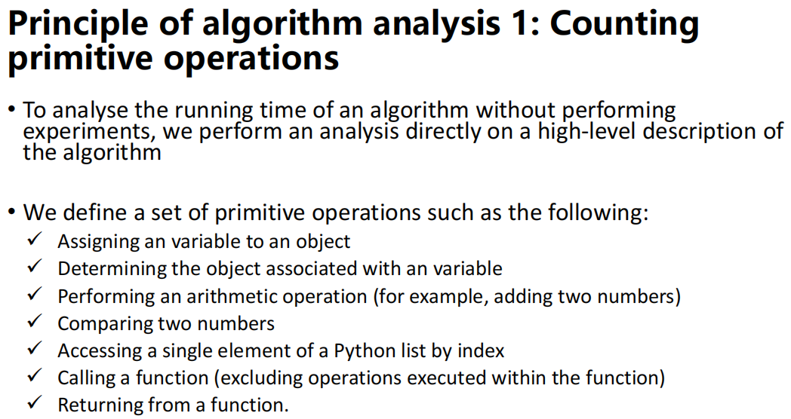

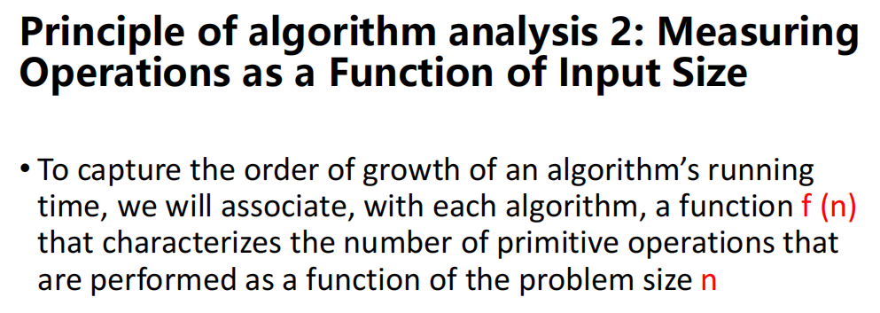

~ 3: Focusing on the Worst-Case Input

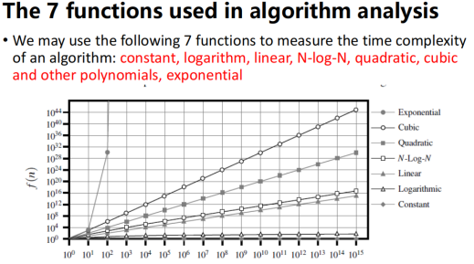

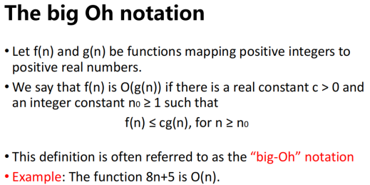

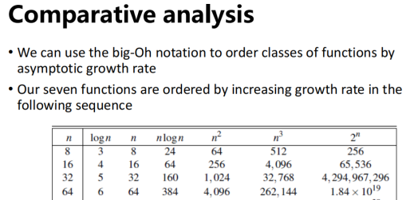

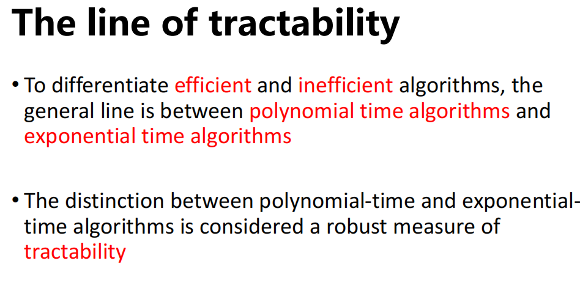

-为了区分高效和低效算法，一般的线是多项式时间算法和指数时间算法之间的区别。多项式时间算法和指数时间算法之间的区别被认为是可处理性的鲁棒度量

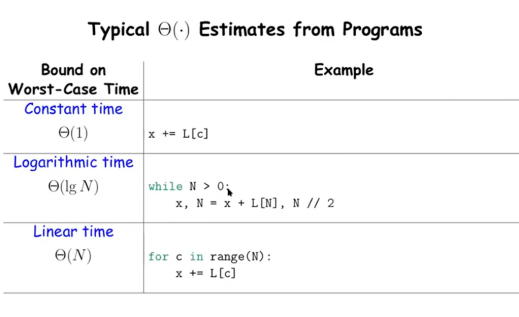

---Recursion is a technique by which a function makes one or more calls to itself during execution

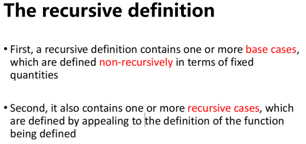

-递归定义包含一个或多个基本情况，以固定数量非递归定义

-它还包含一个或多个递归情况，这是通过吸引被定义的函数的定义来定义的

---How Python implements recursion

-每次调用函数（递归或其他）时，将创建一个称为active record或frame的结构，以存储有关该函数调用进度的信息

-active record存储函数调用的参数和局部变量

-当函数的执行导致嵌套函数调用时，前一个调用的执行被暂停，其激活记录存储在嵌套调用返回时flow of control<u>应该继续</u>的位置

---Sequential search algorithm

-当序列<u>未排序</u>时，搜索目标值的标准方法是使用一个循环来检查每个元素，直到找到目标或耗尽数据集

---Binary search二叉搜索

-efficiently locate a target value within a sorted sequence of n elements

-When <u>the sequence is sorted and indexable</u>, binary search is a much more efficient algorithm

---The strategy of binary search

-We call an element of the sequence a candidate如果，在搜索的当前阶段，我们不能排除该项目与目标相匹配

-该算法保持了low和high两个参数，这样，所有candidate的index至少有low，最多有high

-最初, low = 0, high = n−1.

然后比较the target value与the median candidate, i.e. the item data\[mid\] with index mid = \[(low+high)/2\]

-如果the target value等于the median candidate，则the search terminates successfully

-If target \< data\[mid\], 在low到mid-1间recur

-If target \> data\[mid\], 在mid+1到high间recur

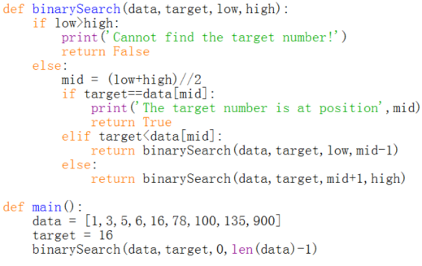

-(Complexity) The binary search algorithm runs in O(logn) time for a sorted sequence with n elements

---Linear recursion: a recursive function that is designed so that each invocation of the body makes <u>at most *one* new</u> recursive call

-Finding the factorial和binary search 都是 linear recursive algorithms

--- Multiple recursion: a function makes two or more recursive calls

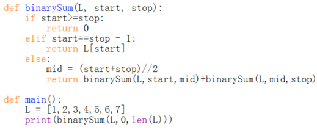

---Stack class

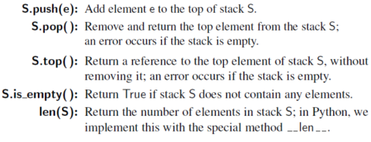

-普通list

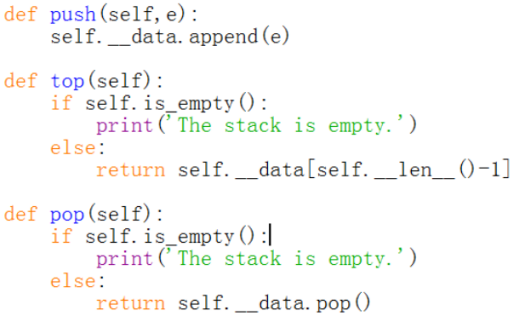

---Queue class

-only the element that has been in the queue the longest can be next removed

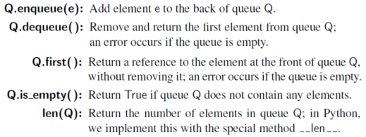

-普通list

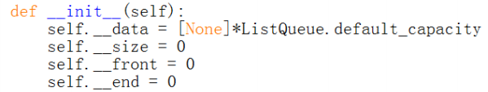

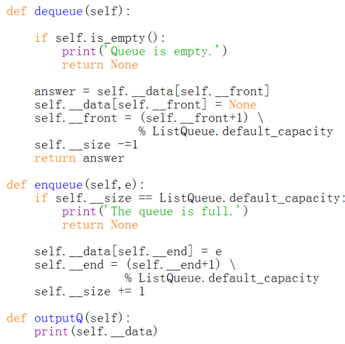

---List in Python is a referential structure

---A collection of numbers are usually stored as a <u>compact array</u> in languages such as <u>C/C++ and Java</u>

-A compact array is storing the bits that <u>represent</u> the primary data (<u>not reference</u>)

-对于compact structure，总体内存使用量将低得多，因为没有专门用于sequence of memory references（除了主数据）的explicit storage显式储存

---Linked list

-通过从头部开始，然后按照每个节点的下一个引用从一个节点移动到另一个节点，我们可以到达列表的尾部

我们可以将尾部识别为节点，其下一个引用为 None。此过程通常称为traversing the linked list。

-由于节点的下一个引用可以被视为指向另一个节点的链接或指针，因此traversing the linked list的过程也称为link hopping 或pointer hopping

-Implement a Queue with a Circularly

Linked List

---Doubly linked list: each node keeps an explicit reference to <u>the node before it</u> <u>and</u> a reference to the node <u>after</u> it

-Head and tail sentinels: do not store elements of the primary sequence

---Bubble sort

1.迭代一个数字列表，将每个元素i与下面的元素i+1进行比较，如果i更大，则交换它们

2.再次遍历列表并重复步骤 1 中的过程，但忽略列表中的最后一个元素

3.不断迭代列表，但每次忽略列表尾部的多个元素，直到只剩下一个元素

-普通list

-Singly linked list

---Quick sort

-more efficient than bubble sort

快速排序是一种广泛使用的算法，它比气泡排序更有效

• 快速排序算法的主要过程是：

1.从array(数组)中选择一个元素，称为pivot

2.Partitioning：对数组重新排序，以便所有值小于pivot的元素都位于pivot之前，而所有值大于pivot紧随其后（相等的值可以采用任何一种方式）。在此partitioning之后，pivot处于其最终位置。这称为partition operation

3.Recursively将上述步骤应用于具有较小值的元素的sub-array，并分别应用于具有较大值的元素的sub-array

-普通list

-Singly linked list

---A <u>tree</u> is a data structure that stores elements hierarchically分层地

-Besides root: each element has a <u>parent</u> element, \>=0 children

-A node is called a <u>leaf node</u> if it has no child

-If a node has at least one child, it is an <u>internal node</u>

---Depth-first search (DFS)

-for traversing or searching tree data structures -e.g. maze

-over a binary tree

-Breadth-first search (BFS) -e.g. the best strategy in a game

-over a binary tree

·

With the exception of the top element, each element in a tree has a parent element and zero or more children elements

A binary tree is proper if each node has either zero or two children. Some people also refer to such trees as being full binary trees
