• The theoretical foundation of

computer science (Traditional foundation): Alan Turing

• Turing test

• The modern computer architecture is proposed by John von Neumann:

von Neumann architecture

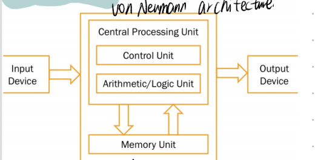

COMPUTER HARDWARE

---Key components in a computer

• Central processing unit (CPU): execute your program. Similar to human

brain, very fast but not that smart

• Input device: take inputs from users or other devices

• Output device: output information to users or other devices

• Main memory: store data, fast and temporary storage

• Secondary memory: slower but large size, permanent storage

---Central Processing Unit

• A processor contains two units, a control unit (CU) and an arithmetic/logic unit (ALU)

• CU is used to fetch commands from the memory

• ALU contains the electric circuits which can execute commands

Memory/Storage

• High speed cache • Internal RAM

• Internal ROM • External RAM • Flash

• Hard disk

• The instructions expressed in binary

code is called **machine language**

Low level language – Assembly Language

---C Language (1969 - 1973)

• high-level programming language

• Somewhere between assembly and other high level languages

• Provide powerful functionalities for low level memory manipulations, platform dependent

• Have the highest efficiency within high level languages

• Very widely used in low level applications

---C++ Language (1979)

• Inherent major features of C

• An object oriented programming language, supporting code reuse

• High efficiency and powerful in low level memory manipulation

• Still platform dependent

-Java Language (1995)

• general-purpose object oriented

• Platform independent

• Java is one of the most popular programming languages currently in use

---Python (1991)

• open source, object oriented

• Powerful libraries

• Powerful interfaces to integrate other programming languages

---Language efficiency v.s. development efficiency

• High level languages cannot be executed directly

• High level languages must be converted into low level languages first

• Lower level languages have higher language efficiency (they are faster

to run on a computer)

• Higher level languages have higher development efficiency (it is easier

to write programs in these languages)

• Interpreter (解释器) is a computer program that directly executes, i.e.

performs, instructions written in a programming or scripting

language, without previously compiling them into a machine language

program

• Compiler (编译器) is a computer program (or a set of programs)

that transforms source code written in a programming language (the

source language) into another computer language (the target

language), with the latter often having a binary form known as object

Code

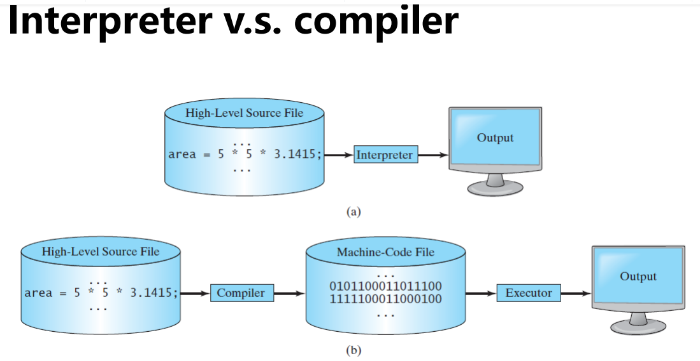

------------------------------------------------------------------------

Operating Systems

• The operating system (OS) is a low level program,

which provides all basic services for managing and

controlling a computer’s activities

• Applications are programs which are built based upon an OS

Decimal number system

Binary number system

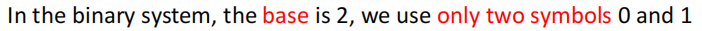

Hexadecimal number system

Octal number system

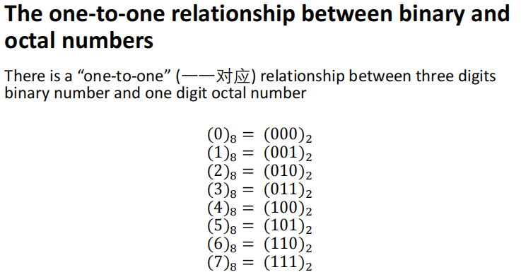

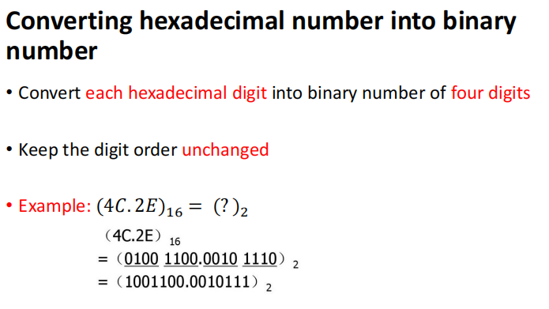

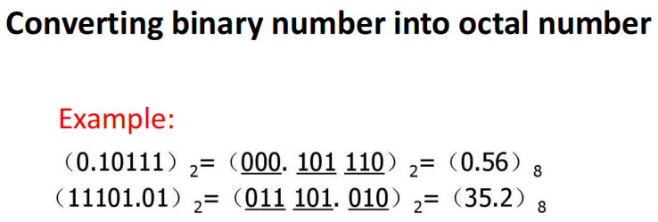

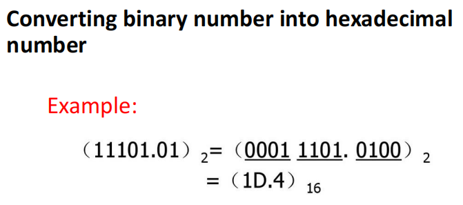

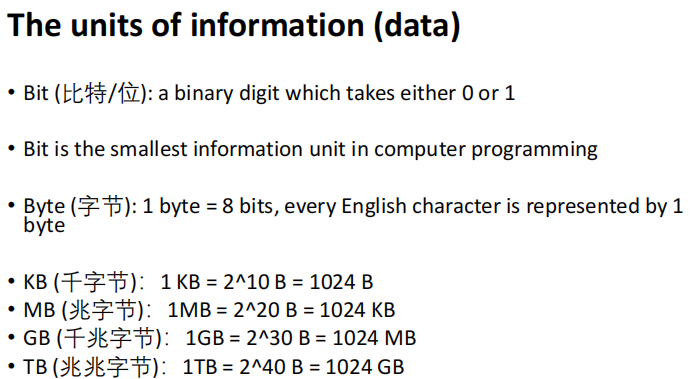

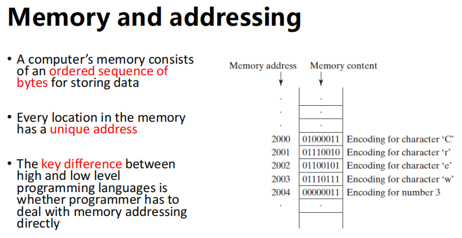

<u>-------------------------------------------------------</u>

Reserved words

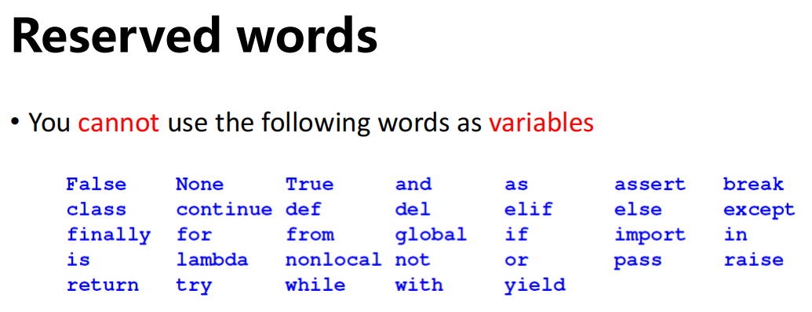

syntax patterns

Interactive

Script

Suffix

-Sequential flow

set up “paths” for the program to follow

-Conditional flow

-Loops (repeated steps) have iterative variables that change each time

through a loop

Often these iterative variables go through a sequence of numbers

Constants: Fixed values such as numbers and letters

String constants use ‘ or “

Rules for defining variables in Python

• Must start with a letter or underscore \_

• Can only contain letters, numbers and underscore

• Case sensitive

-assignment statement: an expression on the right hand + a variable

-the assignment operator (=)

-Cascaded assignment

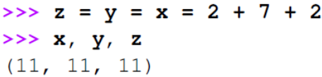

-Simultaneous assignment

Exchange values of 2 variables

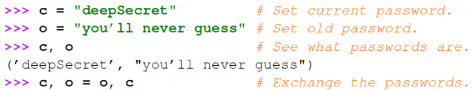

Asterisk (\*)

Operator precedence rules

•Highest to lowest precedence rule

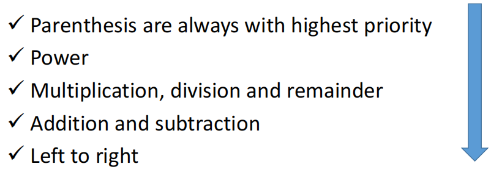

Floor division

Augmented assignment

Parenthesis

Truncates

Conversion

-Bool()

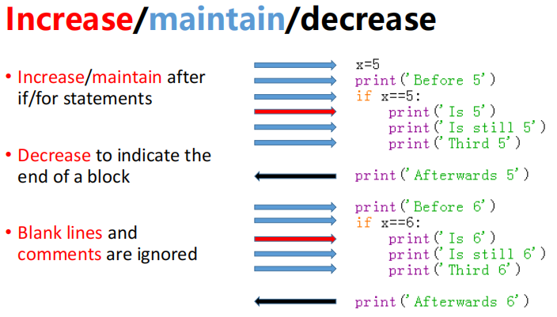

-Logical operators (not, and, or):

can be used to c<u>ombine several logical expressions</u> into <u>a single expression</u>

-Default argument

-Return multiple values

Simultaneous(adj.)同时的 assignment

A string is a sequence of characters

string literal

Concatenate

Index

square brackets

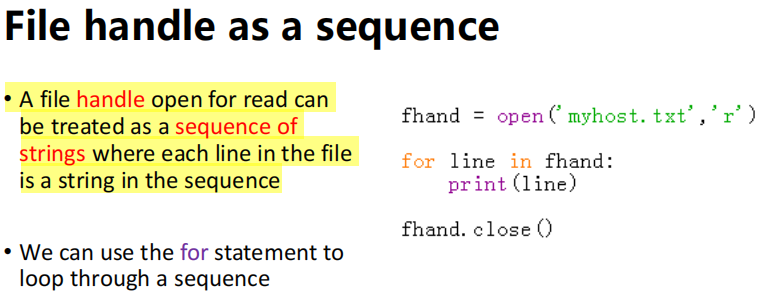

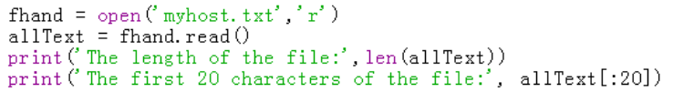

\>\>\>all_text = fhand.read()

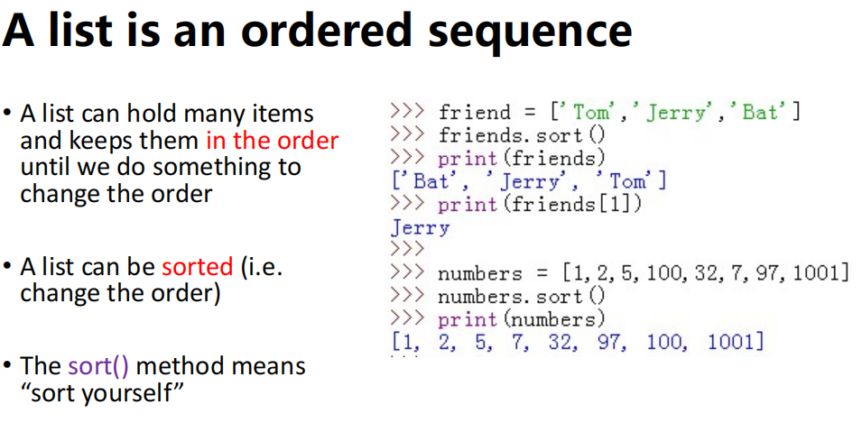\
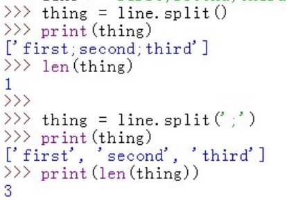

Delimiter

<u>----------------------------------------------------</u>

Parenthesis

Arguments

optional parameters

Void functions: functions do not return a value

“fruitful” functions: Functions that return values

Different variables may

share a name if they have

different scopes
