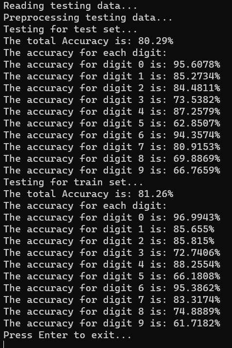

# Assignment 6 — Handwritten digit recognition

**Introduction:**

Handwritten digit recognition uses computers to identify and sort human-written numbers. This technology is useful for tasks like sorting mail and digitizing documents, making data processing faster and more accurate. The project created a model using C++ and OpenCV with the MNIST database to accurately recognize digits from 0 to 9.

**Way to reproduce the project:**

To reduce the file size of the submission, larger files in this project are only packaged once by default. The project is launched within Visual Studio through Assignment6.sln by default. If you want to start the program through the generated .exe file, please refer to the following **\[Starting the Program\]** section.

**Running environment requirements:**

The program runs on **64-bit Windows 11 or Windows 10 systems**. It has not been tested on non-Windows 10/11 systems or non-64-bit systems; please test it yourself if it can run on these systems. If it does not run, please download OpenCV 4.8.1 for the respective system at <https://opencv.org/get-started/> (compatibility with other versions of OpenCV is unknown) and configure the OpenCV environment yourself.

**Starting the program:**

\- If you want to **start through the Visual Studio project:**

> 1\. Open **Assignment6.sln** located in the **same directory as this report file** with Visual Studio.
>
> 2\. Choose **x64** as the active solution platform, then choose other configurations as needed, and finally start the program in the desired way (shortcut keys: **F5 or Ctrl+F5** (without debugging)).

\- If you want to **start through the generated .exe file (Release version):**

> 1\. Copy the data folder under **Project1\\** to **x64\Release\\**
>
> 2\. Start **x64\Release\Assignment6-Project.exe**.

\- If you want to **start through the generated .exe file (Debug version):**

> 1\. Copy the data folder under **Project1\\** to **x64\Debug\\**
>
> 2\. Start **x64\Debug\Assignment6-Project.exe**.

**Viewing the Source Code:**

**- Using Visual Studio:**

> Open **Assignment6.sln**, which is located in the **same directory as this report file**, with Visual Studio. In the Solution Explorer, view the header file **Assignment6.h** and the source file **Assignment6.cpp** under the **Assignment6-Project** project.

**- Using Other Methods:**

> The source code of the program is contained in **Project1\Assignment6.h** and **Project1\Assignment6.cpp**. Please use **any text viewer** to view these files.

**Code Implementation Details**

**Project Composition:**

This project mainly consists of 2 primary files:

> **Header file Assignment6.h**: Declares function prototypes and includes necessary libraries.
>
> **Source file Assignment6.cpp**: Contains the implementation of functions and the "main" function to run the program.

**Important Parts:**

In this project, we use namespace cv.

The project is divided into 4 important parts: MNIST file reading and data conversion, preprocessing of training data and model training, model operation and evaluation, running all processes in the "main" function.

**MNIST** **File Reading and Data Conversion：**

> **- void readAndConvertInteger(cv::int& input_int, std::ifstream& file);**
>
> **Parameters**:
>
> **input_int**: Reference to the integer that needs to be converted.
>
> **file**: Reference to the file stream from which the integer is read.
>
> **Explanation**: This function reads an integer from a MNIST file and converts it from Big Endian format to Little Endian format. This is essential for correct interpretation of the file headers.
>
> **- std::vector\<std::vector\<float\>\> readImagesFileMNIST(const std::string filename);**
>
> **Parameters**:
>
> **filename**: the name of the MNIST file to read
>
> **Explanation**: This function reads MNIST images file and returns a vector of images where each image is represented as a vector of floats.

**- std::vector\<char\> readLabelsFileMNIST(const std::string filename);**

> **Parameters**:
>
> **filename**: The name of the MNIST labels file to read.
>
> **Explanation**: This function reads the MNIST labels file and returns a vector of labels. Each label is represented as a character, corresponding to the digit the image represents.

**Data Preprocessing and Model Training：**

> **- void scalePixelValuesInImages(std::vector\<std::vector\<float\>\>& images_set);**
>
> **Parameters**:
>
> **images_set**: Reference to the vector of image data sets.
>
> **Explanation**: This function normalizes the pixel values in each image of the dataset to a range of \[0,1\]. This normalization is crucial for the consistent processing and performance of machine learning models.
>
> **- Ptrml::SVM trainSVM(const Mat img_Mat, const Mat label_Mat);**
>
> **Parameters**:
>
> **img_Mat**: Matrix of image data used for training.
>
> **label_Mat**: Matrix of label data corresponding to the image data.
>
> **Explanation**: This function creates and trains an SVM model using the provided image and label data. It sets various SVM parameters and uses the input data to train the model for digit recognition.

**Model Running and Evaluation:**

> **- int predictDigitInImageBySVM(const Ptrml::SVM& gotten_svm, const std::vector\<float\>& image);**
>
> **Parameters**:
>
> **gotten_svm**: The trained SVM model used for prediction.
>
> **image**: The image data for which the digit prediction is to be made.
>
> **Explanation**: This function predicts the digit in a given image using the specified SVM model. It involves converting the image data for compatibility with the SVM prediction method.
>
> **- void testPart(Ptrml::SVM gotten_svm, std::vector\<std::vector\<float\>\> images_set, std::vector\<char\> labels_set);**
>
> **Parameters**:
>
> **gotten_svm**: The SVM model to be tested.
>
> **images_set**: The set of images to be tested.
>
> **labels_set**: The set of labels corresponding to the images.
>
> **Explanation**: This function tests the SVM model with the given images and labels and prints out the accuracy and evaluation metrics. It provides a comprehensive assessment of the model's performance on both training and testing data.

**int main() function:**

In the **main** function, we sequentially run the above functions, store necessary global variables, and print out to the console.

**Complex Logic：**

1.  **Endian Conversion**: MNIST data is stored in Big Endian format, but our systems usually use Little Endian format. To properly use the data in MNIST files, after reading MNIST data in the **readAndConvertInteger** function, we swap the first and fourth bytes and the second and third bytes of each number, converting it to Little Endian format.

2.  **MNIST Data Read**: The MNIST dataset is stored in a binary format and sequentially stores four integers. Therefore, in the **readImagesFileMNIST** and **readLabelsFileMNIST** functions, we open the MNIST files in binary format and sequentially read the data we need. Also, each file begins with its magic number, which signifies the file's identity, so we use it to verify that the correct file is opened.

3.  **SVM Parameter Setting**: In the **trainSVM** function, we set several parameters for the SVM function:

    1)  setType: \[C-SVC\] stands for "C-Support Vector Classification". It's one of the types of SVM used for classification problems.

    2)  setKernel: \[LINEAR\] makes the SVM try to divide the data with a straight line, without applying any complex transformations to the data.

    3)  setC: \[1\] It leans towards a simpler model that may not fit all training data perfectly but could be more effective with new data.

4.  **Pixel Data Normalization**: In the **scalePixelValuesInImages** function, we divide each pixel in the images by 255, reducing its value range from \[0,255\] to \[0,1\]. This helps to enhance the efficiency of model training and operation.

**Presentation of Overall Results**

The picture below shows an example of the program output, which includes the process of the program running, as well as the overall accuracy obtained from the test set and training set, and the accuracy of each digit from 0 to 9.



**Analysis of Results and Summary of Findings**

**Result analysis:**

\- The SVM model achieves over 80% accuracy on both the test and training sets, indicating a relatively high level of performance in digit recognition tasks.

\- The model shows consistent performance across both sets, with a slightly better performance on the training set.

\- The model performs exceptionally well in recognizing certain digits, especially '0' and '6', with accuracies above 95% in both sets.

\- The model shows relatively lower accuracy in recognizing digits like '5', '8', and '9', particularly on the test set.

**Conclusion:**

This SVM model basically demonstrates good digit recognition ability and fast training and operation speed. However, the varying accuracy rates in recognizing different digits indicate that this model still needs improvement, either in terms of parameters or model structure. Experimenting with different parameters, improving the model architecture, or using more data for training could potentially enhance this model.

### `Assignment6.cpp`

```cpp
#include "Assignment6.h"

using namespace cv;


// Function to read the integers in a MNIST file and to transform the integer from Big Endian format to Little Endian format
void readAndConvertInteger(int& initial_int, std::ifstream& file) {
    // Make the address of initial_int become a char* pointer, to write the binary data into the integer initial_int directly
    file.read((char*)&initial_int, sizeof(initial_int));

    // Correct the format of magic_num (Because MNIST data is in Big Endian format)

    unsigned char* pt = (unsigned char*)(&initial_int);  // Create a pointer pt, pointing to the 1st byte of initial_int

    // A integer usually occupies 4 bytes of memory, so here just the four in its pointer
    std::swap(*(pt), *(pt + 3));  // pt+(n-1) is equavilent to the adress of the nth byte of initial_int 
    std::swap(*(pt + 1), *(pt + 2));

    // As pt points to the address of initiaal_int, now the bytes of initial_int was changed
}

// Function to read MNIST images file
std::vector<std::vector<float>> readImagesFileMNIST(const std::string filename) {
    std::vector<std::vector<float>> images_set;  // Creat the vector to store the images and to return
    std::ifstream file(filename, std::ios::binary);  // Open the MNIST File in binary mode

    // Extract data in the file
    if (!file.is_open()) {
        std::cerr << "Cannot open the chosen MNIST images file: " << filename << std::endl;  // Error for failing to open the file
        return images_set;  // Return an empty vector if the file cannot be opened
    }

    int magic_num = 0;  // Magic Number of the MNIST file, Used to verify if the type of data is correct
    int img_num = 0;  // Number of images in the file
    int rows_num = 0;  // Number of pixel rows in each image (the height of the image)
    int cols_num = 0;  // Number of pixel columns in each image (the width of the image)

    readAndConvertInteger(magic_num, file);  // Read and convert the value of magic_num

    // Check the file type and data consistency through magic number
    if (magic_num != 2051) {
        std::cerr << "Invalid magic number " << magic_num << " for the MNIST images file: " << filename << std::endl;
        return images_set;  // Return an empty vector if the magic number is invalid
    }
    
    readAndConvertInteger(img_num,file);  // Same process
    readAndConvertInteger(rows_num,file);
    readAndConvertInteger(cols_num,file);

    // Fill the images set
    for (int i = 0; i < img_num; i++) {  // For each image in the file
        int pixel_num = rows_num * cols_num;
        std::vector<float> image(pixel_num);  // Create a vector of all the pixels to represent the processing image

        for (int current_row = 0; current_row < rows_num; current_row++) {  // For each row
            for (int current_col = 0; current_col < cols_num; current_col++) {  // For each column due to each row
                unsigned char pixel = 0;  // Make sure the byte value of this pixel ranges from 0 to 255
                file.read((char*)&pixel, sizeof(pixel));  // Get the value of this pixel

                int pixel_pos = current_col + current_row * cols_num;  // Compute the index for this pixel in the vector image
                image[pixel_pos] = (float)pixel;  // Store the pixel into the set representing the image after converting it into float type
            }
        }

        images_set.push_back(image);  // Add the image to the set
    }

    return images_set;
}

// Function to read MNIST labels file
std::vector<char> readLabelsFileMNIST(const std::string filename) {
    std::vector<char> labels_set;  // Creat the vector to store the labels and to return
    std::ifstream file(filename, std::ios::binary);  // Open the MNIST File in binary mode

    // Extract data in the file
    if (!file.is_open()) {
        std::cerr << "Cannot open the chosen MBIST labels file: " << filename << std::endl;  // Error for failing to open the file
        return labels_set;  // Return an empty set if the file fails to open
    }
    
    int magic_num = 0;  // Magic Number of the MNIST file, Used to verify if the type of data is correct
    int label_num = 0;  // Number of labels in the file
    
    readAndConvertInteger(magic_num,file);  // Read and convert the value of magic_num

    // Check the file type and data consistency through magic number
    if (magic_num != 2049) {
        std::cerr << "Invalid magic number " << magic_num << " for the MNIST labels file: " << filename << std::endl;
        return labels_set;  // Return an empty set if the magic number is invalid
    }

    readAndConvertInteger(label_num,file);  // Read and convert the value of label_num

    // Fill the labels set
    for (int i = 0; i < label_num; i++) {  // For each label data
        unsigned char label = 0;  // Make sure the byte value of this label ranges from 0 to 255
        file.read((char*)&label, sizeof(label));  // Get the value of this pixel

        labels_set.push_back(label);  // Add the label to the set
    }

    return labels_set;
}

// Function to normalize the image data
void scalePixelValuesInImages(std::vector<std::vector<float>>& images_set) {
    for (std::vector<float>& image : images_set) {  // For each image in the images set
        for (float& pixel : image) {  // For each pixel in a image
            pixel = pixel/255.0;  // Narrow the range of pixel values to [0,1], which is more suitable for machine learning
        }
    }
}

// Function to train a SVM model
Ptr<ml::SVM> trainSVM(const Mat img_Mat, const Mat label_Mat) {
    // Create the SVM model
    Ptr<ml::SVM> gotten_svm = ml::SVM::create();

    // Set parameters for this SVM model
    gotten_svm->setType(ml::SVM::C_SVC);  // Type of SVM
    gotten_svm->setKernel(ml::SVM::LINEAR);  // Kernel type
    gotten_svm->setC(1);  // Regularization parameter

    // Train the SVM model
    Ptr<ml::TrainData> train_data = ml::TrainData::create(img_Mat, ml::ROW_SAMPLE, label_Mat);  // Create train data for OpenCV using train sets of images and labels provided
    gotten_svm->train(train_data);  // Train the SVM actually

    return gotten_svm;
}

// Function to predict the digit in a given image of a digit using the specified SVM model
int predictDigitInImageBySVM(const Ptr<ml::SVM>& gotten_svm, const std::vector<float>& image) {
    if (image.empty()) {
        std::cerr << "Cannot open an empty image" << std::endl;
        return -1;
    }
    // Convert the image to OpenCV Mat matrix for predicting
    Mat img_Mat(1, image.size(), CV_32F);  // Create the Mat matrix with 1 row and image.size() columns

    for (size_t i = 0; i < image.size(); i++) {  // For each image
        img_Mat.at<float>(0, i) = image[i];  // Assign each pixel from image to the corresponding position in img_Mat
    }

    // Do the prediction
    float predict_result = gotten_svm->predict(img_Mat);

    return (int)predict_result;  // Convert the result type to int to fit the number to be recognized
}

// Function to do a test for the certain SVM model
void testPart(Ptr<ml::SVM> gotten_svm, 
    std::vector<std::vector<float>> images_set, 
    std::vector<char> labels_set) {

    // Initialize vectors to store the count of predictions
    std::vector<int> correct_nums(10, -1); // Create vector to store count of correct predictions for each digit
    std::vector<int> total_nums(10, -1); // Create vector to store count of total predictions for each digit
    int total_correct_nums = 0;  // A integer to count the number of correct predictions for all the digits

    for (size_t i = 0; i < images_set.size(); i++) {  // For each image in images_set
        int correct_label = labels_set[i];  // Get the corresponding correct label
        int predicted_label = predictDigitInImageBySVM(gotten_svm, images_set[i]);  // Predict the digit in this image

        total_nums[correct_label]++;  // Increment the total predictions count for the digit labels_set[i]

        if (predicted_label == correct_label) {  // If this prediction is correct
            correct_nums[correct_label]++;  // Increment the correct predictions count for the digit labels_set[i]
            total_correct_nums++;  // Increment the correct predictions count for all the digits
        }
    }

    // Calculate the accuracy of total predictions
    float total_acc = (float)total_correct_nums / (float)images_set.size();
    std::cout << "The total Accuracy is: " << total_acc * 100 << "%" << std::endl;

    // Calculate the accuracy for prediction of each digit
    std::cout << "The accuracy for each digit:" << std::endl;
    for (int digit = 0; digit < 10; digit++) {
        if (total_nums[digit] == -1) std::cout << "There are no any sample of the digit" << digit << " in the data set." << std::endl;  // There is no any prediction for this digit
        else {
            float acc = (float)correct_nums[digit] / (float)total_nums[digit];
            std::cout << "The accuracy for digit " << digit << " is: " << acc * 100 << "%" << std::endl;
        }
    }
}

int main() {

    std::cout << "--Start Training Part--" << std::endl;

    // Read and preprocess the train data
    std::cout << "Reading training data..." << std::endl;
    std::vector<std::vector<float>> train_images = readImagesFileMNIST(".\\data\\train-images.idx3-ubyte");
    std::vector<char> train_labels = readLabelsFileMNIST(".\\data\\train-labels.idx1-ubyte");

    std::cout << "Preprocessing training data..." << std::endl;
    scalePixelValuesInImages(train_images);


    // Convert the loaded data to OpenCV Mat matrix for training
    std::cout << "Loading training data to OpenCV..." << std::endl;

    Mat train_imgs_Mat(train_images.size(), train_images[0].size(), CV_32F);  // Create the Mat matrix with number of rows as the size of train images set 
                                                                              // and number of columns as the size of each image
    // Assign each pixel from each image from images to the corresponding position in train_imgs_Mat
    for (size_t i = 0; i < train_images.size(); i++) {  // For each image
        for (size_t j = 0; j < train_images[0].size(); j++) {  // For each pixel
            train_imgs_Mat.at<float>(i, j) = train_images[i][j];
        }
    }

    Mat train_labels_Mat(train_labels.size(), 1, CV_32S);  // Create the Mat matrix with number of rows as the size of train labels set and 1 column
    // Assign each label from labels to the corresponding position in train_labels_Mat
    for (size_t i = 0; i < train_labels.size(); i++) {  // For each label
        train_labels_Mat.at<int>(i, 0) = train_labels[i];  // Also we convert each label from char to int type here
    }


    // Start training using SVM
    std::cout << "Start training..." << std::endl;
    double start_time = (double)getTickCount();  // Start timer for training SVM

    Ptr<ml::SVM> gotten_svm = trainSVM(train_imgs_Mat, train_labels_Mat);  // Train the SVM

    double total_time = ((double)getTickCount() - start_time) / getTickFrequency();  // Stop timer for traning SVM
    std::cout << "Train finishes, time costs: " << total_time << "s" <<std::endl;


    // Start testing
    std::cout << "--Start Testing Part--" << std::endl;

    // Read and preprocess the test data
    std::cout << "Reading testing data..." << std::endl;
    std::vector<std::vector<float>> test_images = readImagesFileMNIST(".\\data\\t10k-images.idx3-ubyte");
    std::vector<char> test_labels = readLabelsFileMNIST(".\\data\\t10k-labels.idx1-ubyte");

    std::cout << "Preprocessing testing data..." << std::endl;
    scalePixelValuesInImages(test_images);

    // Do the test
    std::cout << "Testing for test set..." << std::endl;
    testPart(gotten_svm, test_images, test_labels);  // For the test set
    std::cout << "Testing for train set..." << std::endl;
    testPart(gotten_svm, train_images, train_labels);  // For the train set


    // Wait for an Enter key to exit the programm
    std::string temp_line;
    std::cout << "Press Enter to exit..." << std::endl;
    std::getline(std::cin, temp_line);

    return 0;
}
```

### `Assignment6.h`

```c
#ifndef _assignment6_h
#define _assignment6_h

#include <opencv2/core.hpp>
#include <opencv2/ml.hpp>
#include <string>
#include <vector>

#include <iostream>
#include <fstream>
#include <algorithm>

using namespace cv;

// Function prototypes

/*
 * Function: integerFormatBEtoLE
 * Usage: int result = integerFormatBEtoLE(input_int);
 * ------------------------------------
 * Read the integers in a MNIST file 
 * and transform the integer from Big Endian format to Little Endian format
 */
void readAndConvertInteger(int& input_int, std::ifstream& file);

/*
 * Function: readImagesFileMNIST
 * Usage: std::vector<std::vector<float>> images = readImagesFileMNIST(filename);
 * ---------------------------------------------------
 * Reads MNIST images file and returns a vector of images where each image
 * is represented as a vector of floats.
 * Returns an empty and sends an error vector if the file cannot be opened
 * or the magic number of the file is invalid.
 */
std::vector<std::vector<float>> readImagesFileMNIST(const std::string filename);

/*
 * Function: readLabelsFileMNIST
 * Usage: std::vector<char> labels = readLabelsFileMNIST(filename);
 * ---------------------------------------------------
 * Reads MNIST labels file and returns a vector of labels where each label
 * is represented as a character.
 * Returns an empty and sends an error vector if the file cannot be opened
 * or the magic number of the file is invalid.
 */
std::vector<char> readLabelsFileMNIST(const std::string filename);

/*
 * Function: scalePixelValuesInImages
 * Usage: scalePixelValuesInImages(images_set);
 * ------------------------------------------------
 * Normalizes the image data by scaling pixel values to the range [0,1].
 */
void scalePixelValuesInImages(std::vector<std::vector<float>>& images_set);

/*
 * Function: trainSVM
 * Usage: Ptr<ml::SVM> svm_model = trainSVM(img_Mat, label_Mat);
 * ---------------------------------------------------------
 * Trains an SVM model using the given image and label data, and returns
 * a pointer to the trained model.
 */
Ptr<ml::SVM> trainSVM(const Mat img_Mat, const Mat label_Mat);

/*
 * Function: predictDigitInImageBySVM
 * Usage: int digit_prediction = predictDigitInImageBySVM(svm_model, image);
 * -----------------------------------------------------------
 * Predicts the digit in a given image using the specified SVM model and
 * returns the predicted digit.
 * Return -1 and send an error vector if the image is empty
 */
int predictDigitInImageBySVM(const Ptr<ml::SVM>& gotten_svm, 
    const std::vector<float>& image);

/*
 * Function: testPart
 * Usage: testPart(svm_model, images_set, labels_set);
 * ------------------------------------------------
 * Tests the SVM model with the given images and labels and prints out the
 * accuracy and evaluation metrics.
 */
void testPart(Ptr<ml::SVM> gotten_svm,
    std::vector<std::vector<float>> images_set,
    std::vector<char> labels_set);

#endif  // _assignment6_h
```
