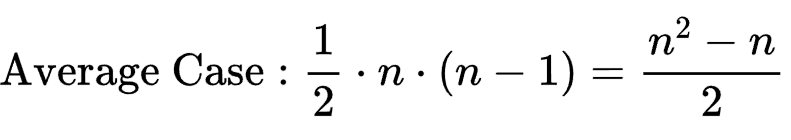
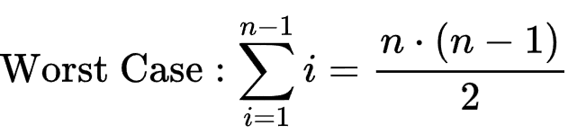

# CSC3100 Assignment 1

**Possible Solutions**

1\. A viable approach to this sorting problem is to employ merge sort, a divide-and-conquer algorithm that guarantees a stable O(n log n) time complexity. The essence of merge sort lies in dividing the list into smaller sublists, sorting those, and then merging them back together in a sorted manner.

2\. Another effective solution is to use quick sort. Quick sort selects a 'pivot' element and partitions the other elements into two sub-arrays, according to whether they are less than or greater than the pivot. This is followed by recursively sorting the sub-arrays.

**Solution Description**

1\. Conversion to 2D Points: For each integer in the input list, calculate the x and y coordinates by dividing the integer by \`k\` and taking the remainder, respectively. This transforms the problem into a 2D sorting problem.

2\. Sorting: Implement a sorting function that sorts the list of 2D points. Inside this function, use the C++ \`sort\` function. Depending on the value of \`id\`, define a custom comparator that implements one of the four specified sorting methods. The comparator compares two points based on their x and y coordinates according to the rules described in the problem statement.

3\. Custom Comparators: For each of the four sorting methods, define a comparator. These comparators take into account both the x and y coordinates, sorting primarily by x and secondarily by y, with the specifics depending on the \`id\`.

4\. Output: After sorting, output the sorted list of points according to the specified format.

**Why This Solution is Superior**

1\. Efficiency: The sort function is optimized and generally performs better than a manually implemented sorting algorithm, especially for large datasets.

And the time complexity of this solution is:



> 

2\. Readability and Maintainability: It separates the sorting logic from the sorting mechanism, which makes the code more readable.

3\. Flexibility: This approach allows for easy adjustments to the sorting criteria without altering the core sorting logic. Should new sorting methods need to be added, this can be done with small changes to the codebase.

Problem 2

**Possible Solutions**

1\. A direct approach is to iterate through each possible rectangle on the map and summing the Tyranids within these rectangles. This involves five nested loops: two to select the top-left corner of the rectangle, two to select the bottom-right corner, and one to sum the Tyranids within the rectangle.

2\. A more complex approach pre-computes the sums over all rectangles in a way that any rectangle's sum can be quickly calculated using these pre-computed values.

**Solution Description**

1\. Initialization: Create a prefix sum matrix of size (n+1) x (m+1), initialized with zeros. This matrix is used to store the cumulative sum of Tyranids up to each point (i, j) from the origin (1, 1).

2\. Populating the Prefix Sum Matrix: Iterate through the galaxy map, updating the prefix sum matrix with the number of Tyranids in each grid. For each cell (a, b), the value is calculated by adding the current cell's Tyranids to the sum of the cells above and to the left of (a, b), then subtracting the cells that were counted twice (the cell diagonally up-left to (a, b)) to avoid double counting.

3\. Calculating Rectangles' Sums: To find the sum of Tyranids in all possible rectangles, iterate through all possible top-left and bottom-right corners of rectangles. Use the prefix sum matrix to quickly calculate the sum of Tyranids in each rectangle. This step exploits the property of the prefix sum matrix to compute the sum in constant time, regardless of the rectangle's size.

4\. Modular Arithmetic: Since the result may be very large, all calculations are done modulo 998244353 to ensure that the final result fits within the range of a 64-bit integer.

**Why This Solution is Superior**

1\. Efficiency: It significantly reduces computational complexity from O(n^2 \* m^2 \* p) in the brute-force approach to O(n \* m) for populating the prefix sum matrix and O(n^2 \* m^2) for calculating the sums of all rectangles, which is more feasible for larger inputs.

2\. Modularity: The use of modular arithmetic ensures that intermediate and final results remain within the bounds of integer data types, preventing overflow and ensuring correctness.

3\. Scalability: This method can handle large inputs efficiently, making it suitable for the problem's constraints where n, m, and p can each be up to 10^5, and k up to 10^9.

### `A1_P1_[ID].cpp`

```cpp
#include <iostream>
#include <vector>
#include <string>
#include <sstream>
using namespace std;

vector<vector<int>>sort_point(int n, int k, int id, vector<int> list_A) {
	vector<vector<int>> list_point(n);
	for (int i = 0; i < n; i++) {
		int temp = list_A[i];
		list_point[i] = vector<int>{ temp / k , temp % k };
	}

	int i, j;
	vector<int> key;

	for (j = 1; j < n; j++) {
		key = list_point[j];
		i = j - 1;

		switch (id) {
		case 1:
			while (i >= 0 && (list_point[i][0] > key[0] 
				|| (list_point[i][0] == key[0] && list_point[i][1] > key[1]))) {

				list_point[i + 1] = list_point[i];
				i = i - 1;
			}
			break;

		case 2:
			while (i >= 0 && (list_point[i][0] < key[0] 
				|| (list_point[i][0] == key[0] && list_point[i][1] > key[1]))) {

				list_point[i + 1] = list_point[i];
				i = i - 1;
			}
			break;

		case 3:
			while (i >= 0 && (list_point[i][0] > key[0] 
				|| (list_point[i][0] == key[0] && list_point[i][1] < key[1]))) {

				list_point[i + 1] = list_point[i];
				i = i - 1;
			}
			break;

		case 4:
			while (i >= 0 && (list_point[i][0] < key[0] 
				|| (list_point[i][0] == key[0] && list_point[i][1] < key[1]))) {

				list_point[i + 1] = list_point[i];
				i = i - 1;
			}
		}

		list_point[i + 1] = key;
	}

	return list_point;
}

int main(int argc,char *argv[]) {
	string line;
	getline(cin, line);

	int total_num = stoi(line);

	while (total_num--) {
		int n, k, id;
		getline(cin, line);
		istringstream para_iss(line);
		para_iss >> n >> k >> id;

		vector<int> list_A(n);
		getline(cin, line);
		istringstream A_iss(line);
		for (int i = 0; i < n; i++) {
			A_iss >> list_A[i];
		}

		vector<vector<int>> sorted_list = sort_point(n, k, id, list_A);

		for (int i = 0; i < n; i++) {
			cout << sorted_list[i][0] << " " << sorted_list[i][1] << endl;
		}
	}
}
```

### `A1_P2_[ID].cpp`

```cpp
#include <iostream>
#include <vector>
#include <sstream>
using namespace std;

long long calculate_Ty(int n, int m, vector<vector<int>> list_Ty) {
	long long result = 0;
    vector<vector<long long>> pre_sum_matrix(n + 1, vector<long long>(m+1, 0));
    const int MOD_PARA = 998244353;

    for (int a = 1; a <= n; a++) {
        for (int b = 1; b <= m; b++) {
             pre_sum_matrix[a][b] = (
                 list_Ty[a][b] 
                 + pre_sum_matrix[a][b - 1] 
                 + pre_sum_matrix[a - 1][b] 
                 - pre_sum_matrix[a - 1][b - 1]
				 ) % MOD_PARA;
            
        }
    }

	long long temp_sum = 0;

	for (int a = 1; a <= n; a++) {
		for (int b = 1; b <= m; b++) {

			for (int c = a; c <= n; c++) {
				for (int d = b; d <= m; d++) {
					temp_sum = (
						pre_sum_matrix[c][d]
						- pre_sum_matrix[c][b - 1]
						- pre_sum_matrix[a - 1][d]
						+ pre_sum_matrix[a - 1][b - 1]
						) % MOD_PARA;
					result = (result + temp_sum) % MOD_PARA;

				}
			}

		}
	}

	return result;
}

int main() {
	string line;
	getline(cin, line);
	
	int n, m, p;
	istringstream iss_first_line(line);
	iss_first_line >> n >> m >> p;
	
	vector<vector<int>> list_Ty(n + 1, vector<int>(m + 1, 0));
	for (int l = 0; l < p; l++) {
		int i, j, k;
		getline(cin, line);
		istringstream iss(line);
		iss >> i >> j >> k;
		list_Ty[i][j] += k;
	}
	
	long long result = calculate_Ty(n, m, list_Ty);

	cout << result << endl;

	return 0;
}
```
