10 Queue

two constrained updates – for the set that a queue stores

Enqueue(e) & Dequeue( )

First-In-First-Out (FIFO)

Typical type of queues

- Linear queue and its implementations

- Circular queue

- Priority queue

- Double ended queue

Linear queue

a linear data structure that follows the FIFO

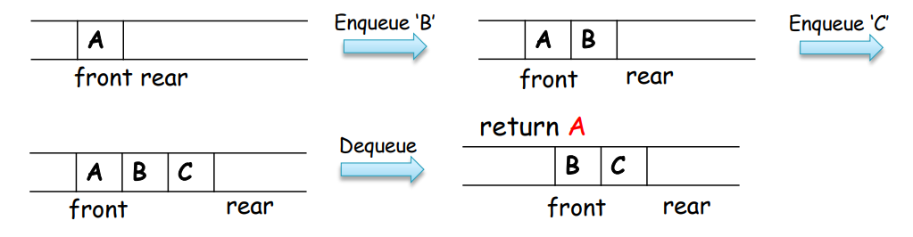

Design with linked list

createQueue: create a linked list

enqueue: add an element to the end of the linked list

dequene: retrieve the first element, and delete the first node

isEmpty: return true if the linked list is empty, otherwise return false

isFull: always return false

Design with array

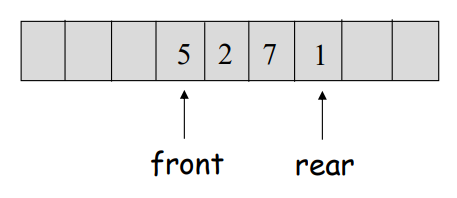

(Implementation:) 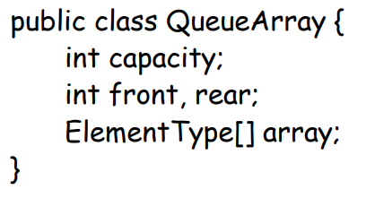

Enqueue: array\[rear\] = X → increase size → increase rear ( \_ (?)\_ \_\_)index

Dequeue: return array\[front\] → decrease size → increase front ( \_\_(?) \_ \_)index

**Problem**:

> 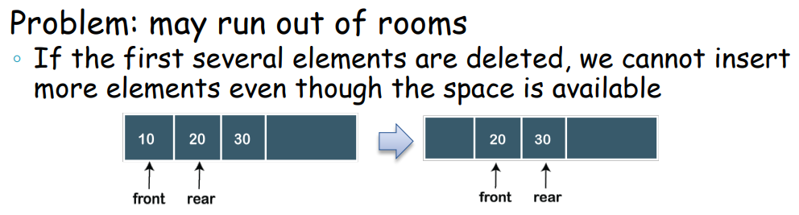
>
> Solutions:
>
> ① (inefficient) <u>Keep front always at 0</u> by <u>shifting the contents up the queue</u>
>
> ② Use a <u>circular queue</u>

Circular queue

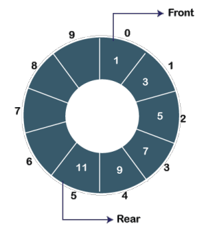 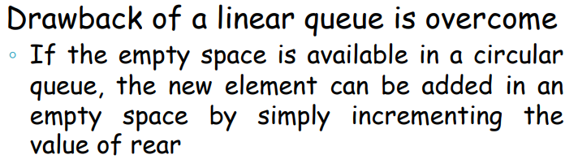

The last element is connected to the first one <u>through Ring Buffer</u>

Enqueue:

> First, check whether the queue is full or not
>
> 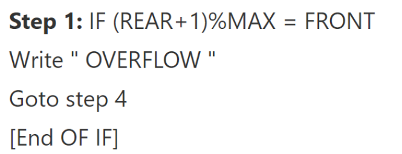
>
> Initially set both front and rear to -1; to insert the first element, both front and rear are set to 0
>
> 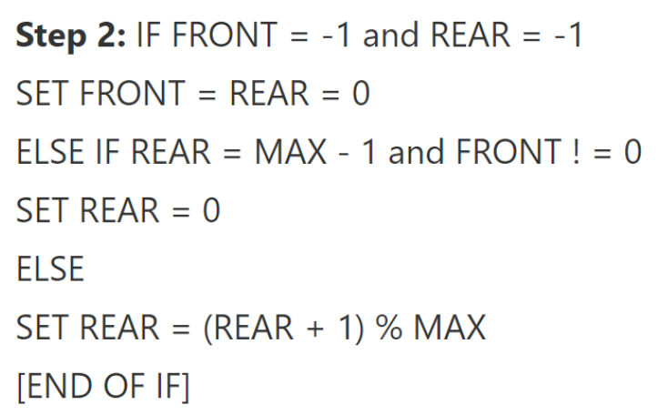
>
> To insert a new element, the rear gets incremented
>
> 
>
> 

Dequeue:

> First, check whether the queue is empty or not, and if the queue is empty, we cannot perform the dequeue operation
>
> When the element is deleted, the value of front gets incremented by 1
>
> If there is only one element left to be deleted, then the front and rear are reset to -1
>
> 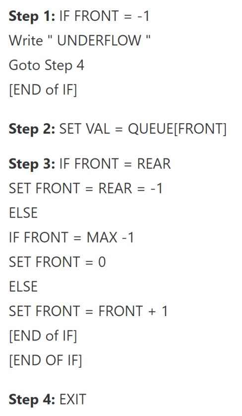
>
> ……

11 Quicksort

-Main features of Quicksort

Very fast known sorting algorithm in practice

Average running time is O (n logn)

Worst case performance is O (n^2) (but very unlikely)

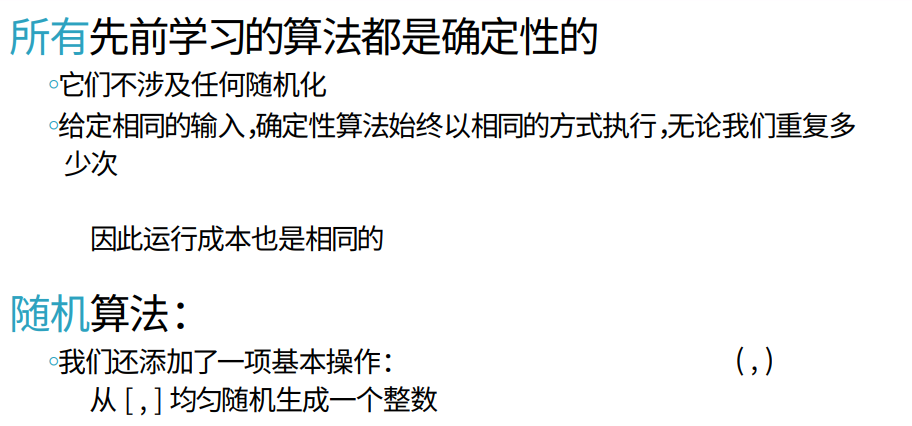（(x, y), \[x, y\]）

……

-Deterministic & Randomized

-Randomized algorithms

-The expected running cost = E(X)

(X: a random variable of the time cost,

> i.e., number of basic operations of a randomized algorithm on an input)

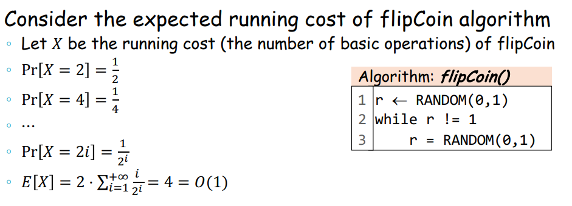

-Quicksort (randomized implementation)

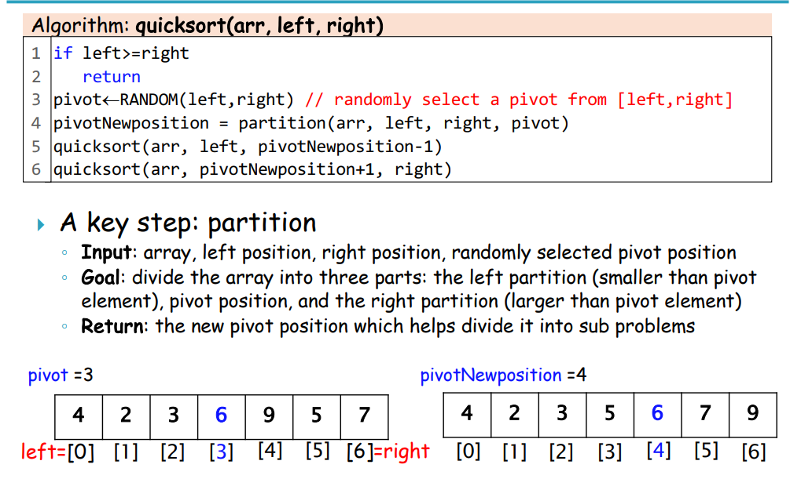

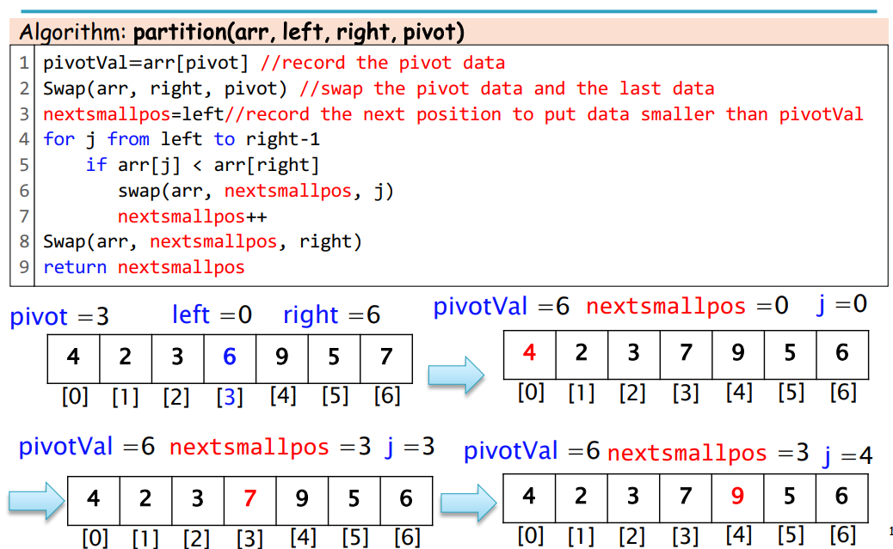

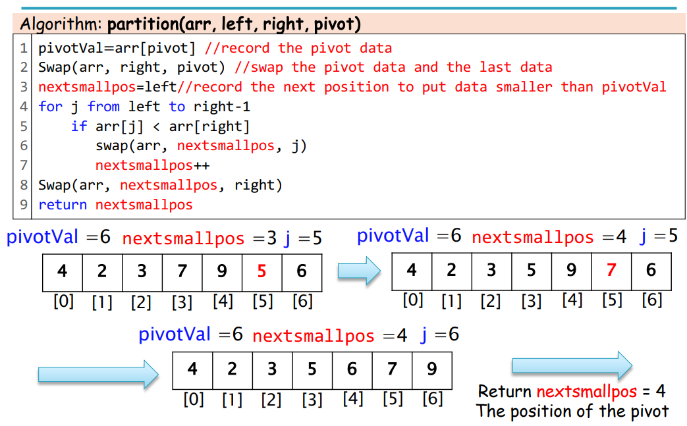

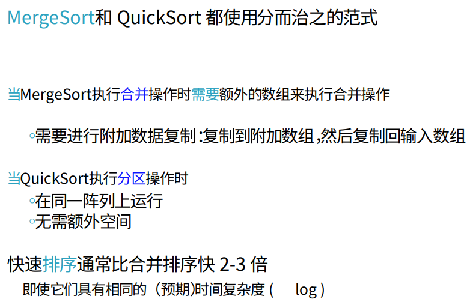

-Quicksort (other implementations)

……

……

L12 More sorting algorithms

-Shellsort (基于⽐较)

-Countingsort (⾮基于⽐较)

-Bucketsort (⾮基于⽐较)

-Radixsort (⾮基于⽐较)

-10 classic sorting algorithms

L13 Tree & binary tree

Tree def.: 。。。

A tree with N **nodes** has N-1 **edges**

Every node in the tree is the root of some subtree (recursive definition)

> Parent
>
> Def.: Node A is the parent of node B if B is the root of the left or right sub-tree of A
>
> Left (right) child
>
> Def.: Node B is the left (right) child of node A if A is the parent of B
>
> Sibling
>
> Def.: Node B and node C are siblings if they have the same parent
>
> Leaf
>
> Def.: A node is called a leaf if it has no children
>
> A <u>**path** from node n1 to nk</u>
>
> A sequence of nodes n1, n2, …, nk, s.t. ni is the parent of ni+1 for 1 ≤ i \< k-1
>
> <u>**Length** of a path</u>
>
> Def.: The length of this path is the number of edges on the path, namely k-1
>
> Note: in a tree, there is exactly only one path from the root to each node
>
> Depth of a node
>
> Def.: The depth of a node ni is the length of the unique path from the root to ni
>
> Note: The root is at depth 0
>
> Height of a node
>
> Def.: The height of a node ni is the length of the longest path from ni to a leaf
>
> Note: All leaves are at height 0
>
> (Special def.)
>
> <u>height</u> of the <u>tree</u> = <u>height</u> of the <u>root</u>
>
> = depth of the tree = depth of the deepest leaf
>
> = maximum height = maximum depth

Binary tree

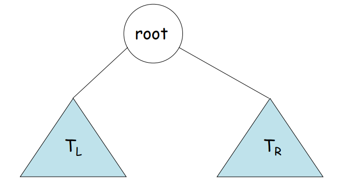

Full binary tree

每个node的children数量为：0或2

Complete binary tree

all the levels are completely filled - except possibly the lowest one

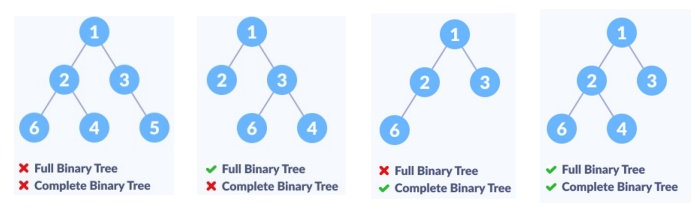

ADT

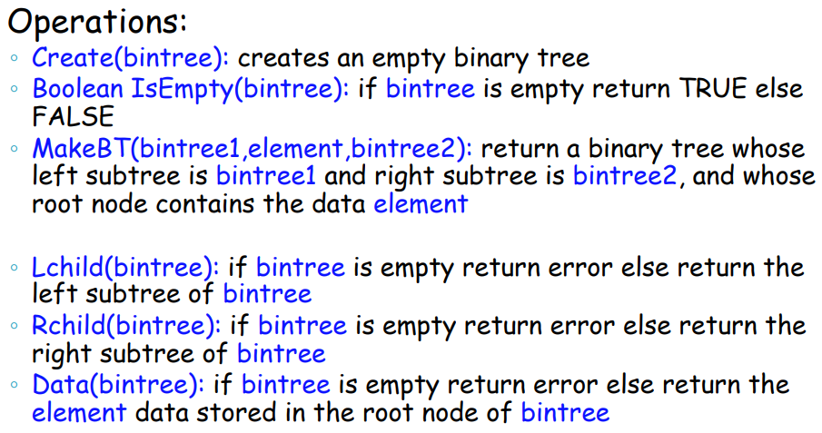

Design (using pointers)

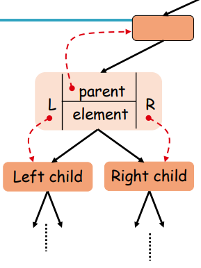

……

Design (using array)

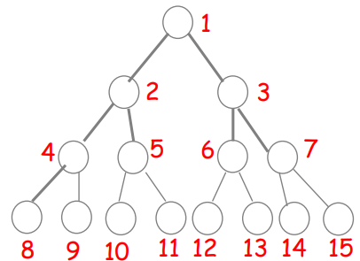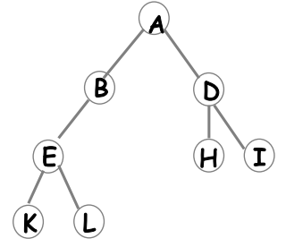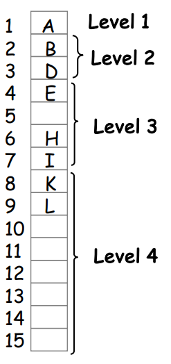

<u>For</u> any **<u>i-th node</u>** (1 ≤ i ≤ n)

> **parent(i)**: **i/2**
>
> **leftChild(i)**: if 2·i ≤ n: **2·i**
>
> otherwise: (node(i)) has <u>no left child</u>
>
> **rightChild(i)** : if 2·i+1 ≤ n: **2·i+1**
>
> otherwise: (node(i)) has <u>no right child</u>

Traversing

3 strategies:

Preorder (depth-first): 当前node → 左树 → 右树

Inorder: 左树 → 当前node → 右树

Postorder: 左树 → 右树 → 当前node

Implementation

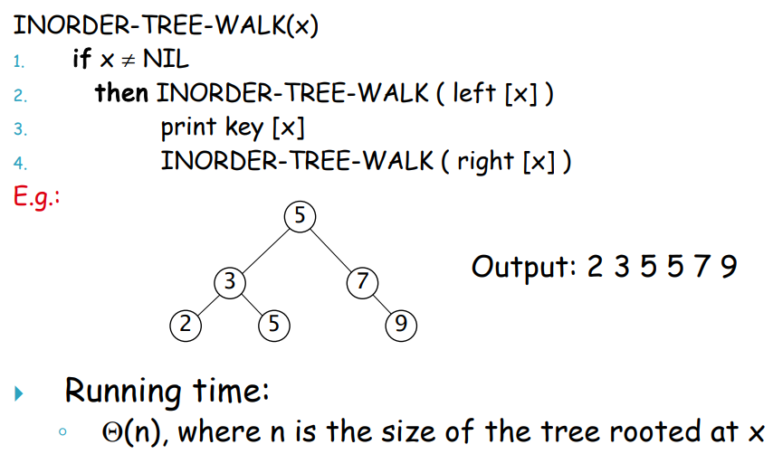

Reconstruction

(?) **Reconstruction** of a binary tree from its **preorder and inorder sequences**

A binary tree may **not be uniquely defined**

> by its **preorder and postorder sequences**

E.g.: by using the sequences: inorder: DCEBAUZTXY

> preorder: ABCDEXZUTY

find the corresponding binary tree

Sol.: ……

L14 Binary search tree

Binary search tree

Def.: a tree that

For each node:

the key values in its left subtree (左树) \< the node’s key value

the key values in its right subtree (右树) \> the node’s key value

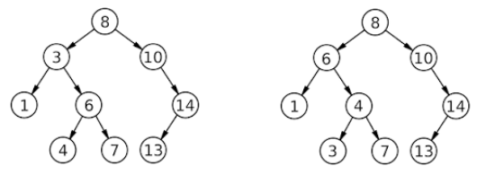

L18 Hashing

L20 Minimum spanning tree

-Minimum spanning tree (MST)

Spanning tree 生成树

> 给定一个连通图，生成树（即连通的非循环图）包含该图的所有顶

Minimum spanning tree 最小生成树 （MST）

> 具有最小权重和的生成树
>
> 如果graph is not connected，则graph的每个connected component都有一个 MST
>
> Problem def.: 给定一个无向加权（连接） (undirected weighted (connected)) graph，找到一组边edges，以便
>
> （1） 每个人都保持连接
>
> （且）（2） 总成本最小

Application of MST

> 找到最便宜的方式连接一组房屋、城市、终端、计算机等。

Properties of MST:

（1）MST不是唯一的

> （2）MST没有循环 (MST has no cycles;)

……

找到MST

Idea: add only “safe” edges

**Safe edges (def.)**: An edge (u, v) is safe for A

> ⇔ A ∪ {(u, v)} is also a subset of some MST

E.g.: (h, g) is safe for A initially

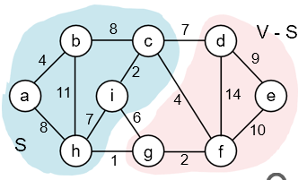

> Reason:
>
> 设 S ⊂ V 是包含 h 但不包含 g 的任何顶点集（因此 g 在 V - S 中）
>
> 在任何 MST 中，必须（至少）有一条边将 S 与 V - S 连接起来
>
> (Q: 何不选择 (h, g) 权重最小的edge？)

Generic MST algorithm

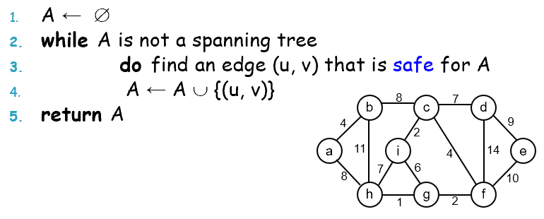

**Cut**

Def.: A cut (S, V - S) is a partition of vertices into two disjoint sets S and V - S

<u>Edge</u> **crosses** a cut

Def.: The edge crosses the cut (S, V - S)

> if one endpoint is in S and the other in V – S

A cut **respects** a set A of edges ⇔ no edge in A **crosses** the cut

An edge is a **light edge** crossing a cut ⇔ its weight is minimum over all edges crossing the cut

(for a given cut, there can be \> 1 light edges crossing it)

Thm.: $`\left\{ \begin{array}{r}
A\ be\ a\ subset\ of\ some\ MST \\
(S,\ V\  - \ S)be\ a\ cut\ that\ respects\ A \\
(u,\ v)be\ a\ light\ edge\ crossing\ (S,\ V - S)
\end{array} \right.\`$ ⇒ $`(u,\ v)\ is\ safe\ for\ A`$

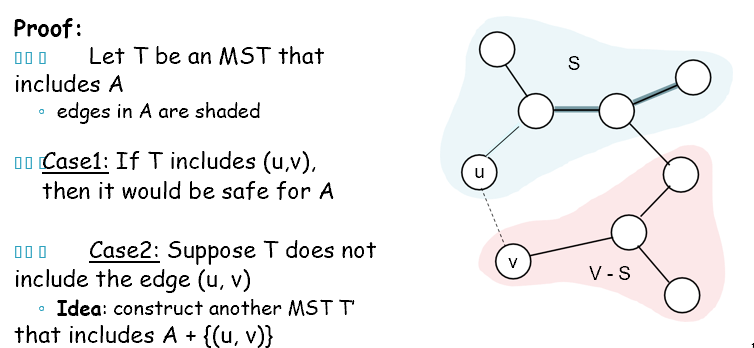

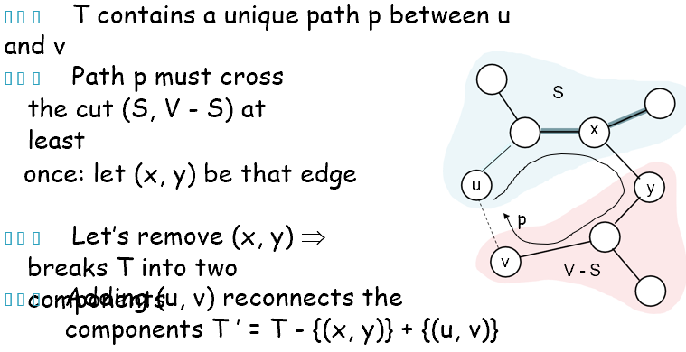

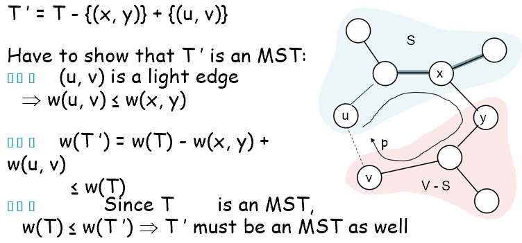

Prim’s algorithm

……

Kruskal’s algorithm

……

(Algorithm 1) naïve method

……

(Algorithm 2) using labels

……

……

L21 Graph shortest path

Model the problem as a graph problem:

vertices = cities

edges = road segments between cities

edge weights = road distances

不同的最短路径

Single-source shortest paths 单源最短路径

> G = (V, E) 找到从给定源顶点 s 到每个顶点 v ∈V 的最短路径

Single-destination shortest paths 单目的地最短路径

> 从每个顶点 v 找到到给定目标顶点 t 的最短路径
>
> 反转每个边edge的方向 → 单源 single-source

Single-pair shortest path 单对最短路径

> 对于给定的顶点 u 和 v 找到从 u 到 v 的最短路径

All-pairs shortest-paths 全对最短路径

> 为每对顶点 u 和 v 找到从 u 到 v 的最短路径

Optimal substructure theorem

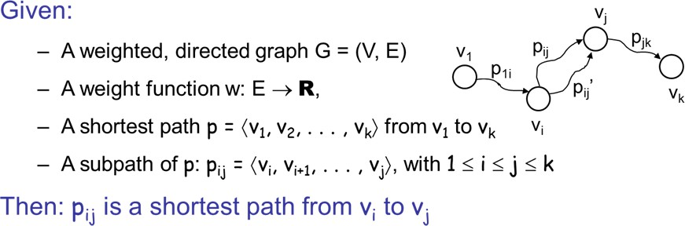

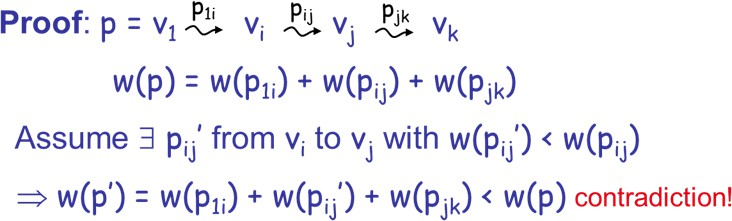

Triangle inequality

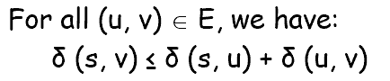

Shortest paths canNOT contain cycles

<u>Negative-weight cycles</u>: × CANNOT

> Shortest path is not well defined

<u>Positive-weight cycles</u>: × CANNOT

> By removing the cycle, we can get a shorter path

Unweighted graph for sshortest path

……

……

L22

Graphs with non-negative weights:

-Single-Source Shortest Path: Dijkstra’s algorithm

​-All-Pair Shortest Path: Floyd’s algorithm

Graphs with negative weights:

-Bellman-Ford algorithm

（Q1: 找到图中每对顶点之间的最短距离/路径）

All-Pair Shortest Path

Weight matrix

W(i, j) = 0 —— if i = j

> W(i, j) = ∞ —— if there is no edge between i and j
>
> W(i, j) = “weight of edge”
>
> 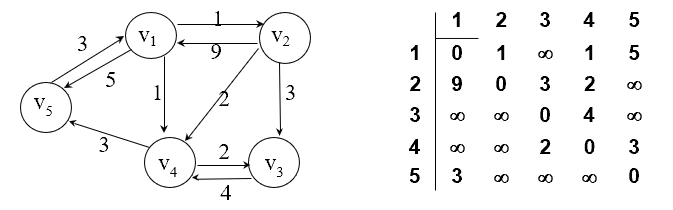

A naive method: Run a single-source shortest path algorithm for each vertex

> 1\. Run Dijkstra’s algorithm \|V\| times
>
> 2\. Dijkstra’s algorithm’s time complexity: O(\|E\| x log\|V\|)
>
> Total time cost: O(\|V\| x \|E\| x log\|V\|)

2\. Floyd’s algorithm

> Total time cost: O(\|V\|3)
>
> (For **dense graphs**, <u>Floyd’s algorithm</u> is **faster**)
>
> (It is easier to implement)

主要想法：

> 一种方法是将路径限制为仅包含受限子集中的顶点
>
> 最初，子集为空
>
> 然后，它逐渐增加，直到它包含所有顶点

（Q1.1：如何由D^(k-1)计算D^(k)？

> (Let D^(k) \[i, j\] = weight of a shortest path from vi to vj using only vertices from {v1,v2,…,vk} as intermediate vertices in the path
>
> D(0) =W
>
> D(n) =D which is the goal matrix)）

Case 1：从vi到vj的最短路径仅限于使用 {v1,v2,…,vk} 中的顶点作为中间顶点，

> **不使用 vk**。
>
> →→ D(k)\[i,j\] = D(k-1)\[i,j\]

Case 2：从vi到vj的最短路径仅限于使用 {v1,v2,…,vk} 中的顶点作为中间顶点，

> 但**使用了 vk**。
>
> →→ D(k)\[i,j\] = D(k-1)\[i,k\]+ D(k-1)\[k,j\]

(Case 1 + Case 2 ⇒⇒ D(k)\[i, j\] = min{ D(k-1)\[i, j\], D(k-1)\[i, k\] + D(k-1)\[k, j\] })

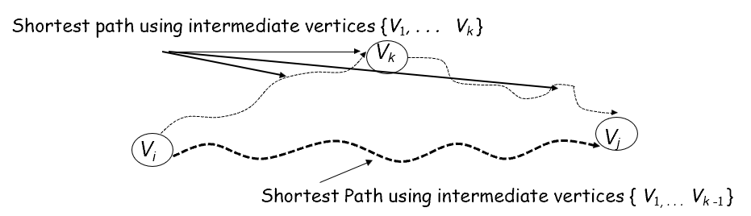

……

**L24**

DAG (Directed acyclic graph)

Def.: A directed graph that contains no cycles

To check: 在整个graph上用DFS

> 1\. 随机生成节点的排列
>
> 2\. 在排列中选择第一个白色节点 s 并执行 DFS（在 DFS 期间，我们将为节点着色，并记录时间戳）
>
> 3\. 重复2.中的操作，直到没有白色节点

E.g.:

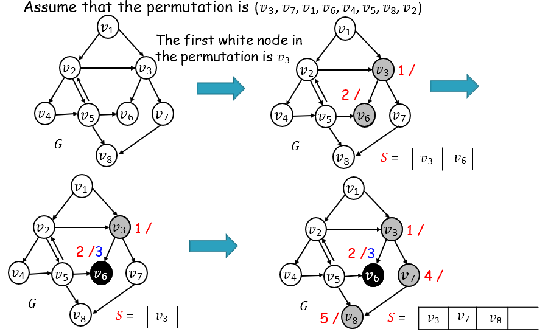

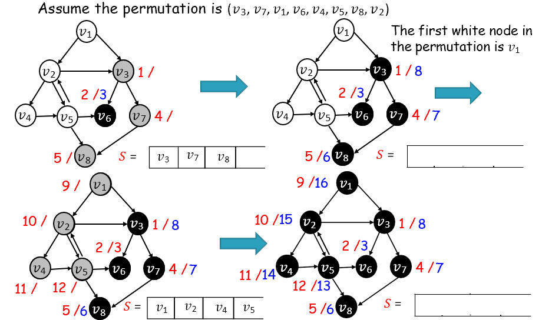

Result:

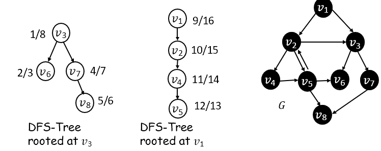

> (?) 1. v3 是 DFS 树中 v8 的祖先，根在 v3
>
> 2\. v5 是 DFS 树中 v1 的后代，根在 v1
>
> 3\. v1 或 v3 都不是另一个的后代
>
> -- Edge classification
>
> G 中的一个edge \<u, v\> 可为三类之一：
>
> forward edge：u 是其中一个 DFS 树中 v 的祖先
>
> backward edge：u 是其中一个 DFS 树中 v 的后代
>
> cross edge （？？？）：\<u, v\>既不是forward edge也不是backward edge
>
> 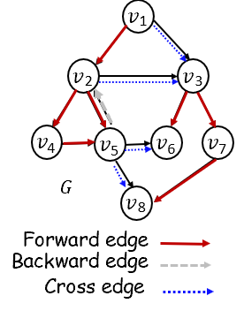

Interval property

……

Cost for edge classifications

……

Cycle theorem

A graph G contains a <u>cycle</u> ⇔ ∃a <u>backward edge</u> in the <u>DFS</u> result on G

检测cycle的总方法

\- 第 1 步：在图形G上执行DFS遍历

> 时间复杂度：O(n+m)（排列可以在O(n)中完成）

\- 第 2 步：根据DFS派生的每个节点的interval对edge进行分类

> 时间复杂度：O(m)

\- 第 3 步：如果存在backward edge，则G包含一个循环，否则G是DAG

\- 总时间复杂度：O(n+m)

Connected (Undirected) Graphs

Connected graph

Def.: 一个graph，每个顶点都通过某种path连接到其他每个顶点

> 不需要每个顶点都具有指向其他每个顶点的edge
>
> 有一些方法可以从每个顶点到达每个其他顶点

Connected component

Def.: 一个subgraph，其中任意两个顶点通过某种path连接，但不连接到supergraph中的其他顶点

> 没有边的顶点本身就是一个connected component

Strongly Connected Component (SCC)

（？？）一个subgraph C，其中的每对顶点都通过某个path来<u>双向</u>连接，并且没有其他（？）顶点能与C的每个顶点<u>双向</u>连接。

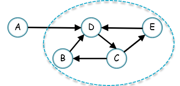

……
