Ch13 溶液

\-**Solute (n.)溶质**

**-Solvent (n.)溶剂**

-The ability of substances to form solutions

depends on取决于

1.natural tendency toward mixing

2.intermolecular forces

-Mixing causes more randomness in the position of the molecules,

Increasing a thermodynamic quantity called entropy.

\-伴随着mixing的entropy↑，溶液的形成↑

\-<u>Any intermolecular force of attraction</u> (Chapter 11)(Dispersion, Dipole-dipole, Hydrogen bond, Ion-dipole) can be t<u>he attraction between solute and solvent molecules</u>.

------------------------------------------------------------------------

\-**supersaturated solution**: crystallization can usually be stimulated by adding a “seed crystal”\
or scratching the side of the flask.

------------------------------------------------------------------------

Factors That Affect Solubility

------------------------------------------------------------------------

1.  Solute–solvent Interactions

    the solute–solvent interaction↑, the solubility of a solute in that solvent↑

    The larger the gas↑, the more soluble↑ it will be in water. (?范德华力?)

    **miscible混溶的，immiscible不混溶的**

    2.Pressure (for gaseous solutes)

    Henry’s Law

    <u>The solubility of a gas</u> is proportional to <u>the partial pressure of the gas above the solution. </u>

    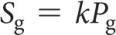 

    3.Temperature

    T↑，大多数固体溶解度↑

    T↑，所有气体溶解度↓

------------------------------------------------------------------------

-Units of Concentration

------------------------------------------------------------------------

Mass percentage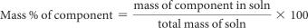; Parts per million (ppm) 10^6

------------------------------------------------------------------------

Parts per **billion十亿** (ppb) 10^9

------------------------------------------------------------------------

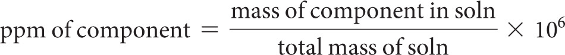

------------------------------------------------------------------------

Mole fraction;

------------------------------------------------------------------------

Molarity

------------------------------------------------------------------------

Molality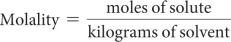

------------------------------------------------------------------------

当水是溶剂时，稀溶液具有相似的molarity 和molality; molality不随温度变化（质量不变）; molarity 随温度变化（体积变化）。

------------------------------------------------------------------------

-Colligative properties depend only on the quantity, not on the identity of the solute particles. 蒸汽压↓;沸点↑;凝固点↓;渗透压

------------------------------------------------------------------------

\-**the vapor pressure** of a solution \< the pure solvent.

------------------------------------------------------------------------

-Raoult’s Law

------------------------------------------------------------------------

挥发性溶剂在溶液上的蒸气压是溶剂的摩尔分数乘以纯溶剂蒸气压的乘积。

------------------------------------------------------------------------

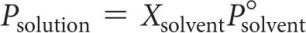 

------------------------------------------------------------------------

-Boiling-Point **Elevation升高** and Freezing-Point Depression(using the van’t Hoff factor)

------------------------------------------------------------------------

Vapor pressure↓，沸点↑，凝固点(熔点)↓

------------------------------------------------------------------------

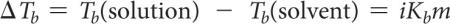 

------------------------------------------------------------------------

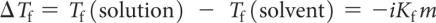 

------------------------------------------------------------------------

The van’t Hoff Factor (i): 解离到溶液中的粒子种数

------------------------------------------------------------------------

-The net movement of solvent molecules from solution of low to high concentration across a semipermeable membrane is **osmosis渗透**. The applied pressure to stop it is **osmotic pressure渗透压**.

------------------------------------------------------------------------

**semipermeable membranes半透膜**

------------------------------------------------------------------------

-Osmotic pressure is a **colligative(adj.)**碰撞的 property. 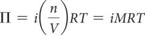 

------------------------------------------------------------------------

**-Isotonic solutions等渗溶液**

------------------------------------------------------------------------

**Hypotonic solution低渗溶液**

------------------------------------------------------------------------

**Hypertonic solution高渗溶液**

------------------------------------------------------------------------

**-colloids胶体**

------------------------------------------------------------------------

**Tyndall effect丁达尔效应**

------------------------------------------------------------------------

**hydrophilic亲水的(极性)；hydrophobic疏水的(非极性)**

------------------------------------------------------------------------

-Stabilizing Colloids by Adsorption

------------------------------------------------------------------------

离子可以粘附在其他疏水胶体的表面上。

------------------------------------------------------------------------

这允许它与水溶液相互作用。

------------------------------------------------------------------------

胶体可以帮助脂肪和油在水溶液中乳化。

------------------------------------------------------------------------

**emulsifier乳化剂**会导致通常不溶于溶剂的东西这样做。

------------------------------------------------------------------------

\-**Brownian Motion布朗运动**

------------------------------------------------------------------------

胶体由于与小得多的溶剂发生多次碰撞而引起的运动。

------------------------------------------------------------------------

------------------------------------------------------------------------

Ch14 化学动力学

-Factors that Affect Reaction Rates

1.  Physical state of the reactants

    反应物碰撞准备(???)↑，反应速度↑

    反应速度Homogeneous reaction \> Heterogeneous reaction.

    Heterogeneous reactions中，固体反应物表面积↑，反应速率↑

2.  Reactant concentrations

    反应物浓度↑，反应速率↑

    原因：分子数↑，碰撞数↑

3.  Reaction temperature

    温度↑，反应速率↑

    温度↑，分子运动速度↑，碰撞数↑，碰撞中分子拥有的能量↑，分子动能↑

4.  Presence of a catalyst

    催化剂影响碰撞的种类，改变机制（从反应物到产物的途径中的单个反应

    -Rate is dependent on **stoichiometry化学计量数**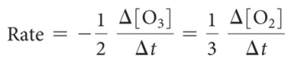

    **-First Order Reactions**: The rates depend only on one reactant to the first power.

    The rate law becomes: Rate = k\[A\]

    rate = k\[A\]

    k\[A\] = −Δ \[A\] / Δt

    rate = −Δ\[A\] / Δt

    Rearrange: ln\[A\] = −kt + ln \[A\]o

    →从图中找k，斜率为k

    E.g. , rate = k \[CH3NC\]

    (?A为反应物?)

    Half-life半衰期: ln 2 = k t½ or t½ = 0.693/k

    \-**Second Order Reactions**

    Def.: The rates depend only on a reactant to the second power.

    The rate law becomes: Rate = k\[A\]2

    k \[A\]2 = −Δ\[A\] / Δ t

    Using calculus: 1/\[A\] = 1/\[A\]o + k t

    E.g. NO2→NO+(1/2)O2

    Its second order rate = k\[NO2\]2

    Half-life半衰期: t½ = 1 / (k \[A\]o)

    So half-life is a concentration dependent quantity for second order reactions!

    -Zero Order Reactions

    rate is independent of the concentration of the reactant ; Rate = k

    These reactions are linear in concentration.

    -Factors That Affect Reaction Rate

<!-- -->

1.  Temperature

    温度每+10℃，Rate constant×2

2.  Frequency of collisions

    分子数↑ / 温度↑，分子速率↑

    →碰撞数↑，反应数↑，反应速率↑

3.  Orientation of molecules

    Bonds must be broken and made and atoms need to be in proper positions.

4.  Energy needed for the reaction to take place (activation energy)

    Def.: The minimum energy needed for a reaction to take place

    -Transition State (Activated Complex): The organization of the atoms at this highest energy state. ;在最高能量状态下，形成transition state

    在此之后，反应可以是吸热或放热

    Activation energy: The energy needed to form transition state

    \-能量↑，拥有反应发生所需的能量的分子数↑

    \- 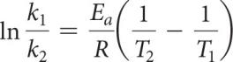Ea: 活化能T: 温度

    -Mechanism

    Def.: a series of stepwise reactions that show how reactants become products

    -Elementary Reaction (又: Elementary Process)

    Def.: Each of these processes (discrete steps) that reactions (may) occurs through.

    (反应可以同时发生，也可以通过几个离散的步骤发生。这些过程中的每一个都被称为基本反应或基本过程。)

    -Molecularity

    The molecularity of an elementary reaction

    ↓可知

    The number of molecules that are involved in that step of the mechanism

    -Termolecular steps三分子步骤

    require three molecules to **simultaneously(adv.)同时地** collide

    速率 \< unimolecular or bimolecular steps

    \-**the rate-determining step 决速步**

    -What is Required of a Plausible(adj.)合理的 Mechanism?

    The rate law必须能够从the rate-determining step中设计出来; 当所有步骤相加时，必须可以获得The stoichiometry; 每一步都必须平衡，就像任何方程式一样;所有intermediates都 被制成并被用完;任何catalyst催化剂都被使用 并再生

    -Catalysts催化剂: Activation energy is lowered, <u>allowing equilibrium to be established at lower temperatures</u>

    1.Homogeneous catalysts 均相催化剂

    The reactants and catalyst are in the same phase; reactants and catalyst are dissolved in the same solvent

    2.Heterogeneous catalysts 非均相催化剂

    Often: gases are passed over a solid catalyst; The **adsorption(n.)吸附** of the reactants is often the rate-determining step.

    3.Enzymes酶

    Active site: region where the reactants attach

    Substrates底物: The reactants are referred to as substrates

------------------------------------------------------------------------

Ch15 化学平衡

-For the <u>forward reaction</u>: N2O4(g) → 2NO2(g)

The rate law is: Ratef = kf \[N2O4\]

For the <u>reverse reaction</u>: 2NO2(g) → N2O4(g)

The rate law is: Rater = kr \[NO2\]2

Ratef = Rater

-the equilibrium constant (Keq)

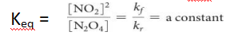

因k与反应物浓度为乘法关系，所以此处为反比 !

-the Haber Process: the industrial preparation of ammonia 氨的工业制备

-For gases, ,where 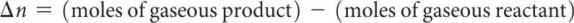

-K\>\>1 → favors products; K\<\<1...

\-**Consecutive(adj.)连续的,连贯的** Equilibria

K3 = K1×K2

-the concentration of a pure substance is 1

\-**Homogeneous equilibria 单相平衡**: all reactants and products are in the same phase.

\-**Heterogeneous equilibria 多相平衡**: something in the equilibrium is in a different phase.

\-**reaction quotient (Q)**: the current conditions

If Q \< K, the reaction is proceed to products. ;...

\-**LeChâtelier’s Principle 勒夏特列原理**

**counteract(v.)抵抗**

------------------------------------------------------------------------

Ch16 酸碱平衡

\-**Arrhenius 阿伦尼乌斯**: **Acid酸性物质** 是 溶解到水中，会增加H+的浓度 的物质; **Base碱性物质 ...**

\-**Brønsted–Lowry 布朗斯特-劳里**: An acid is a proton donor. A base

is a proton acceptor.

-Water is **amphiprotic(adj.)两性的**

\-**Conjugate(v.)结合**

-conjugate bases共轭碱

Acids above the line with H2O as a base are strong acids; Bases...

The substances between the lines with H2O are conjugate acid–base pairs in water.

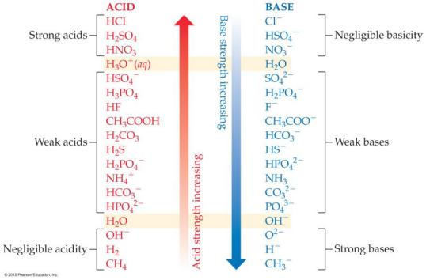

-Negligible (adj.)微不足道的

\-**Autoionization自电离** of Water

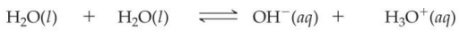

Kw: the ion product constant for water

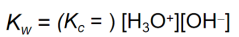 

At 25℃, Kw = 1.0×10-14

\- pH = -log\[H+\]

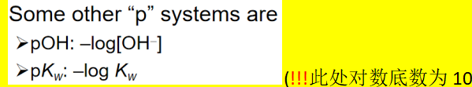

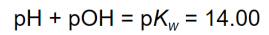

\-**litmus paper石蕊纸**, are used for less accurate measurements;

an **indicator指示器** is one color in its acid form and another color in its basic form.

**pH meters pH计** are used for accurate measurement of pH;

**electrodes电极** indicate small changes in voltage to detect pH.

-Strong Bases强碱: the alkali metal and heavier alkaline earth metal hydroxides (Ca2+, Sr2+, and Ba2+)

-Weak Acids 弱酸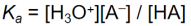

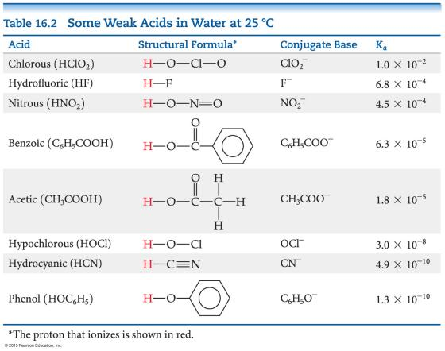

\-**dissociate (v.)解离**

电离程度→<u>difference in</u> conductivity and <u>in</u> rates of chemical reactions.

<u>Strong acids</u>: **Sulphuric acid**, H2SO4

**Hydrochloric acid**, HCl; **Nitric acid**, HNO3

From acidic oxides: SO2, SO3 , NOx

<u>Weak acids</u>: Partially ionized in solution,

**Hydrofluoric acid** , HF; **Acetic acid** CH3COOH

**Formic acid** HCOOH; **Benzoic acid** C6H5COOH

**Carbonic acid** H2CO3; **Phosphoric acid**, H3PO4

From: CO2 ,P2O3, P2O5

**versus sulfurous acid亚硫酸**

\-**Polyprotic Acids多质子酸**

**successive (adj.)逐次的，连续的**

If the factor in the Ka values for the first and second dissociation has a difference of 3 or greater, <u>the pH generally depends only on the first dissociation</u>.

\- 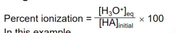 

-the base dissociation constant碱解离常数

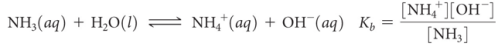 

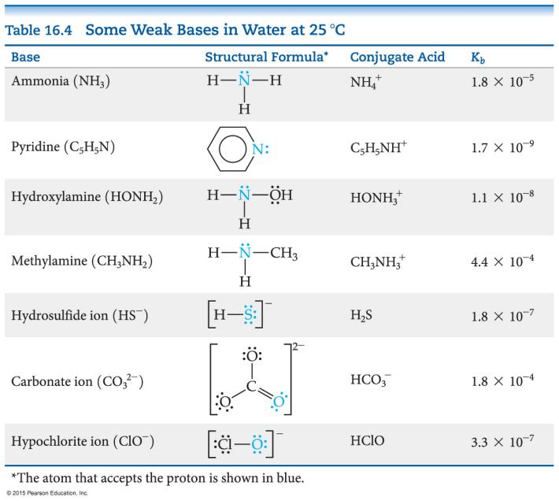

弱碱的种类

1.  Neutral substances

    with an Atom that has a nonbonding pair of electrons

2.  Anions of weak acids

    \-Ka × Kb = Kw

    \-**Hydrolysis水解; Cation阳离子; Anion阴离子**

    \-**Hydrated Cations 水合阳离子**

    Transition and post-transition metals form hydrated cations

    The water attached to the metal

    is more acidic than free water molecules

    ↓使得

    the hydrated ions are <u>acidic</u>.

    -S**alt Solutions 盐溶液** ~酸碱性判断

    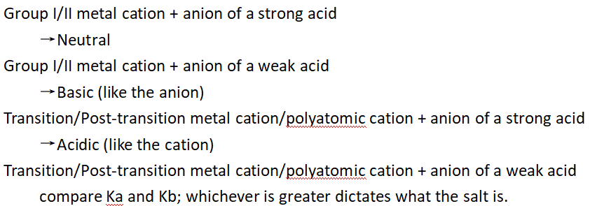

    \- H—A键越弱↓，酸的酸性越强

    阴离子稳定性越高↑，酸的酸性越强↑

    \-**Oxyacids (p.l.)含氧酸**

    非金属元素的电负性↑，具有相同结构的酸的酸性↑

    如果一种元素可以形成一个以上的含氧酸，

    则 具有更多氧(O)原子的氧酸 的酸性更强

    = If the oxidation number increases, the acidity increases. 氧化数↑，酸性增强↑

    -Carboxylic Acids 羧酸: <u>其共轭碱（**羧酸阴离子**）**具有共轭形式**以稳定阴离子</u>。

    -所有 Brønsted-Lowry酸和碱 也称为 Lewis酸和碱

    -Natural Indicators 自然的指示剂

    **Red cabbage红甘蓝** boiled in water yields **dyes(p.l.)染料**

    **Hydrangeas(p.l.)绣球花**

------------------------------------------------------------------------

Ch24 有机化学

-Molecules with long nonpolar regions and polar regions act as surfactants, bringing polar material into aqueous solution (used in detergents and soaps).

\-**Carboxylic acids羧酸**

(—COOH) the most common acids

\-**Amines胺** (—NH2, —NHR, or —NR2)

\-**Hydrocarbons碳氢化合物**

four basic types

**Alkanes烷烃, Alkenes烯烃, Alkynes炔烃, Aromatic hydrocarbons芳烃**

-Properties Common to Hydrocarbons

Are insoluble in water

Are nonpolar

Are soluble in nonpolar solvents

Dispersion forces

↓determine

Melting points and boiling points

\-**structural isomer结构异构体**

Def.: Compounds with the same molecular formula but different connections of atoms

**Butane丁烷**

2.  **Methylpropane 2-甲基丙烷**

    **Pentane戊烷**

    **2-Methylbutane 2-甲基丁烷**

    2,2-Dimethylpropane 2,2-二甲基丙烷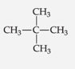

    \-**Systematic Nomenclature**

    

    \-**alphabetically(adv.)按字母顺序**

    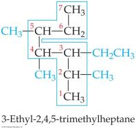

    \-**Cycloalkanes环烷烃**

    do not react with acids, bases, or **oxidizing agents氧化剂**

    the most important reaction is **combustion燃烧**

    2 C2H6(g) + 7 O2(g) → 4 CO2(g) + 6 H2O(l)

    (exothermic, ΔH° = –2885 kJ)

    \-**Cyclohexane环己烷**, **Cyclopentane环戊烷**, **Cyclopropane环丙烷**

    \-**vertex顶点**, **vertices顶点**

    -saturated hydrocarbons = alkanes

    饱和碳氢化合物 = 烷烃

    Unsaturated hydrocarbons are more reactive than saturated hydrocarbons

    -烯烃Alkenes的命名

    longest chain must include BOTH carbon atoms that share the double bond; <u>end name in -ene</u>; lowest number possible given to double-bond carbon atoms; isomers also indicated.

    \-**Geometric Isomers几何异构体**

    **cis isomer顺式异构体**

    **trans isomer反式异构体**

    -炔烃Alkynes的命名

    Naming: longest continuous chain containing both carbon atoms in the triple bond; name <u>ends in -yne</u> ; give C atoms in triple bond lowest number.

    \-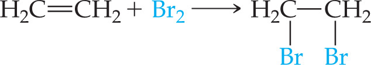

    **hydrogenation氢化**

    

    

    **hydrogen halides卤化氢**

    **halogenation卤化**

    -substitution reactions取代反应

    -additional reactions加成反应

    \-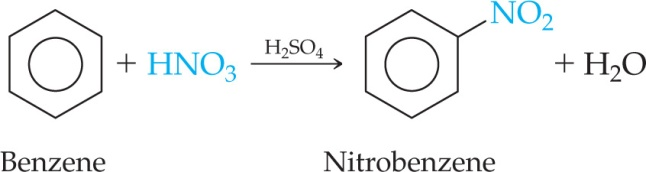

    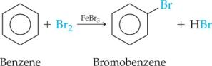

    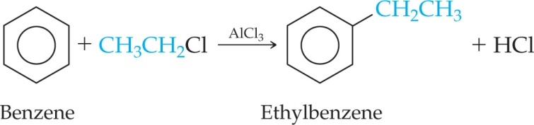

    \-**Aromatic Nomenclature芳香烃命名法**

    **derivatives of benzene 苯的衍生物**

    **1,2 = ortho- 邻位**

    **1,3 = meta- 见位**

    **1,4 = para- 对位**

    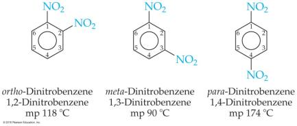

    Benzene

    Napthalene萘

    Anthracene蒽

    Toluene = Methylbeneze甲苯

    Pyrene芘

    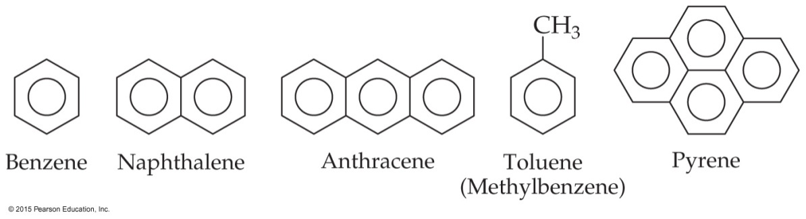

    -Functional Groups

    portion部分

    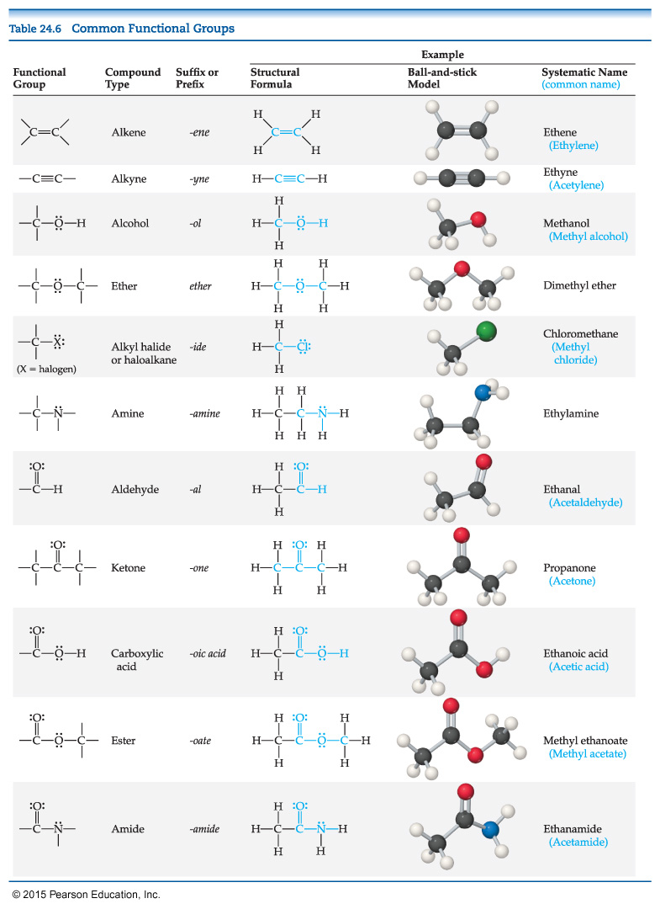

    \-**the alcohol group醇基** = **the hydroxyl group羟基**

    -醇以母烃命名;后缀更改为-ol

    **-Glycerol甘油 -Phenol苯酚 -Cholesterol胆固醇**

    \-**Ether醚** -**dehydration脱水**

    -diethyl ether乙醚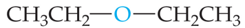

    -tetraydrifuran(THF)四呋喃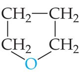

    \-**The carbonyl group羰基**

    **Aldehydes醛, Ketones酮,**

    **Carboxylic acids羧酸, Esters酯, Amides酰胺类**

    \-**methanal** = **formaldehyde甲醛**

    \-**ethanal** = **acetaldehyde乙醛**

    \-**propanone** = **acetone丙酮**

    \- **2-butnone** = **methyl ethyl ketone**

    **2-丁酮**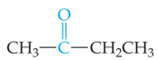

    \-**testosterone睾酮**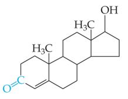

    -除水外最重要的溶剂是丙酮，它溶于水并溶解许多有机化合物。

    \-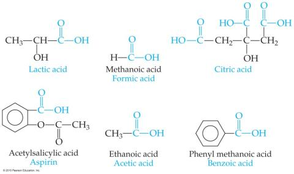

    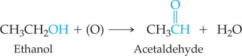

    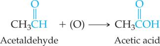

    -酯的命名

    Naming: name the alcohol part as an alkyl name; <u>separate word is the acid part as an -ate anion.</u>

    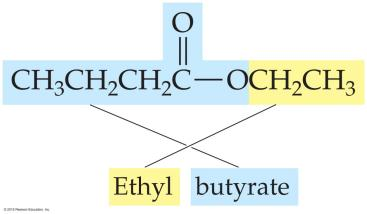

    \-

    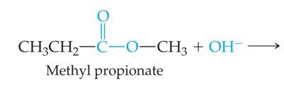

    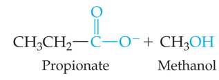

------------------------------------------------------------------------

Ch17

-pH = pKa + log(\[A–\]/\[HA\])

This equation is known as the Henderson–Hasselbalch equation. This applies only to buffers.

-The range of pH values over which a buffer system works effectively

Optimal pH: where pH = pKa(\[HA\] = \[A–\])

If one concentration is more than\
10 times the other, the buffering action is poor; this means that the pH range of a buffer is usually ±1 pH unit from pKa.
