注意读题！

注意读选项对应内容！\
<u>注意！H2O(水)有氢键！</u>

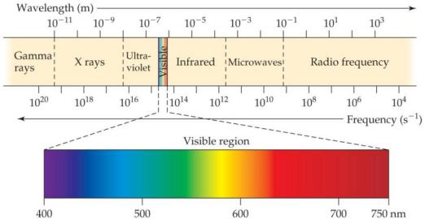

The Photoelectric Effect E=hν

h(Planck’s constant)=6.626×10−34 J∙s

Atomic Emissions

光速(c): 2.998×108 m/s 𝛌𝛎 = 𝐜

Work function 逸出功（功函数）

Monochromatic单色(光谱) (单波长)

Polychromatic多色(光谱) (多波长)

Continuous spectra 连续光谱

Line spectra 线性光谱

The Hydrogen Spectrum 氢原子光谱 

各原子光谱均不止一条线！

The Bohr Model 玻尔模型

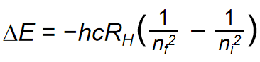

-RH (the Rydberg constant) = 1.097×107m−1

-ni the initial energy levels of the electron

-nf the final energy levels of the electron.

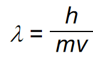

Uncertainty principle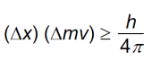

Probability density (electron density) 电子密度ψ2

角动量量子数(l)

-对应能级,轨道形状

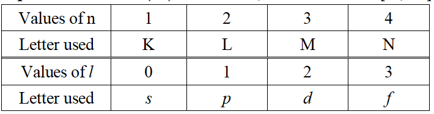

Magnetic Quantum Number (ml)

-对应轨道方向

Peak: 电子出现概率最高的地方

Node: 电子不可能出现的地方

degenerate orbitals 简并轨道

电子数↑, 电子间斥力↑

Spin QuantumNumber (ms) 自旋量子数 = +½ or –½

Electron Configurations 电子排布式

Orbital Diagrams 电子排布图

Condensed(adj.)精简的

valence electrons 价电子

core electrons: 充满的内层电子(含充满的d&f)

f区：lanthanides(p.l.)镧系元素 & actinides(p.l.)锕系元素 & inner transition elements 内过渡元素

Anomalies(p.l.)反常现象

充满轨道由于轨道能量，移除电子由<u>于轨道位置</u>

(ENC) Effective Nuclear Charge (Zeff)

Zeff = Z − S

S: Screening Constant: 同能层0.35 次一能层0.85 其他内部能层1

Zeff↑: 同周期→&同族(group)↑

芯电子对价电子：屏蔽作用

nonbonding atomic radius 未成键原子半径 = van der Waals radius 范德华半径

Zeff ↑，成键原子半径↓

同族↓，成键原子半径↑

Di\`anion二阶阴离子

isoelectronic series 等电子序列

Ionization Energy 电离能 (I)

Electron Affinity电子亲和势(e-×1)

\-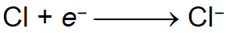常为放热(能)(-负的)

-同族=；同周期→，EA↑

-电负性↑→电子亲和势↓

稀有气体的电子亲和能为正(+)(吸热)

Metalloid类金属 (e.g. Silicon(Si))

Halogen (n.)卤素

The Alkaline Earth Metals碱土金属: 2A; **氧族: 6A**

**mon\`atomic单原子的**

**di\`atomic (adj.)双原子的**

Allotrope 同素异形体: 同元素单质，排列不同，性质不同 (e.g.红磷&白磷)

<u>Radioactive放射性的</u>

Electrostatic (adj.)静电的

Lattice energy晶格能(固→气所需能)↑: 离子电荷↑&离子大小↓

-Coulomb’s law: 

endothermic吸热的

exothermic放热的

dipole moment: μ = Qr (measured in debyes (D)) -e.g. D(C—H) = 413kJ

Oxidation 氧化

Formal charge = valence electrons - ½ (bonding electrons) - all nonbonding electrons

The dominant Lewis structure：

-FC→0 且 负FC→于电负性最大的原子

Resonance structure: 只由电子位置决定

定域电子：具体在1原子上/2原子间

Ethalpy键焓: 断掉1摩尔化学键所需能量

平均键焓为正(+)

ΔHrxn = Σ(全部断的键的键焓) - Σ(全部成的键的键焓)

<u>键数↑，键焓↑，键长↓</u>

Constructive建设性(?)

Destructive破坏性(?)

Antibonding molecular orbitals

e-填MO：低能到高能依次，能量bonding\<antibonding,

repel (v.)排斥

Diamagnetism抗磁性:MO中无不成对e-

Paramagnetism顺磁性:MO中有不成对e-

4 Tetrahedral 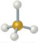

-1 trigonal pyramidal, -2 bent

5 Trigonal bipyramidal 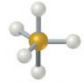

-1 Seesaw, -2 T-shaped, -3linear

6 Octahedral 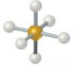

<u>-1 square pyramidal, -2 square planar</u>

1℃=273.15K

1.00 atm = 760 torr = 760 mm Hg = 101.325 kPa = 1.01325 bar

<u>R: gas constant (8.31 kPa• dm3•mol-1•K-1 = 8.31J•mol-1•K-1)</u>

**Boyle’s Law: PV = a constant**

**Charles’s Law: V = constant × T**

**Avogadro’s Law: 1. V = constant × n(气体分子子数) & 2. at STP, 1mol→22.4L**

**<u>STP: 0℃, 1atm</u>**

气体密度 d = MP/RT

气体摩尔质量M = mRT/PV

道尔顿分压定律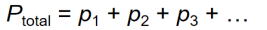

The mole fraction 摩尔分数 (χ)

(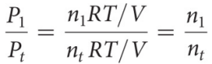)

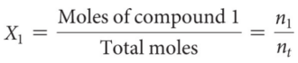

(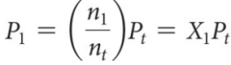)

tenet (n.)原则

negligible (adj.)可以忽略不计的，微不足道的

ump:分子最可能速度(最多分子速度)

uav:分子平均速度

urms:the root-mean-square speed,与平均动能相关

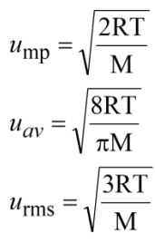同温，则各气体(1/2)m(urms)2相同

气体质量↓，速度↑

Effusion(n.)渗出：气体分子通过小孔转移

Diffusion (n.)扩散

<u>Graham’s Law = Effusion rate</u>

气体密度↓，渗出速率↑

Mean free path 平均自由程

colorless (adj.)无色的

odorless (adj.)无味的

现实气体相较于理想气体：

molecules do <u>attract others</u>: P\<Pideal, Z=PV/nRT\<1

molecules do <u>have volumes</u>: V\>Videal, Z=PV/nRT\>1

Deviation(n.)偏离

The Van Der Waals Equation范德华方程

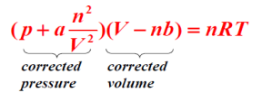

condensed phases 凝聚相：液&固体

物质状态取决于1.粒子的动能间的平衡, 2.粒子间的吸引的能量

Dispersion Force色散力: 非极性粒子

-由暂时极化产生

distort(v.)使变形

-色散力↑← : 电子数↑&大小or质量↑&分子more compact更致密

Ion-dipole forces强于氢键

dissolve (v.)使溶解

viscosity黏滞性↑←: 分子间作用力↑&温度↓

compact (adj.)致密的

Capillary action 毛细管作用

Cohensive force: 结合相似原子

Adhensive force: 结合平面与平面

melting熔化 / freezing凝固

vaporizing汽化 / condensing液化

subliming升华 /depositing凝华

<u>fusion</u>熔化(另用于热?)

Supercritical Fluids 超临界流体

compress (v.)压缩

同温，蒸汽压↑，Volatile挥发性↑

Normal沸点: at 1atm

临界压力: at 临界温度

**Nematic liquid crystals仅一维沿轴排列**

**Smectic liquid crystals二维度沿轴和层排列**

**Cholesteryic liquid crystals各层成角<u>度排列 </u>**

Crystalline solids晶体

Amorphous solids非晶体

Motif (n.)基元(???)

Oblique lattice 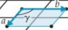

Square lattice 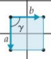

Rectangular lattice 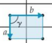

Hexagonal lattice 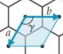

Rhombic lattice (centered rectangular lattice) 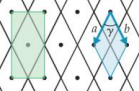

orthorhombic正交

tetragonal四方

monoclinic单斜

Rhombohedral菱方

Hexagonal六方

Triclinic三斜

Cubic close-packed

Hexagonal close-packed

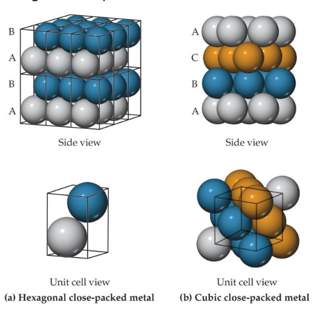

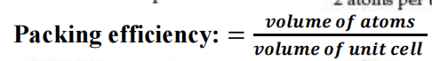

corner atoms被8个晶胞(??)共享

Metallic Bonding解释了：1. The electrical and thermal conductivity; 2. Ductility&Malleability延展性×2

Substitutional alloy

Interstitial alloy: solute atom塞进空隙空洞里

Heterogeneous alloy: 化合物分布不一致

Doping掺杂: 增加半导体导电性

p-type semiconductors

conduction band: Antibonding MO

Valence band: Bonding MO

电子必须通过conduction band转移

电负性之差↑, Band gap(Eg kJ/mol???)↑

**Quantum dots量子点:** 1–10 nm的半导体

**<u>Graphene(n.)石墨烯</u>**

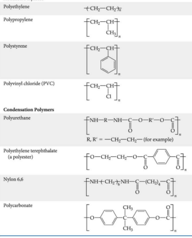Addition polymers:

Polyethylene

Polypropylene

Polystyrene

Polyvinyl chloride (PVC)

Condensation polymers:

Polyurethane

Nylon 6,6

Polycarbonate

Rubber 橡胶

meth\`yl甲基；meth\`ane甲烷

meth\`anol甲醇

di\`eth\`yl二乙基的；eth\`ylene乙烯

glycol乙醇；ethylene glycol乙二醇

Prop\`yl丙基

hydroxyl羟基

form\`ic acid甲酸 acet\`ic acid乙酸 prop\`ion\`ic acid丙酸

Eth\`yl acet\`ate乙酸乙酯

乙醛Acet\`aldehyde

ether醚

benzene苯

SO42- ：sulfate radical；SO32- ：Sulfite

CO32-：

H2CO3：carbonic acid

HCO3- ：Bicarbonate ions

HCl ：hydrochloride

inpurity杂质

almond杏仁

Interstitial空隙

Solute溶质

Solvent溶剂

Oxide氧化物；Denser密度

luster光泽；darkening黯淡

Ejection (n.)排出, 喷出

Current (n.)电流

Relativistic相对论(性质)的

photographic感光的

Subscript (n.)下标；superscript上标

Align (v.)使对齐

violate (v.)违反

Solar cell 太阳能电池

Vulcanize (v.)硫化

Entail (v.)需要

Tank (n.)容器

Heterogeneous (adj.)由很多种类组成的

depict描绘
