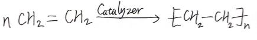

CHM 1001 General Chemistry

Assignment Answers

Name: <u>李彦锦</u> ; Student ID: <u>[ID]</u>

Part 1: Multiple-choice questions

|              |         |
|--------------|---------|
| Question No. | Answers |
| 1            | E       |
| 2            | D       |
| 3            | D       |
| 4            | E       |
| 5            | E       |
| 6            | D       |
| 7            | A       |
| 8            | E       |
| 9            | D       |
| 10           | B       |
| 11           | E       |
| 12           | A       |
| 13           | B       |
| 14           | A       |
| 15           | B       |
| 16           | D       |
| 17           | A       |
| 18           | C       |
| 19           | B       |
| 20           | E       |
| 21           | C       |
| 22           | E       |
| 23           | D       |
| 24           | B       |
| 25           | D       |
| 26           | C       |
| 27           | C       |
| 28           | C       |
| 29           | A       |
| Grades       |         |

Part 2: Short answer questions (You can add pages if needed)

1.  face-centered cubic lattice

2.  7mol × 22.4L/mol = 156.8L

3.  8×1022

<!-- -->

4.  chemical; physical

5.  

6.  √True

7.  increase
