Ch5 Thermochemistry

-Energy

Def.: the ability to do work or transfer heat.

-Kinetic Energy

> Def.: energy an object possesses by virtue of its motion
>
> 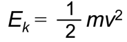

-Potential Energy

> energy an object possesses **by virtue of 凭借** its position or chemical composition.
>
> Electrostatic potential energy (Eel)
>
> 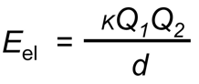
>
> The most important form of potential energy in molecules
>
> 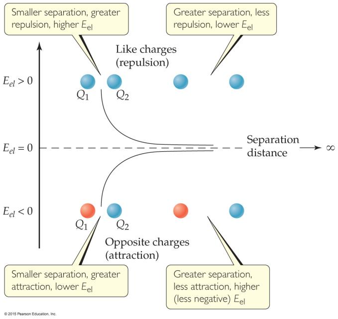

-Units of Energy

> SI unit: joule (J)
>
> 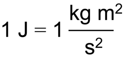
>
> non-SI unit: calorie (cal)
>
> 
>
> (Note: this is not the same as the calorie of foods; the food calorie is 1 kcal!)

-System and Surroundings

System

> includes the molecules we want to study

Surroundings

> everything else

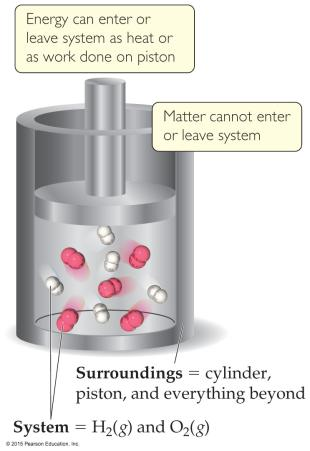

-Work

Def.: Energy used to move an object over some distance

w = F×d

w is work

F is the force

d is the distance over which the force is exerted

-Heat

Energy can also be transferred as heat.

Heat flows from warmer objects to cooler objects.

-Conversion of Energy

Energy can be converted from one type to another.

(e.g.?) Potential energy→Kinetic energy

-First Law of Thermodynamics

Energy is neither created nor destroyed.

The total energy of the universe is a constant

If the system loses energy, it must be gained by the surroundings, and vice versa.

-Internal Energy (E)

Def.: The internal energy of a system

> is the sum of all kinetic and potential energies of all components of the system

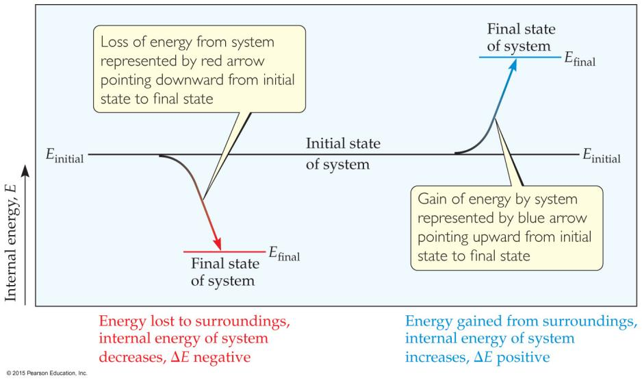

the change in internal energy (ΔE)

> Def.: the final energy of the system minus the initial energy of the system:
>
> 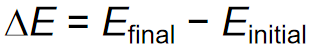

Changes in Internal Energy

> Endergonic
>
> ΔE\>0, Efinal\>Einitial, system absorbed energy from the surroundings
>
> Exergonic
>
> ΔE\<0, Efinal\<Einitial, system released energy from the surroundings
>
> When energy is exchanged between the system and the surroundings,
>
> it is exchanged as either heat (q) or work (w).

i.e. E = q + w.

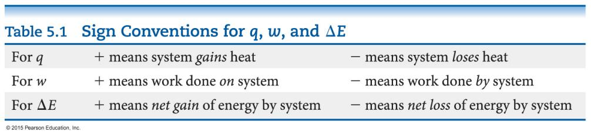

-Exchange of Heat between System and Surroundings

Endothermic

Def.: heat is absorbed by the system from the surroundings

Exothermic

Def.: heat is released by the system into the surroundings

-State Functions (???)

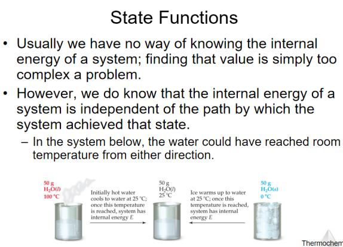

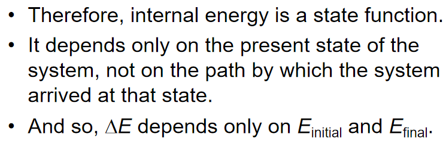

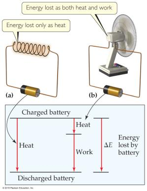

However, q and w are not state functions.

Whether the battery is shorted out or is discharged by running the fan, its ΔE is the same.

But q and w are different in the two cases.

-Work

In an open container,

(Usually) the only work done

is by a gas

pushing on the surroundings (or by the surroundings pushing on the gas).

We can measure the work done

by the gas

if the reaction is done in a vessel that has been fitted with a piston:

w = -PΔV

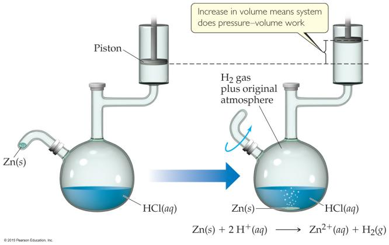

-Enthalpy

Def.: the internal energy plus the product of pressure and volume

If a process takes place at constant pressure (as the majority of processes we study do)

and the only work done is this pressure–volume work,

we can account for heat flow during the process by measuring the enthalpy of the system.

H = E + PV

When the system changes at constant pressure:

ΔH=Δ(E+PV)

( i.e. ΔH=ΔE + PΔV )

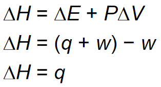So,

at constant pressure,

the change in enthalpy is the heat gained or lost.

-Endothermic and Exothermic

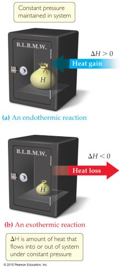

A process is endothermic when ΔH is positive.

A process is exothermic when ΔH is negative.

-Enthalpy of Reaction

the **enthalpy of reaction** OR the **heat of reaction (ΔH)**

ΔH = Hproducts − Hreactants

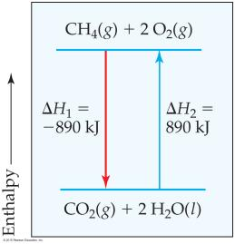

-The Truth about Enthalpy

1.  Enthalpy is an extensive property.

2.  ΔH for a reaction in the forward direction is equal in size, but opposite in sign, to ΔH for the reverse reaction.

3.  ΔH for a reaction depends on the state of the products and the state of the reactants.

    -Calorimetry

Ch6 Electronic Structure of Atoms

-Electronic Structure

Def.: the arrangement and energy of electrons

-Waves

the nature of electromagnetic radiation

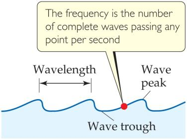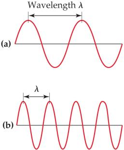

Wavelength (λ)(m)

> Def.: The distance between corresponding points on adjacent waves

Frequency (ν)(s-1)

> Def.: The number of waves passing a given point per unit of time

\-**Electromagnetic Radiation 电磁辐射**

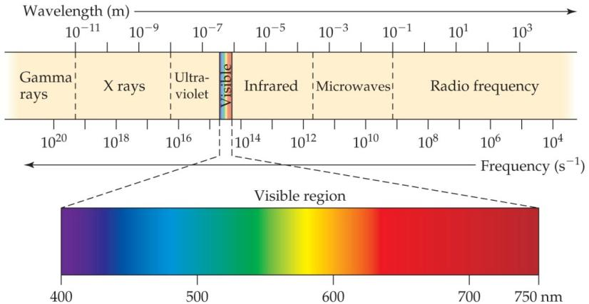 

All electromagnetic radiation travels at the same velocity:

> The speed of light (c) = 3.00×108 m/s.
>
> c=λν

-The Nature of Energy

-Quanta (singular: quantum)

> Def.: energy comes in packets

-The Photoelectric Effect

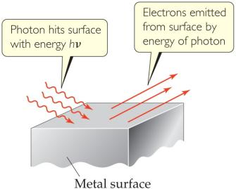

Each metal has a different energy at which it ejects electrons. At lower energy, electrons are not emitted.

energy is proportional to frequency:

E=hν (h is Planck’s constant, 6.626×10−34 J∙s)

-Atomic Emissions

the emission **spectra(n.)光谱** observed from energy emitted by atoms and molecules

-Continuous vs. Line Spectra

**Continuous spectra 连续光谱**

> gets from a white light source

**Line spectra 线性光谱**

> Only a line spectrum of discrete wavelengths is observed.
>
> Each element has a unique line spectrum.

-The Hydrogen Spectrum 氢原子光谱

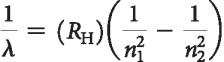

-The Bohr Model 玻尔模型

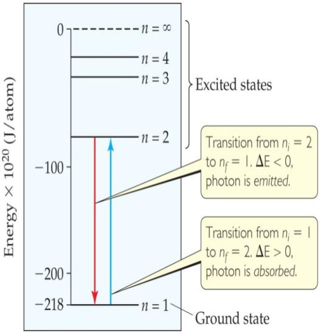

1.  Electrons in an atom can only occupy certain orbits (corresponding to certain energies).

2.  Electrons in permitted orbits have specific, “allowed” energies;

    these energies will not be radiated from the atom.

3.  Energy is only absorbed or emitted in such a way as to move an electron from one “allowed” energy state to another;

    the energy is defined by E=hν

The energy absorbed or emitted

> from the process of electron promotion or demotion
>
> 
>
> RH (the Rydberg constant) = 1.097×107m−1
>
> ni the initial energy levels of the electron
>
> nf the final energy levels of the electron.

-Limitations of the Bohr Model

1.  only works for hydrogen

2.  Classical physics would result in an electron falling into the positively charged nucleus. Bohr simply assumed it would not

3.  Circular motion is not wave-like in nature.

-Important Ideas from the Bohr Model

1.  Electrons exist only in certain discrete energy levels.

2.  Energy is involved in the transition of an electron from one level to another.

-The Wave Nature of Matter 物质的波动性

Louis de **Broglie**

matter should exhibit wave properties

-The Uncertainty Principle 测不准原理

Heisenberg

the more precisely the **<u>momentum</u>(n.)动量** of a particle is known, the less precisely is its <u>position</u> is known

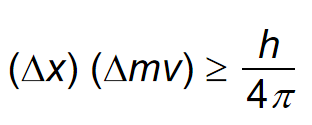

-Quantum Mechanics 量子力学

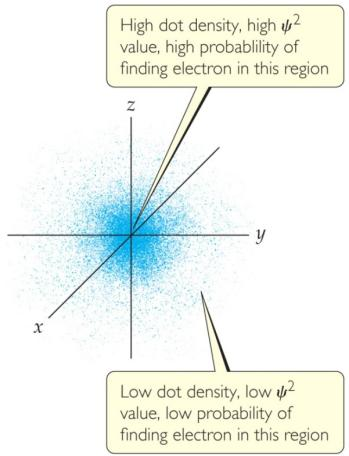a mathematical treatment into which both the wave and particle nature of matter could be incorporated.

a lowercase Greek psi (**ψ**): The solution of Schrödinger’s wave equation

the **electron density 电子密度**

The square of the wave equation, **ψ2**

<u>probability</u> of where an electron is likely to be at any given time

-Quantum Numbers

\-**Principal Quantum Number (n) 主量子数**

> **对应能层**
>
> Describes the energy level on which the orbital resides
>
> Values of n are integers ≥ 1

\-**Angular Momentum Quantum Number (l) 角动量量子数**

> **对应能级**
>
> Defines the shape of the orbital
>
> Values of l are integers ranging from 0 to n − 1
>
> 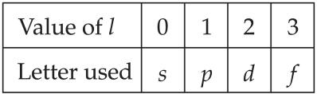 **designation (n.)称呼(?)**

\-**Magnetic Quantum Number (ml) 磁量子数**

> **对应轨道**
>
> values of ml are integers ranging from −l to l:
>
> <u>−l ≤ ml ≤ l</u>
>
> **electron shell 电子层**
>
> Def.: Formed by orbitals with the same value of n
>
> **subshells (p.l.)支壳层**
>
> Def.: Different orbital types within a shell

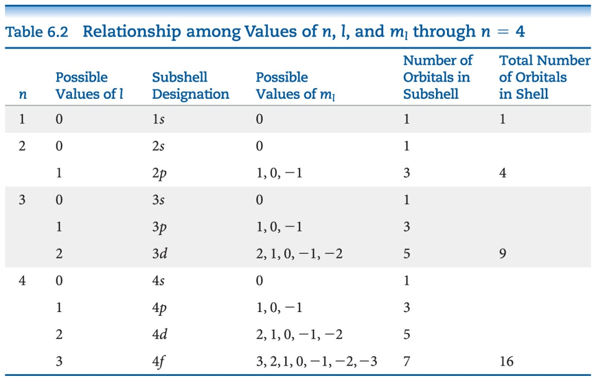

> -s Orbitals
>
> l = 0
>
> are **spherical(adj.)球形的** in shape
>
> n↑, The radius of the sphere↑
>
> **Peak(n.)峰值**: 如图所示：电子出现概率最高的地方
>
> For an *ns* orbital:
>
> the number of peaks = n
>
> **Node(n.)结点**: where there is zero probability of finding an electron
>
> For an *ns* orbital:
>
> the number of nodes = n-1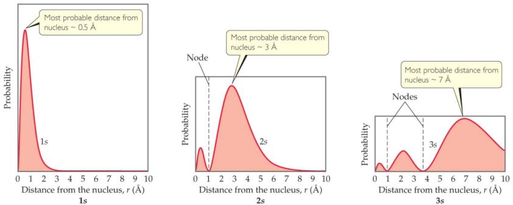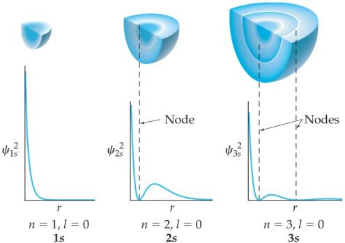

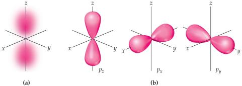

> -p Orbitals
>
> l = 1
>
> Have two **lobes(p.l.)叶** with a **node(n.)结点** between them
>
> 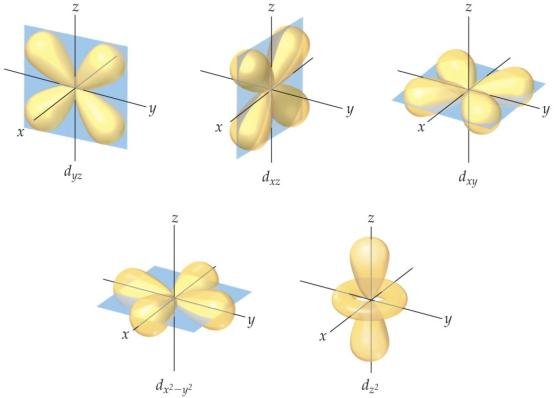-d Orbitals
>
> l = 2
>
> Four of the five d orbitals have four lobes;
>
> the other **resembles(vt.)类似于** a p orbital with a doughnut around the center
>
> -f Orbitals
>
> Very complicated shapes
>
> Seven equivalent orbitals in a sublevel
>
> l = 3
>
> 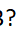-Energies of Orbitals—Hydrogen
>
> **degenerate orbitals 简并轨道**
>
> ↑
>
> 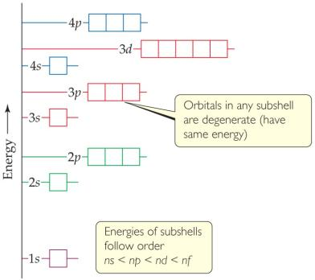For a one-electron hydrogen atom, <u>orbitals on the same energy leve</u>l have the same energy.
>
> ↓
>
> the number of electrons↑, the repulsion between the electrons↑
>
> ↓
>
> In atoms with more than one electron,
>
> Orbital sets in the same sublevel are still degenerate.
>
> Energy levels start to overlap in energy (e.g., 4s is lower in energy than 3d.)
>
> 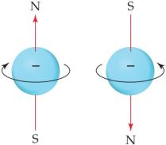-**Spin Quantum Number (ms) 自旋量子数**
>
> two electrons in the same orbital do not have exactly the same energy
>
> The “spin” of an electron describes its <u>magnetic field(?)</u>, which affects its energy.
>
> ms = +½ or –½
>
> -Pauli Exclusion Principle

\-**Electron Configurations 电子排布式**

**ground state 基态**

> Def.: The most stable organization is the lowest possible energy

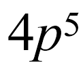The way electrons are distributed in an atom

> a number denoting the energy level;
>
> a letter denoting the type of orbital;
>
> a superscript denoting the number of electrons in those orbitals.

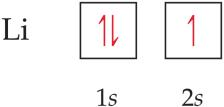-**Orbital Diagrams 电子排布图**

Each box in the diagram represents one orbital.

Half-arrows represent the electrons.

The direction of the arrow represents the relative spin of the electron.

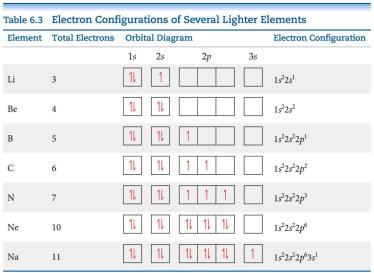

\-**Hund’s Rule 洪特规则**

“For degenerate orbitals, the lowest energy is attained when

the number of electrons with the same spin is maximized.”

\-**Condensed(adj.)精简的 Electron Configurations**

using brackets around a noble gas symbol and listing only valence electrons.

**valence electrons 价电子**

> Def.: the same number of electrons in the outer most shell that elements in the same group of the periodic table have

**core electrons 芯电子(? ; 内层电子)**

> Def.: The filled inner shell electrons, <u>include completely filled d or f sublevels</u>

\-**Periodic Table 元素周期表**

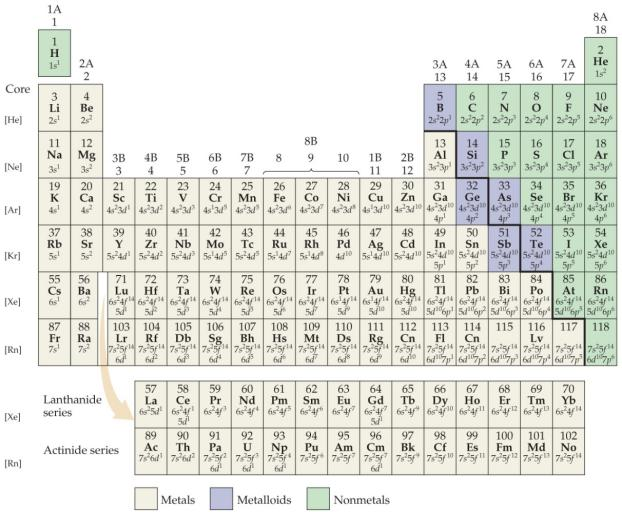

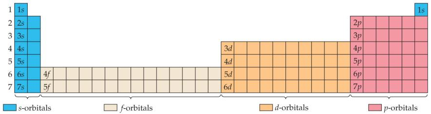

Different blocks on the periodic table correspond to different types of orbitals:

s = blue

p = pink (s and p are representative elements)

d = orange (**transition elements 过渡元素**)

f = tan (**lanthanides(p.l.)镧系元素** and **actinides(p.l.)锕系元素**,

or **inner transition elements 内过渡元素**)

-Some **Anomalies(p.l.)反常现象**

Some irregularities occur when there are enough electrons to half-fill s and d orbitals on a given row.

\-**Chromium(n.)(Cr)铬** as an **Anomaly(n.)反常现象**

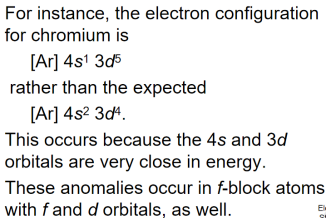

4s has a lower energy than 3d, so it is filled up first.

4s is farther away from the nucleus than 3d.

Filling up of orbitals

> is dependent on orbital energy

Removal of electrons from orbitals

> is dependent on orbital location

Ch7 Periodic Properties of the Elements

-Development of the Periodic Table

-Mendeleev and the Periodic Table

\-**Atomic Number 原子序数**

The number of protons was considered the basis for the periodic property of elements.

\-**Periodicity 周期性**

Def.: the repetitive pattern of a property for elements based on atomic number

following properties:

> **Sizes of atoms and ions 原子大小(原子半径) 和 离子大小(离子半径)**
>
> **Ionization energy 电离能**
>
> **Electron affinity 电子亲和能**
>
> **稀有气体电子亲和能为正(+)**
>
> 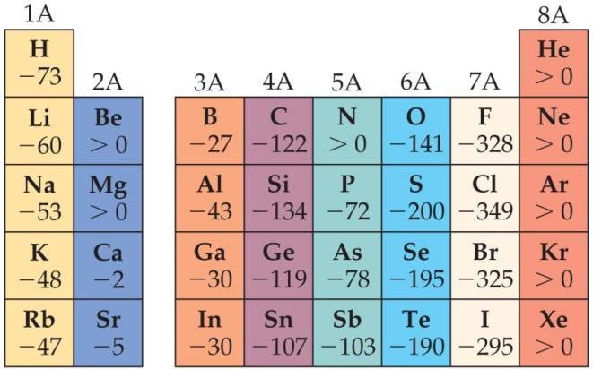
>
> Some **group chemical property trends**

\-**Effective Nuclear Charge (Zeff) 有效核电荷**

a fundamental property that leads to may of the trends

> Many properties depend on attractions between valence electrons and the nucleus.

Electrons are both

> attracted to the nucleus The forces an electron experiences depends on...
>
> repelled by other electrons.

**Zeff = Z − S**

**Z**: the atomic number

> each e- contributes 1.00

**S**: Screening Constant

> Calculation by Slater rule <u>(see textbook p. 300)</u>
>
> (usually close to <u>the number of inner electrons</u>)
>
> **同能层0.35 次一能层0.85 其他内部能层1 ？**

E.g.

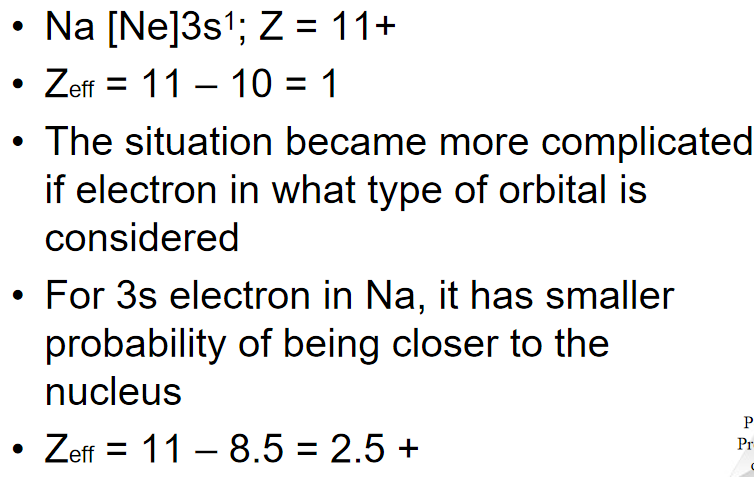

is a periodic property:

> <u>increases across a period.</u>
>
> <u>decreases down a group.</u>

\-**Screening effect 屏蔽效应**

> 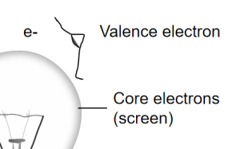

\-**ENC (Effective Nuclear Charge)**

> The ENC felt by outermost electrons
>
> is smaller than
>
> that felt by inner electron
>
> because of screening effect by the inner electrons
>
> The big drop (Ne-Na):
>
> core electrons are more effective
>
> than the valence electrons
>
> at screening the nuclear charge
>
> 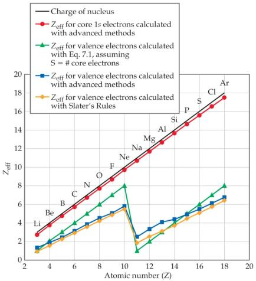

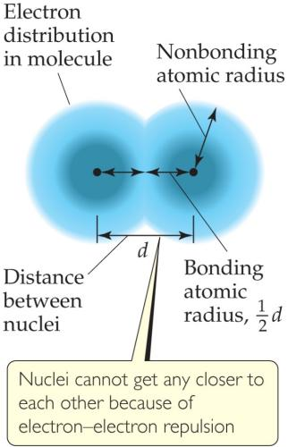-Sizes of an Atoms 原子大小

The **nonbonding atomic radius 未成键原子半径**

or **（又名）**

**van der Waals radius 范德华半径**

> is <u>half of the shortest distance</u>
>
> <u>separating two nuclei</u>
>
> <u>during a collision of atoms</u>.

The **bonding atomic radius 成键原子半径**

> is <u>half the internuclear distance when atoms are bonded</u>.

tends to

— decrease from left to right across a period (Zeff ↑，成键原子半径↓).

— increase from top to bottom of a group (n ↑，成键原子半径↑).

-Sizes of Ions 离子大小

> (Determined by interatomic distances in ionic compounds)
>
> (取决于离子化合物中的原子间距离)

depends on

—the nuclear charge 核电荷

—the number of electrons 电子数

—the orbitals in which electrons reside 有电子的轨道

**Cations(n.)阳离子** are smaller than their parent atoms

**Anions(n.)阴离子** are larger than their parent atoms

\-**isoelectronic series 等电子序列**

**\* isoelectronic (adj.)等电子的**

> In an isoelectronic series, ions have the same number of electrons.
>
> (Ionic size decreases with an increasing nuclear charge.)\\
>
> An Isoelectronic Series (10 electrons)
>
> 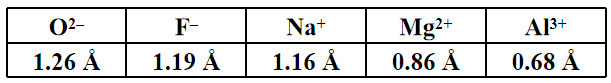

\-**Ionization Energy 电离能 (I)**

Def.: The minimum energy required to remove an electron from the ground state of a gaseous atom or ion.

the higher the ionization energy, the more difficult it is to remove an electron

When all valence electrons have been removed, it takes a great deal more energy to remove the next electron.

The first ionization energy 第一电离能

> is that energy required to remove the first electron
>
> I1 <u>generally increases across a period</u>.
>
> I1 <u>generally decreases down a group</u>.
>
> The <u>s- and p-block elements</u>
>
> show <u>a larger range of values for I1</u>.
>
> (The d-block generally increases slowly across the period;
>
> the f-block elements show only small variations.)

The second ionization energy 第二电离能

> is that energy required to remove the second electron

etc.

-Factors that Influence Ionization Energy

-Irregularities in the General Trend

> when the added valence electron in the next element
>
> enters a new sublevel (higher energy sublevel);
>
> is the first electron to pair in one orbital of the sublevel (electron repulsions lower energy).
>
> The trend is not followed

-Electron Configurations of Ions

Cations: The electrons are lost from the highest energy level (n value).

Anions: The electron configurations are filled to ns2np6

\-**Electron Affinity 电子亲和能**

the energy change accompanying the addition of an electron to a gaseous atom

It is typically exothermic,

So for most elements, the electron affinity is negative

-General Trend in Electron Affinity

> group: 同族元素的电子亲和能基本相同
>
> period: 同周期从左到右递增

Three notable exceptions include the following:

Group 2A: s sublevel is full!

Group 5A: p sublevel is half-full!

Group 8A: p sublevel is full!

Note: the electron affinity for many of these elements is positive (X– is unstable).

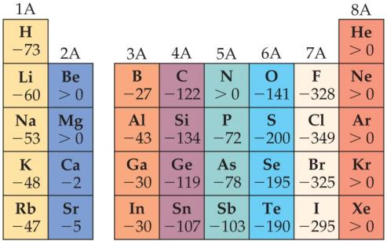

-Metal, Nonmetals, and **Metalloids(n.)类金属**

-Metals Differ from Nonmetals

> Metals tend to form cations.
>
> Nonmetals tend to form anions.

-Metals -Metal Chemistry

> Metals tend to have low ionization energies and therefore tend to form cations relatively easily;
>
> Compounds made up of a metal and a nonmetal tend to be ionic substances;
>
> Most metal oxide are basic;

\-**Nonmetals (n.)非金属** -Nonmetal Chemistry

> Because of their relatively large, negative electron affinities, nonmetals tend to gain electrons when they react with metals;
>
> Compounds composed entirely of nonmetals are typically molecular substances that tend to be gases, liquids or low melting solids at room temperature;
>
> Most nonmetal oxides are acidic;

\-**Metalloids (n.)类金属**

> have some characteristics of metals and some of nonmetals
>
> (have properties intermediate between those of metals and those of nonmetals.)
>
> Several metalloids are electrical semiconductors (computer chips)
>
> E.g. Silicon(Si)

-Group Trends

Elements in a group have similar properties.

Trends also exist within groups.

Groups Compared:

***Alkali (n.)碱***

***Alkaline (adj.)碱性的***

***Halogen (n.)卤素***

Group 1A-第1主族: The **Alkali Metals 碱金属**

Group 2A-第2主族: The **Alkaline Earth Metals 碱土金属**

Group 6A-第6主族: The Oxygen Group 氧族

Group 7A-第7主族: The **Halogens 卤族**

Group 8A-第8主族 : The **Noble Gases 稀有气体**

Group 1A-第1主族: The **Alkali Metals 碱金属**

> 1)Soft metallic solids, silvery, metallic luster, high thermal and electrical conductivity, low density, low melting point;
>
> 2)React with hydrogen to form hydrides and with sulfur to form sulfides;
>
> 3)React vigorously with water, producing hydrogen gas and a solution of an alkali metal hydroxide;
>
> 4)Li metal reacts with oxygen to form lithium oxide; Na reacts with oxygen to form sodium peroxide; K/Rb/Cs react with oxygen to form K/Rb/Cs superoxide;

Group 2A-第2主族: The **Alkaline Earth Metals 碱土金属**

> 1)Solid at room temperature, harder and **denser** and melt at higher temperature (compared with alkali metals);
>
> 2)The first ionization energies of the alkaline earth metals are low but not as low as alkali metals, so the alkaline earth metals are less reactive than alkali metals;
>
> 3)Beryllium doesn’t react with water and steam, even when heated red-hot;
>
> 4)Magnesium reacts slowly with liquid water and more readily with steam;
>
> Calcium and the elements below it react readily with water at room temperature;

**Hydrogen 氢**

> 1)Hydrogen is a nonmetal that occurs as colorless diatomic gas under most conditions;
>
> 2)Hydrogen react with most nonmetals to form molecular compounds in which its electron is shared with other nonmetal;
>
> 3)Hydrogen readily form H+ ions in which the hydrogen atom has lost its electron;
>
> 4)The ability of molecular compounds of hydrogen with nonmetals to form acids in water;

Group 6A-第6主族: **The Oxygen Group 氧族**

> 1)Oxygen: nonmetal, a colorless gas at room temperature, exist in two molecular forms, O2 and O3;
>
> 2)Sulfur: nonmetal, exist in several allotropic forms, the most common and stable form is S8 rings;
>
> 3)Selenium: nonmetal, essential for life but toxic at high doses;
>
> 4)Tellurium: metalloid, elemental structure is more complicated;
>
> 5)Polonium: metal, radioactive;

Group 7A-第7主族: The **Halogens 卤族**

> 1)the halogens are typical nonmetals;
>
> 2)highly negative electron affinities, F and Cl are more reactive than Br and I;
>
> 3)react directly with metals to form metal halides;

Group 8A-第8主族 : The **Noble Gases 稀有气体**

> 1)they have very large ionization energies;
>
> 2)their electron affinities are positive;
>
> 3)they are found as monatomic gases;
>
> 4)they completely filled s and p subshells

Ch8 Basic Concepts of Chemical Bonding

-Chemical Bonds

Ionic Covalent Metallic

-Lewis Symbols

The octet rule

-Ionic Formation

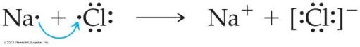

-Energetics of Ionic Bonding—Born-Haber Cycle

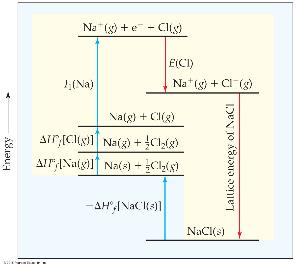

-Energetics of Ionic Bonding

ionization energy and electron affinity

**endothermic (adj.)吸热的**

**exothermic (adj.)放热的**

salt

**formation (n.)形成**

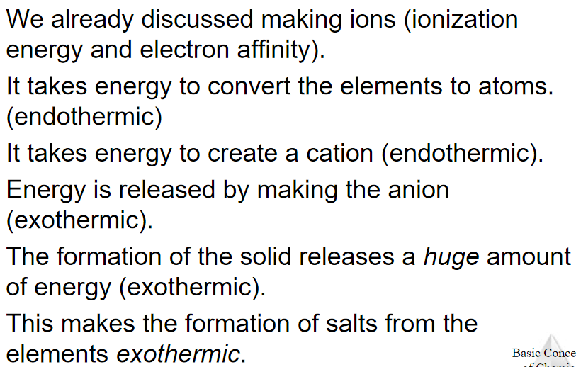

-Lattice Energy

the energy required to

completely separate a mole of a solid ionic compound

into its gaseous ions.

The energy associated with electrostatic interactions is governed by

Coulomb’s law:

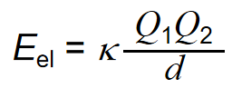

Lattice energy increases with:

> increasing charge on the ions
>
> decreasing size of ions

-Covalent Bonding

atoms share electrons

electrostatic interactions in these bonds:

> attractions between electrons and nuclei,
>
> repulsions between electrons, and
>
> repulsions between nuclei.
>
> (For a bond to form, the attractions must be greater than the repulsions.)

-Lewis Structures

Sharing electrons to make covalent bonds can be demonstrated using Lewis structures.

> 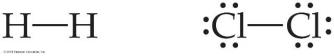

Electrons on Lewis Structures

> Lone pairs
>
> Bonding pairs

-Multiple Bonds

single bonds

double bonds

triple bonds

-Polar Covalent Bonds

the fluorine end of the molecule has more electron density than the hydrogen end.

-Electronegativity

the ability of an atom in a molecule to attract electrons to itself.

electronegativity generally increases as you go

> from left to right across a period.
>
> from the bottom to the top of a group.

-Electronegativity and Polar Covalent Bonds

polar covalent bond

> Electrons tend to spend more time around the more electronegative atom.
>
> partial negative charge (represented by δ–)
>
> 
>
> The greater the difference in electronegativity, the more polar is the bond.

-Dipoles

two equal, but opposite, charges are separated by a distance

dipole moment μ = Qr , measured in debyes (D)

-Is a Compound Ionic or Covalent?

1.  Metal + nonmetal is ionic;

nonmetal + nonmetal is covalent.

> exceptions: It doesn’t take into account oxidation number of a metal (higher oxidation numbers can give covalent bonding)

2.  Electronegativity difference can be used; the table still doesn’t take into account oxidation number.

3.  Properties of compounds are often best: Lower melting points mean covalent bonding, for example.

-Writing Lewis Structures (Covalent Molecules)

1.  Sum the valence electrons from all atoms, taking into account overall charge.

> If it is an anion, add one electron for each negative charge.
>
> If it is a cation, subtract one electron for each positive charge.
>
> 

2.  Write the symbols for the atoms, show which atoms are attached to which,

    and connect them with a single bond

    (a line representing two electrons).

    

3.  Complete the octets around all atoms bonded to the central atom.

    

4.  Place any leftover electrons on the central atom.

    

5.  If there are not enough electrons to give the central atom an octet, try multiple bonds.

    

! Formal charge

> the charge <u>an atom</u> would have <u>if</u> <u>all</u> of the <u>electrons</u> <u>in a covalent bond</u> were <u>shared equally.</u>
>
> Formal charge = valence electrons - ½ (bonding electrons) - all nonbonding electrons
>
> 

The dominant Lewis structure

> is the one in which atoms have formal charges closest to zero.
>
> puts a negative formal charge on the most electronegative atom.
>
> 
>
> （中间一个为the dominant Lewis structure)

-The Best Lewis Structure?

-**Resonance (n.)共轭**

One Lewis structure cannot accurately depict a molecule like <u>ozone</u>.

use multiple structures, resonance structures, to describe the molecule

The organic compound benzene, C6H6, <u>has two resonance structures</u>. It is commonly depicted as a hexagon with a circle inside to signify the delocalized electrons in the ring.

> 
>
> **Localized electrons**
>
> are specifically on one atom or shared between two atoms
>
> **Delocalized electrons**
>
> are shared by multiple atoms.

-Exceptions to the Octet Rule

three types of ions or molecules do not follow the octet rule

1.  ions or molecules with an odd number of electrons,

2.  ions or molecules with less than an octet,

3.  ions or molecules with more than eight valence electrons (an expanded octet).

-1. Odd Number of Electrons

> ions and molecules with an odd number of electrons
>
> 

-2. Fewer Than Eight Electrons

> Elements in the second period before carbon
>
> can make stable compounds with fewer than eight electrons.

e.g. BF3

> Giving boron a filled octet places a negative charge on the boron and a positive charge on fluorine. （电负性F\>B，表现其可能为误）
>
> 
>
> If filling the octet of the central atom results in
>
> a negative charge on the central atom
>
> and a positive charge on the more electronegative outer atom,
>
> don’t fill the octet of the central atom.

-3. More Than Eight Electrons

> element is in period 3 or below in the periodic table (e.g., periods 3, 4, 5, etc.) can use d-orbitals to make more than four bonds
>
> e.g. PF5 and phosphate below
>
> (Note: Phosphate will actually have four resonance structures with five bonds on the P atom!)
>
> 

-Covalent Bond Strength

measured by

> determining how much energy is required to break the bond
>
> bond enthalpy

The bond enthalpy for a Cl—Cl bond, D(Cl— Cl), is measured to be 242 kJ/mol.

> We write out reactions for breaking one mole of those bonds:
>
> 

\-<u>Average</u> Bond Enthalpies

> 平均键焓为正(+),
>
> because bond breaking is an **endothermic(adj.)吸热的** process.
>
> these are averages over many different compounds, not every bond in nature for a pair of atoms has exactly the same bond energy.
>
> 

-Using Bond Enthalpies to Estimate Enthalpy of Reaction

ΔHrxn = Σ(bond enthalpies of all bonds broken) - Σ(bond enthalpies of all bonds formed)

-Bond Enthalpy and Bond Length

measure an average bond length for different bond types.

As the number of bonds between two atoms increases, the bond length decreases.

Ch 9 Molecular Geometry and Bonding Theories

-Molecular Shapes

-What Determines the Shape of a Molecule?

electron pairs, whether they be bonding or nonbonding, repel each other

assuming the electron pairs are placed as far as possible from each other

This is the

Valence-Shell Electron-Pair Repulsion (VSEPR) model.

-Electron Domains

refer to the directions to which electrons point as electron domains

> one or more electron pairs pointing in that direction.

e.g. The central atom in this molecule, A, has four electron domains.

-Valence-Shell Electron-Pair Repulsion (VSEPR) Model

Ch 10 Gases

-Two or more gases form a homogeneous mixture.

-Units of Pressure 压强的单位

Pressure (P) = the force F / a given area A

**-Pascals**

> **1 Pa = 1 N/m2 (SI unit of pressure)**

**-Bar**

> **1 bar = 105 Pa = 100 kPa**

**-mm / Hg / torr**

> These units are literally the difference in the heights measured in mm of two connected columns of mercury, as in the **barometer(n.)气压计** in the figure. (?)

**-Atmospheric pressure 大气压**:

> **1.00 atm = 760 torr = 760 mm Hg = 101.325 kPa**

\-**Manometer 压力计**

Is used to measure the difference in pressure between atmospheric pressure and that of a gas in a vessel

-Barometer

> is used to measure the pressure in the atmosphere at any given time

-Standard Pressure

**Standard atmospheric pressure 标准大气压**

> Normal atmospheric pressure at sea level
>
> **=1.00 atm.**
>
> **=760 torr (760 mmHg).**
>
> **=101.325 kPa**
>
> **=1.01325 bar**

(-The gas law)

\-**Boyle’s Law**

The volume of a fixed quantity of gas at constant temperature is inversely proportional to the pressure.

Mathematical Relationships of Boyle’s Law

> **PV = a constant**
>
> This means, if we compare two conditions: **P1V1 = P2V2**.
>
> 

\-**Charles’s Law**

The volume of a fixed amount of gas at constant pressure

> is directly proportional to its absolute temperature.

Mathematical Relationships of Charles’s Law

> **V = constant × T**
>
> This means, if we compare two conditions: **V1/T1 = V2/T2**.
>
> 

\-**Avogadro’s Law**

The volume of a gas at constant temperature and pressure

> is directly proportional to the number of moles of the gas.

Mathematically: **V = constant × n**, or **V1/n1 = V2/n2**

**<u>STP (Standard temperature and pressure):</u>**

> **<u>0℃, 1atm (0摄氏度，1个标准大气压).</u>**

**Molar volume**

> **at STP, one mole of ideal gas occupies 22.4 L.**

\-**Ideal-Gas Equation 理想气体方程**

 

**the Ideal-Gas Equation: PV = nRT.**

> use <u>a constant of **proportionality(n.)相称，比例性** (**R**)</u>

\-**Density of Gases 气体密度**

-Density & Molar Mass of a Gas

<u>**R: gas constant** (R = 8.31 kPa• dm3•mol-1•K-1 = 8.31J•mol-1•K-1)</u>

**the density of a gas 气体密度 d = MP/RT**

**gas molar mass 气体摩尔质量M = mRT/PV**

> M: the molecular mass
>
> P: the pressure

-Volume and Chemical Reactions

Reactant

\-**Dalton’s Law of Partial Pressures 道尔顿分压定律**

If two gases that don’t react are combined in a container, they act as if they are alone in the container.

The total pressure of a mixture of gases equals the sum of the pressures that each would exert if it were present alone.

\-**Mole Fraction**

relate amount in a mixture to partial pressures:

> 

**The mole fraction 摩尔分数 (χ)**

> That ratio of moles of a substance to total moles
>
>  

-Pressure and Mole Fraction

\-**Kinetic-Molecular Theory 分子动力学理论**

**kinetic (adj.)运动的**

**collision (n.)碰撞**

-Main Tenets of Kinetic-Molecular Theory

**tenet (n.)原则**

**kinetic energy (n.)动能**

**negligible (adj.)可以忽略不计的，微不足道的**

1.  Gases consist of <u>large numbers of molecules</u> that are in continuous, <u>random motion</u>.

2.  <u>The combined volume</u> of all the molecules of the gas is <u>negligible</u> relative <u>to the total volume</u> in which the <u>gas is contained</u>.

3.  <u>Attractive and repulsive forces</u> between <u>gas molecules</u> are <u>negligible</u>.

4.  <u>Energy can be transferred between molecules</u> <u>during collisions</u>, but <u>the average kinetic energy</u> of the molecules does not change with time, as long as the <u>temperature</u> of the gas remains constant.

5.  The <u>average kinetic energy</u> of the molecules is <u>proportional to</u> <u>the absolute temperature</u>.

    

    -How Fast Do Gas Molecules Move?

    Temperature is related to their average kinetic.

    Individual molecules can have different speeds of motion.2

    **ump** : the most probable speed (most molecules are this fast).

    **uav** : the average speed of the molecules.

    **Urms **: the root-mean-square speed, is the one associated with their average kinetic energy.

    

    -urms and Molecular Mass

    

    (1/2)m(urms)2 is the same for two gases at the same temperature.

    <u>If a gas has a low mass, its speed will be greater than for a heavier molecule.</u>

    -Effusion & Diffusion

    **Effusion(n.)渗出**

    Def.: the escape of gas molecules through a tiny hole into an evacuated space.

    

    **Diffusion (n.)扩散**

    Def.: the spread of one substance throughout a space or a second substance.

    

    \-<u>**Graham’s Law** Describes Diffusion & Effusion</u>

    relates the molar mass of two gases

    to their rate of speed of travel

    relates the molar mass of two gases to their rate of speed of travel

    

    lighter gas has the higher effusion rate.

     

    \-**Mean free path 平均自由程**

    the <u>average distance</u> <u>traveled by a molecule</u> <u>between **collisions(p.l.)碰撞**</u> ,

    the value <u>varies with pressure</u>.

    -Real Gases

    **Colorless (adj.)无色的**

    **Odorless (adj.)无味的**

    molecules do have finite volumes and do attract one another.

<!-- -->

1.  molecules do <u>attract others</u>: **P\<Pideal, Z=PV/nRT\<1**

2.  molecules do <u>have volumes</u>: **V\>Videal, Z=PV/nRT\>1**

    <u>In the real world</u>,

    the behavior of gases <u>only conforms to</u> <u>the ideal-gas equation</u>

    at relatively <u>high temperature</u> and <u>low pressure</u>.

    the same gas will show wildly different behavior

    under high pressure at different temperatures.

    \-**Deviations(p.l.)偏离** from Ideal Behavior

    The assumptions made in the kinetic-molecular model

    (negligible volume of gas molecules themselves, no attractive forces between gas molecules, etc.)

    break down at high pressure and/or low temperature.

    

    -Corrections for Nonideal Behavior

     

    -The Van Der Waals Equation

     

    

    Ch 11 Liquids and Intermolecular Forces

    -States of Matter

    The fundamental difference

    between states of matter is

    the strength of the intermolecular forces of attraction.

    Stronger forces bring molecules closer together.

    **Solids** and **liquids**

    are referred to as the **condensed phases**.

    -Differences in the States of Matter

    

    -Which State of Matter?

    relies on the

<!-- -->

1.  balance between the kinetic energies of the particles.

2.  interparticle energies of attraction.

    

    -Intermolecular Forces

    

    Many physical properties reflect intermolecular forces,

    like boiling points, melting points, **viscosity**, surface tension, and **capillary action**.

    -Types of Intermolecular Force

    Weakest to strongest forces:

    ( ! Note: The first two types are also referred to collectively as van der Waals forces.)

<!-- -->

1.  dispersion forces 色散力 (or London dispersion forces 又称伦敦力)

2.  dipole–dipole forces

    1.  hydrogen bonding (a special dipole–dipole force)

3.  ion–dipole forces

    -1. **Dispersion Forces 色散力** (or London dispersion forces 又称伦敦力)

    The figure below shows

    how a nonpolar particle (in this case a helium atom)

    can be temporarily **polarize**d

    to <u>allow dispersion force to form</u>.

    The tendency of an electron cloud to **distort(v.)使变形**

    is called its **polarizability**.

    

    -Factors Which Affect <u>Amount of Dispersion Force</u> in a Molecule

    **compact (adj.)致密的**

<!-- -->

1.  <u>number</u> of electrons in an atom (<u>more electrons, more dispersion force</u>)

2.  <u>size</u> of atom or molecule/molecular <u>weight</u>

3.  <u>shape</u> of molecules with <u>similar masses</u> (<u>more **compact**, less dispersion force</u>)

    

    Linear molecule

    1

    Spherical molecule

    2

    \-**Polarizability极化度** & Boiling Point沸点

    

    If something is <u>more difficult to polarize</u>, it <u>has a lower boiling point</u>.

    极化难度↑，沸点↓

    Remember: This means <u>less intermolecular force</u> (<u>smaller molecule: lower molecular weight, fewer electrons</u>).

    -2. **Dipole–Dipole Interactions 偶极作用**

    Polar molecules have a more positive and a more negative end–a dipole

    (two poles, δ+ and δ−).

    The oppositely charged ends attract each other.

    

    For molecules of <u>approximately equal mass and size</u>,

    the <u>more polar the molecule</u>, <u>the higher its boiling point</u>.

    质量差不多时，分子极性↑，沸点↑

    

    -Which Have a Greater Effect: Dipole–Dipole Interactions or Dispersion Forces?

    If two molecules are of <u>comparable size and shape</u>, <u>dipole–dipole interactions</u> will likely be <u>the dominating force</u>.

    If <u>one molecule is much larger than another</u>, <u>dispersion forces</u> will likely <u>determine</u> its <u>physical properties</u>.

    -What Does This Graph Show Us?

    In a group, the period 3/4/5 elements have higher boiling points as the group member gets larger.

    -2.1. **Hydrogen Bonding 氢键**

    **hydrogen bonds 氢键**

    he dipole–dipole interactions experienced when H is bonded to N, O, or F are unusually strong.

    

    an attraction between

    a hydrogen atom attached to a highly electronegative atom

    and a nearby small electronegative atom in another molecule or chemical group.

    -What Forms Hydrogen Bonds?

    

    These atoms interact with a nearly bare nucleus (which contains one **proton (n.)质子**).

    -3. **Ion–Dipole Interactions 离子偶极作用**

    **(OR: Ion-polar forces, Ion-dipole forces)**

    **dissolve (v.)使溶解**

    **solvent (n.)溶剂**

    are found in solutions of ions

    makes it possible for ionic substances to dissolve in polar solvents.

    

    -Summarizing Intermolecular Forces

    ※※

    -Liquid Properties Affected by Intermolecular Forces

<!-- -->

1.  **boiling point (previously discussed) and melting point 沸点和熔点**

2.  **viscosity 黏滞性**

3.  **surface tension 表面张力**

4.  **capillary action 毛细管作用（？）**

    -2. **Viscosity 黏滞性**

    Def.: Resistance of a liquid to flow

    is related to the ease with which molecules can move past each other. (?)

    increases with stronger intermolecular forces and decreases with higher temperature.

    分子间作用力↓

    黏滞性↓

    温度↑

    -3. **Surface Tension 表面张力**

    

    Water acts as if it has a “skin” on it

    due to <u>extra inward forces on its surface</u>.

    Those forces are called the **surface tension 表面张力**.

    -3. **Capillary Action毛细管作用**

    \-**Cohesion凝聚** and **Adhesion粘附**

    **cohesive forces 内聚力**

    Def.: Intermolecular forces that bind similar molecules to one another

    **adhesive forces 粘附力**

    Intermolecular forces that bind a substance to a surface

    -Capillary Action 毛细管作用

    Def.: The rise of liquids up narrow tubes

    **Adhesive forces** attract the liquid to the wall of the tube.

    **Cohesive forces** attract the liquid to itself.

    -Phase Changes

    Def.: Conversion from one state of matter to another

    

    Energy is either added or released in a phase change.

    Phase changes:

    **melting熔化 / freezing凝固**

    **vaporizing汽化 / condensing液化**

    **subliming升华 /depositing凝华**

    -Energy Change & Change of State

    **heat of <u>fusion</u>熔化热**

    Def.: the energy required to change a solid at its <u>melting</u> point to a liquid

    **heat of vaporization 汽化热**

    Def.: the energy required to change a liquid at its boiling point to a gas

    **heat of sublimation 升华热**

    Def.: the energy required to change a solid directly to a gas

    -Heating Curves

    Def.: A plot of temperature vs. heat added

    Within a phase, heat is the product of specific heat, sample mass, and temperature change.

    The temperature of the substance does not rise during a phase change.

    For the phase changes, the product of mass and the heat of fusion of vaporization is heat.

    (?)

    \-**Supercritical Fluids 超临界流体**

    ***compress (v.)压缩***

    any substance at a temperature and pressure above its critical point,

    where distinct liquid and gas phases do not exist, <u>substance changes to supercritical fluid</u>.

    **critical temperature 临界温度**

    The temperature beyond which a gas cannot be compressed **(?)**

    **critical pressure 临界压力**

    The pressure needed to compress the liquid <u>at critical temperature</u>

    \-**Vapor pressure 蒸汽压**

    The liquid and vapor reach a state of dynamic equilibrium:

    liquid molecules evaporate and vapor molecules condense at the same rate.

    the pressure exerted by a **vapor** in **thermodynamic(adj.)热力学的 equilibrium(n.)平衡** with its **condensed phases 凝聚相** (solid or liquid)

    at a given temperature

    in a closed system.

    \-**Clausius-Clapeyron equation 克劳修斯-克拉佩龙方程**

    是用于描述 单组分系统 在 相平衡 时压强随温度的变化率的方法

    The natural log of the vapor pressure of a liquid is **inversely proportional to(反比于)** its temperature.

    

    \-**Volatile (adj.)挥发性的**

    a substance with a high vapor pressure

    at normal temperatures

    is often referred to as volatile

    (同温，蒸汽压↑，挥发性↑)

    \-**Boiling point 沸点**

    the temperature at which

    its **vapor** pressure

    equals

    the external pressure, acting on the liquid surface.

    \-**Normal boiling point 标准沸点**

    the boiling point of a liquid at 1atm pressure (=760torr).

    \-**Phase diagram**

    a graphic way to summarize the conditions under which equilibria exist between the different states of matter.

    Allows to predict which phase of a substance is present at any given temperature and pressure.

    It shows

    -melting, boiling, and sublimation points at different pressures.

    -the triple point and critical point.

    

    

    \-**Liquid crystal 液晶**

    the viscous, milky state that some substances exhibit between the liquid and solid states.

    (nematic liquid crystals; smectic liquid crystals; cholesteric liquid crystals)

    

    Molecules in liquid crystals have some degree of order.

    **Nematic liquid crystals 向列液晶**

    Molecules are only ordered in one dimension, along the long axis.

    **Smectic liquid crystals 近晶型液晶**

    Molecules are ordered in two dimensions, along the long axis and in layers.

    **Cholesteryic liquid crystals 胆甾型液晶**

    Nematic-like crystals are layered at angles to each other.

    Ch12 Solids and Modern Materials

    -Classifying Solids Based on Bonds

    **Metallic solids 金属晶体**

    **Ionic solids 离子晶体**

    **Covalent-network solids 共价晶体**

    **Molecular solids 分子晶体**

    -Two Other Types of Solids

    **Polymers 聚合物(?)**

    **Nanomaterials 纳米材料**

    crystalline compounds with the crystals on the order of 1–100 nm;

    this gives them very different properties than larger crystalline materials.

    -One Organization of Solids

    **（？Crystal (n.)晶体）**

    **Crystalline (n.)微晶**

    Solids with a regular repeating pattern of atoms

    **Amorphous solids 非晶态固体**

    **（Amorphous (adj.)非晶的；不定型的（？））**

    \-**Unit Cell 晶胞**

    ( **Crystal(n.)晶体结构** = **lattice(n.)点阵** + **motif(n.)基元** )

    \-**Lattice Points (?)点阵点**

    **Lattice Points (?)点阵点**

    Def.: Positions that define the overall structure of the crystalline compound

    **Lattice vectors**

    connect the points and define the unit cell

    -2-dimensional Lattices

    

    -3-dimentional Crystal Lattices

    

    \-**Primitive lattices**

    have atoms only in the lattice points.

    \-**Centered lattices**

    have atoms in another regular location,

    most commonly the body-center or the face-center.

    \-**Motifs (?)(p.l.)基元**

    Sometimes, the atoms are not on the lattice points,

    but the overall structure follows a particular unit cell

    Def.: The groups of atoms that define the overall structure

    

    -Metallic Structure 金属结构

    

    The structures of many metals

    conform to one of the cubic unit cells:

    simple cubic

    body-centered cubic

    face-centered cubic

    -Cubic Structures 立方结构

    

    -Close Packing

    Cubic close-packed.

    Hexagonal close-packed.

    

    

    Band

    as the chain length goes to infinity, the allowed energy states become a continuous band.

    Band structure

    the electronic structure of a bulk solid.

    \-**Alloy (n.)合金**

    Def.: materials that contain more than one element and have the characteristic properties of metals.

    an important means employed to change the properties of certain metals

    -Types of Alloys

<!-- -->

1.  Substitutional alloys

    A second element takes the place of a metal atom.

    Homogeneous alloys (???)

2.  Interstitial alloys

    A second element fills a space in the lattice of metal atoms.

    

3.  Heterogeneous alloys

    components not dispersed uniformly

    -Intermetallic Compounds

    -Metallic Bonding

    The electrical and thermal conductivity

    Ductility of metals is explained by this model.

    Malleability

    

    -A Molecular-Orbital Approach

    -MO Approach with More Orbitals

    \-**Ionic Solids 离子晶体(?)**

    the lattice comprises alternately charged ions

    （晶格(?)由交替带电的离子组成）

    have very high melting and boiling points

    are quintessential crystals.

    Most favorable structures

    have cation–anion distances as close as possible

    the anion–anion and cation–cation distances

    are maximized.

    **anion (n.)阴离子**

    **cation (n.)阳离子**

    -Effect of Ion Size on Structure

    Structure of ionic compounds - major factor:

    **影响离子化合物的结构的主要因素：**

    The size of the cation compared to the anion (radius ratio)

    **阳离子和阴离子的半径之比**

    -**Molecular Solids 分子晶体**

    Consist of atoms or molecules held together

    by weaker forces

    (dispersion,

    dipole–dipole,

    hydrogen bonds)

    \-**Covalent-Network Solids 共价晶体**

    Atoms are covalently bonded over large network distances with regular patterns of atoms.

    **High melting and boiling points. 高熔沸点**

    

    \-**Semiconductors (p.l.)半导体**

    elemental semiconductors

    contain only one type of atom.

    compound semiconductors

    contain two or more elements.

    have a gap between

    the occupied MOs (valence band)

    and

    the unoccupied ones (conduction band)

    

    Electrons

    must enter the conduction band

    for electron transfer.

    (e.g. Group IVA elements have gaps between the bands of 0.08 to 3.05 eV (7 to 300 kJ/mol) )

    -What Forms a Semiconductor?

    Group IVA (all have 4 valence electrons) are semiconductors.

    <u>Inorganic semiconductors</u> 无机的半导体 (like GaAs)

    <u>tend to</u>

    have an average of <u>4 valence electrons</u> (3 for Ga, 5 for As).

    

    \-**Doping (?)掺杂**

    changing the conductivity <u>of semiconductors</u>

    by adding

    an element with more or fewer electrons

    **n-type semiconductors** (n means negative)

    have more electrons

    ↓

    the negative charge

    travels in the conductance band.

    **p-type semiconductors** (p means positive)

    have fewer electrons

    ↓

    **the “hole”(?)**

    travels in the valence band.

    \-**Polymers 聚合物**

    <u>molecules of high molecular weight made (?)</u>

    <u>by joining smaller molecules</u>, called **monomers**.

    <u>two primary types of polymers</u>:

    **Addition polymers 加成聚合物**

    are formed when a bond breaks, and the electrons in that bond make two new bonds.

    **Condensation polymers 缩合聚合物**

    are formed when a small molecule is removed between two large molecules.

    

    -Some Common Polymers

    

    **-Bulk(n.)大部分** Properties of Polymers

<!-- -->

1.  the longer the chain, the more twisting happens.

2.  Chains can have a variety of lengths, and therefore a variety of molecular weights.

3.  The material can be very flexible (plastics).

4.  Short range order can lead to **crystallinity(n.)结晶性** in the solid.

    -Changing the Polymer’s Physical Properties

    <u>Chemically bonding chains</u> <u>of polymers</u> to each other

    <u>can **stiffen(v.)变硬** and strengthen the substance</u>.

    In **vulcanization(n.)硫化**, chains are <u>cross-linked</u> by short chains of sulfur atoms, <u>making the rubber stronger</u>.

    -Nanomaterials

    Particles that have three dimensions

    on the 1–100 nm size

    -Semiconductors on the Nanoscale

    1–10 nm (about 10–100 atoms)

    **Quantum dots量子点** are semiconductors this size

    -Metals on the Nanoscale

    Finely divided metals can have quite different properties than larger samples of metals.

    -Carbon on the Nanoscale

    Carbon nanotubes can be made with metallic or semiconducting properties without **doping**.

    are very strong materials

    **Graphene(n.)石墨烯**: single layers with the structure of graphite.

    Ch13 Properties of Solutions

    \-**Solutions (n.)溶液**

    Def.: <u>homogeneous</u> mixtures of two or more <u>pure</u> substances

    **Solute (n.)溶质**

    **Solvent (n.)溶剂**

    The ability of substances to form solutions物质形成溶液的能力

    depends on取决于

<!-- -->

1.  natural tendency toward mixing

2.  intermolecular forces

    -1. Natural Tendency toward Mixing

    Mixing of gases is a spontaneous process.

    气体混合是一个自发的过程。

    Each gas acts as if it is alone to fill the container.

    每种气体就像单独填充容器一样。

    Mixing

    causes more randomness in the position of the molecules,

    Increasing <u>a thermodynamic quantity</u>

    called <u>entropy</u>.

    混合会导致分子位置的随机性增加，从而增加称为熵的热力学量。

    The formation of solutions is favored by the increase in entropy that accompanies mixing.

    伴随着mixing的entropy↑，溶液的形成↑

    -2. Intermolecular Forces of Attraction

    

    <u>Any intermolecular force of attraction</u> (Chapter 11)

    can be <u>the attraction between solute and solvent molecules</u>.

    \-<u>Attractions</u> Involved When <u>Forming a Solution</u> 形成溶液时涉及的吸引力

    **Solute–solute interactions 溶质-溶质相互作用**

    must <u>be overcome</u> <u>to disperse these particles</u> when making a solution.

    在形成溶液时必须被克服以分散这些粒子

    must <u>be overcome</u> <u>to make room</u> for the solute.

    必须被克服才能为溶质腾出空间

    <u>occur as</u> the <u>particles mix</u>

    -Energetics of Solution Formation

     

    -Exothermic or Endothermic (?)

    

    <u>ΔHmix must be close to the sum of ΔHsolute and ΔHsolvent</u>

    for a reaction to occur

    the <u>randomness from entropy</u> will affect the process, too

    \-**Aqueous(adj.)水的** Solution vs. Chemical Reaction

    仅仅因为物质在与溶剂接触时消失，并不意味着该物质溶解了。它可能已经反应，就像镍与盐酸一样。

    -Opposing Processes

    The <u>solution-making process</u> and <u>crystallization</u> are opposing processes.

    

    **saturated solution饱和溶液**

    When the rate of the opposing processes is equal, additional solute will not dissolve unless some crystallizes from solution.

    当<u>这个相反过程的速率相等时</u>，<u>除非从溶液中结晶一些溶质(?)，否则额外的溶质不会溶解</u>。

    **unsaturated solution不饱和溶液**

    -Solubility

    Def.: the maximum amount of solute

    that can dissolve in a given amount of solvent

    at a given temperature

    T=, 溶剂solvent V&M=, 能溶解的最多溶质的量

    饱和溶液中溶质solute = ↑

    不饱和溶液中溶质solute \< ↑

    过饱和溶液中溶质solute \> ↑

    \-**Supersaturated Solutions 过饱和溶液**

    the solvent holds more solute than is normally possible at that temperature

    These solutions are unstable; 不稳定

    <u>crystallization</u> can usually <u>be stimulated</u>

    by adding a <u>“seed crystal”</u> 添加“种子晶体”

    or <u>**scratching(v.进行)刮** the side of the **flask(n.)烧瓶**</u>. 刮擦烧瓶的侧面

    These <u>are uncommon solutions</u>. 不常见

    -Factors That Affect Solubility

<!-- -->

1.  Solute–solvent Interactions

2.  <u>Pressure (for gaseous solutes)</u>

3.  Temperature

    -1. Solute–Solvent Interactions

    “Like dissolves like. 相似相溶” <u>does not</u> explain everything

    the solute–solvent interaction↑, the solubility of a solute in that solvent↑

    The gases in the table only exhibit dispersion force.

    The larger the gas↑, the more soluble↑ it will be <u>in water</u>. (?范德华力?)

    

    -Organic Molecules in Water

    Polar organic molecules dissolve in water better

    than nonpolar organic molecules.

    Hydrogen bonding increases solubility.

     

    -Liquid/Liquid Solubility

    **Miscible**

    Liquids that mix in all proportions (are...)

    **Immiscible**

    Liquids that do not mix in one another (are...)

    e.g. hexane is nonpolar and water is polar, they are immiscible.

    -Solubility and Biological Importance

    Fat-soluble vitamins (e.g. vitamin A)

    are nonpolar

    they are readily stored in fatty tissue in the body.

    Water-soluble vitamins (e.g. vitamin C)

    need to be included in the daily diet.

    

    -2. Pressure Effects

    Gas solubility is affected by pressure.

    The solubility of solids and liquids are not appreciably affected by pressure.

    -Henry’s Law

    The <u>solubility</u> of <u>a gas</u>

    is proportional to

    <u>the partial pressure</u> of <u>the gas above the solution</u>.

    

    

    -3. Temperature Effects

    For most solids

    as temperature increases, solubility increases.

    However, clearly this is not always true—

    some increase greatly, some remain relatively constant, and others decrease.

    For all gases

    as temperature increases, solubility decreases.

    Cold rivers have higher oxygen content than warm rivers.

    -Solution Concentration

    (have discussed solubility and solutions **qualitatively(adv.)定性地**:

    saturated (which is quantitative), unsaturated, and supersaturated. )

    Now give specific amounts to solutions.

    -Units of Concentration

<!-- -->

1.  Mass percentage

2.  Parts per million (ppm)

3.  Parts per billion (ppb)

4.  Mole fraction

5.  Molarity

6.  Molality

    -1. Mass Percentage

    

    -2. Parts per Million (ppm)

    -3. Parts per Billion (ppb)

    relating mass of a solute to the total mass of the solution

    Since percent is out of 100, we multiplied by 100.

    ppm is per million, so we multiply by 106

    

    ppb is per billion, so we multiply by 109

    -4. Mole Fraction (χ)

    Ch14 Chemical Kinetics

    -Chemical Kinetics

    reaction mechanism

    Def.: a molecular-level view of the path from reactants to products.

    -Factors that Affect Reaction Rates

<!-- -->

1.  Physical state of the reactants

2.  Reactant concentrations

3.  Reaction temperature

4.  Presence of a catalyst

    -1. Physical State of the Reactants 反应物的物理状态

    The more readily the reactants collide, the more rapidly they react.

    反应物碰撞准备(???)↑，反应速度↑

    Homogeneous reactions are often faster

    反应速度Homogeneous reaction \> Heterogeneous reaction.

    Heterogeneous reactions that involve solids are faster if the surface area is increased; i.e., a **fine(adj.)精细的** powder reacts faster than a **pellet(n.)球团，丸** or **tablet(n.)片**.

    Heterogeneous reactions中，固体反应物表面积↑，反应速率↑

    -2. Reactant Concentrations 反应物浓度

    Increasing reactant concentration generally increases reaction rate.

    反应物浓度↑，反应速率↑

    Since there are more molecules, more collisions occur.

    原因：分子数↑，碰撞数↑

    -3. Temperature

    Reaction rate generally increases with increased temperature.

    温度↑，反应速率↑

    Kinetic energy of molecules is related to temperature.

    分子的动能与温度有关

    At higher temperatures, molecules move more quickly, increasing numbers of collisions and the energy the molecules possess during the collisions.

    温度↑，分子运动速度↑，碰撞数↑，碰撞中分子拥有的能量↑

    -4. Presence of a Catalyst

    Catalysts affect rate without being in the overall balanced equation.

    Catalysts affect the kinds of collisions, changing the mechanism (individual reactions that are part of the pathway from reactants to products).

    Catalysts are critical in many biological reactions.

    -Reaction Rate (Rate Law???)

    Def.: Rate is a change in concentration over a time period: Δ\[ \]/Δt

    Δ : “change in”

    \[ \] : molar concentration

    t : time

    Types of rate measured:

    average rate

    instantaneous rate

    initial rate

    -Following Reaction Rates

    

    Rate of a reaction is measured using the concentration of a reactant or a product over time.

    In this example, \[C4H9Cl\] is followed.

    The average rate is calculated by the –(change in \[C4H9Cl\]) ÷ (change in time).

    The table shows the average rate for a variety of time intervals.

    -Plotting Rate Data

    

    A plot of the data gives more information about rate.

    The slope of the curve at one point in time gives the **instantaneous(adj.)瞬时的** rate.

    某时间点上曲线的斜率→瞬时速率

    Initial rate: The instantaneous rate at time zero

    初始速率：0时刻的瞬时速率

    this is often the rate of interest to chemists. (???)

    This figure shows instantaneous and initial rate of the earlier example.

    Note: Reactions typically slow down over time!

    -Relative Rates

    rates are followed(???) using a reactant or a product.

    Rate is dependent on stoichiometry.

    If we followed use of C4H9Cl and compared it to production of C4H9OH, the absolute values would be the same and the values would have opposite signs.

    

    if the equation is not 1:1

    E.g. 

    

    -Determining Concentration Effect on Rate

    We keep every concentration constant except for one reactant and see what happens to the rate. Then, we change a different reactant. We do this until we have seen how each reactant has affected the rate.

    -An Example of How Concentration Affects Rate

    Rate = k \[NH4+\] \[NO2−\]

    

    -More about Rate Law (???)

    The exponents tell <u>the **order** of the reaction with respect to each reactant</u>.

    In our example from the last slide: Rate = k \[NH4+\] \[NO2−\]

    <u>The order with respect to each reactant is 1</u>.

    (It is first order in NH4+ and NO2−.)

    <u>The reaction is second order</u>

    (1 + 1 = 2;

    we just <u>add up all of the reactants’ orders to get the reaction’s order</u>).

    k: the rate constant (i.e. reaction rate constant),

    a temperature-dependent quantity

    单位取决于反应级数：

    对于n级反应, the unit of k is: mol1-n·Ln-1·s-1 (i.e. mol1-n·dm3n-3·s-1)

    (最终使单位为mol·L-1·s-1)

    \-**First Order Reactions**

    Def.: The rates depend only on one reactant to the first power.

    The rate law becomes: Rate = k\[A\]

    -Relating k to \[A\] in a First Order Reaction

    rate = k\[A\]

    k\[A\] = −Δ \[A\] / Δt

    rate = −Δ\[A\] / Δt

    Rearrange to: Δ\[A\] / \[A\] = −kΔt

    Integrate: ln(\[A\] / \[A\]o) = −kt

    Rearrange: <u>ln\[A\] = −kt + ln \[A\]o </u>

    Note: this follows the equation of a line: y = mx + b

    So, a plot of <u>ln \[A\]</u> vs. <u>t</u> is linear.

    -e.g. Conversion of Methyl Isonitrile to Acetonitrile

    

    It is first order rate = k \[CH3NC\]

    

    -Finding the Rate Constant, k

    Besides using the rate law,

    we can find the rate constant from the plot of ln\[A\] vs. t.

    Remember the integrated rate law: ln\[A\] = −kt + ln\[A\]o

    The plot will give a line.

    Its slope will equal −k.

    \-**Half-life**

    Def.: The amount of time it takes

    for one-half of a reactant

    to be used up in a chemical reaction.

    E.g.

    

    ln \[A\] = − k t + ln \[A\]o

    ln (\[A\]o/2) = − k t½ + ln \[A\]o (???)

    − ln (\[A\]o/2) + ln \[A\]o = k t½

    ln (\[A\]o / \[A\]o/2) = k t½

    ln 2 = k t½ or t½ = 0.693/k

    \-**Second Order Reactions**

    Def.: The rates depend only on a reactant to the second power.

    The rate law becomes: Rate = k\[A\]2

    -Solving the Second Order Reaction for A → Products

    rate = k\[A\]2

    k \[A\]2 = −Δ\[A\] / Δ t

    rate = −Δ\[A\] / Δt

    Rearranging: Δ\[A\] / \[A\]2 = −kΔt

    Using calculus: <u>1/\[A\] = 1/\[A\]o + k t</u>

    Notice: The linear relationships for first order and second order reactions differ!

    -e.g. Decomposition of NO2

    NO2→NO+(1/2)O2

    Its second order rate = k\[NO2\]2

    A plot following NO2 decomposition

    shows that it must be second order

    because it is linear for 1/\[NO2\],

    not linear for ln \[NO2\].

    

    -Half-Life and Second Order Reactions

    

    -Zero Order Reactions

    rate is independent of the concentration of the reactant:

    

    Rate = k

    These reactions are <u>linear</u> in concentration. (???)

    -Factors That Affect Reaction Rate

<!-- -->

1.  Temperature

2.  Frequency of collisions

3.  Orientation of molecules

4.  Energy needed for the reaction to take place (activation energy)

<!-- -->

1.  -Temperature and Rate

    Generally, 温度↑，速率↑

    温度↑，The rate constant↑

    温度每+10℃，Rate constant×2

    2\. -Frequency of Collisions

    -The Collision Model

    is based on the kinetic molecular theory

    In a chemical reaction, bonds are broken and new bonds are formed.

    Molecules can only react if they collide with each other.

    分子数↑

    碰撞数↑，反应数↑，反应速率↑

    温度↑，分子速率↑

    3\. -Orientation of Molecules

    Molecules can often collide without forming prod ucts.

    Aligning molecules properly can lead to chemical reactions.

    Bonds must be broken and made and atoms need to be in proper positions.

    

    4\. -Energy Needed for a Reaction to Take Place (Activation Energy)

    Def.: The minimum energy needed for a reaction to take place

    An energy barrier must be overcome for a reaction to take place

    \-**Transition State (Activated Complex)**

    Reactants gain energy

    as the reaction proceeds

    until the particles reach the maximum energy state

    Def.: The organization of the atoms at this highest energy state

    **Activation energy**

    Def.: The energy needed to form transition state

    -Reaction Progress

    绘制图表以显示粒子所拥有的能量as the reaction proceeds

    在最高能量状态下，形成transition state

    在此之后，反应可以是吸热或放热

    

    -Distribution of the Energy of Molecules

    气体有平均温度，但每个分子都有自己的能量。

    能量↑，拥有反应发生所需的能量的分子数↑

    

    -The Relationship Between Activation Energy & Temperature 活化能与温度的关系

    k = A×e−Ea/RT

    ↓

    ln k = −Ea/RT + ln A

    

    Ea: 活化能

    T: 温度

    -Law vs. Theory

    **Mechanism**

    Def.: a series of stepwise reactions

    that show how reactants become products

    (The rate law: The description where Kinetics gives what happens

    We explain the rate law with a theory called a mechanism. )

    -Reaction Mechanisms

    Reactions may occur all at once or through several discrete steps.

    **Elementary Reaction (又: Elementary Process)**

    Def.: Each of these processes (discrete steps) that reactions (may) occurs through.

    (反应可以同时发生，也可以通过几个离散的步骤发生。

    这些过程中的每一个都被称为基本反应或基本过程。)

    -Molecularity

    The molecularity of an elementary reaction

    ↓可知

    The number of molecules that are involved in that step of the mechanism

    

    -Termolecular

    Termolecular steps

    require three molecules

    to **simultaneously(adv.)同时地** collide

    with

    the proper orientation & the proper energy.

    (Termolecular steps)

    are <u>rare</u>

    must be <u>slower</u> than unimolecular or bimolecular steps

    \*Nearly all <u>mechanisms</u> use only unimolecular or bimolecular reactions.

    -What Limits the Rate?

    **the rate-determining step 决速步**

    Def.: the slowest reaction in the mechanism.

    (The overall reaction cannot occur faster than the slowest reaction in the mechanism. )

    

    -What is Required of a **Plausible(adj.)合理的** **Mechanism(n.)机制**?

    The rate law必须能够从the rate-determining step中设计出来

    当所有步骤相加时，必须可以获得The stoichiometry

    每一步都必须平衡，就像任何方程式一样

    所有intermediates都 被制成 并 被用完

    任何catalyst催化剂都被 使用 并 再生

    -A Mechanism With a Slow Initial Step

    Overall equation: NO2 + CO → NO + CO2

    Rate law: Rate = k \[NO2\]2

    If the first step is the rate-determining step, the coefficients on the reactants side are the same as the order in the rate law!

    So, the first step of the mechanism begins:

    NO2 + NO2 →

    The easiest way to complete the first step is to make a product:

    NO2 + NO2 → NO + NO3

    We do not see NO3 in the stoichiometry, so it is an intermediate, which needs to be used in a faster next step.

    NO3 + CO → NO2 + CO2

    Since the first step is the slowest step, it gives the rate law.

    If you add up all of the individual steps (2 of them), you get the stoichiometry.

    Each step balances.

    This is a plausible mechanism.

    -A Mechanism With a Fast Initial Step

    Equation for the reaction:

    2NO + Br2 ⇌ 2NOBr

    The rate law for this reaction is found to be

    Rate = k\[NO\]2\[Br2\]

    Because termolecular processes are rare, this rate law suggests a multistep mechanism.

    The rate law indicates that a quickly established equilibrium is followed by a slow step.

    Step 1: NO + Br2 ⇌ NOBr2

    Step 2: NOBr2 + NO → 2NOBr

    -What is the Rate Law?

    The rate of the overall reaction depends upon the rate of the slow step.

    The rate law for that step would be

    Rate = k2\[NOBr2\] \[NO\]

    But how can we find \[NOBr2\]?

    -\[NOBr2\] (An Intermediate)?

    NOBr2 can react two ways:

    With NO to form NOBr.

    By decomposition to reform NO and Br2.

    The reactants and products of the first step are in equilibrium with each other.

    For an equilibrium (as we will see in the next chapter):

    Ratef = Rater.

    Substituting for the forward and reverse rates:

    k1 \[NO\] \[Br2\] = k−1 \[NOBr2\]

    Solve for \[NOBr2\], then substitute into the rate law:

    Rate = k2 (k1/k−1) \[NO\] \[Br2\] \[NO\]

    This gives the observed rate law!

    Rate = k \[NO\]2 \[Br2\]

    -Catalysts

    increase the rate of a reaction ↑反应速率

    by decreasing the activation energy of the reaction ↓活化能

    <u>change the mechanism</u> by which the process occurs

    更改(...)过程发生的机制

    

    -Types of Catalysts

<!-- -->

1.  **Homogeneous catalysts 均相催化剂**

2.  **Heterogeneous catalysts 非均相催化剂**

3.  **Enzymes酶**

    -1. **Homogeneous Catalysts 均相催化剂**

    Def.: The <u>reactants</u> and catalyst <u>are in the same phase</u>

    Many times大多数时候,

    reactants and catalyst are dissolved in the same solvent

    -2. **Heterogeneous Catalysts 非均相催化剂**

    Def.: The catalyst is <u>in a different phase</u> than the reactants

    通常情况(Often)：gases are passed over a solid catalyst

    The **adsorption(n.)吸附** of the reactants

    is often the rate-determining step.

    -3. **Enzymes酶**

    are biological catalysts

    They have:

    **Active site**

    region where the reactants attach

    **Substrates**

    The reactants are referred to as substrates

    \-**Lock-and-Key Model**

    In the enzyme–substrate model,

    the substrate fits into the active site of an enzyme

    ↓

    Enzyme-substrate complex

    (?)They are specific

    

    Ch15 Chemical Equilibrium

    -The Concept of Equilibrium

    **Chemical equilibrium 化学平衡**

    occurs when **<u>a reaction and its reverse reaction</u>** **<u>proceed at the same rate</u>**

    当正反反应速率相同时，达到化学平衡

    As **<u>a system approaches equilibrium</u>**, both the forward and reverse **<u>reactions are occurring</u>**.

    当系统接近平衡时，正向和反向反应都会发生。

    At equilibrium, the **<u>forward and reverse reactions</u>** are proceeding at the same rate.

    在平衡状态下，正向和反向反应以相同的速度进行。

    Once **<u>equilibrium is achieved</u>**, the amount of each reactant and product remains constant.

    一旦达到平衡，每种反应物和产物的量保持不变。

    -Writing the Equation for an Equilibrium Reaction

    Since, in a system at equilibrium, 由于在处于平衡状态的系统中，

    both the forward and reverse reactions are being carried out, 正向和反向反应都在进行，

    we write its equation with a double arrow: 因此我们用双箭头写出其方程：

    N2O4(g) ⇌ 2NO2(g)

    -Comparing Rates ※(!!!)

    For the forward reaction: N2O4(g) → 2NO2(g)

    The rate law is: Rate = kf \[N2O4\]

    For the reverse reaction: 2NO2(g) → N2O4(g)

    The rate law is: Rate = kr \[NO2\]2

    -The Meaning of Equilibrium

    Therefore, at equilibrium:

    Ratef = Rater

    ↓

    kf \[N2O4\] = kr \[NO2\]2

    Rewriting this:

    **the equilibrium constant (Keq)**

    Keq =

    （注意：因k与反应物浓度为乘法关系，所以此处为反比！！！）

    \-**The Haber Process**

    —Another Equilibrium

    **the Haber Process**

    **the industrial preparation of ammonia 氨的工业制备**

    The equilibrium constant

    depends on **stoichiometry(n.)化学计量数**:

    

    \-**The Equilibrium Constant 平衡常数**

    Consider the generalized reaction

    aA + bB ⇌dD + eE

    The equilibrium expression for this reaction would be

    

    Also, since pressure is proportional to concentration for gases in a closed system, the equilibrium expression can also be written

    

    -More with Gases and Equilibrium

    We can compare the equilibrium constant based on concentration to the one based on pressure.

    For gases,

    PV = nRT (the Ideal Gas Law).

    ↓Rearranging

    P = (n/V)RT （(n/V) is \[ \]：n/V是浓度）

    The result is

    

    Where 

    -Equilibrium Can Be Reached from Either Direction 平衡可以从任一方向达到

    The ratio of \[NO2\]2 to \[N2O4\] remains constant

    at this temperature

    no matter what the initial concentrations of NO2 and N2O4 are.

    无论 NO2 和 N2O4 的初始浓度如何，\[NO2\]2与\[N2O4\]的比率在此温度下都保持不变

    

    -**Magnitude(n.)大小** of K

    If K\>\>1

    the reaction favors products;

    products predominate at equilibrium.

    If K\<\<1

    the reaction favors reactants;

    reactants predominate at equilibrium.

    -The Direction of the Chemical Equation and K

    The equilibrium constant of a reaction in the reverse reaction

    is the reciprocal of

    the equilibrium constant of the forward reaction

    逆反应中反应的平衡常数是正向反应平衡常数的倒数

    

    \-**Stoichiometry(n.)化学计量数** and Equilibrium Constants

    To find the new equilibrium constant

    of a reaction when the equation has been multiplied by a number,

    simply raise the original equilibrium constant to that power.

    当方程乘以一个数字时，要找到反应的新平衡常数，只需将原始平衡常数提高到该幂即可。

    e.g. Here, the stoichiometry is doubled;

    the constant is the squared

    

    \-**Consecutive(adj.)连续的,连贯的** Equilibria

    当2个连续的平衡发生时，方程可以相加→得到一个平衡

    新反应的平衡常数是原2个平衡常数的乘积

    K3 = K1×K2

    

    -Homogeneous vs. Heterogeneous

    **Homogeneous equilibria 单相平衡**

    all reactants and products are in the same phase.

    **Heterogeneous equilibria 多相平衡**

    something in the equilibrium is in a different phase.

    ! The value used for the concentration of a pure substance is always 1

    -A Heterogeneous Equilibrium

    —The Decomposition of CaCO3

    

    -Deducing Equilibrium Concentrations

    

    E.g.:

    

    ↓

    

    ↓

    

    -Is a Mixture in Equilibrium? Which Way Does the Reaction Go?

    **reaction quotient (Q)**

    looks like the equilibrium constant, K,

    but the values used to calculate it are <u>the current conditions</u>

    To calculate Q, one substitutes the initial concentrations of reactants and products into the equilibrium expression.

    为了计算Q，人们将反应物和生成物的初始浓度代入平衡表达式

    -Comparing Q and K

    If Q \< K, nature will make the reaction proceed to products.

    If Q = K, the reaction is in equilibrium.

    If Q \> K, nature will make the reaction proceed to reactants.

    

    -Calculating Equilibrium Concentrations 计算平衡浓度

    

    e.g.:

    

     

    

    \-**LeChâtelier’s Principle 勒夏特列原理**

    If a system at equilibrium is disturbed by a change

    in temperature, pressure, or the concentration

    of one of the components,

    the system will shift its equilibrium position

    so as to **counteract(v.)抵抗** the effect of the disturbance.

    -How Conditions Change Equilibrium

    We will use LeChâtelier’s Principle qualitatively

    to <u>predict shifts in equilibrium</u>

    <u>based on changes in conditions</u>

    

    -Change in Reactant or Product Concentration

    If the system is in equilibrium

    adding a reaction component will result in some of it being used up.

    removing a reaction component will result in some if it being produced.

    

    -Change in Volume or Pressure

    

    -Change in Temperature

    Endothermic吸热: 温度↑，平衡→

    Exothermic放热: 温度↑，平衡←

    E.g.1 -An Endothermic Equilibrium

    

    

    e.g.2 -An Exothermic Equilibrium

    

    \-**Catalysts (p.l.)催化剂**

    increase the rate of

    both the forward and reverse reactions.

    Equilibrium is achieved faster,

    but the equilibrium composition remains **unaltered(adj.)未改变的**.

    Activation energy is lowered, <u>allowing equilibrium to be established at lower temperatures</u>.

    Ch16 Acid–Base Equilibria

    \-**Arrhenius 阿伦尼乌斯**

    **Acid酸性物质**:

    a substance that, when dissolved in water, increases the concentration of **hydrogen ions (H+)**.

    是 溶解到水中，会增加H+的浓度 的物质

    **Base碱性物质**:

    A base is a substance that, when dissolved in water, increases the concentration of **hydroxide ions (OH-)**.

    是 溶解到水中，会增加OH-的浓度 的物质

    \-**Brønsted–Lowry 布朗斯特-劳里**

    An acid

    is a proton donor.

    酸性物质给出质子(H+)

    must have at least one removable (acidic) proton (H+) to donate

    A base

    is a proton acceptor.

    碱性物质接收质子(H+)

    must have at least one nonbonding pair of electrons to accept a proton (H+)

    -Water is **amphiprotic(adj.)两性的**

    Water can act as a Brønsted–Lowry base and accept a proton (H+) from an acid, as on the previous slide.

    It can also donate a proton and act as an acid, as is seen below.

    

    水能结合质子也能给出质子 ，因此水是两性的

    \-**Conjugate(v.)结合** Acids and Bases

    (conjugate means “joined together as a pair.”)

    Reactions between acids and bases always yield their conjugate bases and acids.

    

    -Relative Strengths of Acids and Bases

    Acids above the line with H2O as a base are strong acids;

    their conjugate bases do not act as acids in water.

    Bases below the line with H2O as an acid are strong bases;

    their conjugate acids do not act as acids in water.

    The substances between the lines with H2O are conjugate acid–base pairs in water.

     

    In every acid–base reaction,

    equilibrium favors

    transfer of the proton

    from the stronger acid to the stronger base

    to form the weaker acid and the weaker base.

    

    -Autoionization of Water

    Autoionization:

    In pure water, a few molecules act as bases and a few act as acids.

    

    -Ion Product Constant

    The equilibrium expression for this process: 

    Kw: the ion product constant for water

    At 25℃, Kw = 1.0×10-14

    -Aqueous Solutions Can Be Acidic, Basic, or Neutral

    If a solution is neutral, \[H+\] = \[OH–\]

    If a solution is acidic, \[H+\] \> \[OH–\]

    If a solution is basic, \[H+\] \< \[OH–\]

    -pH

    Def.: pH = -log\[H+\]

    a method of reporting hydrogen ion concentration

    Neutral pH is = 7.00

    Acidic pH is \< 7.00

    Basic pH is \> 7.00

    -Other “p” Scales

    <u>The “**p**” in pH</u> tells us to <u>take the **–log** of a quantity</u> (in this case, hydrogen ions)

    (!!!此处对数底数为10)

    -Relating pH and pOH

    

    -How Do We **Measure pH**?

    Indicators, including

    **litmus paper**, are used for less accurate measurements;

    an **indicator** is one color in its acid form and another color in its basic form.

    **pH meters** are used for accurate measurement of pH;

    **electrodes** indicate small changes in **voltage** to detect pH.

    -Strong Acids 强酸

    the seven strong acids: HCl, HBr, HI, HNO3, H2SO4, HClO3, HClO4.

    by definition, strong electrolytes and exist totally as ions in aqueous solution

    

    for the monoprotic strong acids, \[H3O+\] = \[acid\]

    -Strong Bases 强碱

    the soluble hydroxides,

    which are the alkali metal and heavier alkaline earth metal hydroxides (Ca2+, Sr2+, and Ba2+).

    these substances dissociate completely in aqueous solution

    

    or

    

    \- Weak Acids 弱酸

    the equation for weak acid’s dissociation:

    the acid-dissociation constant Ka: an equilibrium constant related to it

    

    The greater the value of Ka, the stronger is the acid.

    

    -Comparing Strong and Weak Acids

    Strong acids completely dissociate to ions.

    Weak acids only partially dissociate to ions.

    -Another Comparison

    Strong Acid: \[H+\]eq = \[HA\]init

    Weak Acid: \[H+\]eq \< \[HA\]init

    This creates a <u>difference in</u> conductivity and <u>in</u> rates of chemical reactions.

    

    -Acid Strengths

    Strong acids:

    Almost completely ionized in solution

    Sulphuric acid, H2SO4

    Hydrochloric acid, HCl

    Nitric acid, HNO3

    From acidic oxides: SO2, SO3 , NOx

    Weak acids:

    Partially ionized in solution,

    Hydrofluoric acid , HF

    Acetic acid CH3COOH

    Formic acid HCOOH

    Benzoic acid C6H5COOH

    Carbonic acid H2CO3

    Phosphoric acid, H3PO4

    From: CO2 ,P2O3, P2O5,

    -Polyprotic Acids

    Def.: have more than one acidic proton.

    It is <u>always easier to remove the first proton than any successive proton</u>.

    If the factor in the Ka values for the first and second dissociation

    has a difference of 3 or greater,

    <u>the pH generally depends only on the first dissociation</u>.

    -Calculating Ka from the pH

    The pH of a 0.10 M solution of formic acid, HCOOH, at 25℃(???) is 2.38.

    Calculate Ka for formic acid at this temperature.

    

    

    

    

    -Calculating Percent Ionization

    

    -Method to Follow to Calculate pH Using Ka

<!-- -->

1.  Write the chemical equation for the ionization equilibrium.

2.  Write the equilibrium constant expression.

3.  Set up a table for Initial/Change in/Equilibrium Concentration to determine equilibrium concentrations as a function of change (x).

4.  Substitute equilibrium concentrations into the equilibrium constant expression and solve for x. (Make assumptions if you can!)

    e.g.

    Calculate the pH of a 0.30 M solution of acetic acid, HC2H3O2, at 25℃.

    

    

    -Weak Bases

    E.g. Ammonia, NH3

    have an equilibrium constant

    called **the base dissociation constant**

    Equilibrium calculations

    E.g. using the base dissociation constant instead

    

    -Base Dissociation Constants

    

    -e.g. What is the pH of 0.15 M NH3?

<!-- -->

1.  NH3 + H2O ⇌ NH4+ + OH–

2.  Kb = \[NH4+\]\[OH–\] / \[NH3\] = 1.8 × 10–5

3.  

4.  1.8 × 10 – 5 = x2 / (0.15 – x)

    If we assume that x \<\< 0.15, 0.15 – x = 0.15.

    Then: 1.8 × 10–5 = x2 / 0.15 , and: x = 1.6 × 10–3

    Note: x is the molarity of OH–, so –log(x) will be the pOH (pOH = 2.80) and \[14.00 – pOH\] is pH (pH = 11.20).

    -Types of Weak Bases

    Two main categories

<!-- -->

1.  Neutral substances

    with an Atom

    that has a nonbonding pair of electrons

    that can accept H+ (like ammonia and the **amines**)

2.  Anions of weak acids

    -Relationship between Ka and Kb

    

    For a conjugate acid–base pair,

    Ka × Kb = Kw

    -Acid–Base Properties of Salts

    Hydrolysis

    Def.: The reaction with water (Many ions react with water to create H+ or OH-. )

    to determine whether a salt is an acid or a base,

    look at the cation and anion separately

    The cation can be acidic or neutral.

    The anion can be acidic, basic, or neutral.

    \-**Anions**

    Anions of strong acids are neutral

    E.g. Cl–

    Anions of weak acids are conjugate

    e.g. C2H3O2-+ H2O ⇌HC2H3O2 + OH-

    Protonated anions from polyprotic acids

    can be acids or bases:

    If Ka \> Kb, the anion will be acidic

    If Kb \> Ka, the anion will be basic

    \-**Cations**

    Group I or Group II metal cations are neutral

    E.g. Ca2+, Sr2+, Ba2+

    Polyatomic cations are typically the conjugate acids of a weak base

    e.g. NH4+

    Transition metal cations & post-transition metal cations are acidic

    Because there are no H atoms in these cations

    \-**Hydrated Cations 水合阳离子**

    <u>Transition and post-transition metals</u> <u>form</u> **hydrated cations**

    <u>The water attached to the metal</u>

    is <u>more acidic than free water molecules</u>

    ↓使得

    <u>the hydrated ions are acidic.</u>

    

    \-**Salt Solutions 盐溶液** —Acidic, Basic, or Neutral?

    Group I/II metal cation + anion of a strong acid

    →Neutral

    Group I/II metal cation + anion of a weak acid

    →Basic (like the anion)

    Transition/Post-transition metal cation/polyatomic cation + anion of a strong acid

    →Acidic (like the cation)

    Transition/Post-transition metal cation/polyatomic cation + anion of a weak acid

    compare Ka and Kb; whichever is greater dictates what the salt is.

    \-<u>Factors</u> that <u>Affect **Acid Strength**</u>

<!-- -->

1.  H—A bond <u>must be</u> <u>polarized with</u> δ+ on the H atom & δ– on the A atom

2.  <u>Bond strength</u>

    Weaker bonds can be broken more easily, making the acid stronger.

    H—A键越弱↓，酸的酸性越强

3.  <u>Stability of A–</u>

    More stable anion means stronger acid

    阴离子稳定性越高↑，酸的酸性越强(?)↑

    \-**Binary Acids (p.l.)二元酸**

    Def.: consist of H and one other element

    (注意：与最高价氧化物的水化物…(?)不是一样的！)

    <u>Within a group</u>

    <u>H—A bond strength</u> is generally the most important factor to <u>determine acid strength</u>

    <u>Within a period</u>

    <u>bond polarity</u> is the most important factor to <u>determine acid strength</u>

     

    \-**Oxyacids (p.l.)含氧酸**

    Def.: consist of H, O, and one other element, which is a nonmetal

    Generally,

    as the electronegativity of the nonmetal increases,

    the acidity increases for acids with the same structure.

    非金属元素的电负性↑，具有相同结构的酸的酸性↑

    

    -Oxyacids with Same “Other” Element

    If an element can form more than one oxyacid,

    the oxyacid with more O atoms is more acidic

    如果一种元素可以形成一个以上的含氧酸，

    则 具有更多氧(O)原子的氧酸 的酸性更强

    （组成元素相同，含氧酸的分子中氧原子数↑，含氧酸的酸性↑）

    e.g. **sulfuric acid硫酸** & **versus sulfurous acid亚硫酸**

    Another way of saying it:

    If the oxidation number increases, the acidity increases.

    氧化数↑，酸性增强↑

    

    \-**Carboxylic Acids 羧酸**

    Def.: organic acids containing the —COOH group

    Factors contributing to their(Carboxylic Acids’) acidic behavior 羧酸有酸性的原因

<!-- -->

1.  Other O attached to C draws electron density from O—H bond, increasing polarity.

    其他附着在C上的O从O—H键中吸引电子密度，增加极性

2.  Its conjugate base (carboxylate anion) has resonance forms to stabilize the anion.

    <u>其共轭碱（**羧酸阴离子**）**具有共轭形式**以稳定阴离子</u>。

    

    -Lewis Acid/Base Chemistry

    **Lewis acids** are electron pair acceptors.

    路易斯酸是电子对受体

    **Lewis bases** are electron pair donors.

    路易斯碱基是电子对供体

    All **Brønsted–Lowry acids and bases** are also called **Lewis acids and bases**.

    所有 Brønsted-Lowry酸和碱 也称为 路易斯酸和碱

    There are compounds

    which do not meet the Brønsted–Lowry definition

    which meet the Lewis definition. (???)

    有些化合物不符合Brønsted-Lowry定义，但符合Lewis定义 (???)

    -Comparing Ammonia’s Reaction with H+ and BF3

     (???)

    

    -Natural **Indicators(p.l.) 指示剂**

    **Red cabbage红甘蓝** boiled in water yields **dyes(p.l.)染料** that show a variety of colors over the pH range of 1 through 14.

    在水中煮沸的红甘蓝产生的染料在 1 到 14 的 pH 范围内显示出各种颜色

    Shown (left to right) is red cabbage juice solutions of pH 1, 4, 7, 10, and 13.

    图中（从左到右）是pH 1、4、7、10和13的红甘蓝汁溶液

    

    -Red cabbage extract in different pH

    

    \-**Hydrangeas(p.l.)绣球花** turn red or blue depends on the acidity of the soil they are grown

    绣球花 变红或变蓝 取决于 他们种植的土壤的酸度

    Ch17 Additional Aspects of Aqueous Equilibria

    -Effect of Acetate on the Acetic Acid Equilibrium

    Acetic acid CH3COOH 乙酸

    Sodium acetate NaCH3COO

    electrolyte

    

    -The Common-Ion Effect

    (???)

    “Whenever a weak electrolyte and a strong electrolyte containing a common ion are together in solution, the weak electrolyte ionizes less than it would if it were alone in solution.”

    This affects acid–base equilibria.

    We will also see (later in the chapter) how it affects solubility.

    -An Acid–Base Example

    -Buffers

    -Titrations(p.l.)滴定 of Polyprotic(adj.)多质子的 Acids 多元酸的滴定

    There is an **equivalence point** for each dissociation

    when a polyprotic acid is titrated with a base

    Using the Henderson–Hasselbalch equation,

    we can see that

    half way to each equivalence point

    gives us

    the pKa for that step.

    -Solubility Equilibria

    (Because ionic compounds are strong electrolytes, they dissociate completely to the extent that they dissolve. 因为离子化合物是强电解质，所以它们在溶解时会完全解离。)

    solid is the reactant, the ions in solution are the products.

    solubility-product constant: represented as Ksp

    -Solubility Product

    , 

    , 

    -Solubility vs. Solubility Product

    Solubility

    Def.: the quantity of a substance that dissolves to form a saturated solution

    Common units: g/L, mol/L

    

    -Calculating Solubility from Ksp

    

    

    -Factors Affecting Solubility

<!-- -->

1.  The Common-Ion Effect

    If one of the ions in a solution equilibrium is already dissolved in the solution, the solubility of the salt will decrease.

    E.g. If either calcium ions or fluoride ions are present, then calcium fluoride will be less soluble.

    -Calculating Solubility with a Common Ion

    

    

2.  pH

    If a substance has a basic anion, it will be more soluble in an acidic solution.

    Buffers control pH.

    When a buffer is used, there is no change in concentration of hydroxide ion!

    (???)

3.  Complex Ion Formation

    Metal ions can act as Lewis acids and form complex ions with Lewis bases in the solvent.

    increases the solubility of these salts.

    

    -How Complex Ion Formation Affects Solubility

    

    Silver chloride is insoluble. It has a Ksp of 1.6 × 10–10.

    In the presence of NH3, the solubility greatly increases because Ag+ will form complex ions with NH3.

    \-**Amphoterism(?)(n.)两性性** and Solubility

    **Amphoteric oxides两性氧化物**

    and

    **Hydroxides(p.l.)氢氧化物**

    <u>are soluble in strong acids or base</u>,

    because they <u>can act either as acids or bases.</u>

    E.g. oxides and hydroxides of Al3+, Cr3+, Zn2+, and Sn2+

    

    -Will a **Precipitate(n.)沉淀物** Form?

    To decide, we calculate

    the reaction quotient, Q,

    and compare it to

    the solubility product constant, Ksp.

    If Q = Ksp, the system is at equilibrium and the solution is **saturated(adj.)饱和的**.

    If Q \< Ksp, more solid can dissolve, so no precipitate forms.

    If Q \> Ksp, a precipitate will form.

    Ch18 Chemistry of the Environment

    \-

    Ch19 Chemical Thermodynamics

    \-**First Law of Thermodynamics (n.)热力学第一定律**

    the total energy of the universe is a constant

    Energy can

    be converted from one form to another

    or transferred from a system to the surroundings or vice versa.

    \-**Enthalpy (n.)焓** / **Entropy (n.)熵**

    Enthalpy

    Def.: the heat absorbed by a system during a constant-pressure process.

    Entropy

    Def.: a measure of the randomness in a system.

    Both play a role in determining whether a process is **spontaneous(adj.)自发的**.

    \-**Spontaneous Processes 自发过程**

    Def.: proceed without any outside assistance.

    

    The gas in vessel A

    will spontaneously effuse into vessel B,

    but it will not spontaneously return to vessel A.

    Processes that are spontaneous in one direction

    are nonspontaneous in the reverse direction.

    -Experimental Factors Affect Spontaneous Processes

<!-- -->

1.  Temperature &

2.  Pressure

    can affect spontaneity.

    e.g. (how temperature affects spontaneity)

    ice melting or freezing

    

    -Reversible and Irreversible Processes

    **Reversible process 可逆过程**

    <u>The system changes</u>

    so that <u>the system and surroundings can be returned to the original state</u>

    <u>by exactly reversing the process.</u>

    Maximize work done by a system on the surroundings.

    ***Increment (n.)增加***

    

    **Irreversible processes 不可逆过程**

    <u>cannot be undone</u>

    by exactly reversing the change to the system

    or <u>cannot have the process exactly followed in reverse</u>.

    <u>Any spontaneous process is irreversible</u>!

    

    \-**Entropy (n.)熵**

    <u>a measure of the randomness of a system.</u>

    It <u>is</u> a state function

    

    Can <u>be found</u>

    by <u>heat transfer from surroundings</u>

    <u>at a given temperature</u>

    

    \-**Second Law of Thermodynamics 热力学第二定律**

    The entropy of the universe

    increases in any spontaneous processes.

    →Result in the following relationships:

    

    -Entropy on the Molecular Scale (!?)

    <u>Describe entropy on the molecular level</u> (Boltzmann)

    <u>Gas molecule expansion (?)</u>

    

    Two molecules are in the **apparatus(n.)装置** above;

    both start in one side. What is the likelihood they both will end up there? (1/2)2

    If one mole is used? (1/2)6.02×1023! (No chance!)

    Gases spontaneously expand to fill the volume given.

    Most probable arrangement of molecules:

    approximately equal molecules in each side

    \-**Statistical Thermodynamics 统计热力学**

    Def.: The field that uses statistics (probability) to relate

    bulk properties of substances (the big picture)

    & what happens on the molecular scale

    (Thermodynamics looks at bulk properties of substances (the big picture).)

    In **microstate(n.)微观状态**:

    A single possible arrangement of position and kinetic energy of molecules

    -Boltzmann’s Use of Microstates

    Because there are so many possible microstates, we can’t look at every picture.

    W:

    the number of microstates.

    Entropy:

    a measure of how many microstates are associated with a particular macroscopic state.

    The connection between

    the number of microstates

    & the entropy of the system:

    

    -Entropy Change

    entropy is a state function

    ↓

    the final value - the initial value → the overall change

    ↓

    the number of microstates↑ → a positive entropy change (\>0) (more disorder↑).

    

    -Effect of Volume and Temperature Change on the System

    Volume↑

    ↓

    (possible for the molecules) more positions↑

    ↓

    more microstates↑

    ↓

    entropy↑

    Temperature↑

    ↓

    the average kinetic energy↑

    ↓

    a distribution of molecular speeds↑

    ↓

    more possible kinetic energy values↑

    ↓

    more microstates↑

    ↓

    entropy

    -Molecular Motions

    Molecules exhibit several types of motion.

    **Translational平移**

    Movement of the entire molecule from one place to another

    **Vibrational振动**

    <u>Periodic</u> motion of atoms within a molecule

    **Rotational旋转**

    Rotation of the molecule about an axis

    Note: More atoms↑→more microstates↑ (→more possible molecular motions↑)

    -Entropy on the Molecular Scale

    Volume↑

    Temperature↑ the number of microstates↑ → the entropy↑

    the number of independently moving molecules↑

    -Entropy and Physical States

    the freedom of motion of molecules↑ → entropy↑

    → S(g) \> S(l) \> S(s)

    either solids or liquids→gases

    solids→liquids or solutions (of a system) Entropy↑

    the number of gas molecules↑

    (during a chemical reaction)

    

    

    -Third Law of Thermodynamics

    The entropy

    of a pure crystalline substance

    at absolute zero

    is 0

    Consider all atoms or molecules in the perfect lattice at 0 K; there will only be one microstate.

    S = k lnW = k ln1 = 0

    -Standard Entropies

    The reference for entropy = 0 K

    →at 298 K, the values for elements ≠ 0 J/mol K

    (Generally) Standard molar enthalpy for gases \> liquids and solids

    (Be careful of size!)

    molar mass↑

    Standard entropies

    number of atoms in a formula↑

    

    -Entropy Changes

    Calculate entropy changes for a reaction

    (in a manner analogous to that by which ΔH is calculated)

    S° = ΣnΔS°(products) –ΣmΔS°(reactants)

    n and m are the coefficients in the balanced chemical equation

    -Entropy Changes in Surroundings

    <u>Heat</u> that flows <u>into or out of the system</u>

    <u>changes the entropy of the surroundings</u>.

    For an **isothermal(adj.)等温的** process 

    Pressure= → (for the system) qsys = ΔH°

    

    -Entropy Change in the Universe

    The universe is composed of

    the system and the surroundings.

    ↓

    ΔSuniverse = ΔSsystem + ΔSsurroundings

    For spontaneous processes

    Suniverse \> 0

    -Total Entropy and Spontaneity

    the Gibbs Free Energy (ΔG)

    ΔG = −TΔSuniverse

    ΔG = ΔH − T ΔS

    

    -Gibbs Free Energy

    ΔG \< 0

    the forward reaction is spontaneous.

    ΔG = 0

    the system is at equilibrium.

    ΔG \> 0

    the reaction is spontaneous in the reverse direction.

    -Standard Free Energy Changes

    standard free energies of formation (Gf°)

    Analogous to standard enthalpies of formation

    ΔG°= ΣnΔGf°(products) - ΣmΔGf°(reactants)

    (n and m are the stoichiometric coefficients)

    

    -Free Energy Changes

    ΔG = ΔH–TΔS

    

    If ΔG \< 0

    ↓

    reactions are spontaneous

    ↓

    the sign of enthalpy & entropy 焓和熵的符号

    & the magnitude of the temperature 温度的大小

    matters to **spontaneity(n.)自发性** 对自发性很重要

    -Free Energy and Equilibrium

    Under any conditions, standard or nonstandard

    <u>the free energy change</u> can be found:

    G = ΔG° + RT ln Q

    (Under standard conditions,

    concentrations are 1 M, so Q = 1 and ln Q = 0;

    the last term drops out. (???))

    At equilibrium, Q = K, and ΔG = 0

    ↓

    

    

    

    Ch20 Electrochemistry

    -Electrochemistry

    Def.: the study of the relationships between electricity and chemical reactions

    includes the study of both spontaneous and nonspontaneous processes.

    -Synopsis of Assigning Oxidation Numbers (as a Reminder)

    Elements = 0

    **Monatomic(adj.)单原子的** ion = charge

    F: –1

    O: –2 (unless **peroxide(n.)过氧化物** = –1)

    H: +1 (unless a **metal hydride金属氧化物** = –1)

    <u>The sum of the oxidation numbers</u>

    equals <u>the overall charge</u> (<u>0 in a compound</u>).

    \-**Oxidation Numbers 氧化数**

    To keep track of what loses electrons and what gains them

    element **is oxidized被氧化**

    ←If element is reduced.

    element **is reduced被还原**

    ←If the oxidation number decreases for an element

    \-**Oxidation(n.)氧化** and **Reduction(n.)还原**

    A species is oxidized

    when it loses electrons.

    E.g. Zinc loses two electrons,

    forming the Zn2+ ion

    A species is reduced

    when it gains electrons.

    E.g. H+ gains an electron,

    forming H2

    An **oxidizing agent氧化剂** causes something else to be oxidized (H+)

    A **reducing agent还原剂** causes something else to be reduced (Zn)

    \-**Half-Reactions (p.l.)半反应**

    The oxidation and reduction are written and balanced separately.

    We will use them to balance a **redox(n.)氧化还原** reaction.

    E.g. When Sn2+ and Fe3+ react

    

    

    -Balancing Redox Equations:

    The Half-Reactions Method (a **Synopsis(n.)概要**)

<!-- -->

1.  Make two half-reactions (oxidation and reduction).

2.  Balance atoms other than O and H. Then, balance O and H using H2O/H+.

3.  Add electrons to balance charges.

4.  Multiply by common factor to make electrons in half-reactions equal.

5.  Add the half-reactions.

6.  Simplify by dividing by common factor or converting H+ to OH- if basic.

7.  Double-check atoms and charges balance!

    

    -The Half-Reaction Method

    

    -Oxidation Half-Reaction

    

    -Reduction Half-Reaction

     

    -Combining the Half-Reactions

     

    -Balancing in Basic Solution

    在碱性溶液中发生的反应可以像在酸中发生一样平衡。

    一旦方程平衡，在每一侧添加OH-以“中和”方程中的H+并在其位置产生水。

    如果这在两侧都产生水，请从每侧减去水，使其仅出现在等式的一侧。

    \-**Voltaic Cells 伏打电池**

    Def.: In <u>spontaneous</u> <u>redox reactions</u>,

    electrons are transferred

    and energy is released.

    在自发的氧化还原反应中，电子被转移并释放能量

    That energy can do work

    if the electrons flow through an external device.

    如果电子流过外部设备，这种能量可以起作用

    Anode (n.)负极

    Def.: The oxidation occurs at the anode

    发生氧化反应

    Cathode (n.)正极

    Def.: The reduction occurs at the cathode.

    发生还原反应

    (正极是阴极，负极是阳极)

    负极：电子流出的一极（负极定义）；化合价升高的一极；发生氧化反应的一极；活泼性相对较强（有时候也要考虑到电解质溶液对两极的影响）金属的一极。（仅适用于原电池）

    正极：电子流入的一极（正极定义）；化合价降低的一极；发生还原反应的一极；相对不活泼（有时候也要考虑到电解质溶液对两极的影响）的金属或其它导体的一极。（仅适用于原电池）

    阳极：发生氧化反应的电极（阳极定义）

    阴极：发生还原反应的电极（阴极定义）

    **Salt bridge 盐桥**

    usually a U-shaped tube that contains a salt/agar solution

    is used to keep the charges balanced

    (When electrons flow, charges aren’t balanced)

    

    In the cell, electrons leave the anode and flow through the wire to the cathode.

    在电池中，电子离开阳极并通过导线流向阴极。

    Cations are formed in the anode compartment.

    阳离子在阳极室中形成。

    As the electrons reach the cathode, cations in solution are attracted to the now negative cathode.

    当电子到达阴极时，溶液中的阳离子被吸引到现在的负阴极。

    The cations gain electrons and are deposited as metal on the cathode.

    阳离子获得电子并以金属形式沉积在阴极上。

    \-**Electromotive Force (Ecell) 电动势** (emf)

    Def.: The potential difference between the anode and cathode in a cell

    又：the **cell potential**

    measured in **volts (V)**

    1 volt = 1 joule per coulomb

    (1 V = 1 J/C).

    Electrons flow spontaneously one way in a redox reaction, from high to low potential energy.

    

    \-**Standard Reduction Potentials 标准还原电位**

    Reduction potentials for many electrodes have been measured and tabulated.

    许多电极的还原电位已被测量并制成表格。

    The values are compared to the reduction of hydrogen as a standard.

    这些值与作为标准的氢气还原进行比较。

    \-**Standard Hydrogen Electrode (SHE) 标准氢电极**

    Def.: 在标准状态下的氢电极。国际上规定其电极电位为0，其他各种电极的平衡电位或标准电位均是以此电极为参照基准。

    Their reference is called the standard hydrogen electrode (SHE).

    By definition as the standard, the reduction potential for hydrogen is 0 V:

    

    

    \-**Standard Cell Potentials 标准电池电位**

    Def.: The cell potential at standard conditions:

     (red ~ reduction)

    Because cell potential is based on the potential energy per unit of charge, it is an intensive property.

    由于电池电位基于每单位电荷的势能，因此它是一种密集的属性。

    \-**Cell Potentials 电池电位**

    E.g.

    

    For the Anode in this cell:

    E°red = –0.76 V

    For the Cathode in the cell

    E°red = +0.34 V

    ↓↓

    For the cell,

    E°cell

    = E°red (anode) – E°red (cathode)

    = +0.34 V – (–0.76 V)

    = +1.10 V

    -Oxidizing and Reducing Agents 氧化剂与还原剂

    The more positive the value of E°red,

    the greater the tendency for reduction under standard conditions.

    E°red正值↑，\[在标准条件下\]还原的趋势↑

    The strongest oxidizers have the most positive reduction potentials.

    氧化剂强↑，还原电位E°red正值↑

    The strongest reducers have the most negative reduction potentials.

    还原剂强↑，还原电位E°red负值↑

    

    \-**Free Energy 自由能** and **Redox (n.)氧化还原**

    Spontaneous redox reactions

    produce a positive cell potential OR emf.

    自发的氧化还原反应 产生 正(+)的电池电势 或 电动势

    E° = E°red (reduction) – E°red (oxidation)

    Note that this is true for <u>ALL redox reactions</u>, not only for voltaic cells.

    Gibbs free energy is the measure of spontaneity

    吉布斯自由能 是 自发性 的 度量

    ↓

    Positive emf corresponds to negative ΔG

    正(+)的电动势 ~(对应)~ 负的ΔG

    ΔG = -nFE (<u>F is the Faraday constant, = 96485 C/mol</u>)

    -Free Energy and Redox and K

    ΔG° = - nFE° = - RT ln K

    

    \-**Nernst Equation 能斯特方程**

    E = E° - (RT/nF) ln Q 或 E = E° - (2.303 RT/nF) log Q

    Using

    standard thermodynamic temperature

    and the constants R and F:

    E = E° - (0.0592/n) log Q

    (ΔG = ΔG° + RT ln Q

    ↓

    \- nFE = nFE° + RT ln Q

    Dividing both sides by - nF

    ↓

    E = E° – (RT/nF) ln Q (Nernst Equation) )

    -Concentration Cells

    Def.: a cell could be created

    that has the same substance at both electrodes

    在 两个电极上 具有 相同物质 的 电池

    the Nernst equation implies that concentration cells could be created

    For Concentration Cells:

    E°cell = 0

    Q ≠ 0

    Therefore, as long as the concentrations are different, E will not be 0. (???)

    

    -Some Applications of Cells

    Electrochemistry can be applied as follows:

    **Batteries(n.)电池**:

    a portable, self-contained electrochemical power source that consists of one or more voltaic cells. 一种便携式、独立的电化学电源，由一个或多个伏打电池组成。

    Batteries <u>can be</u>

    **primary cells 原电池**

    (cannot be recharged when “dead”—the reaction is complete)

    OR

    **secondary cells (?)二次电池**

    (can be recharged)

    **Prevention of corrosion 防止腐蚀 (“rust-proofing 防锈”)**

    **(corrosion(n.)腐蚀)**

    **Electrolysis (n.)电解**

    -Some <u>Examples of Batteries</u>

    **Lead–acid battery 铅酸电池**

    reactants and products are solids

    ↓

    Q = 1 and the potential is independent of concentrations;

    反应物和产物是固体 → <u>Q = 1</u> 且 <u>电位与浓度无关</u>

    made with lead and sulfuric acid (hazards).

    由铅和硫酸制成（危害）

    

    **Alkaline battery碱性电池**

    most common primary battery 最常见的原电池

     separator

    **Ni–Cd batteries 镍镉电池** and **Ni–metal hydride batteries 镍氢电池**

    lightweight, rechargeable

    重量轻，可充电

    Cd is toxic and heavy, so hydrides are replacing it

    Cd有毒且重，因此氢化物正在取代它

    **Lithium-ion batteries 锂离子电池**

    light, rechargeable

    重量轻，可充电

    produce more voltage than Ni-based batteries.

    产生比镍基电池更高的电压

    

    \-**Fuel Cells 燃料电池**

    the basis for fuel cells:

    The direct conversion of chemical to electrical energy

    is expected to be more efficient

    (When a fuel is burned, the energy created can be converted to electrical energy.

    Usually, this conversion is only 40% efficient, with the remainder lost as heat.)

    <u>Fuel cells are NOT batteries 燃料电池不是电池</u>

    <u>the source of energy must be continuously provided 必须持续提供能源</u>

    \-**Hydrogen Fuel Cells 氢燃料电池**

    Ch21 Nuclear Chemistry

    -Energy: Chemical vs. Nuclear

    化学能与化学键的形成和断裂有关。

    相比之下，核能是巨大的。

    核能是由于原子核的变化将它们变成不同的原子。

    -The Nucleus

    

    原子核由两种**nucleons(p.l.)核子**，**protons(p.l.)质子**和**neutrons(p.l.)中子**组成。

    质子数是原子序数。

    质子和中子的数量加起来就是质量数。

    \-**Isotopes (p.l.)同位素**

    并非<u>同一元素</u>的所有<u>原子</u>都具有相同的质量，因为这些原子中的<u>中子数量不同</u>。

    例如，铀有三种天然存在的同位素：

    Uranium-234

    Uranium-235

    Uranium-238

    \-**Radioactivity (n.)放射性**

    **Radionuclides(p.l.)放射性核素**

    Def.: It is not uncommon for these nuclides of an element to be unstable, or **radioactive(adj.)放射性的**

    There are several <u>ways radionuclides can **decay(v.)衰变** into a different nuclide(n.)核素.</u>

    放射性核素可以通过多种方式衰变成不同的核素。

    We use <u>nuclear equations核方程↑</u> to show how these nuclear reactions occur.

    我们使用核方程来说明这些核反应是如何发生的。

    -Equations

    In chemical equations, <u>atoms</u> and <u>charges</u> need to balance.

    在化学方程式中，原子和电荷需要平衡。

    In nuclear equations, <u>atomic number</u> and <u>mass number</u> need to <u>balance</u>.

    在核方程中，原子序数和质量数需要平衡。

    This is a way of <u>balancing charge (atomic number) and mass (mass number)</u> <u>on an atomic scale</u>.

    这是一种在原子尺度上平衡电荷（原子序数）和质量（质量数）的方法。

    -Most Common Kinds of <u>Radiation Emitted</u> by a Radionuclide

    放射性核素 发出的 <u>最常见</u> 辐射 种类

    

    \-<u>Types</u> of Radioactive Decay

    **Alpha decay**

    **Beta decay**

    **Gamma emission**

    **Positron(n.)正电子 emission**

    **Electron capture电子捕获**

    

    \-**Alpha Decay α衰变**

    Def.: the loss of an α-particle (He-4 nucleus, two protons and two neutrons)

    

    

    

    \-**Beta Decay β衰变**

    Def.: the loss of a β-particle (a high-speed electron emitted by the nucleus)

    

    

    

    \-**Gamma Emission γ射线发射**

    Def.: the loss of a **γ-ray伽玛射线**, which is high-energy radiation that almost always accompanies the loss of a nuclear particle

    

    \-**Positron Emission 正电子放射**

    Def.: Some nuclei decay by emitting a positron, a particle that has the same mass as, but an opposite charge to, that of an electron

    

    

    \-**Electron Capture (K-Capture)**

    An electron

    from the surrounding electron cloud

    is absorbed into

    the nucleus

    during electron capture.

    

    \-<u>Sources</u> of <u>Some Nuclear Particles</u> 一些核粒子的来源

    Beta particles

    

    Positrons

    

    or 

    Electron capture(the thing happen during it)

    

    

    \-**Nuclear Stability 核稳定性**

    <u>Any</u> atom with <u>more than one proton</u> (anything but H)

    will have repulsions <u>between the protons</u> in the nucleus.

    <u>任何</u>具有多个质子（除了H之外的任何东西）的原子

    都会在原子核中的<u>质子之间</u>产生排斥力。

    Strong nuclear force helps keep the nucleus together.

    <u>强大的**nuclear force核力**</u>有助于保持原子核在一起。

    Nuclear force↑，原子核聚集(稳定性)↑

    Neutrons play a key role stabilizing the nucleus, so <u>the ratio of neutrons to protons</u> is an important factor.

    中子在稳定原子核方面起着关键作用，因此<u>中子与质子的比例</u>是一个重要因素。

    \-**Neutron–Proton Ratios中子与质子的比例**

    For smaller nuclei (Z ≤ 20), stable nuclei have a neutron-to-proton ratio

    close to 1:1.

    对于较小的原子核（Z≤ 20），稳定原子核的中子与质子比接近1：1。

    As nuclei get larger, it takes a larger number of neutrons to stabilize the nucleus.

    随着原子核变大，需要更多的中子来稳定原子核。

    中子:原子 比例(\>1)↑，原子和稳定性↑

    

    图中的阴影区域称为

    **belt of stability稳定带**

    显示了哪些核素是稳定的

    -Unstable **Nuclei(p.l.)原子核**

    将nucleus与“belt of stability”比较

    这条带上方的原子核有太多的neutrons，因此它们倾向于通过<u>emitting beta particles</u>来decay。

    中子:质子 比例↑，Beta decay

    带下方的原子核有太多的protons，因此它们往往通过positron emission或electron capture变得更加稳定。

    中子:质子 比例↓，Positron emission或Electron capture

    图同上

    \-**Alpha Emission α粒子放射**

    There are no stable nuclei with an atomic number greater than 83.

    Nuclei with such large atomic numbers tend to decay by alpha emission.

    原子序数\>83 的原子核 都不稳定，都倾向于通过alpha emission来decay

    \-**Radioactive Decay Chain放射性衰变链**

    一些radioactive nuclei 放射性原子核

    不能通过仅经历一次**nuclear transformation核转变**<u>来稳定</u>。

    它们<u>经历一系列衰变</u>，直到形成<u>稳定的nuclide 核素←</u>（通常是lead铅的nuclide 核素）。

    

    -Stable **Nuclei(p.l.)原子核**

    **Magic numbers魔数** of 2, 8, 20, 28, 50, or 82 protons or 2, 8, 20, 28, 50, 82, or 126 neutrons result in more stable nuclides.

    2、8、20、28、50 或 82 个质子或 2、8、20、28、50、82 或 126 个中子的魔数会产生更稳定的核素。

    Nuclei with an even number of protons and neutrons tend to be more stable than those with odd numbers.

    具有<u>偶数</u>个<u>质子和中子</u>的<u>原子核</u>往往<u>比</u>具有<u>奇数</u>的原子核更<u>稳定</u>。

    

    -Nuclear Transmutations

    **Nuclear transmutations核嬗变**

    can be induced by accelerating a particle to collide it with the nuclide.

    可以通过 加速粒子 与 核素 碰撞 来诱导

    (核嬗变是一种化学元素转化成另外一种元素，或一种化学元素的某种同位素转化为另一种同位素的过程)

    **Particle accelerators粒子加速器** (“atom smashers原子粉碎机”)

    are enormous, having circular tracks with radii that are miles long.

    Use of neutrons中子的使用

    医学中使用的大多数合成同位素都是通过轰击粒子上的中子来制备的，中子不会排斥中性粒子。

    **Transuranium elements超铀元素**

    <u>铀之后的元素是通过用中子轰击同位素而发现的</u>。

    <u>较大的元素（原子序数大于110）是通过将大原子与高能轻元素的原子核碰撞而成的</u>。

    -Writing Nuclear Equations for Nuclear Transmutations 写核嬗变的核方程

    两(×2)种方法

    1.

    2.

    -Kinetics of Radioactive Decay 放射性衰变的动力学

    <u>Radioactive decay</u> is a <u>first-order process.</u>

    放射性衰变是一个一级过程。

    The kinetics of such a process obey this equation

    这种过程的动力学遵循以下方程：

    

    

    -Half-Life 半衰期

    The half-life of such a process is

    

    Def.: Half-life is the time required for half of a radionuclide sample to decay.

    

    \-**Radiometric Dating 辐射测年法**

    Applying first-order kinetics and half-life information, we can date objects using a “nuclear clock.”

    应用一阶动力学和半衰期信息，我们可以使用“核钟”来确定物体的年代。

    Carbon dating works: the half-life of C-14 is 5700 yr.

    碳测年工作：C-14的半衰期为5700年。

    It is limited to objects up to about 50,000 yr old; after this time there is too little radioactivity left to measure.

    它仅限于大约 50，000 岁的物体;在此之后，剩下的放射性太少，无法测量。

    Other isotopes can be used (U-238:Pb-206 in rock).

    可以使用其他同位素（岩石中的U-238：Pb-206）。

    -Measuring Radioactivity 测量放射性

    -Units 单位

    Activity is the rate at which a sample decays.

    活性是样品衰变的速率。(?)

    The units used to measure activity are as follows:

    Becquerel (Bq): one **disintegration(n.)解体,分解** per second

    贝克勒尔（Bq）：每秒一次崩解

    Curie (Ci): 3.7 × 1010 disintegrations per second, which is the rate of decay of 1 g of radium.

    居里（Ci）：每秒3.7×1010次崩解，这是1克镭的衰变速率。

    -Some Instruments 仪器

    **Film badges胶片剂量计**

    **Geiger counter盖革计数器**

    **Phosphors荧光粉** (s**cintillation counters闪烁计数器**)

    \-**Film badges胶片剂量计**

    Radioactivity was first discovered by Henri Becquerel because it fogged up a photographic plate.

    Film has been used to detect radioactivity since more exposure to radioactivity means darker spots on the developed film.

    Film badges are used by people who work with radioactivity to measure their own exposure over time.

    

    \-**Geiger counter盖革计数器**

    A Geiger counter measures the amount of activity present in a radioactive sample.

    盖革计数器测量放射性样品中存在的活性量。

    Radioactivity enters a window and creates ions in a gas; the ions result in an electric current that is measured and recorded by the instrument.

    放射性进入窗口并在气体中产生离子;离子产生由仪器测量和记录的电流。

    \-**Phosphors荧光粉** (s**cintillation counters闪烁计数器**)

    Def.: substances absorb radioactivity and emit light

    吸收放射性并发光的物质

    An instrument commonly used to measure the amount of light emitted by a phosphor is a scintillation counter. It converts the light to an electronic response for measurement.

    <u>通常用于测量荧光粉发出的光量的仪器是闪烁计数器</u>。它<u>将光转换为电子响应以进行测量</u>。

    \-**Radiotracers (p.l.)放射性示踪剂**

    Def.: **radioisotopes(p.l.)放射性同位素** used to study a chemical reaction

    用于研究化学反应的放射性同位素

    An element can be followed through a reaction to determine its path and better understand the mechanism of a chemical reaction.

    可以通过反应跟踪元素以确定其路径并更好地了解化学反应的机理。

    -Medical Application of Radiotracers

    Radiotracers have found wide diagnostic use in medicine.

    放射性示踪剂在医学中发现了广泛的诊断用途。

    Radioisotopes are administered to a patient (usually intravenously) and followed. Certain elements collect more in certain tissues, so an organ or tissue type can be studied based on where the radioactivity collects.

    放射性同位素给予患者（通常静脉注射）并随访。某些元素在某些组织中收集更多，因此可以根据放射性收集的位置来研究器官或组织类型。

    

    -Positron Emission Tomography (PET Scan)

    正电子发射断层扫描（PET扫描）

    A compound labeled with a positron emitter is injected into a patient.

    将用正电子发射器标记的化合物注射到患者体内。

    Blood flow, oxygen and glucose metabolism, and other biological functions can be studied.

    可以研究血流、氧气和葡萄糖代谢以及其他生物学功能。

    Labeled glucose is used to study the brain, as seen in the figure to\
    the right.

    标记的葡萄糖用于研究大脑，如右图所示。

    -Energy in Nuclear Reactions

    There is a **tremendous(adj.)巨大的** amount of energy stored in nuclei.

    Einstein’s famous equation, E = mc2, relates directly to the calculation of\
    this energy.

    To show the enormous difference in energy for nuclear reactions, the mass change associated with the α-decay of 1 mol of U-238 to Th-234 is –0.0046 g.

    The change in energy, ΔE, is then

    ΔE = (Δm)c2

    E = (–4.6 × 10–6 kg)(3.00 × 108 m/s)2

    E = –4.1 × 1011 J

    (Note: the negative sign means heat is released.)

    \-**Mass Defect质量亏损**

    Def.: The masses of nuclei are always less than those of the individual parts.

    原子核的质量总是小于各个部分的质量。

    这种mass difference质量差称为**mass defect.质量缺陷**。

    **Nuclear binding energy 核结合能**

    Def.: The energy needed to separate a nucleus into its nucleons is called the nuclear binding energy.

    将原子核分离成其核子所需的能量称为nuclear binding energy核结合能。

    

    Ch24 The Chemistry of Life: Organic and Biological Chemistry

    -Organic Chemistry and Biochemistry

    Chapter focus

    the molecules that bridge chemistry & biology

    Most common elements

    C, H, O, N

    **Organic chemistry**

    study of compounds containing carbon

    **Biochemistry**

    the study of chemistry of living systems

    -General Characteristics of Organic Molecules

    

    Carbon makes 4 bonds

    All single bonds:

    tetrahedral; sp3 hybridized

    One double bond:

    trigonal planar; sp2 hybridized

    One triple bond:

    linear; sp hybridized

    C—H are most common

    C forms stable (strong) bonds with many elements

    E.g. C, H, O, N, the halogens

    **functional groups 官能团**

    Groups of atoms that determine how an organic molecule reacts

    -Solubility

    Most prevalent bonds are C—C and

    C—H, which are nonpolar; solubility in water is low for many organic compounds.

    Organic molecules that have polar groups (e.g. glucose)

    are soluble in polar solvents

    Molecules with long nonpolar regions and polar regions act as surfactants, bringing polar material into aqueous solution (used in detergents and soaps).

    

    -Acid–Base Properties

    Many organic molecules contain <u>acidic or basic functional groups</u>

    Carboxylic acids

    (—COOH)

    are the most common acids.

    Amines

    (—NH2, —NHR, or —NR2, where R is an organic group made up of C and H atoms) are the most common bases

    -Hydrocarbons

    Consist of ONLY carbon and hydrogen.

    They are grouped based on the number of bonds between carbon atoms.

    There are four basic types of hydrocarbons:

    

    Alkanes

    Alkenes

    Alkynes

    Aromatic hydrocarbons

    -Properties Common to Hydrocarbons

    Are insoluble in water

    Are nonpolar

    Are soluble in nonpolar solvents

    Dispersion forces

    ↓determine

    Melting points and boiling points

    (low molar mass hydrocarbons are gases; moderate molar mass hydrocarbons are liquids; high molar mass hydrocarbons are solids).

    -Uses of Some Simple Alkanes

    Methane (CH4): in natural gas (heating fuel)

    Propane (C3H8): in bottled gas (heating and cooking fuel)

    Butane (C4H10): in disposable lighters and fuel canisters for camping

    Alkanes with 5 to 12 C atoms: gasoline

    -Structure of Alkanes

    Carbons in alkanes:

    are sp3 hybridized, tetrahedral, have 109.5° bond angles

    In the straight chain form, all carbons connect in a continuous chain.

    C can make four bonds, so it is possible for a carbon atom to bond to three or four C atoms, making a branched alkane.

    Compounds with the same molecular formula but different connections of atoms are called structural **isomers** (as seen on the next slide)

    -Structural Isomers

    

    -Methods for Writing Formulas

    (There are a few common methods for writing the structures in organic chemistry)

    Structural formulas

    Show how atoms are bonded to each other

    Condensed structural formulas

    Don’t show all C—H

    they condense them to groupings (like CH3)

    \-**Systematic Nomenclature** of Organic Compounds

    There are three parts to a compound name:

    Base

    how many carbons are in the longest continuous chain

    Suffix

    what type of compound it is

    Prefix

    what groups are attached to the chain

    

    -How to Name a Compound

<!-- -->

1.  Find <u>the longest continuous chain of C atoms</u>,

    and use this as the base name.

2.  Number the chain

    from the end nearest the first substituent encountered.

3.  Name each substituent.

    (Side chains that are based on alkanes are called alkyl groups.)

4.  Begin the name

    with the number(s) on the C atom(s)

    to which each substituent is bonded.

5.  When two or more substituents are present,

    list them **alphabetically**.

    

    

    \-**Cycloalkanes**

    Def.: Alkanes that form rings or cycles

    (Possible) with <u>at least three C atoms</u>

    (but) sp3 hybridization—requires 109.5° angles—not a very stable molecule.

    Four-C ring

    is also not very stable.

    Five-C and more

    have room for proper bond angle.

    Naming: add cyclo- as a prefix to alkane name.

    

    -Reactions of Alkanes

    Alkanes

    are <u>relatively unreactive</u>

    due to

    the lack of polarity

    & presence of only C—C and C—H σbonds, which are very stable.

    ↓

    <u>do not react with acids, bases, or oxidizing agents</u>

    However, <u>the most important reaction</u> observed is **combustion**:

    2 C2H6(g) + 7 O2(g) → 4 CO2(g) + 6 H2O(l)

    (exothermic, ΔH° = –2885 kJ)

    -Saturated vs. Unsaturated
