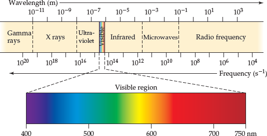
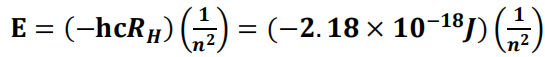
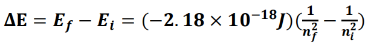
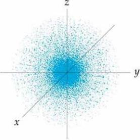
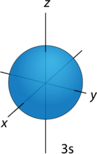
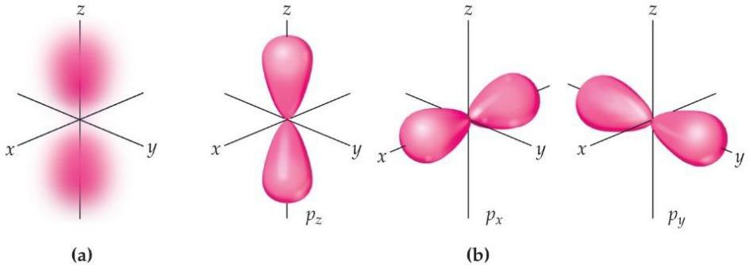
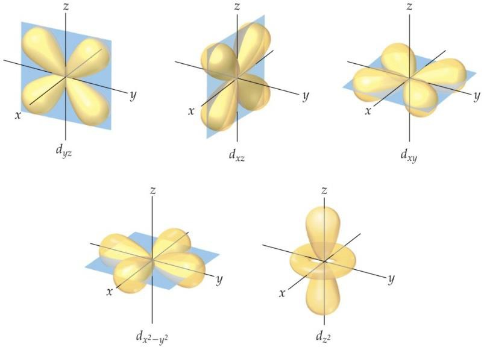
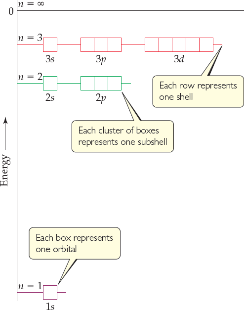
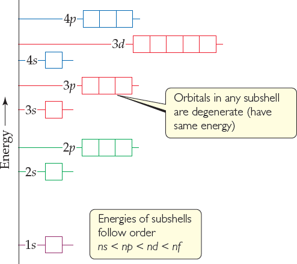
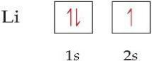

> **General Chemistry**
>
> **Chapter 6· Electronic Structure of Atoms**
>
> **Review**

# Definitions:

- **Electromagnetic radiation 电磁辐射:** the radiant energy released by certain electromagnetic processes. Visible light is electromagnetic radiation, as is invisible light, such as radio, infrared, and X- rays.

- **The speed of light (c) 光速:** 2.998×108 m/s. All electromagnetic radiation moves at the same speed.

- **Periodic 周期:** the pattern of peaks and troughs repeats itself at regular intervals.

- **Wave length (**𝛌) **波长:** the distance between two adjacent peaks (or between two adjacent troughs). (unit: m)

- **Frequency (**𝛎) 频率**:** the number of complete wavelengths or cycles that pass a given point each second. (unit: s-1）

- <u>𝛌𝛎 = 𝐜</u>

# Electromagnetic spectrum 电磁光谱:

- **Quantum (E) 量子:** the smallest quantity of energy that can be emitted or absorbed as electromagnetic radiation.

  - <u>𝐄 = 𝐡𝛎**;** Plank constant (h): 6.626×10-34 J-s</u>

- **Photoelectric effect:** Light shining on a clean metal surface causes electrons to be emitted from the surface. A minimum frequency of light, different for different metals, is required for the emission of electrons.

  - **Photon 光子:** energy of photon = E = hν

- **Work function 逸出功（功函数）:** A certain amount of energy that required for the electrons to overcome the attractive forces holding them in the metal.

- **dual wave particle nature 波粒二象性:** Light possesses both wave-like and particle-like characteristic and, depending on the situation, will behave more like waves or more like particles.

- **Spectrum 光谱:** is produced when radiation from polychromatic is separated into its component wavelengths.

  - **Monochromatic 单色(光谱):** the radiation composed of a single wavelength.

  - **Polychromatic 多色(光谱):** the radiation composed of many different wavelength.

  - **Continuous spectrum 连续光谱:** a spectrum consists of a continuous range of colors.

  - **Line spectrum 线性光谱:** a spectrum consists of only specific wavelengths.

- **Bohr’s model 玻尔模型:** The energies corresponding to the allowed orbits for the electron in the hydrogen atom are:

<figure>

</figure>

 

- **Ground state 基态:** The lowest-energy state (n=1)

- **Excited state 激发态:** When the electron is in a higher-energy state (n=2 or higher)

- The energy change for the transition of electron jumping from an initial state to a final state:

<figure>

<figcaption>
𝒏𝟐
</figcaption>
</figure>

# 

# 

# Momentum 动量: mv

- **Matter waves 物质波:** 𝛌 = <u>h</u>

> **mv**

- **Uncertainty principle 测不准原理:** ∆𝐱 ∙ ∆(𝐦𝐯) ≥ <u>h</u>

> **mv**

- **Wave function:** a series of mathematical functions that describe the electron in the atom.

- **Probability density (electron density) 电子密度:** 𝝍𝟐**,** the probability that the electron will be found at a given point in space.

- **Orbital: **a set of wave functions that yields by the solution to Schrodinger’s equation. Each orbital has a characteristic shape and energy.

- **The principal quantum number (n):** energy level, **n = 1, 2, 3, 4, ...**

- **The angular momentum quantum number (*l*):** shape (of orbital)**, *l* = 0, 1, 2, 3, ...n-1**

- **The magnetic quantum number (m*l*):** orientation**, m*l* = interval of \[ -*l*, +*l* \]**

<table style="width:61%;">
<colgroup>
<col style="width: 15%" />
<col style="width: 10%" />
<col style="width: 11%" />
<col style="width: 11%" />
<col style="width: 11%" />
</colgroup>
<tbody>
<tr>
<td><blockquote>

Values of n

</blockquote></td>
<td><blockquote>

1

</blockquote></td>
<td>
2
</td>
<td style="text-align: left;"><blockquote>

3

</blockquote></td>
<td style="text-align: left;"><blockquote>

4

</blockquote></td>
</tr>
<tr>
<td><blockquote>

Letter used

</blockquote></td>
<td><blockquote>

K

</blockquote></td>
<td><blockquote>

L

</blockquote></td>
<td style="text-align: left;"><blockquote>

M

</blockquote></td>
<td style="text-align: left;"><blockquote>

N

</blockquote></td>
</tr>
<tr>
<td><blockquote>

Values of <em>l</em>

</blockquote></td>
<td><blockquote>

0

</blockquote></td>
<td>
1
</td>
<td style="text-align: left;"><blockquote>

2

</blockquote></td>
<td style="text-align: left;"><blockquote>

3

</blockquote></td>
</tr>
<tr>
<td><blockquote>

Letter used

</blockquote></td>
<td><blockquote>

<em>s</em>

</blockquote></td>
<td>
<em>p</em>
</td>
<td style="text-align: left;"><blockquote>

<em>d</em>

</blockquote></td>
<td style="text-align: left;"><blockquote>

<em>f</em>

</blockquote></td>
</tr>
</tbody>
</table>

- **Electron shell 电子层:** the collection of orbitals with the same value of n.

- **Subshell 支壳层:** the set of orbitals that have the same n and *l* values.

- ***s, p, d* Orbitals:**

> **s orbitals** (spherical)
>
> 

**p orbitals** (dumbbell-shaped, the subscript *x, y, z* denotes axis along which the orbital is aligned)

> **d orbitals** (cloverleaf-shaped, the subscript *xy, xz, yz* denotes the four lobes lie in *xy, xz, yz* planes)

> General energy ordering of orbitals for the **hydrogen atom** (left) and a **many-electron atom** (right)

- **Electron spin:** that causes each electron to behave as if it were a tiny sphere spinning on its own axis.

- **The spin magnetic quantum number (ms):** independent of other three quantum numbers because ms is always = –½ or +½

- **Electron configuration:** the way electrons are distributed among the various orbitals of an atom.

  - The most stable electron configuration—the ground state—is that in which the electrons are in the lowest possible energy states.

  - The orbitals are filled in order of increasing energy, with no more than two electrons per orbital.

- **Orbital diagram:** Each orbital is denoted by a box and each electron by a half arrow**.**

- **The Pauli exclusion principle:** an orbital can hold a maximum of two electrons and they must have opposite spins.

- **Hund’s rule:** for degenerate orbitals, the lowest energy is attained when the number of electrons having the same spin is maximized.

> ***The rule: Filling up of orbitals is dependent on orbital energy while removal of electrons from orbitals is dependent on orbital location.***
