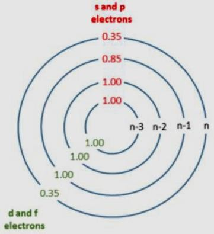
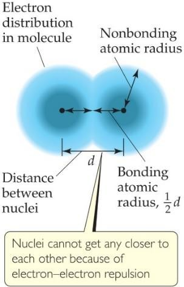
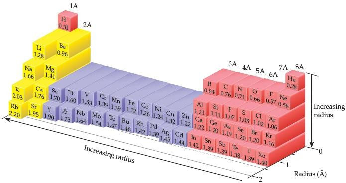
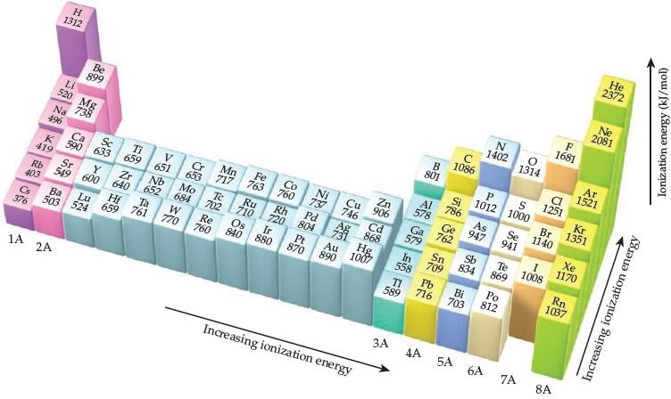
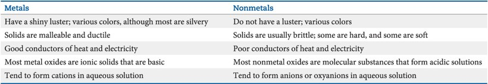

> **Review**

\
General Chemistry
=================

> **Chapter 7· Periodic properties of the elements**

- **Valence orbitals:** the occupied orbitals that hold the electrons involved in bonding.

- **Zeff:** effective nuclear charge. The net positive charge experienced by an electron in a multi-electron atom. **Zeff = Z – S (Zeff \< Z)**

- **Z:** the actual nuclear charge. The value of Z = the atomic number

- **S:** screening constant

  1)  Simple method: the value of S equals the number of core electrons.

  2)  Slater's rules:

> **A:** electrons for which *n* is larger than the value of *n* for the electron of interest contribute 0 to the value of S.
>
> **B:** electrons with the same value of *n* as the electron of interest contribute 0.35 to the value of S, except for the \[1s\] group, where the other electron contributes only 0.30.
>
> **C:** electrons that have principle quantum number *n*-1 contribute
>
> 0.85 to the value of S.
>
> **D:** electrons that have even smaller principle quantum number contribute 1 to the value of S.

- **Trends**:

1)  The effective nuclear charge increase from left to right across any period.

2)  The effective nuclear charge increase slightly when go down a column.

- **Nonbonding atomic radius (van der Waals radius):** half of the shortest distance separating two nuclei during a collision of atoms.

- **Bonding atomic radius (covalent radius):** half the interatomic distance when atoms are bonded.

> *Unless otherwise noted, we mean the bonding atomic radius when we speck of the “size” of an atom.*

- **Trends (atomic radii):**

1)  Within each group, bonding atomic radius tends to increase from top to bottom (*n* ↑);

2)  Within each period, bonding atomic radius tends to decrease from left to right (*Z*eff ↑).

# Ionic radius *vs.* atomic radius:

1)  Cations are smaller than their parent atoms;

2)  Anions are larger than their parent atoms.

3)  For ions carrying the same charge, ionic radius increase when go down a column.

- **Isoelectronic series:** a group of ions all containing the same number of electrons. The ionic radius decrease with increasing atomic number.

- **Ionization energy:** the minimum energy required to remove an electron from the ground state of the isolated gaseous atom or ion; the higher the ionization energy, the more difficult it is to remove an electron.

- **Electron affinity:** the energy change accompanying the addition of an electron to a gaseous atom, Cl (g) + *e*− → Cl- (g)

# Successive ionization energy:

1)  : the first ionization energy *I*1: Na (g) → Na+ (g) + e-

2)  : the second ionization energy *I*2: Na+ (g) → Na2+ (g) + e- 3): *I*1\< *I*2\< *I*3

4\) Only the outermost electrons are involved in the sharing and transfer of electrons that give rise to chemical bonding and reactions.

# Trends (the first ionization energy):

1)  I1 generally increase as move across a period.

2)  I1 generally decrease as move down any column in the periodic table.

3)  The *s*- and *p*-block elements show a larger range of *I*1 values than do the transition-metal elements.

- When electrons are removed from an atom to form a cation, they are always removed first from the occupied orbitals having the largest principal quantum number *n*.

- Metallic character generally increase as proceed down a group of periodic table and decrease as proceed right across a period.

# Properties of metals and nonmetals:

- **Metals:**

1)  Metals tend to have low ionization energies and therefore tend to form cations relatively easily;

2)  Compounds made up of a metal and a nonmetal tend to be ionic substances;

3)  Most metal oxide are basic;

# Nonmetals:

1)  Because of their relatively large, negative electron affinities, nonmetals tend to gain electrons when they react with metals;

2)  Compounds composed entirely of nonmetals are typically molecular substances that tend to be gases, liquids or low melting solids at room temperature;

3)  Most nonmetal oxides are acidic;

- **Metalloids:** Metalloids have properties intermediate between those of metals and those of nonmetals.

# Alkali metals:

1)  Soft metallic solids, silvery, metallic luster, high thermal and electrical conductivity, low density, low melting point;

2)  React with hydrogen to form hydrides and with sulfur to form sulfides;

3)  React vigorously with water, producing hydrogen gas and a solution of an alkali metal hydroxide;

4)  Li metal reacts with oxygen to form lithium oxide; Na reacts with oxygen to form sodium peroxide; K/Rb/Cs react with oxygen to form K/Rb/Cs superoxide;

# Alkaline earth metals:

1)  Solid at room temperature, harder and denser and melt at higher temperature (compared with alkali metals);

2)  The first ionization energies of the alkaline earth metals are low but not as low as alkali metals, so the alkaline earth metals are less reactive than alkali metals;

3)  Beryllium doesn’t react with water and steam, even when heated red-hot;

4)  Magnesium reacts slowly with liquid water and more readily with steam;

5)  Calcium and the elements below it react readily with water at room temperature;

# Hydrogen:

1)  Hydrogen is a nonmetal that occurs as colorless diatomic gas under most conditions;

2)  Hydrogen react with most nonmetals to form molecular compounds in which its electron is shared with other nonmetal;

3)  Hydrogen readily form H+ ions in which the hydrogen atom has lost its electron;

4)  The ability of molecular compounds of hydrogen with nonmetals to form acids in water;

5)  Hydrogen has the ability to gain electron from a metal with a low ionization energy;

# The Oxygen Group:

1)  Oxygen: nonmetal, a colorless gas at room temperature, exist in two molecular forms, O2 and O3;

2)  Sulfur: nonmetal, exist in several allotropic forms, the most common and stable form is S8 rings;

3)  Selenium: nonmetal, essential for life but toxic at high doses;

4)  Tellurium: metalloid, elemental structure is more complicated;

5)  Polonium: metal, radioactive;

# The Halogen:

1)  the halogens are typical nonmetals;

2)  highly negative electron affinities, F and Cl are more reactive than Br and I;

3)  react directly with metals to form metal halides;

# The Noble Gases:

1)  they have very large ionization energies;

2)  their electron affinities are positive;

3)  they are found as monatomic gases;

4)  they completely filled *s* and *p* subshells
