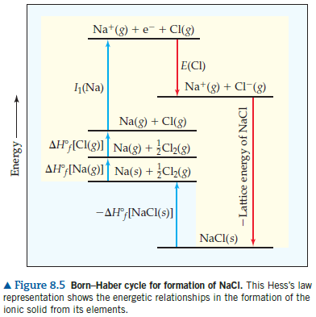
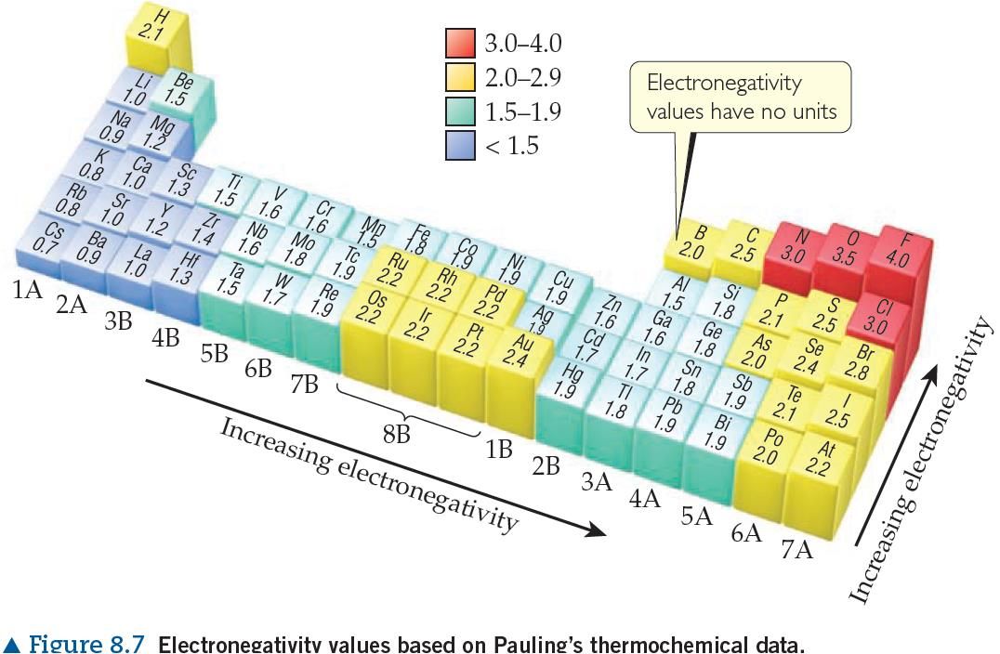

# Review Ch08

> Converted from [Review-Ch08.pdf](Review-Ch08.pdf).

**General Chemistry**

**Chapter 8· Basic Concepts of Chemical Bonding**

Review Definitions:  General types of chemical bonds: ionic bonds, covalent bonds and metallic bonds.

1) Ionic bonds: electrostatic attraction 2) Covalent bonds: electrons shared 3) Metallic bonds: electrons delocalized

** Valence electrons: The electrons involved in chemical bonding, for most atoms**

are those in the outermost occupied shell.

 Lewis electron-dot symbols (Lewis symbols): consists of the element’s chemical

symbol plus a dot for each valence electron. 1) The dots are placed on the four sides of the symbol—top, bottom, left, and right; 2) Each side can accommodate up to two electrons; 3) All four sides are equivalent; 4) In general, spread out the dots as much as possible;

** The Octet Rule: Atoms tend to gain, lose, or share electrons until they are**

**surrounded by eight valence electrons.**

 Lattice energy: The energy required to completely separate one mole of a solid

ionic compound into its gaseous ions. 1) NaCl(s) →𝑁𝑎+(𝑔) + 𝐶𝑙−(𝑔)       ∆𝐻𝑙𝑎𝑡𝑡𝑖𝑐𝑒= +788𝐾𝐽/𝑚𝑜𝑙 2) For a given arrangement of ions, the lattice energy increases as the charge on the ions increase and as their radii decrease.

** Electron configuration of ions (s-,p-,d-block elements):**

1) We expect ionic compounds of the representative metals from groups 1A, 2A, and 3A to contain 1+, 2+, and 3+ cations, respectively; 2) We expect ionic compounds of the representative nonmetals from groups 5A, 6A, and 7A to contain 3-, 2-, and 1- anions, respectively; 3) In forming ions, transition metals lose the valence-shell s electron first, then as many d electrons as required to reach the charge of the ion.

 Covalent bond: A chemical bond formed by sharing pairs of electrons.  Bonding pairs: shared electron pairs  Lone pairs (nonbonding pairs): unshared electron pairs  Single bond: A shared electron pair  Double bond: Two shared electron pairs between two atoms  Triple bond: Three shared electron pairs between two atoms

1) The bond length between two atoms decreases as the number of shared electron pairs increases. 2) The bond enthalpy between two atoms increases as the number of shared electron pairs increases.

** Bond polarity: A measure of how equally or unequally the electrons in any**

covalent bond are shared.

 Nonpolar covalent bond: the electrons are shared equally.  Polar covalent bond: the atoms exerts a greater attraction for the bonding

electrons than the other.

 Electronegativity: the ability of an atom in a molecule to attract electrons to itself.  Trends:

1) Electronegativity increase from left to right across a period; 2) Electronegativity decrease with increasing atomic number in a group;

** The greater the difference in electronegativity between two atoms, the more**

**polar their bond.**

 Polar molecule: A molecule in which the centers of positive and negative charge

**do not coincide.**

 Dipole: Two electrical charges of equal magnitude but opposite sign are separated

**by a distance.**

** Dipole moment: The quantitative measure of the magnitude of a dipole.**

**μ=Qr  (unit: Debyes, 1D = 3.34 × 10−30 𝐶∙𝑚)**

** Differentiating ionic and covalent bonding:**

1) Simplest approach: the interaction between a metal and a nonmetal is ionic and that between two nonmetals is covalent; 2) More sophisticated approach: to use the difference in electronegativity as the main criterion for determining whether ionic or covalent bonding will be dominant. 3) Properties of compounds are often best: Lower melting points mean covalent bonding, for example.

** The procedures follow in the drawing Lewis structures:**

1) Sum the valence electrons from all atoms, taking into account overall charge; 2) Write the symbols for the atoms, show which atoms are attached to which, and connect them with a single bond (a line, representing two electrons); 3) Complete the octets around all the atoms bonded to the central atom; 4) Place any leftover electrons on the central atom; 5) If there are not enough electrons to give the central atom an octet, try multiple bonds;

 Formal charge: the charge the atom would have if each bonding electron pair in

the molecule were shared equally between its two atoms, different from the real charges on atoms.

 To calculate the formal charge: calculated by subtracting the number of electrons

assigned to the atom from the number of valence electrons in the neutral atom. 1) All unshared (nonbonding) electrons are assigned to the atom on which they are found; 2) For any bond—single, double, or triple—half of the bonding electrons are assigned to each atom in the bond;

Formal charge = valence electrons −1

2 (𝑏𝑜𝑛𝑑𝑖𝑛𝑔 𝑒𝑙𝑒𝑐𝑡𝑟𝑜𝑛𝑠) −𝑛𝑜𝑛𝑏𝑜𝑛𝑑𝑖𝑛𝑔 𝑒𝑙𝑒𝑐𝑡𝑟𝑜𝑛𝑠

 Dominant Lewis structure: the most important Lewis structure.  To choose the dominant Lewis structure:

1) The dominant Lewis structure is generally the one in which the atoms bear formal charges closest to zero; 2) A Lewis structure in which any negative charges reside on the more electronegative atoms is generally more dominant than one that has negative charges on the less electronegative atoms;

 Resonance: a way of describing delocalized electrons within certain molecules or

polyatomic ions where the bonding cannot be expressed by one single Lewis

structure. A molecule or ion with such delocalized electrons is represented by resonance structures.

** Exceptions to the octet rule:**

1) Molecules and polyatomic ions containing an odd number of electrons; 2) Molecules and polyatomic ions in which an atom has fewer than an octet of

valence electrons;

3) Molecules and polyatomic ions in which an atom has more than an octet of valence electrons.

 Hypervalent: molecules and ions with more than an octet of electrons around the

central atom.

** The strength of a covalent bond between two atoms is determined by the**

**energy required to break the bond.**

 Bond enthalpy: the enthalpy change ΔH, for the breaking of a particular bond in

one mole of a gaseous substance.

 Atomization: a molecule decomposed into its atoms.  Rules about bond enthalpy:

1) Energy is always required to break chemical bonds. 2) Energy is always released when a bond forms between two gaseous atoms or molecular fragments. 3) The greater the bond enthalpy, the stronger the bond is. 4) A molecule with strong chemical bonds generally has less tendency to undergo chemical change than does one with weak bonds.

 ∆𝐻𝑟𝑥𝑛= Σ(𝑏𝑜𝑛𝑑 𝑒𝑛𝑡ℎ𝑎𝑙𝑝𝑖𝑒𝑠 𝑜𝑓 𝑏𝑜𝑛𝑑 𝑏𝑟𝑜𝑘𝑒𝑛) −Σ(𝑏𝑜𝑛𝑑 𝑒𝑛𝑡ℎ𝑎𝑙𝑝𝑖𝑒𝑠 𝑜𝑓 𝑏𝑜𝑛𝑑𝑠 𝑓𝑜𝑟𝑚𝑒𝑑)
