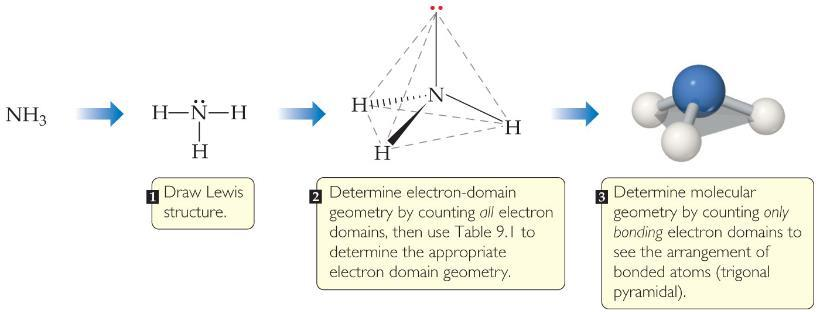
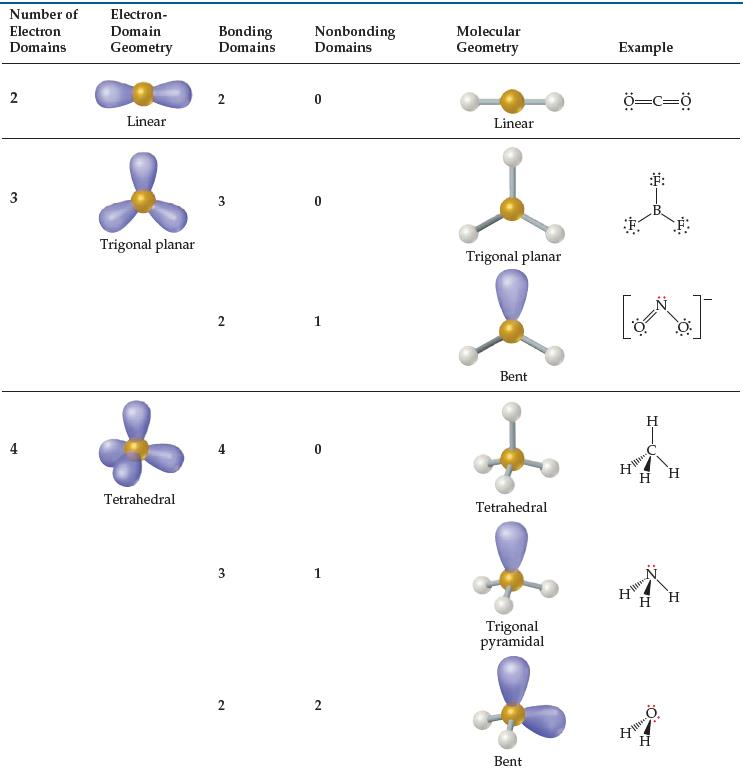
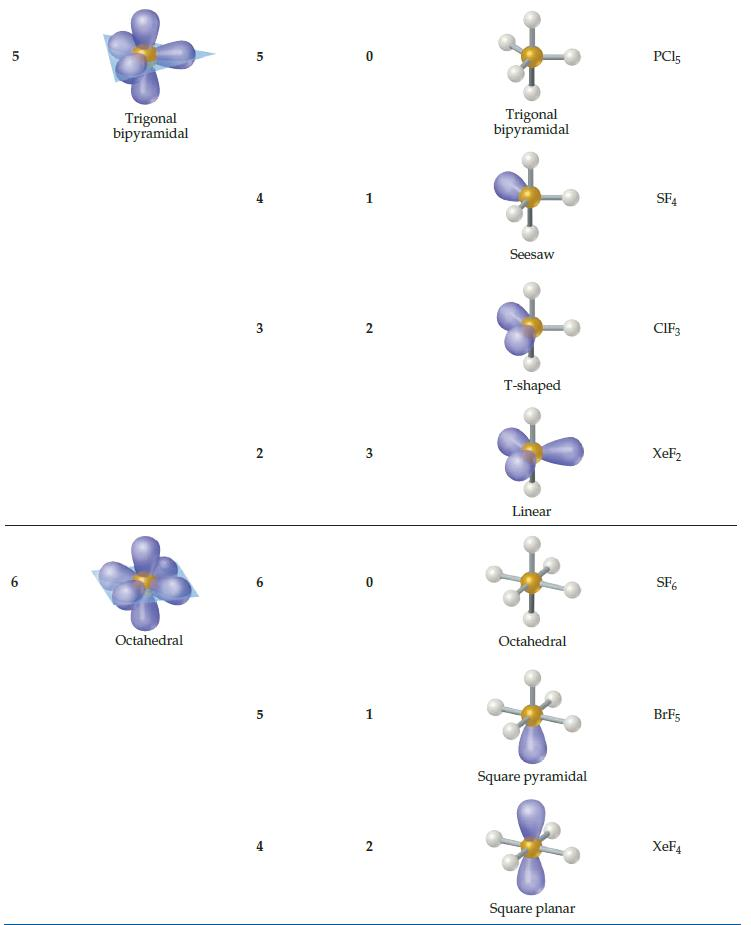
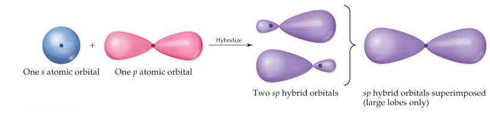
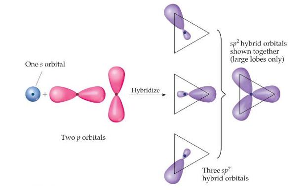
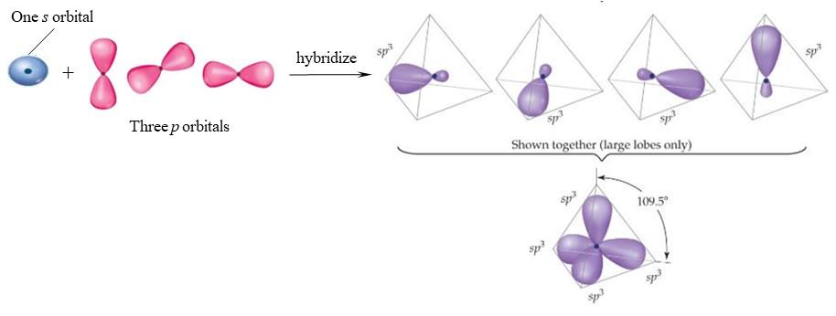

# Review Ch09

> Converted from [Review-Ch09.pdf](Review-Ch09.pdf).

## Chapter 9

## Molecular Geometry and Bonding Theories

Review Molecular geometry: Molecular shape: the bond angles of a molecule, together with the bond lengths, define the shape and size of the molecule. Bond angle: 1) Nonbonding pairs are larger than bonding pairs, the repulsion is greater, the bond

angles decrease. CH4 (109.5°)>NH3 (107°)>H2O (104.5°).

2) Double and triple bond have larger domains than single bonds, the repulsion is

greater, making their bond angles greater.

Electron domain: a bonding pair of electrons thus defines a region in which the electrons are most likely to be found. Each nonbonding electron pair, each single bond, each double bond, or each triple bond is counted as one electron domain.  Valence Shell Electron Pair Repulsion Theory (VSEPR Model)：A model used

in chemistry to predict the geometry of individual molecules from the number of electron domains surrounding their central atoms.

1) Draw the Lewis structure of the molecule ion, and count the number of electron

**domains around the central atom.**

2) Determine the electron-domain geometry by arranging the electron domains about

**the central atom so that the repulsions among them are minimized.**

3) Use the arrangement of the bonded atoms to determine the molecular geometry.

 Valence bond theory 1) The marriage of Lewis’s notion of electron-pair bonds and the idea of atomic orbitals leads to a model of chemical bonding. 2) In VB theory, electrons of two atoms begin to occupy the same space, this is called “overlap” of orbitals. 3) The sharing of space between two electrons of opposite spin results in a covalent bond.  Hybrid orbital theory Hybrid orbital: by “mixing” atomic orbitals to create new orbitals of equal energy, called degenerate orbitals. Hybridization: the process of mixing atomic orbitals is a mathematical operation, the number of hybrid orbitals on an atom equals the number of atomic orbitals that are mixed. sp-hybridization

**sp2-hybridization**

**sp3-hybridization**

Hybrid Orbital Summary: 1) Draw the Lewis structure for the molecule or ion; 2) Use the VSEPR model to determine the electron-domain geometry around the

central atom;

3) Specify the hybrid orbitals needed to accommodate the electron pairs based on their

geometric arrangement.

Sigma (σ) bond: head-to-head overlap Pi (π) bond: side-to-side overlap 1) In every σ bond at least one pair of electron is localized in the space between the

atoms.

2) The electrons in σ bonds are localized in the region between two bonded atoms,

they do not make a significant contribution to the bonding between any other two atoms.

3) When atoms share more than one pair of electrons, one pair is used to form a σ

bond, the additional pairs form π bonds.

4) Molecules can have π systems that extended over more than two bonded atoms,

electrons in extended π systems are said to be “delocalized”.

 Molecular Orbital Theory Bonding molecular orbitals: are constructive combinations of atomic orbitals, the energy of the resulting MO is lower than the two atomic orbital from which it was made. Antibonding molecular orbitals: are destructive combinations of atomic orbitals, the energy of the resulting MO is higher than the energy of the atomic orbitals. Bond order =1/2*(bonding electrons – antibonding electrons) Summary: 1) Molecular orbitals have many characteristics like atomic orbitals. 2) They differ from atomic orbitals because they represent the entire molecule, not a

single atom.

3) Whenever there is direct overlap of orbitals, forming a bonding and an antibonding

orbital, they are called sigma (σ) MOs. The antibonding orbital is distinguished with an asterisk as σ*.

4) σ and σ* orbitals formed from s and p atomic orbitals. 5) π and π* orbitals formed from p atomic orbitals. 6) The effect of raising and lowering energy is greater for σ and σ*.

2s

2s

2p

2p

σ2s

π2p

σ*

2s

σ*

2p

σ2p

π*

2p

Atomic orbitals

Atomic orbitals

Molecular

orbitals

Energy

2s 2s

2p 2p

σ2s

σ*

2s

σ*

2p

σ2p

π*

2p

Atomic orbitals

Atomic orbitals

Molecular

orbitals

π2p

MO energy levels for O2, F2, and Ne2                  MO energy levels for B2, C2, and N2

Diamagnetism: the result of all electrons in every orbital being spin paired. These substances are weakly repelled by a magnetic field. Paramagnetism: the result of the presence of one or more unpaired electrons in an

orbital.  Comparison

VSEPR VB HO MO

can predict the geometric configuration  but can’t explain the reason and strength of bonding

can’t explain the geometric configuration and molecular magnetism

can explain the geometric configuration but lack of foresight

can explain the molecular magnetism and bonding situation, can’t explain the molecular geometry
