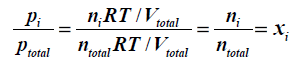
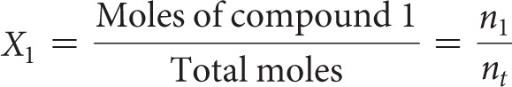
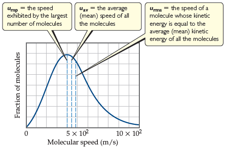
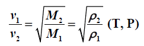
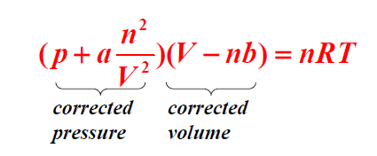

# Review Ch10

> Converted from [Review-Ch10.pdf](Review-Ch10.pdf).

## Chapter 10

## Gases

Review Definitions:  Pressure (P): defined as the force (F), that acts on a given area (A).  Atmospheric pressure: defined as the force exerted by the atmosphere on a

given surface area.

** Standard atmospheric pressure: the pressure sufficient to support a column of**

mercury 760mm high.

 1 atm= 760 mmHg = 760 torr = 1.10325×105 Pa = 101.325 kPa = 1.01325 bar  The gas law

Boyle’s law:        PV=constant  (constant n, T ) Charles’s law:     V/T=constant (constant n, P ) Avogadro’s Law: V/n=constant (constant P, T)

 Ideal-gas equation: PV = nRT  R: gas constant (8.31 kPa• dm3•mol-1•K-1  = 8.31J•mol-1•K-1)  Gas density: d=PM/RT  Standard temperature and pressure (STP): 0℃, 1atm.  Molar volume: the volume occupied by 1mol of ideal gas at STP, which is 22.4L.  Dalton’s law of partial pressures: the total pressure of a mixture of gases equals

the sum of the pressures that each would exert if it were present alone. Pt = P1 + P2 + P3 + …+Pn

 Partial pressure: the pressure exerted by a particular component of a mixture of

gases.

 Mole fraction (X): a dimensionless number that expresses the ration of number of

moles of one component in a mixture to the total number of moles in the mixture.

** Kinetic-molecular theory of gases:**

1) Gases consist of large numbers of molecules that are in continuous, random

motion;

2) The combined volume of all the molecules of the gas is negligible relative to

the total volume in which the gas is contained;

3) Attractive and repulsive forces between gas molecules are negligible; 4) Energy can be transferred between molecules during collisions, but the average

kinetic energy of the molecules does not change with time, as long as the temperature of the gas remains constant;

5) The average kinetic energy of the molecules is proportional to the absolute

temperature.

 Effusion: the escape of gas molecules through a tiny hole.  Diffusion: the spread of one substance throughout a space or throughout a second

substance.

** Graham’s law of effusion: lighter gas has the higher effusion rate.**

 Mean free path: the average distance traveled by a molecule between collisions,

the value varies with pressure.

** Real gas: molecules do have finite volumes and do attract one another.**

1) molecules do attract others: P<Pideal,       Z=PV/nRT<1 2) molecules do have volumes: V>Videal,      Z=PV/nRT>1

** Van der Waals equation:**

