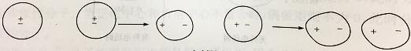
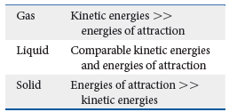
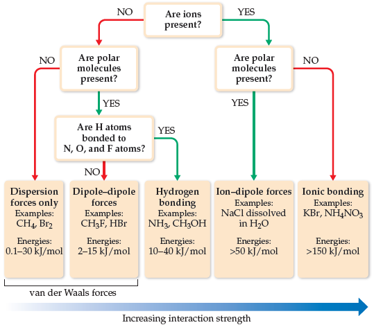
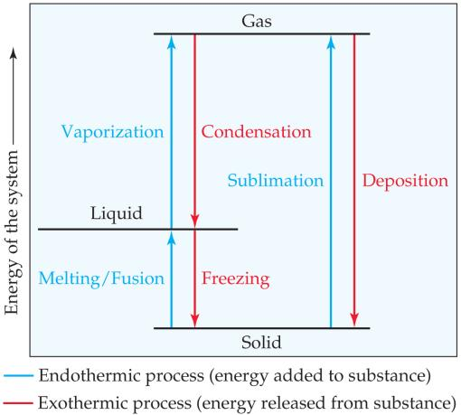
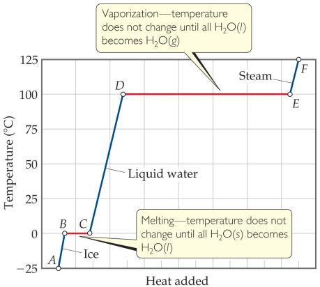
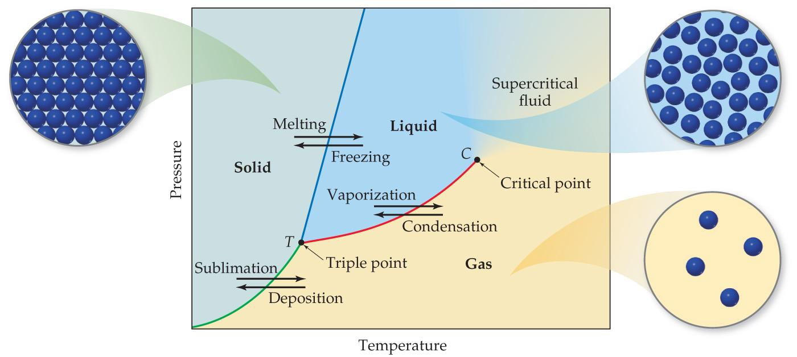
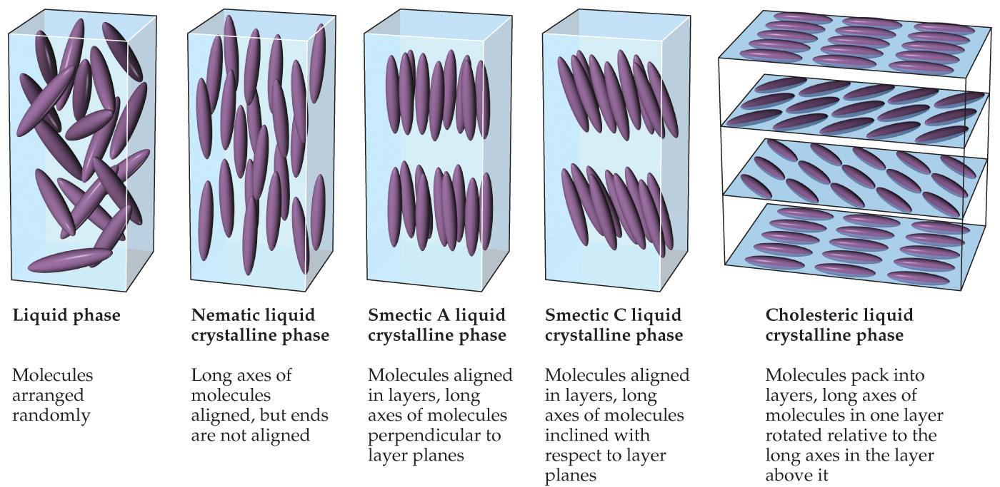

# Review Ch11

> Converted from [Review-Ch11.pdf](Review-Ch11.pdf).

**Chapter 11**

**Liquids and Intermolecular Forces**

**Review  State of substance: depends largely on the**

balance between the kinetic energies of the particles (atoms, molecules, or ions) and the interparticle energies of attraction.

** Intermolecular force: dispersion force, dipole-dipole attraction, hydrogen**

bonding, ion-dipole force.

 Dispersion force: the motions of electrons in one atom influence the motions of

electrons in its neighbors. The instantaneous dipole on one atom can induce an instantaneous dipole on an adjacent atom, causing the atoms to be attracted to others. It tends to increase in strength with increasing molecular weight.

 Polarizability: The ease with which the charge distribution is distorted.  The greater the polarizability, the more easily the electron cloud can be distorted

to given an instantaneous dipole. More polarizable molecules have larger dispersion forces.

** Dipole-dipole force: the presence of a permanent dipole moment in polar**

molecules. For molecules of approximately equal mass and size, the strength of intermolecular attractions increases with increasing polarity.

** Hydrogen bonding: an attraction between a hydrogen atom attached to a highly**

electronegative atom (usually F, O, N) and a nearby small electronegative atom in another molecule or chemical group.

 Ion-polar force: exists between an ion and a polar molecule. Cations are attracted

to the negative end of a dipole, and anions are attracted to the positive end. The magnitude of the attraction increases as either the ionic charge or the magnitude of the dipole moment increases.

** Comparison:**

1) When the molecules of two substances have comparable molecular weights and

shapes, dispersion forces are approximately equal in the two substances.

2) When the molecules of two substances differ widely in molecule weights, and

there is no hydrogen bonding, dispersion forces tend to determine which substance has the stronger intermolecular attractions.

** Viscosity: the resistance of a liquid to flow, it increases with stronger**

**intermolecular forces and decreases with higher temperature.**

 Surface tension: the energy required to increase the surface area of a liquid by a

unit amount.

** Capillary action: the rise of liquids up very narrow tubes.**

 Cohesive forces: Intermolecular forces that bind similar molecules to one another.  Adhesive forces: Intermolecular forces that bind a substance to a surface.

 Phase change (change of state): each state of matter (solid, liquid, gas) transforms

into either of the other two states.

** Heating curve: a graph of temperature versus amount of heat added.**

 Within a phase, heat is the product of specific heat, sample mass, and temperature

change.

 For the phase changes, the product of mass and the heat of fusion or vaporization

is heat.

 Supercooling: the process of lowering the temperature of a liquid or a gas below

**its freezing point without it becoming a solid.**

 Superheating: the phenomenon in which a liquid is heated to a temperature higher

**than its boiling point, without boiling.**

 Critical temperature: the lowest temperature which vapor of the substance cannot

**be liquefied, no matter how much pressure is applied.**

 Critical pressure: the lowest pressure required to liquefy a gas at its critical

**temperature.**

 Supercritical fluid: any substance at a temperature and pressure above its critical

point, where distinct liquid and gas phases do not exist, substance changes to supercritical fluid.

** Vapor pressure: the pressure exerted by a vapor in thermodynamic equilibrium**

with its condensed phases (solid or liquid) at a given temperature in a closed system.

** Clausius-Clapeyron equation:**

 Volatile: a substance with a high vapor pressure at normal temperatures is often

**referred to as volatile**

 Boiling point: the temperature at which its vapor pressure equals the external

pressure, acting on the liquid surface.

 Normal boiling point: the boiling point of a liquid at 1atm pressure.  Phase diagram: a graphic way to summarize the conditions under which equilibria

exist between the different states of matter. Allows to predict which phase of a substance is present at any given temperature and pressure.

 liquid crystal: the viscous, milky state that some substances exhibit between the

liquid and solid states. (nematic liquid crystals; smectic liquid crystals; cholesteric liquid crystals).

