# Review Ch12

> Converted from [Review-Ch12.pdf](Review-Ch12.pdf).

## Chapter 12

## Solids and modern materials

**Review Definitions:  Organization of solids:**

1) Crystalline solids: the atoms are arranged in an orderly repeating pattern. 2) Amorphous solids: lack of order in the arrangement of atoms.

** Comparison:**

1) Crystalline solids have regular geometric shape and fixed melting point, while

amorphous solids do not.

2) The properties of electricity, mechanics, optics, thermal conductivity, electrical

conductivity for crystalline solids are anisotropy, while amorphous solids is isotropy.

 Unit cell: a relatively small repeating unit in a crystalline solid.  Crystal lattice: the geometrical pattern of points on which the unit cells are

arranged.

** Lattice point: positions that define the overall structure of the crystalline**

compound.

 Lattice vector: the positions of the lattice points.  Two-dimensional lattices:

** Three-dimensional primitive lattices:**

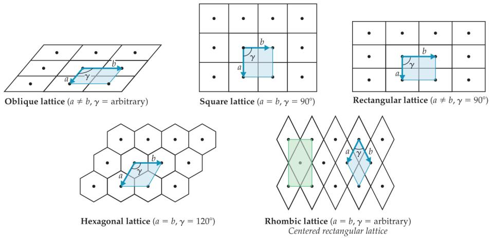

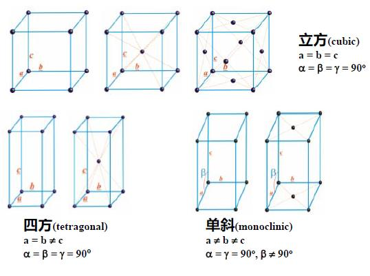

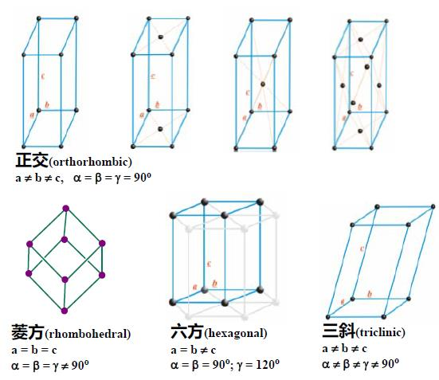

** Classification of solids:**

1) Metallic solids 2) Ionic solids 3) Covalent-network solids 4)  Molecular solids 5)  Polymers 6) Nanomaterials

** Metallic Solids: held together by a delocalized “sea” of**

**collectively shared valence electrons.**

** Electron-Sea model: a simple model that pictures the metal**

as an array of metal cations in a “sea” of valence electrons. The electrons are confined to the metal by electrostatic attractions to the cations, and they are uniformly distributed throughout the structure.

 Molecular-Orbital model: as the number of atoms in a chain increases, the energy

gap between the bonding orbitals and between the antibonding orbitals disappears, resulting in a continuous band of energy.

 Band: as the chain length goes to infinity, the allowed energy states become a

continuous band.

** Band structure: the electronic structure of a bulk solid.   Close packing：**

**Hexagonal close packing (hcp)          Cubic close packing (ccp)**

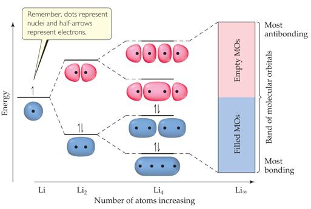

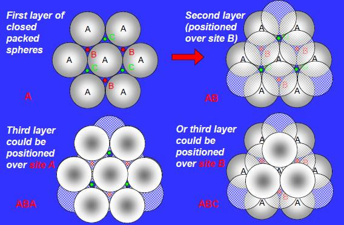

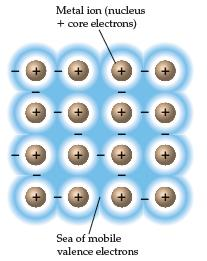

** Packing efficiency: =**

𝒗𝒐𝒍𝒖𝒎𝒆 𝒐𝒇 𝒂𝒕𝒐𝒎𝒔

**𝒗𝒐𝒍𝒖𝒎𝒆 𝒐𝒇 𝒖𝒏𝒊𝒕 𝒄𝒆𝒍𝒍**

** Structures of metallic solid:**

 Alloy: a material that contains more than one element and has the characteristic

properties of a metal. 1） Substitutional alloy: Atoms of the solute in a solid solution occupy positions

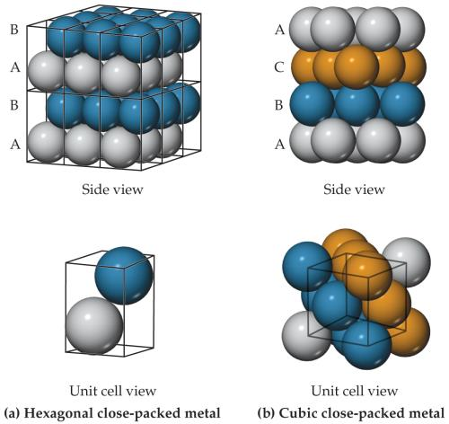

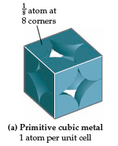

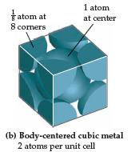

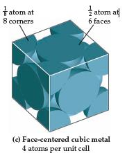

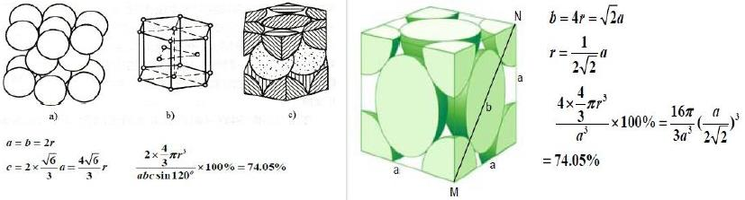

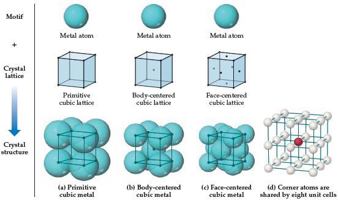

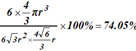

normally occupied by a solvent atom. Two metallic components have similar atomic radii and chemical-bonding characteristics

2） Interstitial alloy: the solute atoms occupy interstitial positions in the “holes”

between solvent atoms. The solute atoms must have a much smaller bonding atomic radius than the solvent atoms.

3） Heterogeneous alloy: the components are not dispersed uniformly. 4） Intermetallic compound: compounds rather than mixtures. have definite

properties and their composition cannot be varied.

 Ionic solids: the substances that held together by the electrostatic attraction

**between cations and anions: ionic bonds.**

 For a given ionic compound, a number of factors that come into play when

considering which type of structure is most favorable, but two of the most important are the relative sizes of ions and the stoichiometry.

** Structures of ionic solids:**

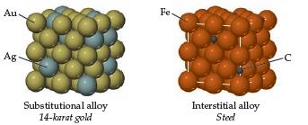

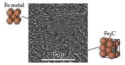

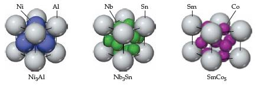

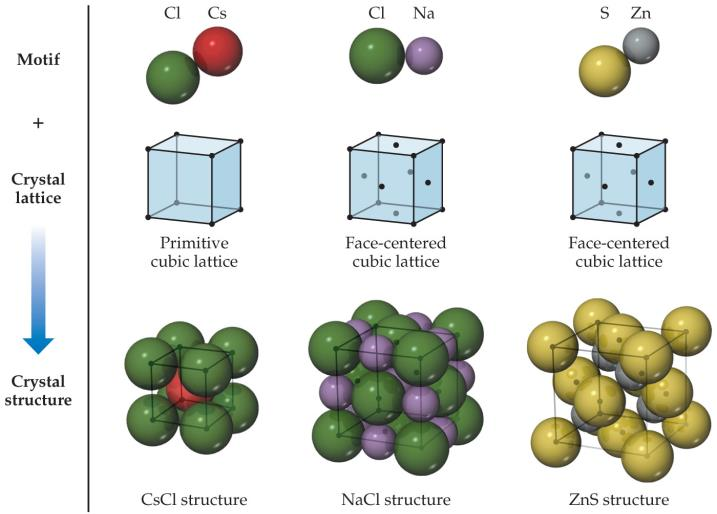

 These structures (CsCl, NaCl, ZnCl) can be realized only for ionic compounds in

which the number of cations and anions is equal.

 Molecular solids: the substances that consist of atoms or neutral molecules held

together by dipole-dipole forces, dispersion forces, and/or hydrogen bonds.

 Covalent-network solids: the substances that consist of atoms held together in

large networks by covalent bonds.

 Semiconductors: solids conduct electricity but nowhere near as well as metals.

1) elemental semiconductors: contain only one type of atom. 2) compound semiconductors: contain two or more elements.

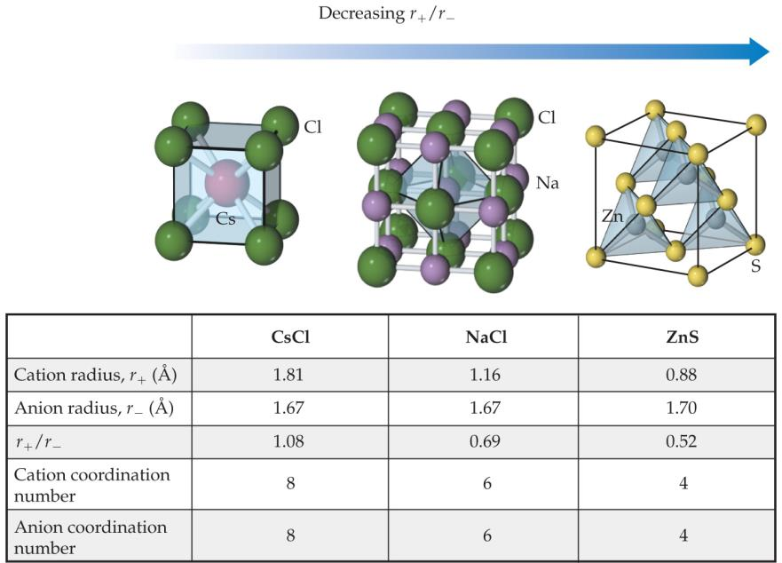

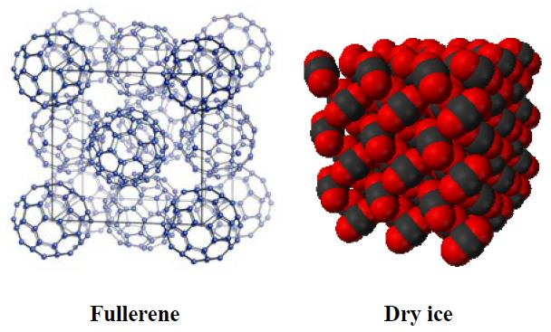

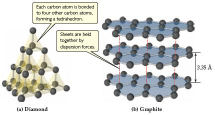

** Valence band: The band that forms from bonding molecular orbitals.**

** Conduction band: the band that forms the antibonding orbitals.**

 Band gap (Eg): the energy difference between the top of the valence band and the bottom of the conduction band in insulators and semiconductors.

 In a semiconductor, the valence band is filled with electrons and the conduction band is empty. These two bands are separated by the energy band gap.

 The size of the bad gap increases as the bond length decreases, and as the difference in electronegativity between the two elements increases.

** Insulator: solids does not conduct electricity at all.**

 Doping: The process of adding controlled amounts of impurity atoms to a material.

 n-type semiconductors: have more electrons, so the negative charge travels in the conductance band.

 p-type semiconductors: have fewer electrons, so the “hole” travels in the valence band.

**Comparison:**

Metallic solids Ionic solids Molecular solids Covalent-network

solids

 Consists of metal

**atoms held together by metallic bolding;**

 high electrical and

thermal conductivity;

 e.g. Silver,

copper, alloys, etc.

 Consists of cations

**and anions held together by electrostatic attraction (ionic bonds);**

 high melting and

boiling points

 e.g. NaCl, CsCl,

ZnS, etc

 Consists of atoms or

neutral molecules held together by intermolecular forces (dipole-dipole, dispersion forces, and/or hydrogen bonds);

 Soft, relatively low

melting point

 e.g. Ar, H2O, CO2, etc

 Consists of atoms

**held together in large networks by covalent bonds;**

 Much harder,

higher melting points than molecular solids

 e.g. diamond,

graphite, etc

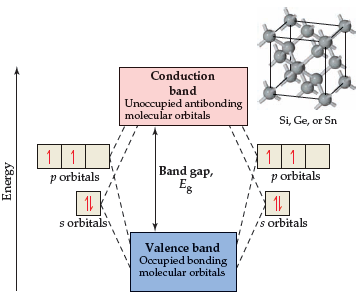

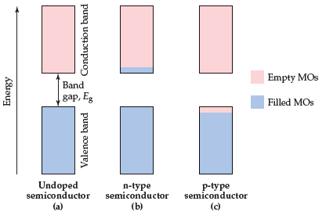

** Polymers: contain long chains of atoms (usually C), where the atoms within a**

given chain are connected by covalent bonds and adjacent chains are held to one another largely by weaker intermolecular forces.

 Addition polymerization: monomers are coupled through their multiple bonds.  Condensation polymerization: two molecules are joined to form a larger molecule

by elimination of a small molecule, such as H2O.

 Nanomaterials: materials of which a single unit is sized in at least one dimension)

between 1~1000 nm, but usually is 1~100 nm.
