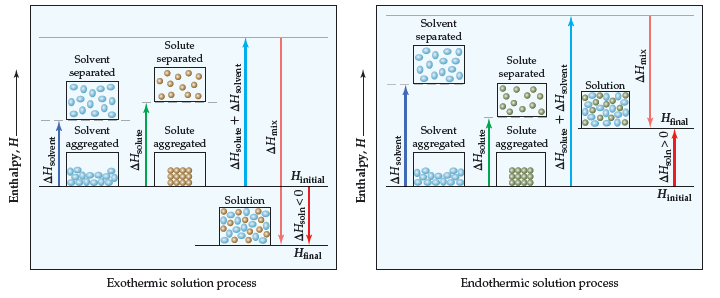
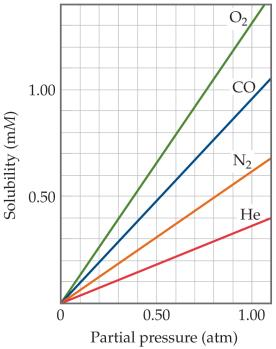
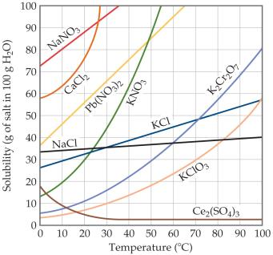
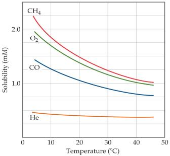
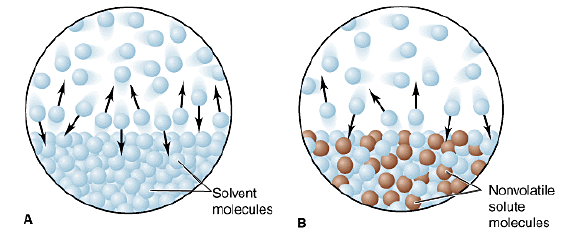
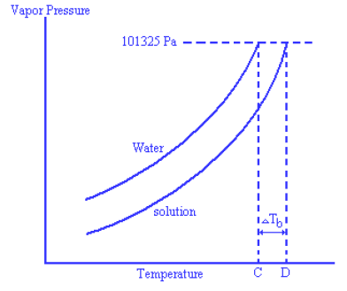
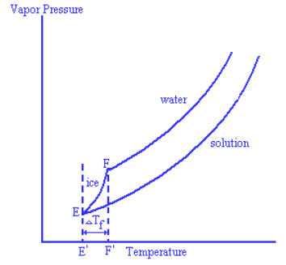
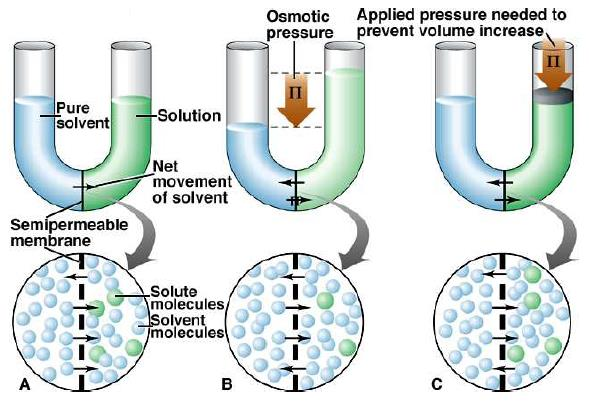

# Review Ch13

> Converted from [Review-Ch13.pdf](Review-Ch13.pdf).

## Chapter 13---Properties of Solutions

Review Definitions:  The ability of substances to form solutions depends on： 1) natural tendency toward mixing; 2) intermolecular forces (dispersion force, dipole-dipole force, hydrogen bond, ion-

dipole force);

 Solute–solute interactions between solute particles must be overcome to disperse

the solute particles through the solvent.

 Solvent–solvent interactions between solvent particles must be overcome to make

room for the solute particles in the solvent.

 Solvent–solute interactions between the solvent and solute particles occur as the

particles mix.

** Enthalpy changes:**

 Hydrate: compounds that have a defined number of water molecules in the crystal

lattice.

 Crystallization: the process where a solid forms where the atoms or molecules are

highly organized in a structure known as a crystal.

 Saturated: a solution that is in equilibrium with undissolved solute is saturated.  Unsaturated: if we dissolve less solute than the amount needed to form a saturated

solution, the solution is unsaturated.

 Supersaturated: under suitable conditions, it’s possible to form solution that

contain a greater amount of solute than needed to form a saturated solution, it’s supersaturated.

 Solubility: the amount of solute needed to form a saturated solution in a given

quantity of solvent.

 Factors affecting solubility 1) Solute–Solvent Interactions: “like dissolves like.” Substances with similar

intermolecular attractive forces tend to be soluble in one another.

**2) Pressure Effects------ Henry’s Law: Sg=kPg**

a) the solubility of the gas in a liquid solvent increases in a direct proportion to

the partial pressure of the gas above the solution;

b) Pg is the equilibrium partial pressure of the gas when it reaches equilibrium; c) The molecular state of the solute should be the same in gas phase and solution; d) The lower the solution concentration is, the more suitable the law is;

**3) Temperature Effects**

a) Usually, dissolution of inorganic salt in liquid is a endothermic process; b) Usually, dissolution of gas in liquid is a exothermic process;

** Units of Concentration:**

1) Mass percentage: mass % of component =

𝑚𝑎𝑠𝑠 𝑜𝑓 𝑐𝑜𝑚𝑝𝑜𝑛𝑒𝑛𝑡 𝑖𝑛 𝑠𝑜𝑙𝑢𝑡𝑖𝑜𝑛

𝑡𝑜𝑡𝑎𝑙 𝑚𝑎𝑠𝑠 𝑜𝑓 𝑠𝑜𝑙𝑢𝑡𝑖𝑜𝑛 ×100

2) Parts per million (ppm): ppm of component =

𝑚𝑎𝑠𝑠 𝑜𝑓 𝑐𝑜𝑚𝑝𝑜𝑛𝑒𝑛𝑡 𝑖𝑛 𝑠𝑜𝑙𝑢𝑡𝑖𝑜𝑛

𝑡𝑜𝑡𝑎𝑙 𝑚𝑎𝑠𝑠 𝑜𝑓 𝑠𝑜𝑙𝑢𝑡𝑖𝑜𝑛 ×106

3) Parts per billion (ppb): ppb of component =

𝑚𝑎𝑠𝑠 𝑜𝑓 𝑐𝑜𝑚𝑝𝑜𝑛𝑒𝑛𝑡 𝑖𝑛 𝑠𝑜𝑙𝑢𝑡𝑖𝑜𝑛

𝑡𝑜𝑡𝑎𝑙 𝑚𝑎𝑠𝑠 𝑜𝑓 𝑠𝑜𝑙𝑢𝑡𝑖𝑜𝑛 ×109

4) Mole fraction (X): mole fraction of component =

𝑚𝑜𝑙𝑒𝑠 𝑜𝑓 𝑐𝑜𝑚𝑝𝑜𝑛𝑒𝑛𝑡

𝑡𝑜𝑡𝑎𝑙 𝑚𝑜𝑙𝑒𝑠 𝑜𝑓 𝑎𝑙𝑙 𝑐𝑜𝑚𝑝𝑜𝑛𝑒𝑛𝑡𝑠

5) Molarity (M): molarity =

𝑚𝑜𝑙𝑒𝑠 𝑜𝑓 𝑠𝑜𝑙𝑢𝑡𝑒

𝑙𝑖𝑡𝑒𝑟𝑠 𝑜𝑓 𝑠𝑜𝑙𝑢𝑡𝑖𝑜𝑛 (do vary with temperature)

6) Molality (m): molality =

𝑚𝑜𝑙𝑒𝑠 𝑜𝑓 𝑠𝑜𝑙𝑢𝑡𝑒

𝑘𝑖𝑙𝑜𝑔𝑟𝑎𝑚𝑠 𝑜𝑓 𝑠𝑜𝑙𝑣𝑒𝑛𝑡 (do not vary with temperature)

 Colligative properties: physical properties of solutions that depend on the quantity

(concentration) but not on the kind or identity of the solute particles.

1) Vapor Pressure Lowering: the vapor pressure of the solution is lower than that

of the pure solvent.

**Psolution = Xsolvent•Pºsolvent (Raoult’s Law) △Psolution = Xsolute•Pºsolvent**

a) The vapor pressure of a volatile solvent above a solution containing a

nonvolatile solute is proportional to the solvent’s concentration in the solution.

b) The law is only suitable for the ideal solutions (the size and force of the

**solute and solvent molecules are similar to each other) and dilute solutions.**

2) Boiling-Point Elevation: the boiling point of the solution is higher than that

of the pure solvent.

**ΔTb =Tb (solution)-Tb (solvent) = i•Kb•m;**

a) Tb (solution): the boiling point of the solution; b) Tb (solvent): the boiling point of the pure solvent; c) m: the molality of the solute; d) Kb: the molal boiling-point-elevation constant for the solvent (K•kg•mol-1); e) i: van’t Hoff factor (for a nonelectrolyte, i=1; for a electrolyte, i will depend

**on how the substance ionizes in that solvent)**

**3) Freezing-Point Depression: the freezing-point of the solution is lower than**

that of the pure liquid.

ΔTf =Tf (solution)-Tf (solvent) = - i•Kf•m; Kf: the molal freezing-point-depression constant (K•kg•mol-1)

**4) Osmotic Pressure: the minimum pressure which needs to be applied to a**

solution to prevent the inward flow of water across a semipermeable membrane.

**Π=i(**

𝒏

**𝑽)RT=iMRT;**

a) Π: the osmotic pressure; b) V: the volume of solution; c) i: van’t Hoff factor; d) n: the number of moles of solute; e) R: ideal-gas constant; f) T: the absolute temperature

** Colloids: the intermediate types of dispersions are called colloids.**

1) Particle size can be used to classify a mixture as colloid or solution. Colloid particles range in diameter from 5 to 1000 nm; solute particles are smaller than 5 nm in diameter.

** Hydrophilic: a molecule or other molecular entity that is attracted to water**

**molecules and tends to be dissolved by water.**

 Hydrophobic: a molecule or other molecular entity that is not attracted to water

and may seem to be repelled by it.

 Tyndall Effect: the scattering of light by colloidal particles.  Brownian motion: collisions that cause a random motion of the entire colloidal

particle.

g)   M: the molarity of the solute
