Existence of solutions

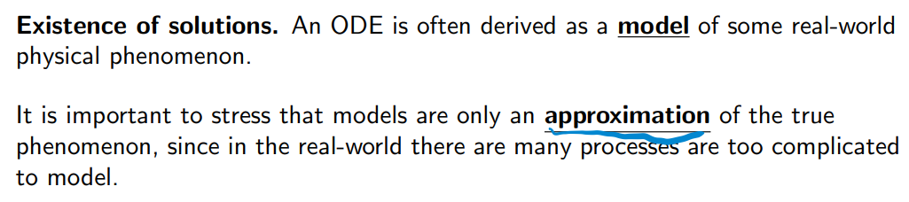

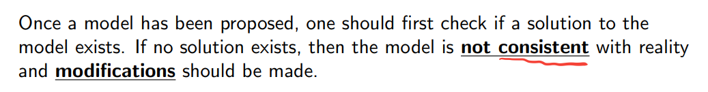

Uniqueness of solutions

(If the model has at least one solution)

Thm 4.1

（给first-order linear ODE）

func. p,q are cont. on (α, β) ⊂ ℝ

⇒ ∀t0 ∈ (α, β), y0 ∈ ℝ,

∃ unique func. y,

s.t.

> 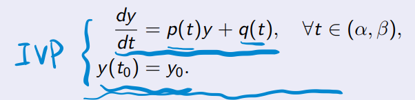

and the solution is defined throughout the interval (α, β).

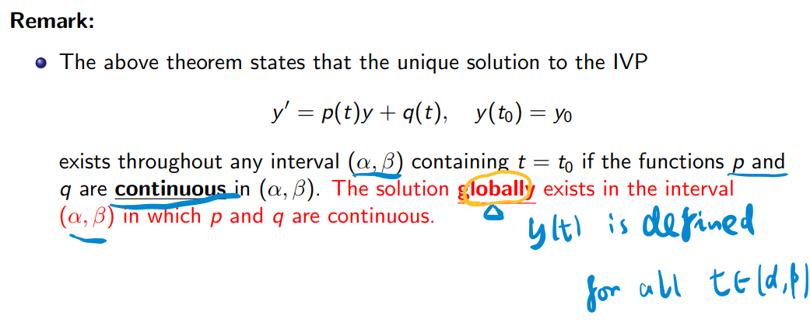

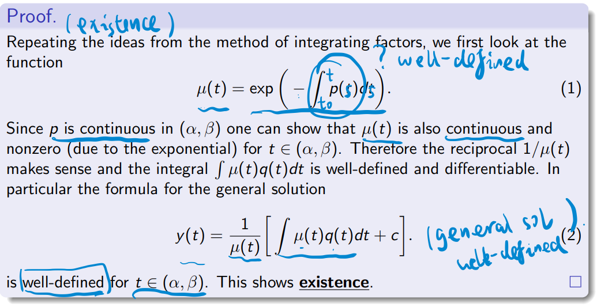

（给non-linear ODE）

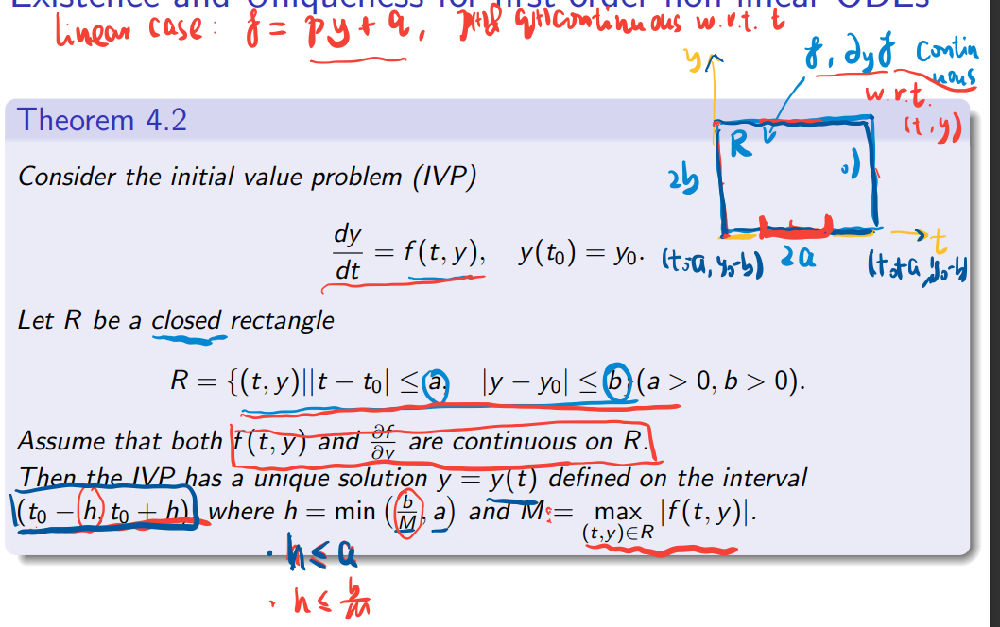

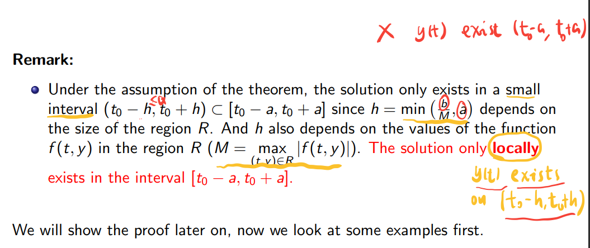

……

Slide 6

-P1 Homogeneous equations with constant coefficients

The general second-order linear homogeneous ODE 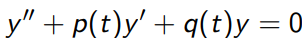

the fundamental set of solutions for it always exist, but there’s no method to find them explicitly.

<u>ODE (1):</u> 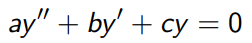

substituting a <u>**trial** function y(t) = exp(rt)</u> for some constant r into the ODE (1)

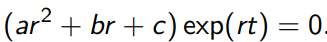

exp(rt) is positive → 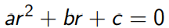: the **<u>characteristic equation</u>** for the ODE (1)

Slide 7

-P1 Non-homogeneous equations

Non-homogeneous equations: 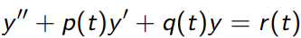 **<u>(1)</u>**

(given functions p, q and r that are continuous in an interval I)

The corresponding homogeneous equation: 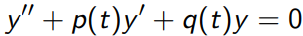 **<u>(2)</u>**

Let Z_1 and Z_2 be solutions to the non-homogeneous (1).

> 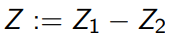
>
> 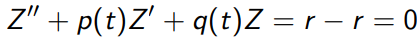
>
> → Z satisfies the homogeneous (2)
>
> →→ ∃constants c1, c2,
>
> s.t.  **=** 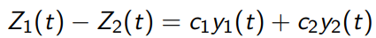
>
> Y(t) is a solution to (1), (y_1, y_2) is a fundamental set of solutions to (2)
>
> → 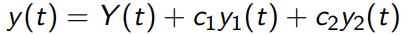

Complementary solution (of (1))

Def.: 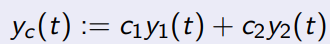

Particular solution (of (1))

Def.: **Y(t)** which satisfies 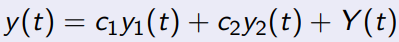

……

**<u>Case 1 -</u>** 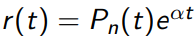

**Y(t) =** 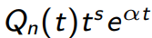

The **value** for **s**:

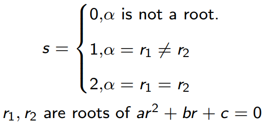

……

Case 2

……

Non-homogeneous second order linear ODEs

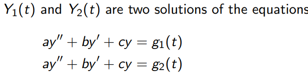

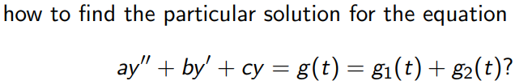

Thm. 7.2

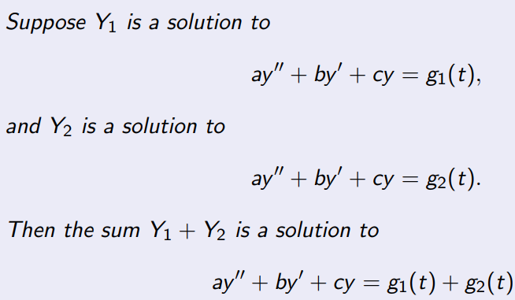

-P2 Variation of parameters

(((?) requires that the non-homogeneous term r(t) to be in a special form))

(?) a more general method that in principle can be applied to any equation

General Theory

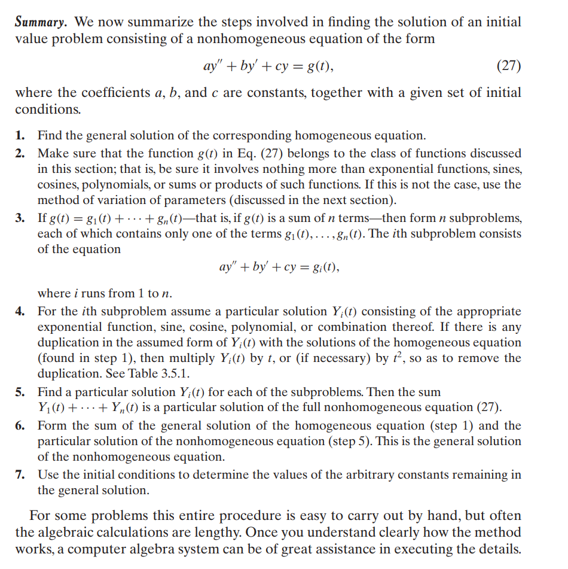
