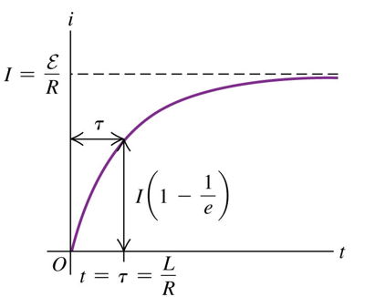
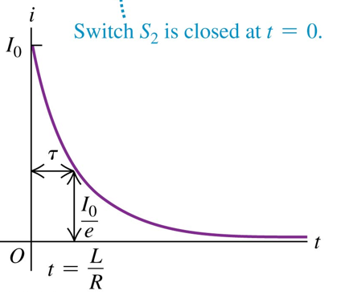

真空介电常数 $`\varepsilon_{0} = 8.85 \times 10^{- 12}F/m`$ ,

magnetic constant $`\mu_{0} = 4\pi \times 10^{- 7}H/m`$ ,

光速 $`c = 2.99 \times 10^{- 8}m/s`$ ,

玻尔磁子 *μ*B=9.274 × 10−24 J/T ,

普朗克常数 h= 6.626 × 10−34 J∙s ,

库伦常数 $`k = 4\ \pi\ \epsilon_{0} = 9 \times 10^{9}N \cdot m^{2}/C^{2}`$

1 eV = 1.602 × 10−19 J

**==Before==**

Electric dipole moment $`p = q\ d`$

a dipole在电场中的势能 $`U = \vec{p} \bullet \vec{E}`$

Electric flux电通量: (+)正←→向外 (反之亦然)

**高斯定律** $`\Phi_{E} = Q_{encl}/\epsilon_{0}\`$

高斯定律是 表面上所有点的电场 与表面内的总电荷 之间的关系

**均匀线状电荷 产生的电场** $`E = \frac{1}{2\pi\varepsilon_{0}}\frac{\lambda}{r}`$

**无限电荷平面 产生的电场** $`E = \sigma/2\varepsilon_{0}`$

**导体表面 产生的电场** $`E_{\bot} = \sigma/\varepsilon_{0}\`$

Electrostatic shielding电磁屏蔽: 导体壳内部E=0，电荷正负分别分布于表面左右

内部有空腔的实心导体：内表面电荷 必为 内部存在的电荷的相反数

导体表面始终是equipotential surface 等势面

导体外的电场 总是垂直于 导体表面

电势能 $`U = q_{0}V = \frac{1}{k}\ \frac{qq_{0}}{r}`$

一组电荷产生的电势

$`V_{a} - V_{b} = - \int_{b}^{a}\vec{E} \bullet d\vec{l}`$ ($`\Delta V = E\ d`$)

$`C = \frac{Q}{V_{ab}} = \frac{Q}{Ed} = \varepsilon_{0}\frac{A}{d}`$ (in vacuum)

电容器中的电势能 $`U = \frac{Q^{2}}{2C} = \frac{1}{2}CV^{2} = \frac{1}{2}QV`$

电容器的能量密度 $`u = \frac{1}{2}\epsilon_{0}E^{2}`$ (单位: $`J/m^{3}`$)

串联电路 series: $`\frac{1}{C_{eq}} = \frac{V}{Q} = \frac{1}{C_{1}} + \frac{1}{C_{2}} + \frac{1}{C_{3}} + \cdots`$

并联电路 parallel: $`C_{eq} = \frac{Q}{V} = C_{1} + C_{2} + \cdots`$

(并联电路中: Q = Q1 + Q2+…)

$`\varepsilon = {K\ \varepsilon}_{0}`$

K: The dielectric constant (in vacuum K=1)

Dielectrics电介质: 为不导电的材料

电流$`I = \frac{dQ}{dt} = n\ |q|{\ v}_{d\ }A`$ ; $`v_{d} = \tau\ a = qE\tau/m`$

Current density 电流密度 $`\vec{\mathbf{J}} = n\ q\ \overrightarrow{\mathbf{v}_{\mathbf{d}}}`$ (与$`\vec{E}`$同向)

Resistivity (ρ) 电阻率 $`\rho = E/J`$

$`\rho(T) = \rho_{0}\lbrack 1 + \alpha(T - T_{0})\rbrack`$

Conductivity (σ) 电导率 $`\sigma = 1/\rho`$

resistance电阻 R=ρL/A

**semiconductor diode半导体二极管**

**Thermistor (n.)热敏电阻**

Kirchhoff’s rules 基尔霍夫定律:

$`\sum_{}^{}{I_{in} =}\sum_{}^{}I_{out}`$ ; $`\sum_{closed\ loop\ }^{}{\Delta V} = 0`$

**==Ch27 Magnetic Field and Magnetic Forces==**

the direction of B → north pole指向方向

magnetic field lines: 与该点的磁场矢量相切

-magnetic flux $`\Phi_{B} = \int_{}^{}{Bcos\varnothing\ dA} = \int_{}^{}{\vec{B} \bullet d\vec{A}}`$

<u>通过任何封闭面的磁通量为0</u>: $`\oint_{}^{}\vec{B} \bullet d\vec{A} = 0`$

\-**移动电荷受的磁力** $`\vec{F} = q\vec{v} \times \vec{B} = qvB\ sin\varnothing`$

判断磁力的方向：右手法则——**从v到B**

-Hall emf霍尔电动势: $`Eq = qvB`$ → $`E = vB`$

电荷载流子符号不同，则Hall emf正负极相反

\-**通电导体受的磁力** (某<u>小段</u>(条形?)导体中)

the total force on all the charges in this segment:

$`F\  = {(\sum_{}^{}q)v}_{d}B = \ (n\ Al\ q)v_{d}B\  = \ ({nqv}_{d}\ A)(lB)`$

**某段电线受的磁力** $`\vec{F} = I\ \vec{l} \times \vec{B}`$

**极小一段电线受的磁力** $`d\vec{F} = I\ d\vec{l} \times \vec{B}`$

-current loop中的力矩:

$`\vec{\tau} = \vec{\mu} \times \vec{B}\ \ \ \ (\tau = IABsin\Phi)`$

$`\vec{\mu}`$: magnetic dipole moment $`\vec{\mu} = I\ \vec{A}`$

($`\vec{A}`$的方向：对loop中的电流方向使用右手定则)

current loop中的电场势能: $`U = \vec{\mu} \bullet \vec{B}`$

\-**Helical motion 螺旋运动**

条件：粒子的速度分量①⊥场, ②∥场

→ 粒子的速度和动能保持不变

\-**Mass spectrometer 质谱仪**

(初始速度/S1与S2间电压 或由 $`qU_{0} = W = \frac{1}{2}mv^{2}`$计算)

(中间过程筛选速度$`Eq\  = \ qvB`$ → $`v = \frac{E}{B}`$)

(后 计算比荷-用向心力：

$`qvB = \frac{mv^{2}}{R}`$ → $`R = \frac{mv}{|q|B}`$ (q/m = v/BR(?)) )

\-**Cyclotron 回旋加速器**

**==Ch28 Sources of Magnetic Field 磁场源==**

\-**移动的电荷产生的磁场** $`\vec{B} = \frac{\mu_{0}}{4\pi}\ \frac{q\vec{v} \times \vec{r}}{r^{2}}`$

**一小段电流产生的磁场** $`d\vec{B} = \frac{\mu_{0}}{4\pi}\ \frac{I\ d\vec{l} \times \vec{r}}{r^{2}}`$

\-**长度为2a，通有电流I的 直载流导体**:

$`B = \frac{\mu_{0}I}{4\pi}\frac{2a}{x\sqrt{x^{2} + a^{2}}}`$ (x: 到测量点的半径)

**长度为∞(无穷大)，通有电流I的 直载流导体**:

$`B = \frac{\mu_{0}I}{2\pi r}`$ (r: 到测量点的半径)

\-**两个平行导体之间的磁力**:

$`\frac{F}{L} = \frac{\mu_{0}I_{1}I_{2}}{2\pi r}`$

<u>电流同向：吸引力 (attractive force)</u>

<u>电流反向：排斥力 (repel each other)</u>

\-**圆环电流loop产生的磁场**

半径为a、通有电流I，在(沿x轴)loop的中心到field point的距离为x 处的 磁场:

$`B_{x} = \frac{\mu_{0}Ia^{2}}{2\left( x^{2} + a^{2} \right)^{\frac{3}{2}}}`$ ; 判断 Bx的方向：右手定则

\-**圆环电流loop的磁场线**: are not circles

-Ampere’s law (special case)

通有电流I的直载流体：<u>距离其半径为r的封闭圆环上</u>，该直载流体产生的**磁场 的线积分**:

$`\oint_{}^{}{\vec{B} \bullet d\vec{l}}( = \oint_{}^{}{B_{||}\ dl}) = \frac{\mu_{0}I}{2\pi r}\ (2\pi r) = \mu_{0}I`$

-Ampere’s law (general statement)

假设 几根长而直的导体 穿过 以integration path为界 的表面

→ **<u>总</u>磁场的线积分** 与 电流的代数和 成正比

$`\int_{}^{}\vec{B} \bullet d\vec{l} = \mu_{0}I_{encl}`$

(适用于任何形状的导体和路径)

如果闭合路径周围的积分为零，则不一定意味着磁场is everywhere along the path，只是通过an area bounded by the path的总电流为零。

\-**长的圆柱形导体产生的磁场**

(应用安培定律 以 找到磁场B)

Inside the conductor (r\<R): $`B = \frac{\mu_{0}I}{2\pi}\frac{r}{R^{2}}`$

(← $`\oint_{}^{}{\vec{B} \bullet d\vec{l}} = B \bullet 2\pi r = \mu_{0}\frac{\mathbf{I}}{\mathbf{\pi}\mathbf{R}^{\mathbf{2}}}\mathbf{\pi}\mathbf{r}^{\mathbf{2}} = \mu_{0}I\frac{r^{2}}{R^{2}}`$)

Outside the conductor (r\>R): $`B = \frac{\mu_{0}I}{2\pi r}`$

R: 该圆柱形导体的横截面半径

r: 测量点距离中心轴该圆柱形导体的距离

-solenoid (n.) 螺线管

**螺线管产生的磁场**

螺线管中间: $`B = \mu_{0}nI`$ (B最大值)

螺线管两端: $`B = {\frac{1}{2}\mu}_{0}nI`$(从max减少至此)

当电子绕原子核运行时:

**magnetic dipole moment** $`\mu = \frac{e}{2m}L`$

L: 该电子的轨道角动量

Atomic angular momentum: is quantized:

·它在特定方向上的分量始终是h/2π的整数倍

**Bohr magneton (*μ*B) 玻尔磁子**:

(magnetic dipole moment的一个基本单位)

*μ*B = *eh*/4*πm* = 9.274 × 10−24 J/T

\-**paramagnetism顺磁性**

**diamagnetism抗磁性**

当外部磁场渗透到\[…\]中时, 任意一点的磁场B:

顺磁性材料: 大于(\>) Km

抗磁性材料: 略小于(\<)用真空替换材料时的B

**Km: the relative permeability of the material相对磁导率**

*χ*m **the magnetic susceptibility磁化率:**

Def.: *χ*m = *K*m – 1

\-**Ferromagnetism** 铁磁性: 在材料（如铁）中，

**atomic magnetic moments**倾向于在magnetic domains中彼此平行排列

当没有外部施加的磁场时: the domain magnetizations是随机定向的

当有外部磁场时: the domain boundaries会变化:

在磁场 方向上磁化的domains grow增长，

在其他 方向上磁化的domains shrink收缩

**==Ch29 电磁感应==**

**Electromagnetic Induction电磁感应**

Induced current 感应电流

感应电动势 ; 感应电场

-确定induced current/induced emf 方向:

Lenz’s law 楞次定律: 任何<u>磁感应效应</u>的<u>方向</u>都是**<u>与效应的原因相反</u>**的

-magnetic flux磁通量$`d\Phi_{B} = B_{\bot}\ dA`$

$`\Phi_{B} = \vec{B} \bullet \vec{A} = BA\ cos\Phi`$

\-<u>法拉第</u>感应定律: (N: 匝数)

闭合loop 中的 感应emf: $`\varepsilon = - N\frac{d\Phi_{B}}{dt}`$

-螺线管中的电流随时间变化 → 感应电场

电场around path的线积分 $`\oint_{}^{}\vec{E} \bullet d\vec{l} = - \frac{d\Phi_{B}}{dt}`$

(变化的磁通量产生电场)

\-**motion emf** $`\mathcal{E} = vBL`$

(扫过磁场的运动的导体棒)

**Rotor 转子; Commutator 换向**器

\-**The Meissner effect:**

将超导材料置于均匀施加的磁场中, 那么所有的磁通量都会从超导体中排出

\-**Eddy currents 涡流**

当一块金属穿过磁场或位于不断变化的磁场中时, 产生电流的涡流

-(Ampere’s law is incomplete)

对于以圆为界的平面圆形区域,

进电表面: $`I_{encl} = i_{C}`$; 另一面: $`I_{encl} = 0`$

\-**Displacement current 位移电流** $`\mathbf{i}_{\mathbf{D}} = \epsilon\frac{d\Phi_{E}}{dt}`$

$`\mathbf{\epsilon}`$**: 中间材料的Dielectric constant介电常数**

在板之间的区域中定义的虚构的位移电流

(可看作是板之间磁场的来源)

**==Ch30 Inductance电感==**

\-**Mutual inductance 互感系数 M** (对2个coli)

$`M = \frac{N_{2}\Phi_{B2}}{i_{1}} = \frac{N_{1}\Phi_{B1}}{i_{2}}`$ (N: 匝数, i: 线圈中电流)

单位: 1 H=1 Wb/A = 1 V∙s/A = 1 Ω∙s = 1 J/A2

**Mutual induction 互感** ; **coil (n.)线圈**

\-**Self-inductance 自感系数 L**

$`L = \frac{N\Phi_{B}}{i}`$ (自感←线圈中有变化电流)

$`\Phi_{B}`$: 每1匝中的磁通量

**self-induced emf 自感电动势**

\-<u>inductors电感器</u>as circuit elements电路元件

**Inductor两端电势差**: $`V_{ab} = V_{a} - V_{b} = L\frac{di}{dt}`$

通过它的电流i为常数，则 自感电动势ℰ=0

…电流i增大，则 自感电动势ℰ与i反向

…电流i为常数，则 自感电动势ℰ与i同向

(注: 自感电动势ℰ朝向的方向为其使电势+的地方)

\-**Magnetic field energy 磁场能**

> $`U_{B} = L\int_{0}^{I}{i\ di} = \frac{1}{2}\ L\ I^{2}`$

(↑ 在inductor电感器中store储存的能量)

(磁场能: 磁场中储存的能量)

(磁场势能: 物体在磁场中由于其位置而具有的能量)

\-**Magnetic energy density磁能密度u** (unit:$`J/m^{3}`$)

In a vacuum: $`u = \frac{B^{2}}{2\mu_{0}}`$; In a material: $`u = \frac{B^{2}}{2\mu}`$

$`\mathbf{\mu}`$**: magnetic permeability磁导率** $`\mu = K_{m}\ \mu_{0}`$

-The <u>**R-L** circuit</u>: **R-L电路**

Current increases with time:

Current decreases with time:

The **time constant (τ)** for the circuit: $`\tau\  = \ L/R`$

τ: 表示电路中电流达到稳态值的时间

-The L-C circuit: Oscillation (LC振荡)

电容器上的电荷 $`q = Qcos(\omega t + \Phi)`$

电路中的电流 $`i = \frac{dq}{dt} = - \omega Q\sin(\omega t + \Phi)`$

(L中)磁场能$`U_{B} = \frac{1}{2}Li^{2}`$; (C中)电场能$`U_{E} = \frac{q^{2}}{2C}`$

Angular frequency of oscillation $`\omega = \sqrt{1/LC\ }`$

-The <u>**L-R-C** series circuit</u>: **L-R-C电路**

是damped harmonic motion阻尼谐波运动

(if the resistance is not too large)

exponentially decaying指数衰减

**L-R-C电路的 角频率** $`\omega' = \sqrt{\frac{k}{m} - \frac{b^{2}}{{4m}^{2}}}`$

**== Ch31 Alternating Current 交流电==**

appliance (n.)用电器 ; Instantaneous瞬时的

-AC source 交流电源

瞬时电势差 $`u = Vcos\omega t`$

瞬时电流 $`i = Icos\omega t`$

**Phasor diagram 相量图** (对于正弦电流)

\-**Root-mean-square values (the rms value)**

$`I_{rms} = \sqrt{{(i^{2})}_{av}} = \frac{I}{\sqrt{2}}`$ (对于正弦电流)

$`V_{rms} = \frac{V}{\sqrt{2}}`$ (对于正弦电流)

交流电路中的: (以下的V、I均为最大值)

resistor电阻 $`R = \frac{V_{R}}{I}`$

inductor电感器 两端电势差max $`V_{L} = I\ X_{L}`$

$`\mathbf{X}_{\mathbf{L}}`$**: Inductive reactance 感抗**: $`X_{L} = \omega L`$

capacitor 电容器 两端电势差max $`V_{C} = I\ X_{C}`$

$`\mathbf{X}_{\mathbf{C}}`$**: Capacitive reactance 容抗**: $`X_{C} = \ 1/\omega C\`$

f↑，ω↑，$`X_{L}`$↑ & $`X_{C}`$↑

-The <u>**L-R-C** series circuit</u>: **L-R-C电路**

电路中总电压最大值 $`V = IZ`$

**Z: The <u>impedance 阻抗</u> (of the circuit)**:

$`Z = \sqrt{R^{2} + {(X_{L} - X_{C})}^{2}}`$

-The instantaneous power 瞬时功率 p = vi

平均功率 $`P_{av} = \frac{1}{2}VI\ cos\varnothing = V_{rms}\ I_{rms}\ cos\varnothing`$

$`\varnothing`$: <u>电压相对于电流</u>的phase angle相位角

cos ϕ : the <u>**power factor** of the circuit</u>

<u>resistor: v与i同相; inductor: v比i多90°</u>

<u>capacitor: v比i少90°</u>

求$`\varnothing`$方式: $`\tan\varnothing = \frac{X_{L} - X_{C}}{R}`$

当ω等于**resonance angular frequency 共振角频率**$`\mathbf{\omega}_{\mathbf{0}}\mathbf{= 1/}\sqrt{\mathbf{LC}}`$ 时:

$`X_{L}\  = \ X_{C}`$, 阻抗Z最小($`Z_{\min} = R`$), 电流i最大

共振resonance: the current amplitude电流幅度此时出现的这种peaking峰值

\-**Transformers 变压器**

**primary coil初级线圈; secondary coil次级线圈**

**delivered voltage; supplied voltage**

$`\frac{V_{2}}{V_{1}} = \frac{N_{2}}{N_{1}}`$ : 1: primary coil的; 2: secondary coil的

V: 电压的最大值/rms值; N: 匝数

step-up transformer: V2 \> V1

step-down transformer: V2 \< V1

**==Ch32 Electromagnetic Waves==**

-Maxwell equation

$`\oint_{}^{}\vec{E} \bullet d\vec{A} = \frac{Q_{free}}{\varepsilon_{0}\text{ϰ}}`$; $`\oint_{}^{}\vec{B} \bullet d\vec{A} = 0`$;

$`\oint_{}^{}\vec{E} \bullet d\vec{l} = - \frac{d\text{Φ}_{B}}{dt}`$;

$`\oint_{}^{}\vec{B} \bullet d\vec{l} = \mu_{0}\text{ϰ}_{m}\left( I + \varepsilon_{0}\text{ϰ}\frac{d\text{Φ}_{E}}{dt} \right)`$

$`\vec{E}(x,t) = \hat{j}E_{\max}cos(kx - \omega t)`$

$`\vec{B}(x,t) = \hat{k}B_{\max}cos(kx - \omega t)`$

注意: **Wave Number**: **𝑘**=$`\frac{2\pi}{\lambda}`$

Wave front波阵面: 以恒定速度光速c在+x轴上移动的boundary plane

$`\vec{E}`$<u>和</u>$`\vec{B}`$<u>同相</u>; $`\hat{E} \times \hat{B} = \hat{v}`$

在真空中: $`B_{0} = \frac{E_{0}}{c}`$ , $`c = \frac{1}{\sqrt{\varepsilon_{0}\mu_{0}}}`$

-EM波的性质

在a dielectric电介质中:

波的速度 $`v = \frac{1}{\sqrt{\epsilon\ \mu}} = \frac{1}{\sqrt{K\ K_{m}}}\frac{1}{\sqrt{\epsilon_{0}\mu_{0}}} = \frac{c}{\sqrt{K\ K_{m}}}`$

$`\epsilon`$: permittivity介电常数; $`\mu`$: permeability渗透率

$`K`$: dielectric constant; $`K_{m}`$: relative permeability

材料的**index of refraction折射率**:

$`\frac{c}{v} = \mathbf{n} = \sqrt{K\ K_{m}} \approx \sqrt{K}`$

由振荡点电荷产生的电磁波: 是正弦波，不是平面波——但在足够远的相对较小的空间，可以平面波近似

-The electromagnetic spectrum 电磁频谱

\-<u>Gauss’s laws and the simple plane wave</u>

<u>Qencl=0 →</u> $`\oint_{}^{}\vec{E} \bullet d\vec{A}`$<u>=0;</u> $`\oint_{}^{}\vec{B} \bullet d\vec{A} = 0`$

→为transverse横波

-EM波中: $`E = cB`$

(↑ *d*Φ*B* = *Bac* *dt* ; $`\oint_{}^{}\vec{E} \bullet d\vec{l} = - \frac{d\text{Φ}_{B}}{dt}`$ )

-EM波中: $`B = \epsilon_{0}{\ \mu}_{0}\ c\ E`$

(↑ *d*Φ*E* = *Eac* *dt* ; $`\int_{}^{}\vec{B} \bullet d\vec{l} = \mu_{0}I_{encl}`$)

-真空中 EM波速不变: $`c = \frac{1}{\sqrt{\varepsilon_{0}\mu_{0}}} = \frac{\omega}{k}`$
