Ch21

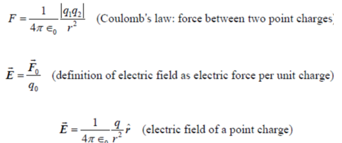

Mechanical waves 机械波 传播速度v = $`\sqrt{\frac{E}{\rho}}`$ (?)

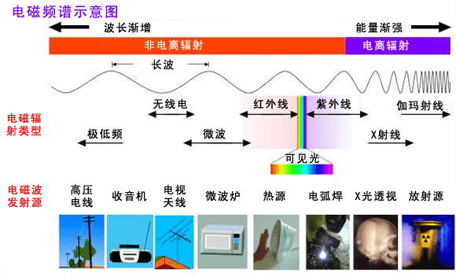

gravitational interactions 引力相互作用

(Universal gravitational force万有引力 $`\vec{F} = - \frac{Gm_{1}m_{2}}{r^{2}}\widehat{\ r}`$ )

electromagnetic interactions 电磁相互作用

the strong interaction 强相互作用

the weak interaction 弱相互作用


-Electric field due to aa point charge

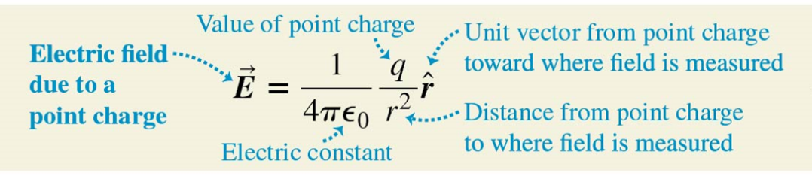

- $`\epsilon_{0} = \mathbf{8}.\mathbf{854} \times \mathbf{10}^{- \mathbf{12}}\ \mathbf{F} \cdot \mathbf{m}^{- \mathbf{1}}`$

- $`4\ \pi\ \epsilon_{0} = k = 9 \times 10^{9}N \cdot m^{2}/C^{2}`$

spacing(n.)间距

superposition (n.)叠加

-Electric dipole

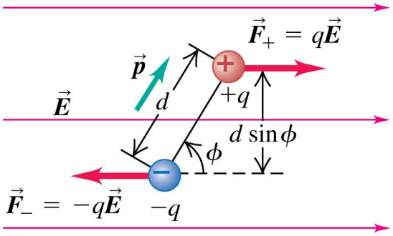

Electric dipole moment $`p = q\ d`$

Unit: C·m

Torque for a dipole in an electric field

- $`\vec{\tau} = \vec{p} \times \vec{E}`$

Potential energy for a dipole in an electric field

- $`U = \vec{p} \bullet \vec{E}`$

***Ch22***

\- Electric flux电通量


单位: N ∙ m<sup>2</sup>/C.


The net electric flux 净电通量

与面内的净电荷 成正比，

is independent of 面的大小 (无关)


(+) positive (outward) flux 正-向外

(-) negative (inward) flux 负-向内

\- Gauss’s Law: 高斯定律是表面上 所有点

\_的电场 与 表面内的_总电荷 \_之间的 关系

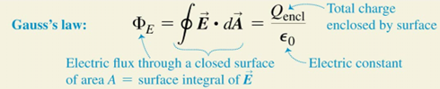

导体内部：E=0 everywhere → Q<sub>encl</sub>=0 → 电荷在表面

electrostatic conditions: charges not in motion

Spherical shell ; Non-Conducting Solid Sphere

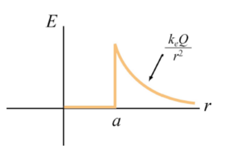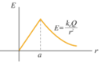

Field of a uniform line charge 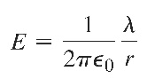

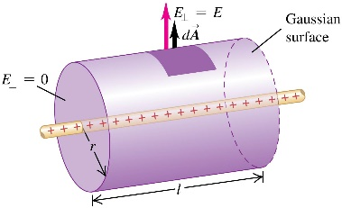

Field of an infinite plane sheet of charge

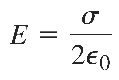 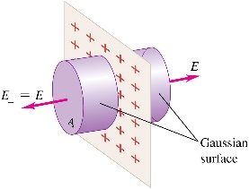

Field at the surface of a conductor

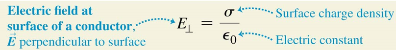

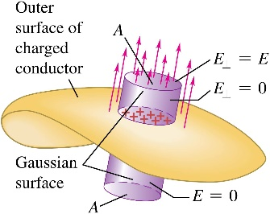

导体上的一片电荷产生的场与仅仅一片电荷产生的场不同：因为电荷片的两边都有电场，而导体只有外部有电场

Electrostatic shielding电磁屏蔽: 导体壳内部E=0，电荷正负分别分布于表面左右

内部有空腔的实心导体：内表面电荷必为内部存在的电荷的相反数

***Ch23***

\- Electric potential energy

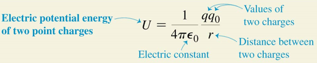

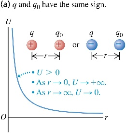 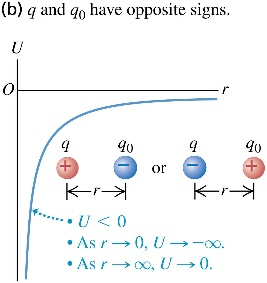

Electric potential V<sub>ab</sub> = V<sub>a</sub> – V<sub>b</sub>

单位电荷从 A 移动到 B 时电力所做的功

The potential due to a collection of point charges:

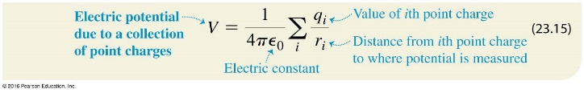

Electrical potential with several point charges

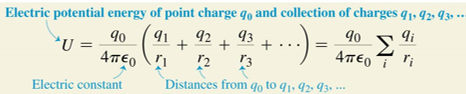

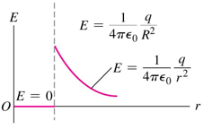 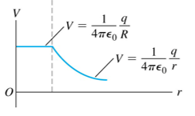

equipotential surface 等势面

导体的表面始终是等电位表面。

导体外的电场总是垂直于导体表面

<span class="mark">U<sub>a</sub> − U<sub>b</sub> = q (V<sub>a</sub> − V<sub>b</sub>)</span>

<span class="mark">1 eV = 1.602 × 10<sup>−19</sup> J</span>


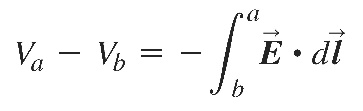

1 N/C = 1 V/m

\- Potential gradient 电位梯度

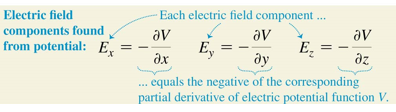

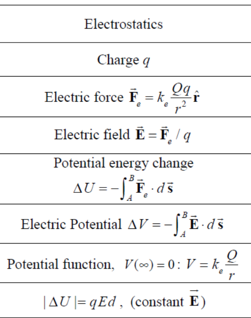

***Ch24***

$`C = \frac{Q}{V_{ab}} = \frac{Q}{Ed} = \varepsilon_{0}\frac{A}{d}`$ (in vacuum)

<span class="mark">1F = 1C<sup>2</sup>/N·m = 1C<sup>2</sup>/J</span>

<span class="mark">1V = 1C/J → 1F = 1C/V</span>

1C<sup>2</sup>/N·m<sup>2</sup> = 1F/m

→ $`\varepsilon_{0} = 8.85 \times 10^{- 12}F/m`$

The potential energy stored in a capacitor:

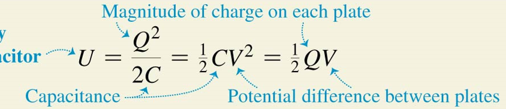

work to charge a capacitor

· $`dW = v\ dq = \frac{q\ dq}{C}`$

``` math
W_{total} = \int_{0}^{W_{total}}{dW} = \frac{1}{C}\int_{0}^{Q_{final}}{q\ dq} = \frac{Q_{final}^{2}}{2C}
```

=the total work done by the electric field on the charge

when <u>the capacitor **discharges放电**</u>

The energy density:

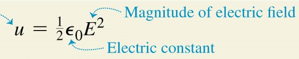

串联电路 series:

<span class="mark">·</span> $`V = V_{1} + V_{2}`$

<span class="mark">·</span> $`\frac{1}{C_{eq}} = \frac{V}{Q} = \frac{1}{C_{1}} + \frac{1}{C_{2}} + \frac{1}{C_{3}} + \cdots`$

并联电路 parallel:

<span class="mark">· Q = Q<sub>1</sub> + Q<sub>2</sub></span>

<span class="mark">·</span> $`\frac{1}{C_{eq}} = \frac{V}{Q} = \frac{1}{C_{1}} + \frac{1}{C_{2}} + \frac{1}{C_{3}} + \cdots`$

Electric energy density in a vacuum:

· $`u = Energy\ density = \frac{\frac{1}{2}CV^{2}}{Ad} = \frac{1}{2}\varepsilon_{0}E^{2}`$

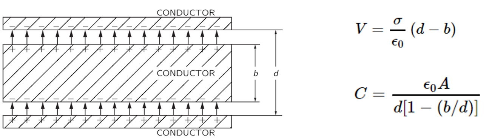

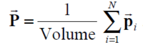 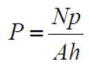

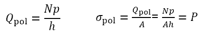

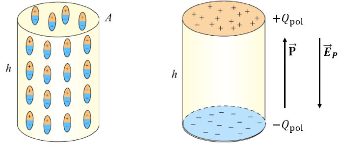

The dielectric constant K

· $`\varepsilon = {K\ \varepsilon}_{0}`$ (in vacuum K=1)

Dielectrics电介质: nonconducting material

Dielectric breakdown 介电击穿

dielectric strength: the maximum electric field……

\- The force on a dielectric thin film 

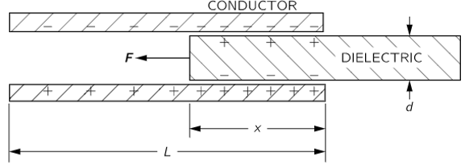

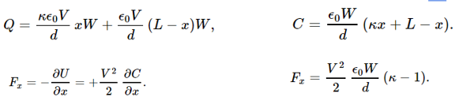

***Ch25***

电流 ·$`I = \frac{dQ}{dt} = n\ |q|{\ v}_{d\ }A`$

·$`v_{d} = \tau\ a = qE\tau/m`$

n: Concentration of moving charged particles 移动带电粒子的浓度

\|q\|: Charge per particle 每个粒子的电荷

\- The total current I : is found by adding up the currents due to each kind of charged particle.

-Current density 电流密度

· $`\vec{\mathbf{J}} = n\ q\ \overrightarrow{\mathbf{v}_{\mathbf{d}}}`$

矢量 电流密度J 的方向 始终 与 矢量 电场E(?) 的方向 相同，无论电荷载流子的符号是什么

-Resistivity (ρ) 电阻率

·$`\rho = \frac{E}{J}`$ (电场大小/电流密度大小)

Conductivity (σ) 电导率

·$`\sigma = \frac{1}{\rho}`$

The **resistance电阻** of a conductor:

· $`R = \frac{\rho L}{A}`$

· $`V = IR`$

电流从 较高电位 流向 较低电位 (电流流向与电势)

在给定温度下，电流与电压成正比

-Nonohmic resistors 非欧姆电阻器

电压与电流的关系可能不是 成正比的，

对于 电流的两个方向(!!)，电压与电流的关系可能不同。

semiconductor diode半导体二极管

diode (n.)二极管

<span class="mark">温度*T*↑，电阻率ρ↑</span>

· $`\rho(T) = \rho_{0}\lbrack 1 + \alpha(T - T_{0})\rbrack`$

α: Temperature coefficient of resistivity

-Thermistor (n.)热敏电阻

<span class="mark">温度T↑，<u>石墨</u>的电阻率ρ↓</span>

-Superconductivity (n.)超导性

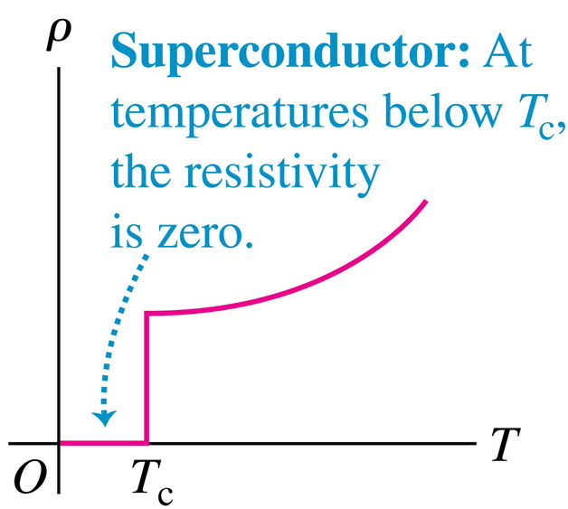

phase transition相变

**- Electromotive force (emf) (Ɛ) 电动势**

1V = 1J/C

Terminal voltage端电压

·$`V_{ab} = Ɛ - Ir`$

Power 功率<span class="mark">·</span>$`P = V_{ab}I`$

***Ch26***

-Kirchhoff’s rules 基尔霍夫定律

·$`\sum_{}^{}{I_{in} =}\sum_{}^{}I_{out}`$

·$`\sum_{closed\ loop\ }^{}{\Delta V} = 0`$

电容器充电时：

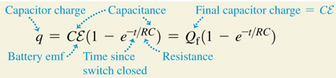

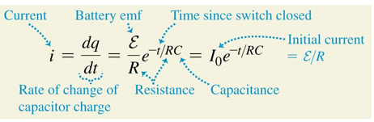

电容器放电时：

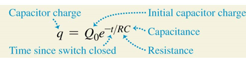

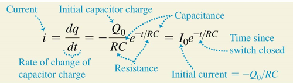

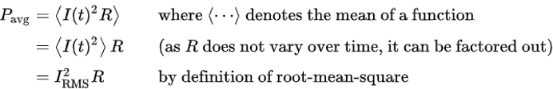
