-Summary

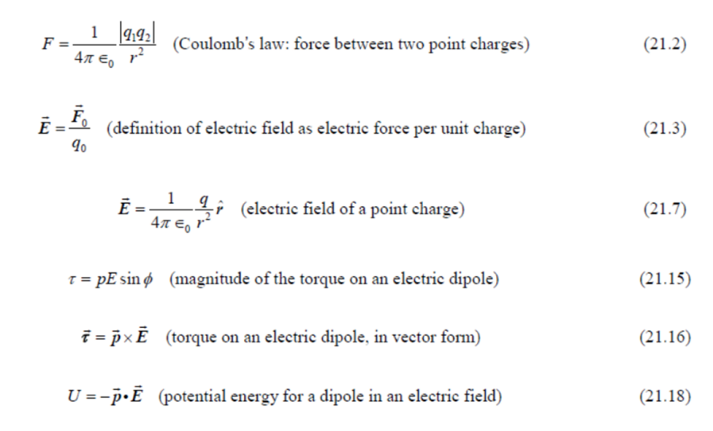

**-****Mechanical waves 机械波**

exist only within a material medium (e.g., waves in string, <u>sound wave (pressure wave<span class="mark">??</span>)</u> ). The medium particles oscillate about their equilibrium locations. Traveling speed of the wave is determined by the properties of medium. Wave equations follow Newton’s laws.

传播速度v = $`\sqrt{\frac{E}{\rho}}`$ (??pow/μ)

**-Electromagnetic waves 电磁波**

require no material medium (e.g., light, radio waves) and travel at the speed c= 299,792,458 m/s. It is the electric (and magnetic) field that oscillates and wave equations follow the Maxwell’s equations.

**-Matter waves 物质波**

describe behavior of particles in quantum mechanics, such as electrons, protons, atoms and molecules. Wave equations follow Schrodinger’s equation and Dirac’s equation.

\-**Electromagnetic Spectrum 电磁频谱**


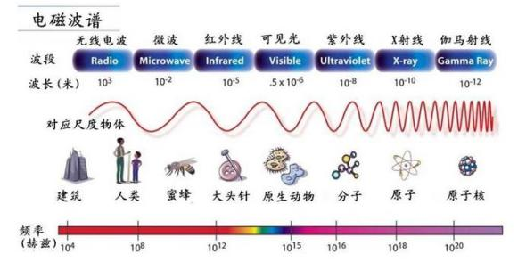

-Electric charge and the structure of matter

Protons and neutrons make up the tiny dense nucleus, which is surrounded by electrons.

\-**Conservation of charge 电荷守恒**

The <u>magnitude</u> of <u>charge of the electron or proton</u> is a natural unit of charge. All observable charge is <u>quantized</u> in <u>this unit</u>.

The <u>universal principle of charge conservation</u> states that the <u>algebraic sum</u> of all the electric charges in <u>any closed system</u> <u>is constant</u>.

-The fundamental forces of nature 自然界的基本作用力

**gravitational interactions 引力相互作用**

> (**Universal gravitational force万有引力**:
>
> 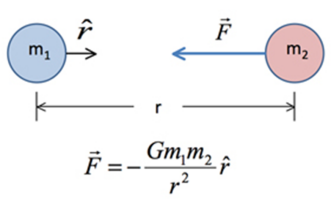)

**electromagnetic interactions 电磁相互作用**

**the strong interaction 强相互作用**

**the weak interaction 弱相互作用**

\-**Electrostatic force 电磁力**

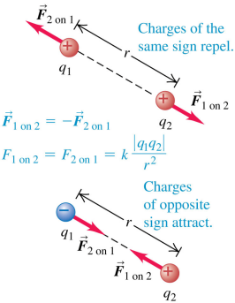**Coulomb’s Law 库仑定律**

> The <u>magnitude</u> of the <u>electric force</u>
>
> between two point charges
>
> is directly proportional to the product of their charges
>
> and inversely proportional to the square of the distance between them
>
> 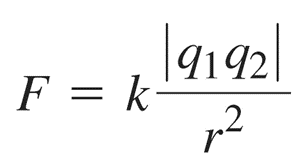
>
> **repel (v.)排斥**
>
> \-**Electrostatic force静电力**
>
> **electrostatic (adj.)静电的**
>
> 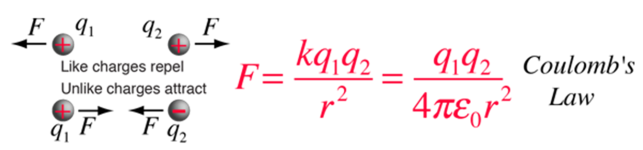

-Gravity 引力

1.  Gravity is the weakest of the four fundamental interactions of nature.

> <u>The gravitational attraction</u> is approximately
>
> <u>10<sup>−38</sup> times</u> the strength of the strong force
>
> <u>(i.e. gravity is <span class="mark">**38 orders(38个数量级)** of magnitude weaker</span>)</u>,
>
> 10<sup>−36</sup> times the strength of the electromagnetic force,
>
> and 10<sup>−29</sup> times the strength of the weak force

So gravity has a **negligible(adj.)忽略不计的** influence on

the behavior of **subatomic particles亚原子粒子**,

and plays no role in determining <u>the internal properties</u> <u>of everyday matter</u>.

2.  Gravity is the dominant interaction at the **macroscopic scale宏观尺度**,

> and is the cause of the **formation形成**, shape, and **trajectory轨迹** of astronomical bodies.
>
> It is responsible for various phenomena observed on Earth and throughout the universe

-Differences between gravity and electric force

1.the universe is **electrically neutral电中性的** on large scales (世界大尺度上是电中性的)

2.Electric force is very strong, 36 orders of <u>magnitude stronger</u> than gravitational force.

3.Electric charge <u>has polarity</u> and <u>can be shielded(=screened=屏蔽)</u> (电荷有极性所以可以被屏蔽）

4.The <u>charges distribution</u> <u>can be **polarized(v.过分)极化**</u> (电荷分布可以被极化)

\-**Electrostatic shielding 静电屏蔽**

**Faraday cage 法拉第笼**

> the object with a <u>conducting box</u>

Electric charge has polarity and can be shielded (screened)

> 电荷有极性所以可以被屏蔽

-The charges distribution can be polarized 电荷分布可以被极化

A <u>charged object of either sign</u>

> **exerts(v.)发挥** an attractive force on **<u>an uncharged insulator(n.)绝缘体</u>**.
>
> 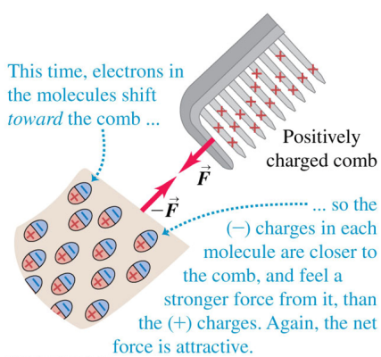 **comb(n.)梳子**

-Measuring the electric force between point charges 测量两个点电荷之间的电磁力大小

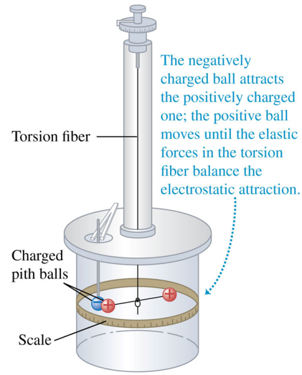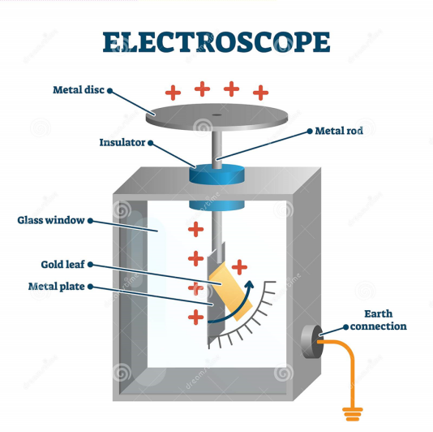

-The **electric field** of a point charge 点电荷的**电场**

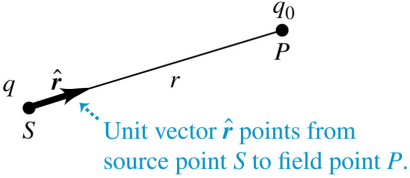Unit vectorpoints from **source point** S to **field point** P

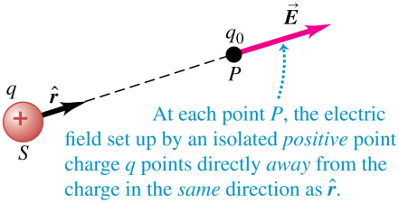At each point, the electric field set up by an isolated positive point charge q points directly away from the charge in the <u>same direction as</u> 

Using <u>a unit vector</u>

<u>that points *away* from the origin</u>, we can write

<u>a vector equation</u> that gives both the <u>magnitude</u> and the <u>direction</u> <u>of the electric field</u>:


A point charge q (with positive charge(if it is with negative charge, then its direction of electric field is opposite)) produces an electric field <u>at *<span class="mark">all</span>* points in space</u>.

The field strength decreases with increasing distance.

The field produced by a positive point charge points away from the charge.

\-**Electric field lines 电场线**

> Def.: an **imaginary(adj.)假想的** <u>line or curve</u>
>
> whose <u>tangent</u> at any point <u>is the direction of</u> <u>the electric field *vector* </u>at that point.
>
> 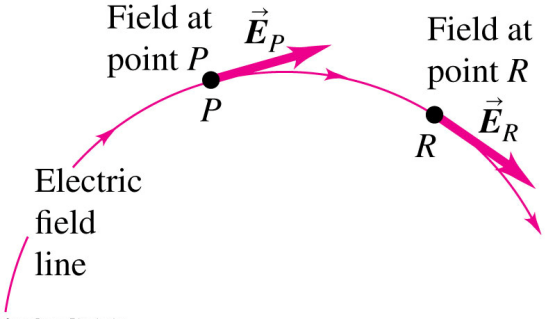
>
> Show the direction of the electric field at each point.
>
> The <u>**spacing(n.)间距** of field lines</u> gives a <u>general idea</u> of the <u>magnitude</u> of the electric field at each point.
>
> At any point, the electric field has a unique direction,
>
> so field lines never **intersect(v.)相交**.
>
> 在任意一点，电场都有独特的方向，因此电场线永远不会相交。

-Superposition of electric fields 电场的叠加

> **superposition (n.)叠加**
>
> The <u>total</u> electric field <u>at a point</u>
>
> is the <u>vector sum</u> of <u>the fields</u> due to all the charges present.
>
> -Electric field lines of two equal positive charges 2个正电荷之间的电场线
>
> 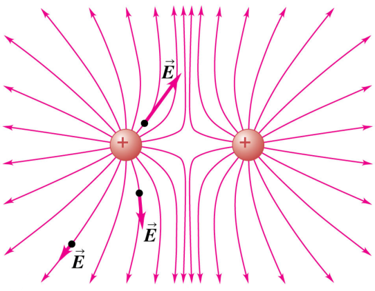
>
> -Electric field lines of two charges
>
> 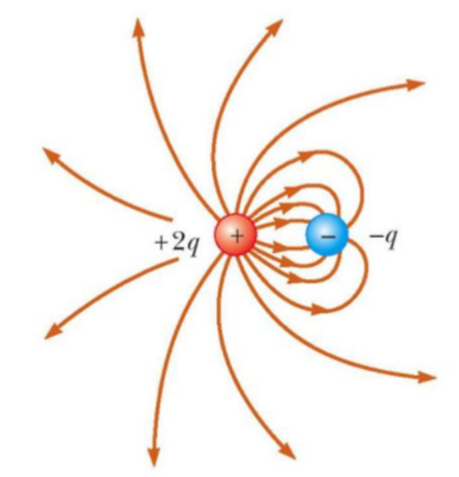
>
> -Electric field lines of a dipole
>
> 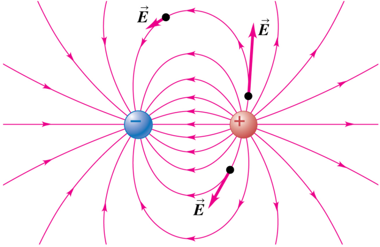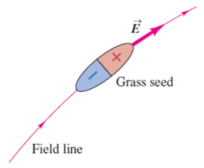

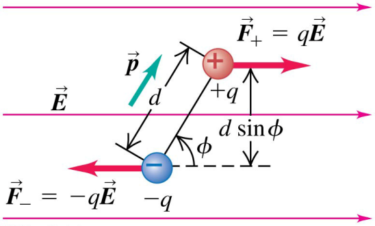-Force and **torque(n.)力矩** on a dipole

When a dipole is placed in a uniform electric field, the net force is always zero, but there can be a net torque on the dipole

当偶极子置于均匀电场中时，

净力始终为零，

但偶极子上可能存在净扭矩。

> Electric dipole ——Definition:
>
> 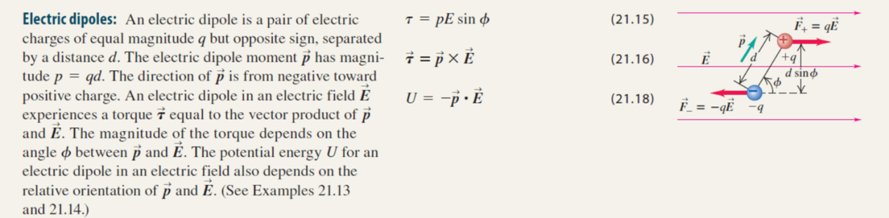

\-**Potential energy势能** of an Electric Dipole

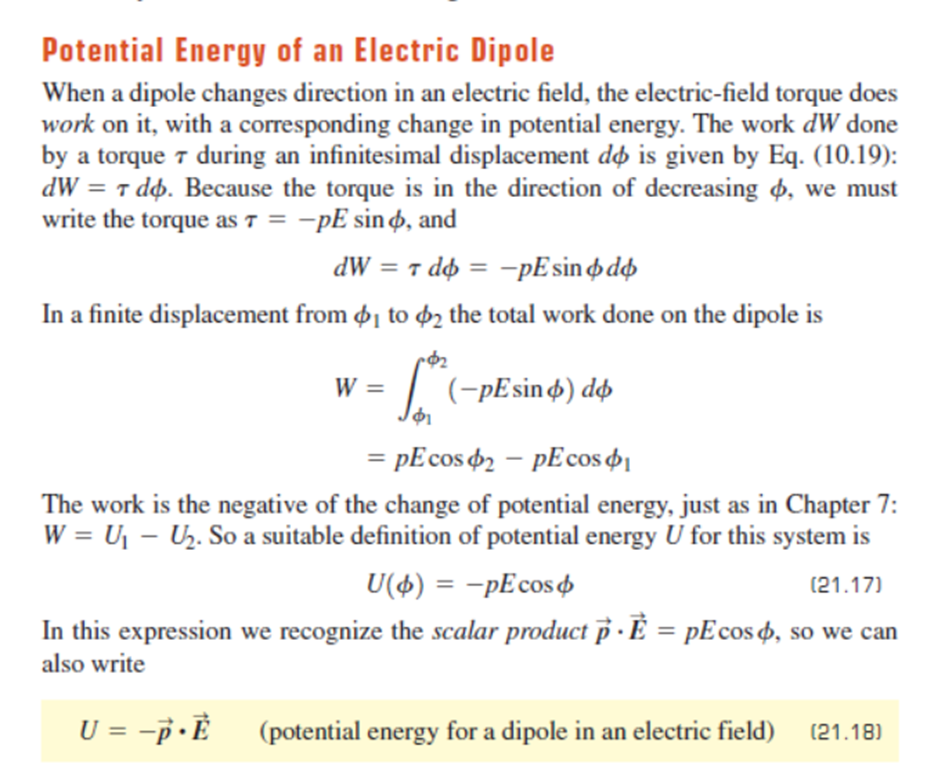 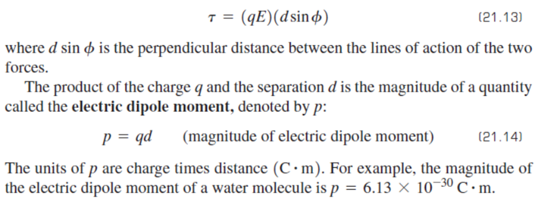

\-

Ch22 Gauss’s law

-What is Gauss’s law all about?

Given <u>any</u> general distribution of charge,

> we <u>surround it</u> with <u>an</u> <u>imaginary surface</u> that <u>encloses the charge</u>.

Then we look at the electric field at various points on this imaginary surface.

<u>Gauss’s law is</u>

> <u>a relationship</u> between <u>the field at all the points on the surface</u> and <u>the total charge enclosed within the surface</u>.

给定电荷的任何一般分布，我们用假想表面(封闭)包围这个电荷。

然后我们看看这个假想表面上不同点的电场。

高斯定律是表面上所有点的场与表面内的总电荷之间的关系。

-Charge and **electric flux电通量**

In both boxes below,

the <u>positive charge</u> within the box

> <u>produces</u> an <u>outward</u> pointing **electric flux电通量**

<u>through the surface</u> of the box

> 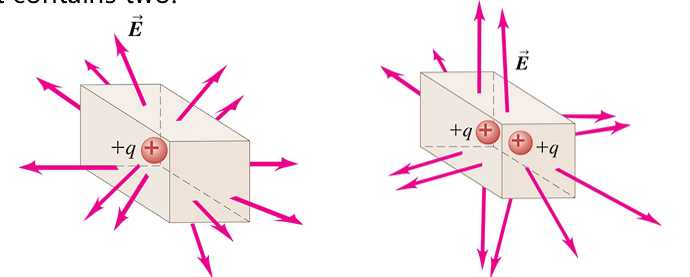
>
> The field patterns on the surfaces of the boxes are different in detail
>
> 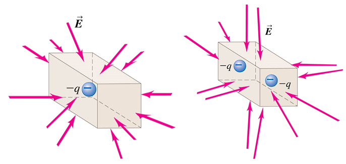
>
> When there are <u>negative</u> charges inside the box, there is an <u>inward</u> pointing electric flux on the surface.

-Zero **net charge净电荷** inside a box:

> Case 1
>
> **net (adj.)净的**
>
> the box is empty (?) and the electric field is zero everywhere
>
> then there is <u>no electric flux</u> into or out of the box
>
> 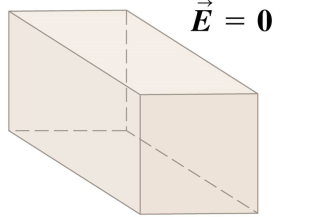
>
> Case 2
>
> there is zero net charge inside the box
>
> the electric field ‘flows into” the box on half of its surface and “flows out of” the box on the other half.
>
> Hence there is <u>no <span class="mark">net</span> electric flux</u> into or out of the box.
>
> 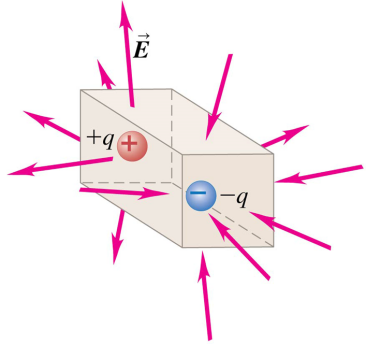
>
> Case 3
>
> there is charge near the box, but not inside it
>
> On one <u>end</u> of the box,
>
> <u>the flux points into the box</u>;
>
> on the opposite end, the <u>flux points out of the box</u>;
>
> On the sides,
>
> the field is **parallel(adj.)平行的** to the surface and so the <u>flux is zero</u>.
>
> The <u><span class="mark">net</span> electric flux</u> <u>through the box</u> is <u>zero</u>.
>
> 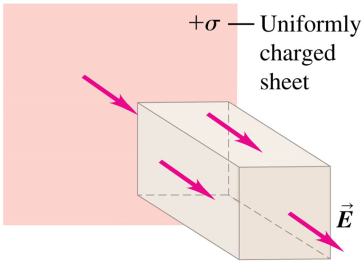

-What <u>affects</u> the <u>flux</u> <u>through a box</u>?

> The <u><span class="mark">net</span> electric flux</u>
>
> is directly <u>proportional</u> to
>
> the <u><span class="mark">net</span> amount of charge</u> <u>enclosed within the surface</u>.
>
> is <u>independent</u> of
>
> the size of the closed surface.
>
> 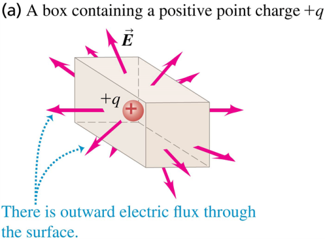
>
> 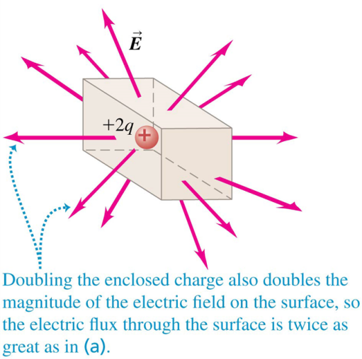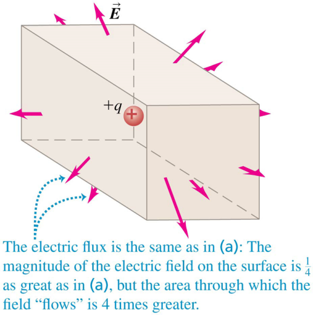

-Calculating electric flux

> Consider a flat area perpendicular to a uniform electric field.
>
> Increasing the area means that more electric field lines pass through the area, increasing the flux.
>
> A stronger field means more closely spaced lines, and therefore more flux.
>
> 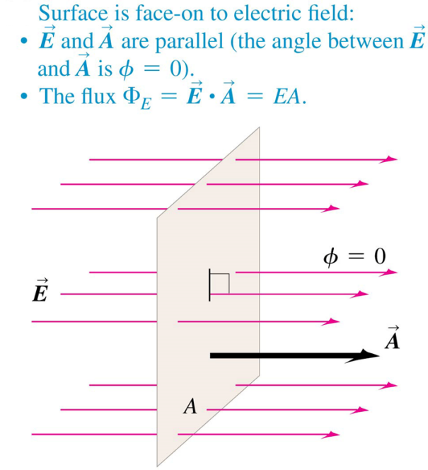
>
> If the area is edge-on to the field,
>
> then the area is perpendicular to the field and the flux is zero.
>
> 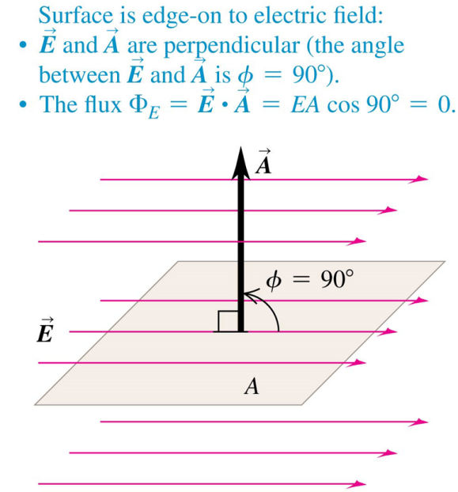
>
> If the area is not perpendicular to the field, then fewer field lines pass through it.
>
> In this case the area that counts is the silhouette area that we see when looking in the direction of the field.
>
> 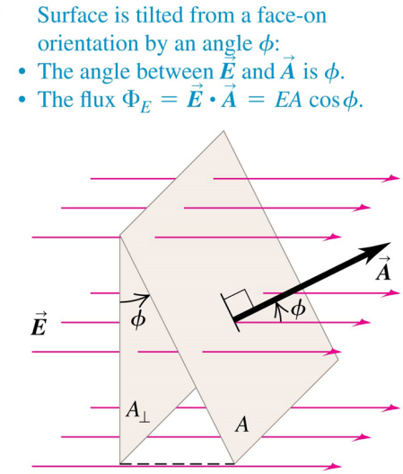
>
> -Flux of a nonuniform(adj.)不均匀的 electric field 非均匀电场的通量
>
> Compute the flux through a surface
>
> using a <u>surface integral</u> <u>over the area</u>:
>
> 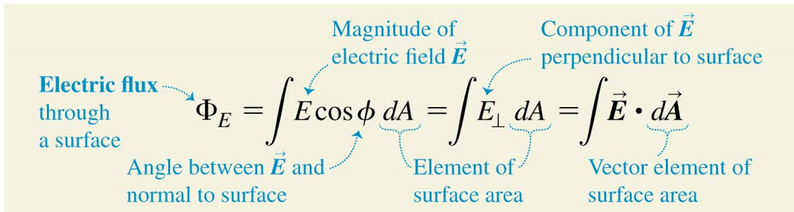
>
> The <u>SI unit</u> for <u>electric flux</u> is <span class="mark">1 N ∙ m<sup>2</sup>/C</span>.
>
> In the case of a single point charge at the center of a spherical surface,
>
> <u>Gauss’s law follows simply from Coulomb’s law</u>.
>
> 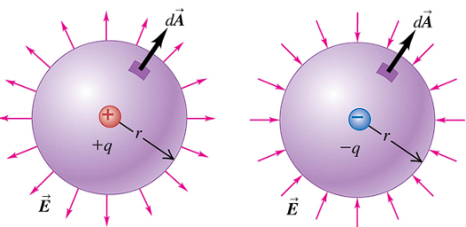
>
> A <u>surface</u> around a positive charge has a <span class="mark"><u>positive (outward) flux</u></span>,
>
> A <u>surface</u> around a negative charge has a <span class="mark"><u>negative (inward) flux</u></span>.

-Gauss’s law 高斯定律

<u>Completely equivalent to Coulomb’s law</u>,

Provides <u>a different way</u> to <u>express the relationship</u> between <u>electric charge</u> and <u>electric field</u>.

-Point charge centered in a spherical surface 以点电荷为中心的球面

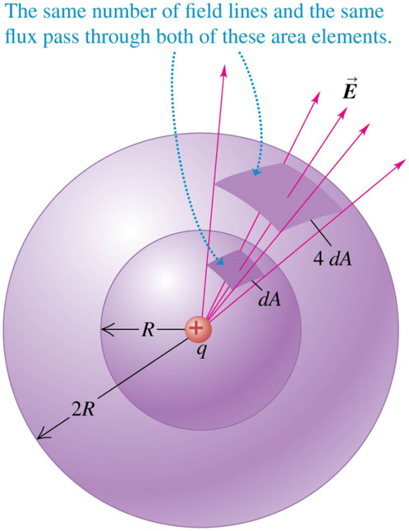The **<u>area element</u>** on the larger sphere is 4 dA,

the electric field magnitude is 1/4 as great

on the sphere of radius 2R as on the sphere of radius R.

↓

The <u>electric flux</u> is the <u>same</u> for both areas

and is <u>independent</u> of <u>the radius of the sphere</u>.

-Point charge inside a nonspherical surface 非球面内的点电荷

As before,

the flux depends only on the charge inside.

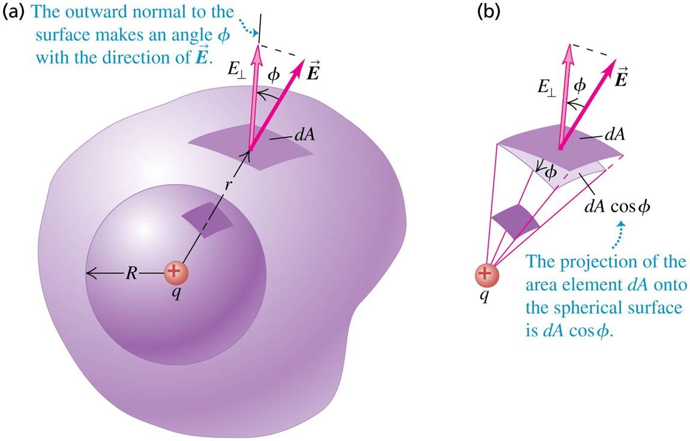

-General form of Gauss’s law 高斯定律的一般形式

*Q*<sub>encl</sub>: the total charge enclosed by a surface.

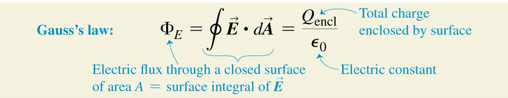

the total electric flux <u>through a closed surface</u>

is equal to the total (net) electric charge inside the surface, divided by ε<sub>0</sub>

-Gauss’s law in a **vacuum(n.)?**

For a closed surface enclosing no charge:

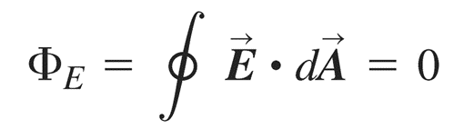

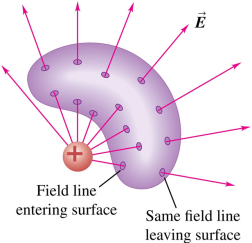

If an electric field line from the external charge enters the surface at one point,

it must leave at another.

如果来自外部电荷的电场线在一点进入表面，它必须在另一点离开。

-Gauss’s law in terms of derivatives 导数形式的高斯定律

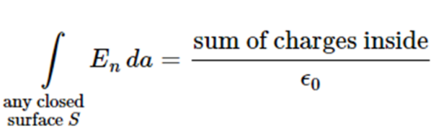 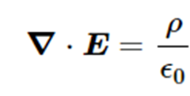

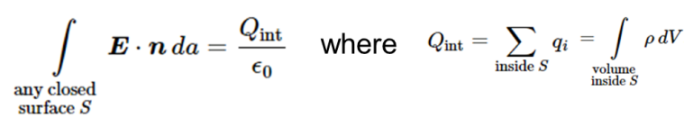

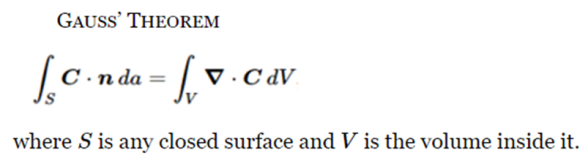

-Applications of Gauss’s law

-1.

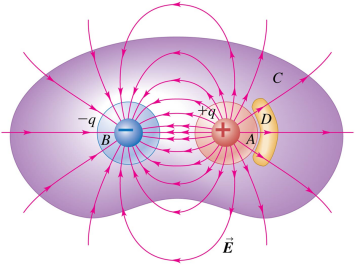Without having to do any integration, we can use Gauss’s law to determine the electric flux through the closed surfaces in the diagram

ΦEA = +q/ε0

ΦEB = -q/ε0

ΦEC = 0

ΦED = 0

\-<span class="mark">2.</span>

Suppose we construct a **<u>Gaussian surface</u>** inside a conductor.

*<u>Because</u> <u>E=0 everywhere on this surface</u>,*

*Gauss’s law requires that the net charge inside the surface is zero.*

Under <u>electrostatic conditions (charges not in motion)</u>,

<u>any</u> <u>excess charge on a solid conductor</u> resides <u>entirely</u> <u>on the conductor’s surface</u>.

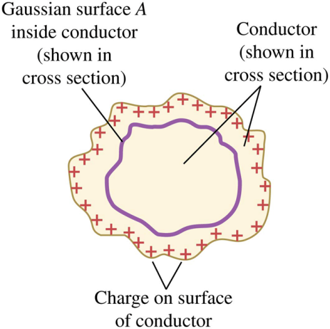

-Spherical symmetry -Spherical shell

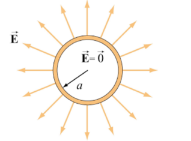 

\-Non-Conducting Solid Sphere

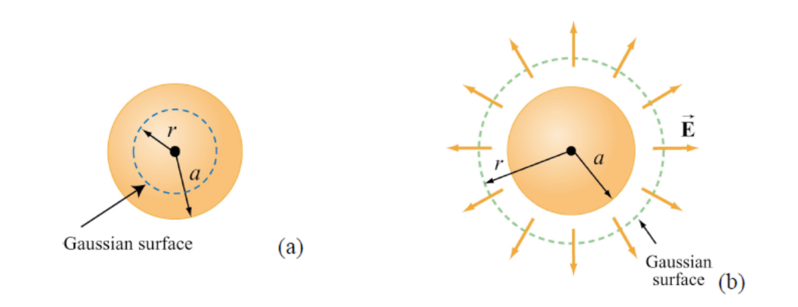

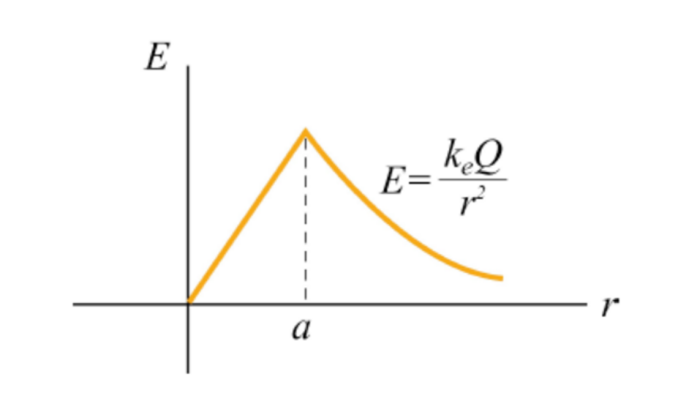

-Field of a uniform line charge

Ch24 Capacitance & Dielectrics

-Capacitor & Capacitance: Definition

**Insulator绝缘体**

**Capacitor电容器**

Charging the capacitor电容器充电

A charge Q is stored on the capacitor

> 电荷Q (Q\>0) 被储存在电容器上：高电势+Q, 低电势-Q

Symbols that represent the capacitor

> 电容的符号：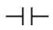、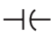

Once the charges and are established on the conductors, the battery is disconnected.

> This gives a fixed potential difference V<sub>ab</sub> between the conductors
>
> the potential of the positively charged conductor with respect to the negatively charged conductor b = the voltage of the battery

the **capacitance电容** of the capacitor电容器 (*C*)

> 
> ``` math
> C = \frac{Q}{V_{ab}}
> ```
>
> \*capacitance电容的*C*是斜体的，coulomb库伦的C<span class="mark">不</span>使用斜体
>
> the value of the capacitance depends only on the shapes and sizes of the conductors and on the nature of the insulating material between them
>
> 电容的值只取决于 导体的形状和尺寸、它们之间的绝缘材料的性质

The SI unit of capacitance电容的单位

> farad法拉(F)
>
> <span class="mark">1F = 1farad = 1C/V = 1 coulomb/volt</span>

-Calculating Capacitance

**Parallel-plate capacitor 平行板电容器**

> Consists of two parallel conducting plates, each with area separated by a distance that is small in comparison with their dimensions
>
> The field between such plates is essentially uniform, and the charges on the plates are uniformly distributed over their opposing surfaces.
>
> 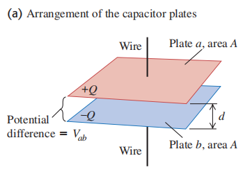
>
> The field magnitude $`E = \frac{\sigma}{\varepsilon_{0}} = \frac{Q}{\varepsilon_{0}A}`$ (<span class="mark">A</span> is area) (using Gauss’s law) (in vacuum)
>
> The field is uniform and the distance between the plates is d,
>
> So $`V_{ab} = Ed = \frac{Qd}{\varepsilon_{0}A}`$
>
> So $`C = \frac{Q}{V_{ab}} = \frac{Q}{Ed} = \varepsilon_{0}\frac{A}{d}`$ (in vacuum)
>
> So <span class="mark">1F = 1C<sup>2</sup>/N·m = 1C<sup>2</sup>/J</span>
>
> <span class="mark">1V = 1C/J → 1F = 1C/V</span>
>
> \*When matter is present between the plates, its properties affect the capacitance
>
> 1C<sup>2</sup>/N·m<sup>2</sup> = 1F/m → $`\varepsilon_{0} = 8.85 \times 10^{- 12}F/m`$
>
> microfarad: 1μF = 10<sup>-6</sup>F
>
> picofarad: 1pF = 10<sup>-12</sup>F
>
> \*For any capacitor <u>in vacuum</u>, the capacitance depends <u>only</u> on the shapes, dimensions, and separation of the conductors that make up the capacitor.
>
> 对于<u>在真空中</u>的任何电容器，电容<u>只</u>取决于构成电容器的分离导体的形状、尺寸

-Capacitors in **Series串联** and **Parallel并联**

schematic diagram示意图

schematic(adj.)示意的

a series connection串联接法

a parallel connection并联接法

-Capacitors in **Series串联**

> In a series connection, the magnitude of charge on all plates is the same.
>
> <u>串联</u>中，<u>所有电容器板上</u>的<u>电荷Q大小全部相同</u>
>
> 在下图(a) 中：
>
> ·$`V_{ac} = V_{1} = \frac{Q}{C_{1}}`$ *·*$`\ V_{cb} = V_{2} = \frac{Q}{C_{2}}`$
>
> ·$`V_{ab} = V = V_{1} + V_{2} = Q(\frac{1}{C_{1}} + \frac{1}{C_{2}})`$
>
> So $`\frac{V}{Q} = \frac{1}{C_{1}} + \frac{1}{C_{2}}`$
>
> 
>
> (电容器上的电势差V通常指从+到- ??)
>
> -Equivalent capacitance (*C*<sub>eq</sub>) 等效电容
>
> Def.: <u>the capacitance of a <span class="mark">single</span> capacitor</u>
>
> for which the charge is the same as for the combination, when the potential difference is the same.
>
> (*C*<sub>eq</sub>: 其V 与 该中所有电容V之和 相同时，其Q与该电路中任一电容Q相同)
>
> (In other words, the combination can be replaced by an equivalent capacitor of capacitance C<sub>eq</sub> 如上图(b) )
>
> Def: $`C_{eq} = \frac{Q}{V}`$
>
> So $`\frac{1}{C_{eq}} = \frac{V}{Q} = \frac{1}{C_{1}} + \frac{1}{C_{2}}`$
>
> Extend $`\frac{1}{C_{eq}} = \frac{V}{Q} = \frac{1}{C_{1}} + \frac{1}{C_{2}} + \frac{1}{C_{3}} + \cdots`$
>
> \*在串联电路中，等效电容总是小于任何单个电容
>
> \*串联电路中，$`V_{total} = V_{1} + V_{2} + V_{3} + \cdots`$

-Capacitor in **Parallel并联**

> in a parallel connection the potential difference for all individual capacitors is the same
>
> 并联中，所有电容器中的电位差V全部相同
>
> 
>
> · <span class="mark">Q<sub>1</sub> = *C*<sub>1</sub> V</span> and <span class="mark">Q<sub>2</sub> = *C*<sub>2</sub> V</span>
>
> · <span class="mark">Q = Q<sub>1</sub> + Q<sub>2</sub> = ( *C*<sub>1</sub> + *C*<sub>2</sub> ) V</span>
>
> So $`\frac{Q}{V} = C_{1} + C_{2}`$
>
> So $`C_{eq} = \frac{Q}{V} = C_{1} + C_{2}`$
>
> Extend $`C_{eq} = \frac{Q}{V} = C_{1} + C_{2} + C_{3} + \cdots`$
>
> \*在并联连接中，等效电容总是大于任何单个电容
>
> \*并联电路中，$`Q_{total} = Q_{1} + Q_{2} + Q_{3} + \cdots`$

-Energy Storage in Capacitors & Electric-Field Energy

at an intermediate stage during the charging process:

> the work (dW) required to transfer an additional element of charge (dq):
>
> ·$`dW = v\ dq = \frac{q\ dq}{C}`$
>
> So
>
> work to charge a capacitor $`W_{total} = \int_{0}^{W_{total}}{dW} = \frac{1}{C}\int_{0}^{Q_{final}}{q\ dq} = \frac{Q_{final}^{2}}{2C}`$
>
> =the total work done by the electric field on the charge
>
> when <u>the capacitor **discharges放电**</u>
>
> If we Define the potential energy of an uncharged capacitor to be zero
>
> then 上式中的 W<sub>total</sub> = U<sub>the potential energy of the charged capacitor</sub>
>
> then Q<sub>final</sub> = *C*V
>
> $`U = \frac{Q^{2}}{2C} = \frac{1}{2}CV^{2} = \frac{1}{2}QV`$ (U is the potential energy of the charged capacitor)
>
> ·$`U = \frac{1}{2}QV`$ shows that <span class="mark">U = Q×the <u>average</u> potential difference V</span>
>
> ·$`U = \frac{1}{2}CV^{2}`$ shows that a charged capacitor is the electrical analog of a stretched spring with elastic potential energy $`U = \frac{1}{2}kx^{2}`$. The charge is analogous to the elongation and the reciprocal of the capacitance $`\frac{1}{C}`$ , is analogous to the force constant $`k`$.

-Applications of Capacitors: Energy Storage

-Electric-Field Energy

> Energy density (*u*) 能量密度
>
> Def.: the energy per unit volume in the space
>
> between the plates of a parallel-plate capacitor with plate area A and separation d
>
> ·$`u = Energy\ density = \frac{\frac{1}{2}CV^{2}}{Ad}`$
>
> Because $`C = \frac{Q}{V_{ab}} = \frac{Q}{Ed} = \varepsilon_{0}\frac{A}{d}`$ , $`V = Ed`$
>
> → $`u = \frac{1}{2}\varepsilon_{0}E^{2}`$ (*u*: electric energy density in a vacuum)
>
> (Although we have derived this relationship only for a parallel-plate capacitor, it turns out to <u>be valid for any capacitor in vacuum</u> and indeed <u>for any electric field configuration in vacuum</u>. )

\-**Dielectric (n.)****电介质(?)，绝缘体**

Def.: nonconducting material

 **foil (n.)箔**

**Dielectric breakdown (?)介电击穿**

> Def.: Any **insulating(adj.)绝缘的** material, when subjected to a suffificiently large electric fifield, experiences a partial ionization that permits conduction through it.
>
> 任何绝缘材料，当受到足够大的电场时，都会经历部分电离，允许通过它导电。

Many dielectric materials can tolerate stronger electric fields without breakdown than can air.

> 许多介电材料可以承受比空气更强的电场而不被击穿。

Thus using a dielectric allows a capacitor to sustain a higher potential difference and so store greater amounts of charge and energy.

> 因此，使用电介质允许电容维持较高的电位差，从而存储更多的电荷和能量。

Ch25 Current, Resistance, and Electromotive Force

-Metallic conduction 金属传导

Electrons in a conductor are free to 导体中的电子可以自由地穿过晶体，

> move through the crystal, colliding at intervals with the stationary positive ions.
>
> 与 固定的的 正离子 间隔 碰撞\
> 

(电子的运动类似于一个球沿着倾斜的平面滚动并从其路径上的钉子反弹的运动。)

\-**Current (I) 电流**

Def.: any motion of charge from one region to another.

> 从一个区域到另一个区域 的 任何 电荷运动
>
> ·$`I = \frac{dQ}{dt} = n\ |q|{\ v}_{d\ }A`$
>
> I: Current through an area (A) 通过区域(A)的电流
>
> \*电流I是标量\
> dQ/dt: Rate at which charge flows through area (A) 电荷流经区域(A)的速率
>
> n: Concentration of moving charged particles 移动带电粒子的浓度
>
> \|q\|: Charge per particle 每个粒子的电荷
>
> v<sub>d</sub>: Drift speed 漂移速度
>
> A: Cross-sectional area 横截面积

-Direction of current flow 电流流动方向

> **Conventional current 常规电流**
>
> is <u>treated as a flow of positive charges</u>
>
> A current can be produced by positive or negative charge flow.
>
> In a metallic conductor, the moving charges are electrons — but the current still points in the direction positive charges would flow.

-Signs of charge carriers

> In the sodium chloride solution, current can be carried by
>
> both positive sodium ions and negative chlorine ions
>
> <u>The total current I</u>
>
> is found by <u>adding up the currents</u> <u>due to each kind of charged particle</u>.

-Current density 电流密度

> ·$`\vec{\mathbf{J}} = n\ q\ \overrightarrow{\mathbf{v}_{\mathbf{d}}}`$
>
> ***J***: Vector current density 矢量 电流密度
>
> n: Concentration of moving charged particles 移动带电粒子的浓度
>
> q: Charge per particle 每个粒子的电荷
>
> **v<sub>d</sub>**: Drift velocity 矢量 漂移速度
>
> \*电流密度 $`\vec{\mathbf{J}}`$ 是矢量，包含the direction of the drift velocity漂移速度的方向$`\overrightarrow{\mathbf{v}_{\mathbf{d}}}`$
>
> \*[**漂移速度**$`\overrightarrow{v_{d}}`$ **(Drift speed)** 是指 带电粒子(<u>如</u> 电子) 在材料中 由于电场](https://byjus.com/physics/drift-velocity/)
>
> [而获得的<u>平均速度</u>](https://byjus.com/physics/drift-velocity/)。[它的国际单位是米每秒（m/s）](https://byjus.com/physics/drift-velocity/)
>
> The vector current density is always in the same direction as the electric field,
>
> 矢量 电流密度***J*** 的方向 始终 与 矢量 电场***E***(?) 的方向 相同，
>
> no matter what the signs of the charge carriers are.
>
> 无论电荷载流子的符号是什么

\-**Resistivity (ρ) 电阻率**

Def.: the ratio of the electric field in the material to the current density it causes:

> ·$`\rho = \frac{E}{J}`$
>
> ρ: Resistivity of a material 材料 的 电阻率
>
> *E*: <u>Magnitude</u> of electric field in material 材料 中的 电场 <u>大小</u>
>
> *J*: <u>Magnitude</u> of current density caused by electric field 电场 引起的 电流密度 <u>大小</u>

**Conductivity (σ) 电导率**

> The conductivity is the reciprocal of the resistivity.
>
> ·$`\sigma = \frac{1}{\rho}`$


-Circuit boards 电路板 and resistivity 电路板与电阻率

> The copper “wires,” or traces, on this circuit board are printed directly onto the surface of the dark-colored insulating board.
>
> 电路板上的铜“线”或走线直接印刷在深色绝缘板的表面上。
>
> Even though the <u>traces(?)</u> are very close to each other, the board has such a high resistivity that essentially no current can flow between the traces.
>
> 尽管走线彼此非常接近，但电路板具有如此高的电阻率，基本上没有电流可以在走线之间流动。
>
> 

\-**Resistance (R)电阻** and **Ohm’s law 欧姆定律** 电阻与欧姆定律

> The **resistance电阻** of a conductor:
>
> · $`R = \frac{\rho L}{A}`$
>
> **Ohm’s Law欧姆定律**:
>
> The <u>**potential电位** difference</u> <u>across a conductor</u>
>
> · $`V = IR`$
>
> V: potential difference between ends of the conductor
>
> Current flows from higher to lower ↓ electric potential 电位
>
> *电流*从 <u>较高</u>电位 *流向* <u>较低</u>电位 (电流流向与电势)
>
> 

\-**Resistors (p.l.)电阻器** are color-coded for easy identification

> 电阻器 采用 颜色编码，便于识别
>
> 
>
> Tolerance: 公差
>
> Multiplier: 乘数
>
> -Ohmic resistors 欧姆电阻器
>
> For a resistor that obeys Ohm’s law, 对于遵循欧姆定律的电阻器，
>
> a graph of current as a function of potential difference (voltage) is a straight line.
>
> 电流与电位差（电压）的函数关系图是一条直线。
>
> e.g., typical metal wire典型金属电线(?)(is an ohmic resistor),
>
> at given temperature, current is proportional to **voltage(n.)电压**
>
> 在给定温度下，电流与电压<u>成正比</u>
>
> 
>
> -Nonohmic resistors 非欧姆电阻器
>
> In devices that do not obey Ohm’s law, 在不遵守欧姆定律的器件中，
>
> the relationship of voltage to current may not be a direct proportion, and it may be different for the two directions of current.
>
> 电压与电流的关系*<u>可能不是</u>* <u>成正比的</u>，
>
> <u>对于</u> <u>电流的两个方向</u><span class="mark">(!!)</span>，<u>电压与电流的关系</u>可能<u>不同</u>。
>
> e.g., **semiconductor diode半导体二极管** (is a nonohmic resistor)
>
> diode (n.)二极管
>
> 

-Resistivity and temperature 电阻率与温度

> The resistivity of a metallic conductor
>
> nearly always increases with increasing temperature.
>
> <span class="mark">温度*T*↑，电阻率ρ↑</span>
>
> 
>
> (dρ/dT = ρ<sub>0</sub> α)
>
> <u>Over a small temperature range,</u>
>
> <u>the resistivity of a metal can be represented approximately.</u>
>
> **Temperature dependence of resistivity电阻率的温度依赖性**:
>
> · $`\rho(T) = \rho_{0}\lbrack 1 + \alpha(T - T_{0})\rbrack`$
>
> ρ(*T*): Resistivity at temperature *T*
>
> ρ<sub>0</sub>: Resistivity at reference temperature *T<sub>0</sub>*
>
> α: Temperature coefficient of resistivity
>
> *T*: Temperature
>
> -Temperature coefficients (α) of resistivity
>
>  tungsten (n.)钨
>
> -Thermistor (n.)热敏电阻
>
> a type of **thermometer(n.)温度计**
>
> the principle原理:
>
> Measuring the resistivity of a small semiconductor crystal
>
> 测量小的半导体晶体的电阻率
>
> is a sensitive measure of temperature
>
> 是一种敏感的测量温度的方法(?)
>
> e.g., **graphite(n.)石墨 (一种半导体)**
>
> The resistivity电阻率 of **graphite (a semiconductor) 石墨(一种半导体)**
>
> decreases with increasing temperature,
>
> <span class="mark">温度T↑，<u>石墨</u>的电阻率ρ↓</span>
>
> since at higher temperatures, more electrons “shake loose” from the atoms and become mobile.
>
> 因为在更高的温度下，更多的电子从原子中“松散”并变得可移动。
>
> -Superconductivity (n.)超导性
>
> Some materials show this phenomenon
>
> <span class="mark">温度T↓，<u>超导材料 的</u> 电阻率ρ：</span>

1.  <span class="mark">At first, it decreases smoothly</span>

2.  <span class="mark"><u>Below</u> a certain **critical temperature(*T<sub>c</sub>*)临界温度**,</span>

> <span class="mark">a **phase transition相变** occurs</span>
>
> <span class="mark">and <u>the resistivity suddenly drops to zero电阻率突然降至零</u></span>
>
> 
>
> Once a current has been established in a superconducting ring,
>
> it continues indefinitely without the presence of any driving field
>
> 一旦电流在超导环中建立，它就会无限期地继续，且没有任何驱动场的存在

\-**Electromotive force 电动势** and **circuits (p.l.)电路**

**Electromotive force (emf) (Ɛ) 电动势**

> Abbreviated缩写：**emf**
>
> Symbol: **Ɛ (capital ε) (a script capital E)** (?)
>
> Def.: The influence that makes current flow from lower to higher potential
>
> <u>使</u> 电流 从 低电位 流向 高电位 的 <u>影响</u>
>
> SI unit 国际单位: volt (V) (1V = 1J/C)
>
> **Source of emf** (Source of electromotive force) **电动势源**
>
> Def.: a circuit device that provides emf
>
> \*Note that “<u>electromotive force</u>” is a poor term
>
> because emf is not a force but <u>an energy-per-unit-charge quantity</u>, like potential.
>
> \*A typical flashlight battery has an emf of 1.5 V;
>
> this means that the battery does 1.5 J of work on every coulomb of charge that passes through it.

\-**Internal resistance (*r*) 内阻**

> Real sources of emf actually contain some internal resistance
>
> 真实的电动势源实际上有一些内阻
>
> **Terminal voltage端电压**
>
> ( Def.: the voltage at the terminals of an electrical device (as a battery or a generator) )
>
> ·$`V_{ab} = Ɛ - Ir`$
>
> V<sub>ab</sub>: <u>Terminal voltage source with internal resistance</u>
>
> Ɛ: emf of source
>
> I: Current through source
>
> r: Internal resistance of source
>
> The **terminal voltage端电压** of the 12-V battery is less than 12 V when it is connected to the light bulb.
>
> 12 V电池连接到灯泡时的端电压小于12 V。

-Symbols for circuit diagrams 电路图符号

: Conductor with negligible resistance

: Resistor

: Source of emf (long vertical line always represents: the positive terminal,

> usually the terminal with higher potential)

 or : Source of emf with internal resistance *r*

> (*r* can be placed on either side)

: Voltmeter电压表 (measures potential difference between its terminals)

: Ammeter电流表 (measures current through it)

-Potential changes 电势变化

The potential rises when the current goes through a battery, 当电流通过电池时，电位上升

> and drops when it goes through a resistor. 当电流通过电阻时，电位下降。


-Energy and power in electric circuits


The box represents a **circuit element电路元件(?)**

> with potential difference *V<sub>ab</sub> = V<sub>a</sub> − V<sub>b</sub>* between its terminals
>
> 其两端之间的电位差是*V<sub>ab</sub> = V<sub>a</sub> − V<sub>b</sub>*
>
> and current *I* passing through it in the direction from a toward b.
>
> 而且电流I沿从a向b的方向通过它。

If the potential at a is lower than at b,

> then there is a net transfer of energy out of the circuit element.
>
> 如果 a 处的电位低于 b 处的电位，
>
> 则存在从电路元件流出的能量净转移。

**Power (*P*) (n.)功率**

> Def.: The time rate of energy transfer
>
> ·$`P = V_{ab}I`$
>
> *P*: Power delivered to or extracted from a circuirt element
>
> *V<sub>ab</sub>*: Voltage across circuit element
>
> *I*: Current in circuit element
>
> Then
>
> ·$`P = V_{ab}I = ƐI - I^{2}r`$
>
> 

-Kirchhoff’s rules 基尔霍夫定律

1.  The sum of the currents flowing into a junction

> is equal to the sum of the currents flowing out of a junction
>
> ·$`\sum_{}^{}{I_{in} =}\sum_{}^{}I_{out}`$

2.  The algebraic sum of the changes in electric potential

> in a closed-circuit loop is zero (0)
>
> ·$`\sum_{closed\ loop\ }^{}{\Delta V} = 0`$

Ch26 Direct-Current Circuits

\-

Ch27 Magnetic Field and Magnetic Forces

-Fundamental knowledge of magnetic field and force

-Magnetic poles

north pole or N pole

south pole or S pole

no experimental evidence for magnetic monopoles

-Magnetic field of the earth

north geographic pole is close to a magnetic south pole

The earth’s magnetic axis is not quite parallel to its geographic axis

magnetic inclination:

> the magnetic field is not horizontal at most points on the earth’s surface

-Magnetic field lines

移动的电荷/电流产生磁场

B: magnetic field

the direction of B → north pole指向方向

magnetic field lines: represent any magnetic field

与该点的磁场矢量相切

各磁场线永不相交

-Magnetic field of a straight current-carrying wire


-Magnetic flux 磁通量


The magnetic flux through any closed surface is zero


B: magnetic field——SI unit: 1 tesla = 1 T = 1 N/A ∙ m

Φ*<sub>B</sub>*: magnetic flux——SI unit: 1 weber = 1 Wb = 1 T ∙ m<sup>2</sup>

-The magnetic force on a moving charge

-Magnetic force as a vector product

$`\vec{F} = q\vec{v} \times \vec{B} = qvB\ sin\Phi`$

Right-hand rule for magnetic force

判断磁力的方向：右手法则——**从v到B**


-Cathode-ray tube (CRT) 阴极管射线


-The Hall effect霍尔效应:


Hall emf霍尔电动势: Eq=qvB → E=vB

电荷载流子符号不同，则霍尔电动势正负极相反

-The magnetic force on a current-carrying conductor

通电导体上的磁力

The magnitude of the force on a single charge is: F = qv<sub>d</sub>B

the total force on all the charges in this segment

$`F\  = {(\sum_{}^{}q)v}_{d}B = \ (n\ Al\ q)v_{d}B\  = \ ({nqv}_{d}\ A)(lB)`$

n: the number of charges per unit volume每单位体积中的电荷

magnetic force on a straight wire <u>segment</u>:

$`\vec{F} = I\ \vec{l} \times \vec{B}`$

magnetic force on an infinitesimal(极小的) wire <u>section</u>:

$`d\vec{F} = I\ d\vec{l} \times \vec{B}`$

-B field of magnetic dipole

magnetic dipole: the loop

$`B_{x} = \frac{\mu_{0}Iab}{4\pi}\frac{3xz}{R^{5}}`$

$`B_{y} = \frac{\mu_{0}Iab}{4\pi}\frac{3yz}{R^{5}}`$

$`B_{z} = - \frac{\mu_{0}Iab}{4\pi}\left( \frac{1}{R^{3}} - \frac{3z^{2}}{R^{5}} \right)`$

the E-field for a dipole oriented along the z-axis:

$`E_{x} = \frac{p}{4\pi\varepsilon_{0}}\frac{3xz}{R^{5}}`$; $`E_{y} = \frac{p}{4\pi\varepsilon_{0}}\frac{3yz}{R^{5}}`$; $`E_{z} = - \frac{p}{4\pi\varepsilon_{0}}\left( \frac{1}{R^{3}} - \frac{3z^{2}}{R^{5}} \right)`$

The magnetic “dipole field”:

is not produced by two “charges,”

but <u>by an elementary current loop</u>

-Force and torque on a current loop


vector <u>magnetic torque</u> on a current loop $`\vec{\tau} = \vec{\mu} \times \vec{B}\ \ \ \ (\tau = IABsin\Phi)`$

magnetic dipole moment $`\vec{\mu} = I\ \vec{A}`$ ($`\vec{A}`$的方向：对loop中的电流方向使用右手定则)

（注：封闭曲面中，$`\vec{A}`$的方向为向外）

The potential energy U in a magnetic field $`\vec{B}`$: $`U = \vec{\mu} \bullet \vec{B} = - IAB\cos\Phi`$


-The direct-current motor 直流电机


Rotor转子:

Commutator换向器:

(电流流入转子的红色侧，流出蓝色侧。

> 因此，磁力矩使转子逆时针旋转。)

-Northern light

\-Helical motion 螺旋运动


如果粒子具有平行于场的以及垂直于场的速度分量，则其路径为螺旋。

粒子的速度和动能保持不变。

-The Van Allen radiation belts


\-Mass spectrometer 质谱仪

-Motion of charged particles in a magnetic field

当带电粒子在磁场中移动时，磁力F垂直于粒子速度v，因此磁力不改变该粒子的速度

-Non-relativistic and relativistic


-Mass spectrometer 质谱仪


(初始速度/S_1与S_2间电压 或由 qU_0=W=1/2 m v^2计算)

(中间过程筛选速度Eq = qvB → v=E/B)

(后 计算比荷-用向心力：qvB = mv^2 / R → R=mv/qB (q/m = v/BR(?)) )

\-Cyclotron 回旋加速器


-Summary


Ch28 Sources of Magnetic Field 磁场源

-The magnetic field of a moving charge

移动的电荷产生的磁场


-Magnetic field of a current element

一小段电流产生的磁场

(The total magnetic field of several moving charges is the vector sum of each field)

Law of Biot and Savart


-Currents and planetary magnetism

地球的磁场是由在其熔融内部循环的电流引起的，传导内部。

这些电流是由我们星球相对快速的自旋（每24小时旋转一次）搅动的。

月球的内部电流要弱得多;它比地球小得多，内部主要是固体，旋转缓慢（每27.3天旋转一次）。

因此，月球的磁场强度仅为地球磁场的10<sup>-4</sup>。

-Magnetic field of a straight current-carrying conductor

直载流导体的磁场


(对上进行积分)

B的方向：右手法则

长度为2a，通有电流I的 直载流导体: $`B = \frac{\mu_{0}I}{4\pi}\frac{2a}{x\sqrt{x^{2} + a^{2}}}`$ (x: 到测量点的半径)

长度为∞(无穷大)，通有电流I的 直载流导体: $`B = \frac{\mu_{0}I}{2\pi r}`$ (r: 到测量点的半径)


-Magnetic fields of current-carrying wires

在每根cable电缆中，紧密间隔的电线沿电缆的长在两个方向上传输电流。

> 来自这些相反电流的磁场相互抵消。

-Force between parallel conductors

两个平行导体之间的磁力


电流同向：吸引力 (attractive force)

电流反向：排斥力 (repel each other)


-Definition of the ampere

magnetic constant $`\mu_{0}`$=4*π* × 10<sup>−7</sup> T ∙ m/A

1 coulomb = 1 C = 1 A·s

-Magnetic field of a circular current loop

圆环电流loop产生的磁场


半径为a、通有电流I，在distance along axis from center of loop to field point为x 处的 磁场B<sub>x</sub>:


> 判断 B<sub>x</sub>的方向：右手定则

-Magnetic field lines of a circular current loop

圆环电流loop的磁场线

they are **<u>not circles</u>**:


-Magnetic fields for MRI 磁共振成像的磁场

-Ampere’s law (special case)


通有电流I的直载流体：距离其半径为r的封闭圆环上，该直载流体产生的磁场 的线积分：

$`\oint_{}^{}{\vec{B} \bullet d\vec{l}} = \oint_{}^{}{B_{||}\ dl} = B\oint_{}^{}{dl} = \frac{\mu_{0}I}{2\pi r}\ (2\pi r) = \mu_{0}I`$

-Ampere’s law (general statement)


假设 几根长而直的导体 穿过 以integration path为界 的表面

→ <u>总</u>磁场的线积分 与 电流的代数和 成正比


(适用于任何形状的导体和路径)

如果闭合路径周围的积分为零，则不一定意味着磁场is everywhere along the path，

> 只是通过an area bounded by the path的<u>总</u>电流为零。

-Field of a long cylindrical conductor

长的圆柱形导体产生的磁场

A cylindrical conductor with radius R carries a current I

(电流uniformly均匀distributed over分布在 导体的the cross-sectional area横截面积上)


(! 应用Ampere’s law找到该磁场)

Inside the conductor (r\<R): $`B = \frac{\mu_{0}I}{2\pi}\frac{r}{R^{2}}`$ (← $`\oint_{}^{}{\vec{B} \bullet d\vec{l}} = B \bullet 2\pi r = \mu_{0}\frac{\mathbf{I}}{\mathbf{\pi}\mathbf{R}^{\mathbf{2}}}\mathbf{\pi}\mathbf{r}^{\mathbf{2}} = \mu_{0}I\frac{r^{2}}{R^{2}}`$)

Outside the conductor (r\>R): $`B = \frac{\mu_{0}I}{2\pi r}`$ (← $`\oint_{}^{}{\vec{B} \bullet d\vec{l}} = B \bullet 2\pi r = \mu_{0}I`$)

R: 该圆柱形导体的横截面半径

r: 测量点距离中心轴该圆柱形导体的距离

-Field of a **solenoid**

**螺线管**产生的磁场

A solenoid consists of a helical winding of wire on a cylinder.

螺线管由圆柱体上的螺旋绕线组成。


-The Bohr magneton

在半径为r的圆形轨道上 以速度v运动 的 <u>电子</u>

> 具有angular momentum角动量$`\vec{L}`$ 和 相反方向的magnetic dipole moment轨道磁偶极矩$`\vec{\mu}`$。

它还具有 spin angular momentum自旋角动量

> 和 相反方向的spin magnetic dipole moment自旋磁偶极矩。


当电子绕原子核运行时，其magnetic dipole moment的大小 与 其轨道角动量 成正比:


Atomic angular momentum:

is quantized: 它在特定方向上的分量始终是 h/2π 的整数倍

Bohr magneton (*μ*<sub>B</sub>) 玻尔磁子: a fundamental unit of magnetic dipole moment

*μ*<sub>B</sub> = *eh*/4*πm* = 9.274 × 10<sup>−24</sup> J/T

(h: Planck’s constant: h = 6.626 × 10<sup>−34</sup> J∙s)

(电子自旋也会导致magnetic moment(磁矩?)，大约等于1个玻尔磁子)

\-**Paramagnetism顺磁性** and **diamagnetism抗磁性**

当外部磁场渗透到<u>顺磁性</u>材料中时: 任何一点的磁场都大于(\>)无量纲因子K<sub>m</sub>

当外部磁场渗透到<u>抗磁性</u>材料中时：任何一点的磁场都略小于(\<)<u>用真空替换</u>材料时的磁场

K<sub>m</sub>: the relative permeability of the material相对磁导率

the magnetic susceptibility磁化率 *χ*<sub>m</sub> = *K*<sub>m</sub> – 1

Def.: The amount by which the relative permeability differs from unity

(???)相对渗透率与单位(unity?)的差异量

-Magnetic susceptibilities of certain materials


-Ferromagnetism 铁磁性

在ferromagnetic materials铁磁性材料（如铁）中，

> atomic magnetic moments原子磁矩倾向于在称为magnetic domains磁畴的区域彼此平行排列。

当没有外部施加的磁场时，the domain magnetizations域磁化是randomly oriented随机定向的。

当存在外部磁场时，the domain boundaries域边界会发生变化;

> 在磁场 方向上 magnetized磁化的domains畴grow增长，
>
> 在其他 方向上 magnetized磁化的domains畴shrink收缩。

Ch29 Electromagnetic Induction

-Faraday’s law 法拉第定律

-Changing magnetic field produces electricity 变化的磁场 产生 电


-Induction experiment 感应实验


> 

**Induced current 感应电流**

**Induced emf 感应电动势**

Def.: the corresponding emf required to cause induced current

-Lenz’s law 楞次定律

确定感应电流或电动势方向

The direction of any magnetic induction effect is such as to oppose the cause of the effect.

任何磁感应效应的方向都是与效应的原因相反的。


-Lenz’s law and the direction of induced current


-Magnetic flux 磁通量 (Review)

Def.: The magnetic flux through the area element 通过单位面积的磁通量:


-Magnetic flux through a flat area


\-**Faraday’s law of induction 法拉第感应定律**

· $`\varepsilon = - N\frac{d\Phi_{B}}{dt}`$

ε: The inuced emf in a close loop

N: 匝数

$`\frac{d\Phi_{B}}{dt}`$: the time rate of change of magnetic flux through the loop

-Determining the **direction of the induced emf** (???)


\-**Faraday’s law 法拉第定律**

**Induced electric field 感应电场**

> Def.: When the current in the solenoid changes with time, it produces a changing magnetic field.
>
> This changing magnetic field induces an electric field in the conducting loop,
>
> which drives the current. The induced electric field can be written in terms of the induced electromotive force (emf),
>
> which is related to the rate of change of magnetic flux.
>
> 当螺线管中的电流随时间变化时，它会产生一个变化的磁场。
>
> 这个变化的磁场在导电环中诱导出一个电场，驱动电流。
>
> 感应电场 可以用 感应电动势（emf） 表示 ，它与磁通量变化率有关
>
> 


-Induced EMF through changing the area A and angle θ

Motional emf:

> When a conducting rod moves perpendicular to a uniform magnetic field, there is a motional emf induced.


-Applications


-The **direct-current motor 直流电机**

**Rotor 转子**

Def.: a wire loop that is free to rotate about an axis

**Commutator 换向器**

Def.:

> 换向器的主要功能是向电枢绕组供电。换向器通过每半转反转旋转绕组中的电流方向，产生稳定的旋转力（扭矩）。


-Displacement current (i<sub>D</sub>) 位移电流


Def.: a fictitious current in the region between the plates

← 当电容器充电时，极板之间的电场增加。

→ Can be regarded as the source of the magnetic field between the plates.

( Ampere’s law is incomplete:

> For the plane circular area bounded by the circle, Iencl is the current iC in the left conductor.
>
> 对于以圆为界的平面圆形区域，I<sub>encl</sub> 是左导体中的电流i<sub>C</sub>。
>
> But the surface that bulges out to the right is bounded by the same circle, and the current through that surface is zero.
>
> 但是向右凸出的表面以相同的圆为界， and 通过该表面的电流为零。 )


-Maxwell’s equations of electromagnetism

(Maxwell’s equations: <u>All the relationships between electric and magnetic fields and their sources</u> are summarized by four equations)

The 1<sup>st</sup> Maxwell equation is:

> <u>Gauss’s law for electric fields</u> (from Chapter 22)
>
> 

The 2<sup>nd</sup> Maxwell equation is:

> <u>Gauss’s law for magnetic fields</u> (from Chapter 27)
>
> 

(Symmetry:

> In empty space where there is no charge, the first two equations are identical in form.
>
> 在没有电荷的空白空间中，前两个方程在形式上是相同的。
>
> )

The 3<sup>rd</sup> Maxwell equation is:

> <u>Formulation of Faraday’s law</u> (from Chapter 29)
>
> (Symmetry: 变化的磁通量产生电场)
>
> 

The fourth Maxwell equation is:

> Ampere’s law, including displacement current (from Chapter 29)
>
> (Symmetry: 变化的电通量产生磁场)
>
> 
>
> (Symmetry:
>
> )

Ch30 Inductance

-Mutual inductance (M) 互感系数

**Mutual induction 互感**


**coil (n.)线圈**

If the current in coil 1 changes, this induces an emf in coil 2,

> 如果线圈 1 中的电流发生变化，则在线圈 2 中产生相应的感应电动势
>
> and vice versa. 反之亦然

**Mutual inductance (M) 互感系数**

Def.: The proportionality constant for this pair of coils.


SI-Unit 单位: H (henry)

( 1 H = 1 Wb/A = 1 V ∙ s/A = 1 Ω ∙ s = 1 J/A<sup>2</sup> )

-Self-inductance (L) 自感系数

**Self-induction 自感**


**Self-induced emf 自感电动势**

Any <u>circuit with a *coil that carries a varying current*</u>

> has a self-induced emf.

**Self-inductance (L) 自感系数**

Def.: the self-inductance L of the circuit:

 (!! Each turn of coil !)

\-**Inductors(n.)电感器** as **circuit elements电路元件**

( (..)**用电器electrical appliance** 通常由 多个 电路元件circuit elements 组成 )

The potential difference between the terminals of the inductor L:


· $`V_{ab} = V_{a} - V_{b} = L\frac{di}{dt}`$

-Potential across a resistor


-Potential across an inductor with <u>constant current</u>


-Potential across an inductor with <u>increasing current</u>

When you have an inductor with increasing current i flowing from a to b,

> the (induced ?? ?)potential drops from a to b.


-Potential across an inductor with <u>decreasing current</u>

When you have an inductor with decreasing current i flowing from a to b,

> The (induced ?? ?) potential increases from a to b


-Magnetic field energy (U<sub>B</sub>) 磁场能

Energy stored in a <u>current-carrying inductor</u>

> can be recovered <u>when *the current decreases to zero*</u>.

当电流降至零时，可以回收存储在载流电感器中的能量。


( ? 磁场能是指磁场中储存的能量，

> ? 而磁场势能是指物体在磁场中由于其位置而具有的能量 ?)


-Magnetic energy density (u) 磁能密度(/磁场能密度)

Def.: The magnetic field energy per unit volume

In a vacuum:


In a material:

a material with (constant) magnetic permeability <span class="mark">*μ* = *K*<sub>m</sub> *μ*<sub>0</sub></span>


-The R-L circuit

Def.: contains a resistor and inductor and possibly an emf source.

 ← a typical R-L circuit

\-<u>Current growth</u> in an R-L circuit

At time t = 0, close <u>switch S1</u>


Current increases with time:


The **time constant (τ)** for the circuit:

> <span class="mark">τ = L/R</span>

\-<u>Current decay</u> in an R-L circuit

there is an initial current I0

At time t = 0, close the switch S2


Current decreases with time:

> 
>
> The **time constant (τ)** for the circuit:
>
> <span class="mark">τ = L/R</span> 表示电路中电流达到稳态值的时间

-The L-C circuit: Oscillation (LC振荡)

Def.: An L-C circuit contains an inductor and a capacitor

> and is an **oscillating circuit**.


(**Oscillating circuit 振荡电路**:

> 它是一种电路， 能够产生周期性的、重复的电信号。
>
> 振荡电路通常由电感器、电容器和放大器等元件组成，
>
> 它们之间的相互作用能够产生振荡信号)

L-C电路包含一个电感和一个电容，是一个振荡电路。 电容器在其左侧板上充电至电位差 Vm 且初始电荷 Qm = CVm，然后开关闭合。 电容器通过电感器放电，当电容器电势变为零时，电流在其最大值 Im 处稳定下来。 电流持续存在，电容器开始充电，极性与初始状态相反。 最终，电流和磁场达到零，电容器以与其初始极性相反的方向充电。 这个过程在相反的方向重复，再过一段时间，电容电荷又恢复到原来的值，整个过程重复。

-Electrical oscillations in an L-C circuit L-C 电路中的电振荡

Apply Kirchhoff’s loop rule


The charge on the capacitor & current through the circuit:


Angular frequency of oscillation (ω) in an L-C circuit:


-Electrical and mechanical oscillations: analogies

电气和机械振荡：类比

 

-The L-R-C series circuit

( L-C电路内加了电阻(R) )

Exhibits **damped harmonic motion阻尼谐波运动**

> <u>if *the resistance is not too large*</u>.

The charge电荷 作为时间的函数:

> 是sinusoidal oscillation正弦振荡
>
> 具有 exponentially decaying指数衰减 的
>
> amplitude振幅 和 angular frequency角频率


Angular frequency (ω) of

underdamped oscillations

in an L-R-C series circuit:


Ch31 Alternating Current 交流电

\-**AC source 交流电源**

Def.: A device that supplies a <u>sinusoidally</u> varying voltage.

**appliance (n.)用电器**


-AC sources and currents

A sinusoidal voltage:

> 

v: the instantaneous potential difference

V: the voltage amplitude

*ω* = 2*πf* : the angular frequency

The corresponding sinusoidal alternating current:

> 

-Phasor diagrams 相量图

**Phasor(s) 相量**

Def.: A rotating vector

(for sinusoidal current: )

Rotates with frequency f & angularspeed ω=2πf

Length: maximum current I

Projection onto horizontal axis: i = I cosωt

To represent sinusoidally varying voltages and currents

**Phasor diagram 相量图** for sinusoidal current:


\-**Root-mean-square values (the rms value)均方根值**(?)

(*<u>of a sinusoidal current</u>*: )

$`I_{rms} = \sqrt{{(i^{2})}_{av}} = \frac{I}{\sqrt{2}}`$


(*<u>for sinusoidal ac sources</u>*: )


-Resistor in an ac circuit 交流电路中的 电阻

related by Ohm’s law:


V<sub>R</sub>: R两侧电压的<u>最大值</u>

I: 通过R的电流的<u>最大值</u>

The resistance does not depend on the frequency of the ac source.

 

-Inductor in an ac circuit 交流电路中的 电感器

 

V<sub>R</sub>: R两侧电压的<u>最大值</u>

I: 通过R的电流的<u>最大值</u>

**X<sub>L</sub>: Inductive reactance 感抗**

Def.: <span class="mark">*X<sub>L</sub>* = *ωL*</span>

电感(L)越大↑，频率(f)越高↑，感抗(X<sub>L</sub>)越大↑


-Capacitor in an ac circuit 交流电路中的 电容器

 

V<sub>C</sub>: C两侧电压的<u>最大值</u>

I: 通过C的电流的<u>最大值</u>

**X<sub>C</sub>: Capacitive reactance 容抗**

Def.: *<span class="mark">X<sub>C</sub>= 1/ωC</span>*

电容(C)越大↑，频率(f)越高↑，容抗(X<sub>C</sub>)越小↓

 

-Comparing ac circuit elements


$`\lim_{\omega \rightarrow \infty}R = R`$ ; $`\lim_{\omega \rightarrow \infty}X_{C} = 0`$ ; $`\lim_{\omega \rightarrow \infty}X_{L} = \infty`$

$`\lim_{\omega \rightarrow 0}R = R`$ ; $`\lim_{\omega \rightarrow 0}X_{C} = \infty`$ ; $`\lim_{\omega \rightarrow 0}X_{L} = 0`$

-The **loudspeaker 扬声器**


为了将不同频率的信号路由到所示的相应扬声器，低音扬声器和高音扬声器在放大器输出端并联连接。

> 高音扬声器分支中的电容器阻挡了声音的低频分量，但通过更高的频率。
>
> 低音扬声器分支中的电感器阻挡了声音的高频分量，但通过较低的频率。

-The L-R-C series circuit

 

V: 电路电压的最大值

I: 电路中电流的最大值

**Z: The <u>impedance 阻抗</u> of the circuit**

Def.: $`Z = \sqrt{R^{2} + {(X_{L} - X_{C})}^{2}}`$


-Measuring body fat by bioelectric impedance analysis

连接到这名超重患者胸部的电极施加频率为 50 kHz 的小交流电压。

附带的仪器测量通过患者身体产生的电流的幅度和相位角。

这些取决于沿路径的水和脂肪的相对量，因此提供了身体成分的灵敏测量。

-Power功率 in a resistor电阻

**The instantaneous power 瞬时功率 <span class="mark">p = vi</span>**

If the circuit element is a pure resistor,

> <u>the voltage and current are *in phase*</u>.

如果电路元件是纯电阻， 则 电压和电流 是 <u>同相的</u>。

→ <u>瞬时功率*p\>0*</u>

-Power功率 in an inductor电感器

-Power in a capacitor

-Power in a general ac circuit 一般 交流电路中的 功率

For an arbitrary combination

> of resistors, inductors, and capacitors,
>
> the average power (P<sub>av</sub>) 平均功率:
>
> 
>
> $`P_{av} = \frac{1}{2}VI\ cos\varnothing = V_{rms}\ I_{rms}\ cos\varnothing`$ (*<u>**P<sub>av</sub>\>0** :</u>* the average power **P<sub>av</sub> *<u>is positive</u>***)
>
> **ϕ**: In <u>any</u> <u>ac circuit</u>
>
> <u>the voltage v</u> across the entire circuit
>
> has some **phase angle ϕ** with respect to <u>the current i</u>.
>
> 
>
> **cos ϕ**: the **power factor** of the circuit

-Resonance in ac circuits


**Resonnance 共振**

<span class="mark"><u>当</u></span>$`\omega\`$<span class="mark"><u>等于 **resonance angular frequency 谐振角频率** </u></span>$`\mathbf{\omega}_{\mathbf{0}}\mathbf{= 1/}\sqrt{\mathbf{LC}}`$ <span class="mark"><u>时</u>:</span>

> <span class="mark">X<sub>L</sub> = X<sub>C</sub></span> → X<sub>L</sub> − X<sub>C</sub> = 0 → <span class="mark"><u>阻抗Z</u>具有其<u>minimum最小值</u>, **Z<sub>min</sub>=R**</span> (等于电阻R)。
>
> <span class="mark">电流i的maximum最大值出现在Z的minimum最小值处</span>
>
> the current amplitude电流幅度 在一定频率下的这种 peaking峰值 称为 **resonance谐振**。

*( X<sub>L</sub> = X<sub>C</sub> → ω<sub>0</sub> L = 1/ω<sub>0</sub> C →* $`\omega_{0} = 1/\sqrt{LC}`$ )

( a graph of current amplitude I as a function of angular frequency ω for an L-R-C series: )


\-**Transformers 变压器**


power is supplied to a **primary coil初级线圈**,

> and then the **secondary coil次级线圈** delivers power to a resistor.

Step-up transformer 升压变压器

is to increase the **delivered voltage** relative to the **supplied voltage**.

In an **ideal transformer理想变压器**:


If N2 \> N1, then V2 \> V1 and we have a step-up transformer.

> If N2 \< N1, then V2 \< V1 and we have a step-down transformer.

Ch32 Electromagnetic Waves

-Maxwell equation

$`\oint_{}^{}\vec{E} \bullet d\vec{A} = \frac{Q_{free}}{\varepsilon_{0}\text{ϰ}}`$

$`\oint_{}^{}\vec{B} \bullet d\vec{A} = 0`$

$`\oint_{}^{}\vec{E} \bullet d\vec{l} = - \frac{d\text{Φ}_{B}}{dt}`$

$`\oint_{}^{}\vec{B} \bullet d\vec{l} = \mu_{0}\text{ϰ}_{m}\left( I + \varepsilon_{0}\text{ϰ}\frac{d\text{Φ}_{E}}{dt} \right)`$

-A simple <u>plane electromagnetic wave</u>

At <u>every point to the left of this plane</u>

there are <u>uniform electric field magnetic fields</u>


**Wave front 波前**:

The boundary plane that moves in the +x-direction with a constant speed <u>c(光速)</u>

(a wave front is an imaginary surface representing corresponding points of a wave that vibrate in unison;

> the set of all locations in a medium where the wave is at the same phase)

-Fields of a sinusoidal wave (plane wave)

 

Shown is a linearly polarized sinusoidal electromagnetic wave traveling in the +x-direction.

-Plane wave

 

-Traveling EM wave

> · $`\vec{E}\text{⊥}\vec{v}`$ , $`\vec{B}\text{⊥}\vec{v}`$ , $`\vec{E}\text{⊥}\vec{B}`$
>
> · $`\vec{E}\text{~and~}\vec{B}\ are\ in\ phase`$(同相?) , $`\hat{E} \times \hat{B} = \hat{v}`$
>
> · <u>in vacuum</u>, $`B_{0} = \frac{E_{0}}{c}`$ <span class="mark">,</span> $`c = \frac{1}{\sqrt{\varepsilon_{0}\mu_{0}}}`$
>
> · $`\varepsilon_{0} = 8.85 \times 10^{- 12}F/m`$ <span class="mark">,</span> $`\mu_{0} = 4\pi \times 10^{- 7}H/m`$ <span class="mark">,</span> $`c = 2.99 \times 10^{- 8}m/s`$

-Properties of electromagnetic waves

1\. The direction of **propagation** of an electromagnetic wave电磁波的**传播**方向:

$`\hat{v} = \hat{E} \times \hat{B}`$


2\. Electromagnetic waves in matter

1
