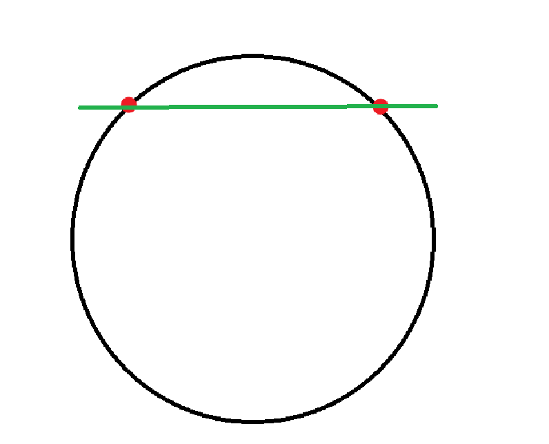
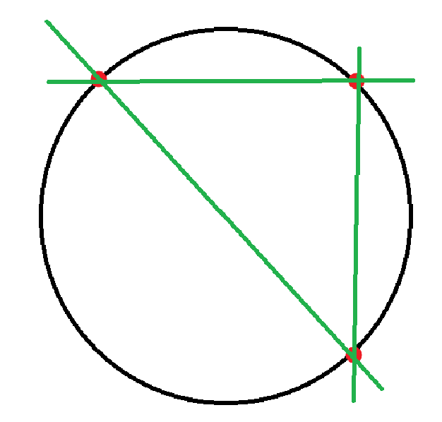
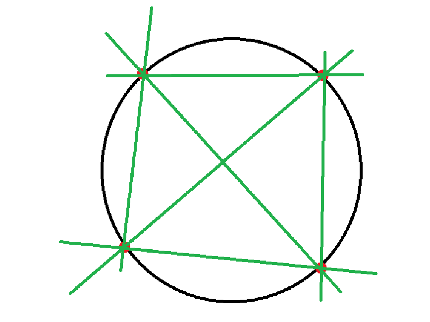

**PART 1: Connecting to the Readings**

1.  VDW Chapter 1 introduces the five NCTM Process Standards. Since 2000, these five standards have helped provide a common language for goals related to how all students learn math. If you were asked which two of these standards would you most want to promote in your future classroom, which two would you choose? Why?

I would choose Problem Solving and Representation. Problem Solving is "the vehicle through which students develop mathematical ideas". it makes math about sense-making, not memorizing. Representation deepens understanding because translating between representations forces students to build richer connections.

2.  VDW Chapter 2 outlines some big ideas about what it means to “Learn” mathematics. Which 2 ideas from this chapter strikes you as particularly important when it comes to learning mathematics? Justify your choices.

Idea 1: Learning is constructed, not passively received. This chapter explains that constructivism holds that learners are "creators (constructors) of their own learning." New ideas (the "red dot") are built by connecting them to existing ideas (the "blue dots"), and the more connections are made, the deeper the understanding. This means teachers cannot simply "pour in" knowledge; they must design experiences where students actively link new concepts to what they already know.

Idea 2: Students should engage in productive struggle. Allowing students time to struggle with mathematics is "one of the findings mentioned as key to developing conceptual understanding". Rather than rescuing students by showing them "the right way," teachers should ask probing questions that keep students engaged. This communicates high expectations and redefines "helping": away from telling and toward supporting sense-making.

3.  VDW Chapter 4 introduces some ideas and frameworks for supporting diverse learning needs when teaching mathematics. As you think about the goal of meeting the needs of your future students, share a few take-aways from this chapter that you would want to remember in the future.

<!-- -->

1)  In a problem-based classroom, children are making sense of the mathematics in their way, bringing to the problems only the skills and ideas that they own, inherently supporting diverse learners. This contrasts with traditional lessons where all students are expected to follow one prescribed method, leaving struggling students behind.

2)  An accommodation changes the environment or support without altering the task . A modification changes the task itself. The key insight is that the goal of both is to help each child reach the learning objectives, not to lower those objectives.

3)  Tiered lessons are a practical differentiation tool. By keeping the same learning goal but varying the complexity of task cards, a teacher can meet a wide range of readiness levels within one lesson. This can be adapted along dimensions of degree of assistance, structure, and complexity.

<!-- -->

4.  VDW Chapter 6 gives a description of the “Response to Intervention (RTI)” approach used by a majority of school districts as a framework for a plan to meet learning needs. Answer **ONE** of the following prompts:

    1.  How does this textbook’s summary of RTI align with your past learning and/or experiences? In what ways do you think RTI models can work well and fall short for supporting diverse mathematics learning needs?

    2.  Suppose you were talking with a friend who had never heard of RTI. Write a brief summary of its overall purpose and who the 3 tiers serve that purpose.

Answer of b:

> Response to Intervention (RtI) is a prevention-based framework designed to identify and support struggling students before they fall significantly behind, rather than waiting for failure to trigger assistance.
>
> RtI is typically visualized as a three-tier pyramid:
>
> Tier 1 (All students): This is the base. All students receive high-quality, standards-based mathematics instruction using research-based practices. Teachers use formative assessments to monitor progress and identify who may be struggling.
>
> Tier 2 (Small groups): Students who did not reach expected achievement in Tier 1 receive additional, more targeted instruction with more explicit strategy instruction, peer-assisted learning, diagnostic interviews, and increased frequency of practice. Students who enter Tier 2 respond to interventions and return to Tier 1.
>
> Tier 3 (Individual students): Students who still struggle after Tier 2 receive the individualized support with a special education teacher. Instruction is tailored to specific areas of weakness and may include referrals for special education evaluation.

5.  In VDW Chapter 6, the textbook describes strategies for meeting the needs of students with “Mild Disabilities”. Select two take-aways from this section that you want to remember for the future and/or share any questions/issues that this section raises for you as an educator.

1\. The CSA sequence (Concrete → Semi-Concrete → Abstract) is critical. Students move from manipulatives to drawings to symbols. but teachers should model symbols \*in parallel\* throughout and return to concrete models whenever needed.

2\. Explicit instruction must include meaning-making. It's not enough to model-and-practice; teachers must make mathematical relationships explicit so students connect today's lesson to broader concepts. Without this, students gain only instrumental understanding.

6.  In VDWChapter 9, we learn that even basic math story problems have many different types of structures and possibilities. Match each addition and subtraction story problem below with its corresponding problem structure. Write the letter of the structure next to the correct story problem.

> **Problem Structures:**

1.  Part-Part-Whole (Unknown Part)

2.  Part-Part-Whole (Unknown Whole)

3.  Join (Unknown Change)

4.  Join (Unknown Result)

5.  Separate (Unknown Initial)

6.  Separate (Unknown Change)

7.  Comparison (Unknown Smaller Set)

8.  Comparison (Unknown Larger Set)

> **STORY PROBLEMS**
>
> \_\_E\_\_ Jaylen had some gummy worms. She gave 3 to her friend Ryan. Now she has 6 gummy worms left. How many gummy worms did she have to start?
>
> \_\_A\_\_ Jaylen and Ryan had 12 gummy worms altogether. Ryan had 7 worms. How many gummy worms did Jaylen have?
>
> \_\_G\_\_ Jaylen had 9 gummy worms. She has 3 more than Ryan. How many gummy worms does Ryan have?
>
> \_\_C\_\_ Jaylen had 5 gummy worms. Ryan gave her some more. Now she has 11. How many worms did Ryan give her?

7.  Match each multiplication/division story problem with its corresponding problem structure (VDW Ch. 9). Write the letter of the structure next to the correct story problem.

> **Problem Structures:**

1.  Equal Groups Multiplication

2.  Partition Division

3.  Measurement Division

> **STORY PROBLEMS**
>
> \_\_C\_\_ Jaylen had 24 gummy worms. She wanted to put them into baggies with 4 worms in each bag. How many bags can she make?
>
> \_\_B\_\_ Jaylen had 24 gummy worms. She wanted to put them equally into 4 baggies. How many worms were in each bag?
>
> \_\_A\_\_ Jaylen had 4 baggies of gummy worms. Each bag had 6 worms in it. How many total worms were there?

7.  VDW Chapter 9 discusses strategies for word (“contextual”) problems. Why does the textbook advise using a “key word approach” is **not** the most effective strategy to teach children to solve story problems? What should be done instead?

\(1\) It tells students to skip sense-making and look for shortcuts. (2) Key words are often misleading. (3) Many problems have no key words at all. (4) Key words fail completely with multi-step problems.

Instead, students should analyze the problem situation, think about what the answer will represent, and try simpler versions with smaller numbers to determine the operation through reasoning.

**PART 2: Applying and Extending Your Learning**

8.  VDW Chapter 3 discusses a three-phase lesson structure for teaching a student-centred lesson. Watch first grade students engage in a problem-solving lesson in [<u>this video</u>](https://www.youtube.com/watch?v=L4UouVlxPII). For <u>each</u> phase of the lesson listed below, describe **two specific actions** the teacher took and briefly explain **why you believe** those actions were beneficial. It may be helpful to review [<u>this list of potential teacher actions</u>](https://docs.google.com/document/d/1h4_kihmy5rP0b3Q3Fn6aTmK77YXyivvY/edit?usp=share_link&ouid=100774781981801170747&rtpof=true&sd=true) at each phase of a problem-based lesson.

    1.  The “Before” (launch) phase

> Actions: (1) Activated prior knowledge; (2) ensured students understood the context and task.
>
> Benefit: Set clear expectations for how students would work and what they'd produce.

2.  The “During” (explore) phase

> Actions: Circulated and listened without giving away strategies, allowing productive struggle.
>
> Benefit: Asked probing questions ("How do you know?") to deepen thinking without reducing cognitive demand.

3.  The “After” (summarize) phase

> Actions: (1) Strategically selected student solutions to share; (2) sequencethe student solutions from less to more efficient.
>
> Benefit: Facilitated class discussion to solidify the key mathematical idea, rather than simply declaring right/wrong.

9.  [<u>Watch this video</u>](https://www.youtube.com/watch?v=ssfT0GMM7Oo) of a first grade number talk using Ten Frames . Discuss **two** ways this activity is helping develop these students' number sense making explicit connections to ideas from VDW Chapter 8. Justify your selections.

<!-- -->

1)  Anchoring to 5 and 10. The ten-frame lets students instantly see numbers relative to benchmarks (e.g., 7 as "5 and 2 more" or "3 away from 10"). Ch. 8 identifies these benchmarks as critical for later computation strategies like "make a 10."

2)  Part-part-whole relationships. Students see the same number in multiple compositions (e.g., 7 as 4+3 or 5+2). Ch. 8 calls this "the most important relationship that can be developed about numbers," foundational for fact fluency.

<!-- -->

10. Chapter 9 begins to discuss some strategies for helping students tackle word problems. One common strategy used in schools is called the “Three Reads Strategy”. [<u>Watch this explanation</u>](https://www.youtube.com/watch?v=t_VQ4uYKOAY) of the strategy by a third grade teacher (note: there are different possible variations of this strategy). To what extent does this strategy align with the recommendations in Chapter 9? Justify your answer.

Strongly aligned. Ch. 9 recommends students "think about the answer before solving". asking what is happening, what will the answer tell us, and will it be large or small. Three Reads mirrors this exactly: Read 1 = understand the story, Read 2 = identify the question, Read 3 = identify relevant information. This directly counters the key-word approach Ch. 9 warns against and supports ELLs through repeated, structured encounters with the text.

**PART 3: Being a Problem-Solver Yourself!**

Draw a circle. Draw two points anywhere on the circumference. If you connect each point to the other point, you have one line running across the circle, right?

Draw another circle. This time, draw three points spread around the circumference. Connect each point to the other points. How many lines do you have running across the circle now? (Three!)

What happens if you draw a circle with four points around the circumference, all connected to each other? How many lines would you have then? (Six!)

11. The book *Problems with Patterns and Numbers* presents an interesting problem called **Mystic Rose**. The Mystic Rose is a circle with 18 points on its circumference. Each point is connected to each other point with a straight line.

<!-- -->

1.  How many straight lines are there altogether? *Make sure to show and/or explain your work so that others can see how you figured it out.*

> Build up from simpler cases:
>
> 2 Points - 1 New lines added - 1 Total lines
>
> 3 Points - 2 New lines added - 3 Total lines
>
> 4 Points - 3 New lines added - 6 Total lines
>
> 5 Points - 4 New lines added - 10 Total lines
>
> ……
>
> Each new point connects to all existing points, so total = 1+2+3+...+17 = 18 × 17 / 2 = 153.

2.  What problem-solving strategies did you use to solve this problem? Be descriptive.

- Simplify the problem: Started with 2, 3, 4, 5 points to find the pattern.

- Make a table: Organized results to reveal the pattern (triangular numbers).

- Generalize: Recognized the formula n(n−1)/2 and applied it to n=18.

- Verify: Checked the formula against known small cases before applying.
