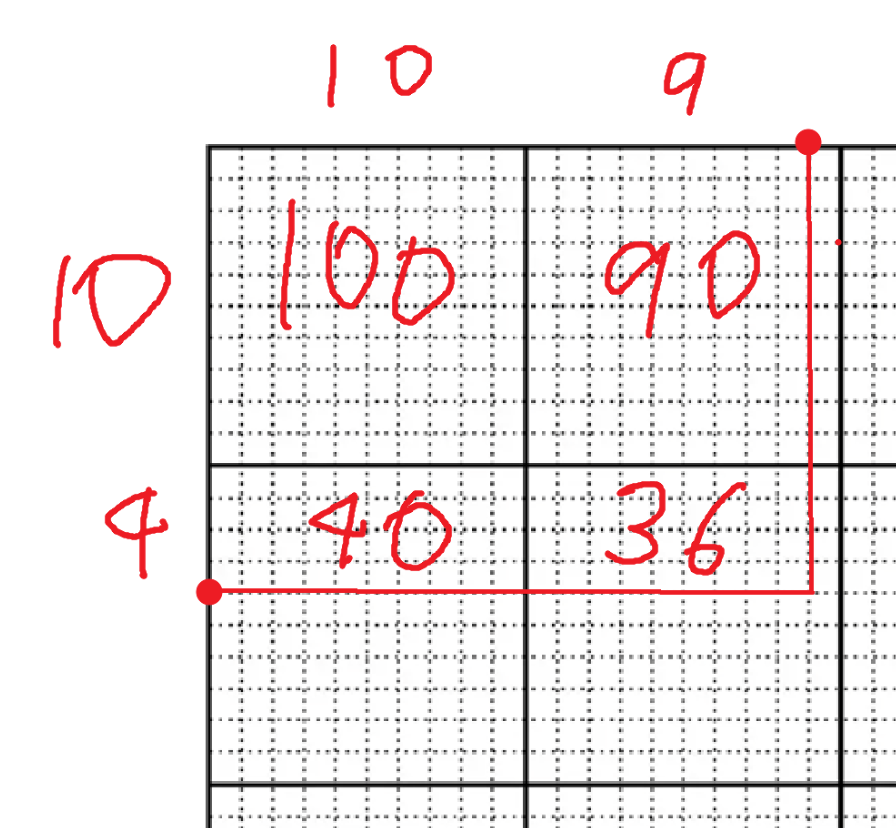
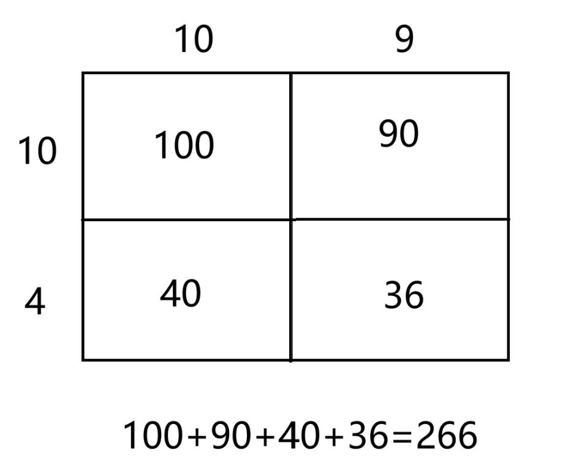
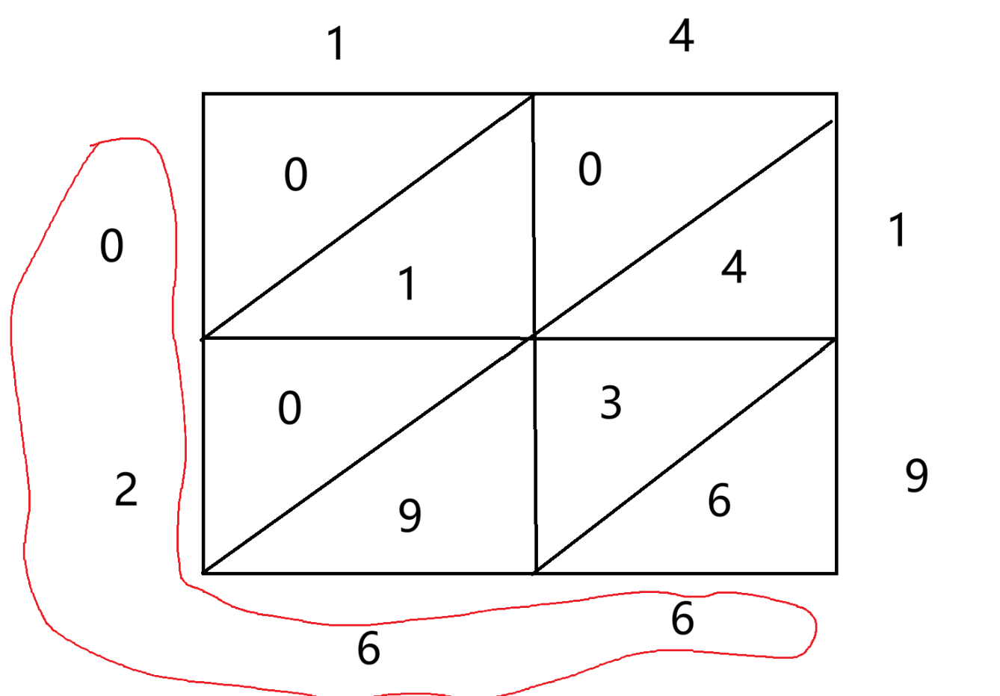

**PART 1: Connecting to the Readings and Class Slides**

1.  For <u>each</u> basic math fact listed below, name two specific **reasoning** strategies from Chapter 10 that a student might use to figure out the answer, <u>and describe or show</u> how the student might use the strategies. \[Note: Counting strategies are **not** reasoning strategies\]

    1.  8 + 7

        1.  Strategy 1: Since 8 + 2 = 10, take 2 from the 7 to make 10, then add the remaining 5. So 8 + 2 = 10, then 10 + 5 = 15.

        2.  Strategy 2: Think of 7 + 7 = 14 (a known double). Since 8 is one more than 7, add 1 more: 14 + 1 = 15.

    2.  13 - 6

        1.  Strategy 1: Think: "6 + ? = 13?" I know 6 + 4 = 10, and 10 + 3 = 13, so 4 + 3 = 7. So the answer is 7.

        2.  Strategy 2: Start at 13. Subtract 3 to get to 10 (since 6 = 3 + 3). Then subtract 3 more from 10 to get 7. So the answer is 7.

    3.  7 x 6

        1.  Strategy 1: Think of 5 × 6 = 30 (a "fives" fact). Then 7 × 6 is two more sixes: 30 + 6 + 6 = 42.

        2.  Strategy 2: Think of 7 × 6 as 7 × 3 × 2. First, 7 × 3 = 21 (double 7 is 14, plus one more 7 = 21). Then double 21: 21 × 2 = 42.

2.  For <u>each</u> of the following problems, show possible solutions using three different reasoning strategies: a **jump strategy**, a **decomposition strategy**, <u>and</u> a **compensation strategy.**

    1.  48 + 36 = ?

Jump Strategy:

Start at 48. Jump +30 → 78. Jump +6 → 84.

Decomposition Strategy:

Split both numbers: 40 + 30 = 70. Then 8 + 6 = 14. Combine: 70 + 14 = 84.

Compensation Strategy:

Round 36 up to 40. Compute 48 + 40 = 88. Then subtract the extra 4: 88 - 4 = 84.

2.  48 - 36 = ?

Jump Strategy:

Start at 36. Jump +4 → 40. Jump +8 → 48. Total jumps: 4 + 8 = 12.

Decomposition Strategy:

40 - 30 = 10. Then 8 - 6 = 2. Combine: 10 + 2 = 12.

Compensation Strategy:

Round 36 up to 40. Compute 48 - 40 = 8. Then add back the extra 4: 8 + 4 = 12.

3.  Use the equation **14 x 19 = ?** to answer the following questions:

    1.  Write a story problem to represent this question.

A teacher is ordering notebooks for her class. She needs 14 packs, and each pack contains 19 notebooks. How many notebooks will she have in total?

2.  Show how this can be solved visually using base ten grid paper

> 

3.  Show how this can be solved using a “compensation” reasoning strategy (rounding and adjusting)

Round 19 up to 20. Compute 14 × 20 = 280. Since we multiplied by 1 too many, subtract one group of 14: 280 - 14 = 266.

4.  Show how this can be done using partial products (“box-method”)

> 

5.  Show how this can be done using the lattice method

> 

4.  Use the equation **535 ÷ 4 = ?** to answer the following questions:

    1.  Write a story problem to represent this question.

A school has 535 colored pencils to divide equally among 4 classrooms. How many pencils does each classroom get, and how many are left over?

2.  Show how this can be solved using base ten blocks (direct modeling). [<u>Use this polypad page</u>](http://polypad.org/7bvHWNYoHGQg) to do your work. When you select a block, there is a “split” option in the bottom toolbar to break it into smaller pieces. Take a screenshot of your final answer and paste it here.

Represent 535 with 5 hundreds-flats, 3 tens-rods, and 5 ones-cubes.

Share the hundreds among 4 groups: each group gets 1 hundred (4 used, 1 left over).

Trade the remaining 1 hundred for 10 tens, giving 13 tens total.

Share 13 tens among 4 groups: each gets 3 tens (12 used, 1 left over).

Trade the remaining 1 ten for 10 ones, giving 15 ones total.

Share 15 ones among 4 groups: each gets 3 ones (12 used, 3 left over).

3.  Show how this can be done using a “flexible division” (partial quotients) method

535

\- 400 (4 × 100) → 100

135

\- 120 (4 × 30) → 30

15

\- 12 (4 × 3) → 3

3 \_\_\_\_\_\_\_\_

Answer: 133 remain 3

**PART 2: Applying and Extending Your Learning**

5.  Sam, a 3rd grade student of yours, approaches you and says, “My dad said that when you add a number to zero, you always get that same number, but when you multiply a number by zero, you always get zero. I don’t get it. Can you help me?” How would you respond to Sam? Consider using real life examples or pictures that might help Sam understand these ideas.

Addition: 🍪🍪🍪🍪🍪 + (nothing) = 🍪🍪🍪🍪🍪 → 5 + 0 = 5

Multiply: Zero groups of 🍪🍪🍪🍪🍪 = (nothing) → 0 × 5 = 0

6.  Nora, a third grader, was getting quicker at answering multiplication facts, especially with numbers that were 5 or less (ex: 5 x 4, 3 x 3). But she still struggled to efficiently compute her “times 8” facts. How would you help Nora?

The key idea: ×8 = double × 4, and ×4 = double × 2 (which she already knows). So multiplying by 8 is just "double, double, double."

For example, for 8 × 7:

Start with 2 × 7 = 14 (she knows this)

Double it: 4 × 7 = 28

Double again: 8 × 7 = 56

7.  In class, we have discussed how “Number Talks” are a common structure used in math classrooms to engage students in sharing their thinking and to practice and encourage different strategies. [<u>Read this blog post</u>](https://shelleygrayteaching.com/do-you-need-help-with-number-talks-heres-the-quick-start-guide/) by a teacher who shares some of her journey incorporating number talks into her instruction. After reading, share two take-aways from her blog post that you think would be helpful to remember if you choose to use number talks with your future students.

Take-away 1: Use the "thumb to chest" signal instead of raising hands. When a student has a strategy, they put a thumb to their chest. If they think of additional strategies, they put up a finger for each one. This is powerful because it keeps the environment calm, encourages students to keep thinking rather than stopping after one strategy, and protects the thinking time of students who are still working.

Take-away 2: Record all answers without judging them as right or wrong. The teacher writes all volunteered answers on the board and then asks students to "defend" their answer. This creates a safe space for mistakes: students are not shut down for wrong answers but instead invited to revise their thinking after hearing others' strategies.

**PART 3: Being a Problem-Solver Yourself!**

8.  A large, beautiful tree has 10 main trunks. On each trunk there are 10 branches. On each branch there are 10 twigs. On each twig there are 10 leaves.

    1.  One day a woodcutter came along and cut down one trunk from the tree.

    2.  Then he cut off one branch from another trunk of the tree.

    3.  Then he cut off one twig from another branch.

    4.  Finally he pulled one leaf from another twig.

> a\. How many leaves were left on the tree then?

8889

> b\. Show and/or explain how you worked out the solution.

10000-1000-100-10-1

=9000-100-10-1

=8900-10-1

=8890-1

=8889
