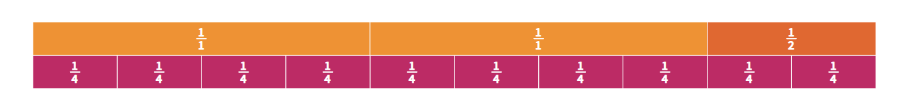
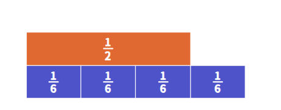
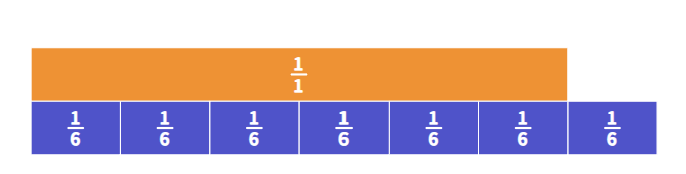
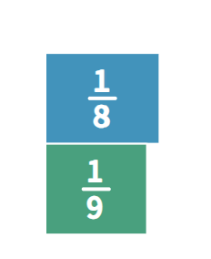
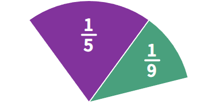
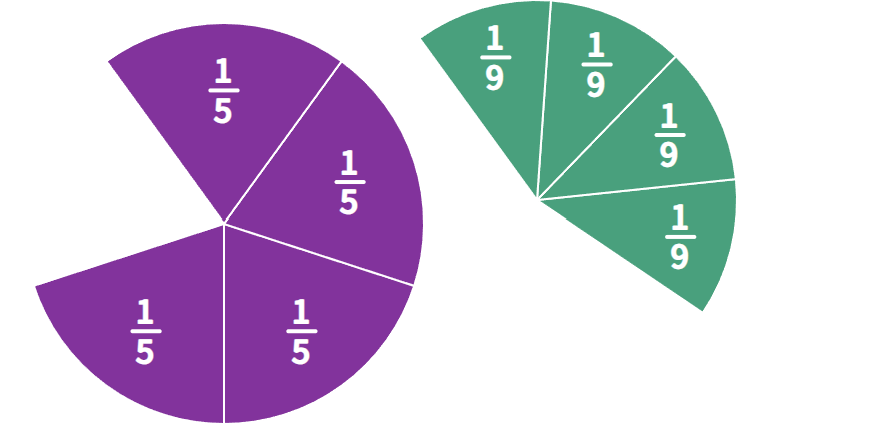
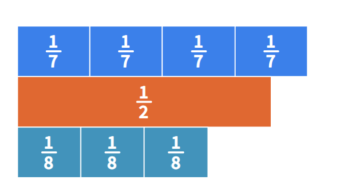
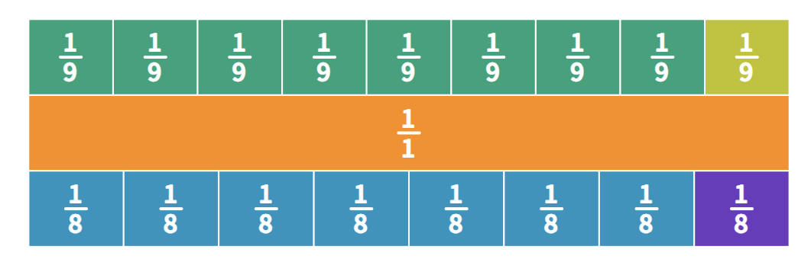
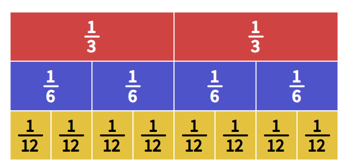

1.  The whole matters.

A fraction only tells the relationship between the part and the whole. It does not tell the size of the whole.

Example: If Mark gets 1/2 of a small pizza and Jane gets 1/3 of a large pizza, Jane can still get more pizza.

2.  Jun’s pizza problem: we must define the whole before interpreting a fraction.

Jun ate 5 pieces from 2 small pizzas, where each pizza was cut into 4 equal pieces.

Different answers are possible depending on the whole:

1.  If the whole is “pieces,” Jun ate 5 pieces.

2.  If the whole is “one pizza,” Jun ate 1 1/4 pizzas.

3.  If the whole is “the whole order,” Jun ate 5/8 of the order.

<!-- -->

3.  Fourths must be equal in area.

A shape can show fourths even if the pieces look different, as long as the pieces have equal area. The pieces do not have to be in the same shape.

4.  Counting fourths.

> iterating fractions: counting fractional parts
>
> Example: 10 fourths = 10/4 = 2 1/2
>
> 

5.  Adding like fractions.

> Example: 3/4 + 2/4 = 5/4
>
> 
>
> The denominator stays the same.

6.  Different ways to show 3/5.

To represent 3/5 in 3 ways:

1.  An area model, like shading 3 out of 5 equal parts of a rectangle or circle.

2.  A length model, like marking 3/5 on a number line.

3.  A set model, like 3 out of 5 stars or 3 out of 5 people.

<!-- -->

7.  Three meanings of fractions.

3/5 as example

1.  Part-whole meaning: 3/5 can mean 3 parts out of 5 equal parts of one whole.

2.  Division meaning: 3/5 can mean 3 brownies shared equally among 5 people. Each person gets 3/5 of a brownie.

3.  Ratio meaning: 3/5 can mean 3 red balls for every 5 green balls, or 3 out of every 5 students.

8\. Fair sharing examples.

1.  Four lasagna pans shared by six people: 4 ÷ 6 = 4/6 = 2/3. Each person gets 2/3 of a pan. One way to see this is to get 1/2 + 1/6, which equals 2/3.

2.  Seven cookies shared by six people: 7 ÷ 6 = 7/6 = 1 1/6. Each person gets 1 whole cookie and 1/6 of another cookie.

9\. Comparing fractions by reasoning.

1.  1/8 \> 1/9: because if one whole is shared among 8 people, each piece is larger than if it is shared among 9 people.

2.  4/5 \> 4/9: because fifths are larger pieces than ninths, and both fractions have 4 pieces.

3.  4/7 \> 3/8: because 4/7 is more than 1/2, while 3/8 is less than 1/2.

4.  8/9 \> 7/8: because both are close to 1, but 8/9 is only 1/9 away from 1, while 7/8 is 1/8 away from 1. Since 1/9 is smaller than 1/8, 8/9 is closer to 1.

10\. Equivalent fractions.

A farm example: 2/3 = 4/6 = 8/12. The amount of land being used stays the same, but the whole is partitioned into smaller equal pieces.

