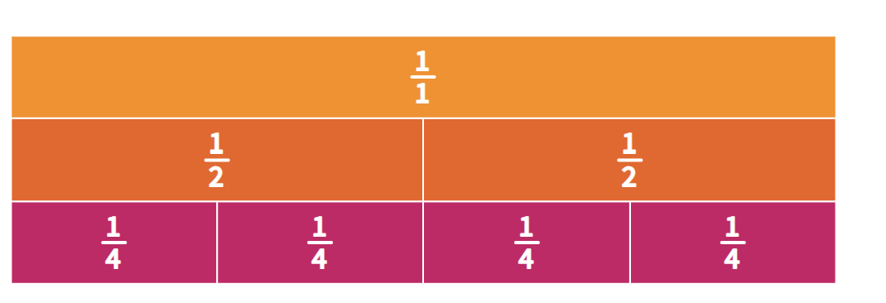
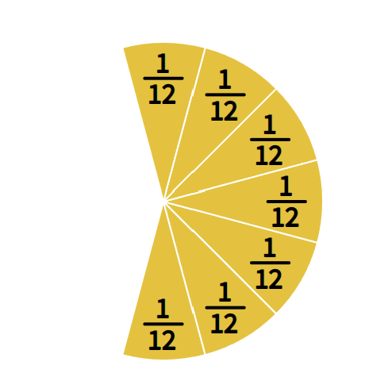
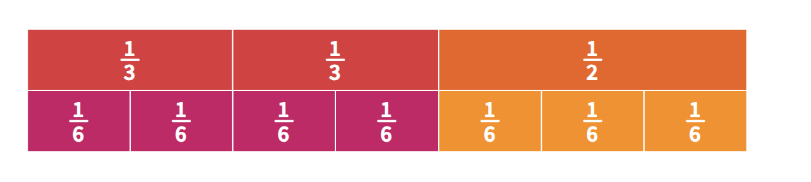
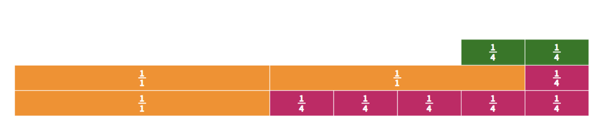

1\. Fraction models

Fractions can be represented using different models, helping explain fraction addition and subtraction visually.

- Area models: rectangles, circles, fraction tiles, lasagna pans

- Length models: number lines, distance, miles, ribbons

- Set models: groups of objects, such as stars or counters

2\. Equivalent fractions and the “giant one”

Equivalent fractions: different names for the same amount.

Example: 1/2 = 2/4 = 3/6 = 4/8

“giant one”: means multiplying by a fraction equal to 1, such as 2/2, 3/3, or 4/4.

Example: 1/2 x 4/4 = 4/8

3\. Helpful steps for adding and subtracting fractions

4 helpful ideas for teaching fraction addition and subtraction:

1.  Put the problem into a story context.

2.  Estimate the answer before solving.

3.  Use visual models or manipulatives.

4.  Talk about common misconceptions directly.

Example: Before solving 5/8 + 5/8, I should think about whether the answer will be more than 1 or less than 1. Since 5/8 is more than 1/2, two groups of 5/8 must be more than 1.

4\. Adding fractions with like denominators

Example: 5/8 + 5/8

Story problem: On Monday I ran 5/8 of a mile. On Tuesday I ran another 5/8 of a mile. How far did I run in all?

The denominator stays 8 because I am counting eighths.

A common mistake: 5/8 + 5/8 = 10/16

This is not reasonable because 10/16 is less than 1, but the estimate showed that the answer should be more than 1.

5\. Another like-denominator example

Example: 5/6 + 2/6

Story problem: Adam put 5/6 of a cup of milk into the dough. Then he added 2/6 of a cup more. How many cups of milk did he use?

> The denominator stays 6 because the pieces are still sixths. I am counting how many sixth-size pieces there are.
>
> A common mistake: 5/6 + 2/6 = 7/12

This is not reasonable because 7/12 is less than 1, but the estimate showed that the answer should be more than 1.

6\. Adding fractions with unlike denominators

Example: 2/3 + 1/2

Story problem: Sahar had 2/3 of a pound of trail mix. Brad had 1/2 of a pound of trail mix. How many pounds did they have together?

> Estimate: 2/3 is more than 1/2. If I add another 1/2, the answer should be more than 1.
>
> Find common denominators: 2/3 = 4/6; 1/2 = 3/6
>
> Now add: 4/6 + 3/6 = 7/6 = 1 1/6
>
> Answer: 1 1/6 pounds
>
> This shows why common denominators are needed. Thirds and halves are different-size pieces, so I need to rename both fractions as sixths before adding.
>
> 

7\. Misconception with unlike denominators

A common mistake: 2/3 + 1/2 = 3/5

This shows that adding across the numerators and denominators does not work for fraction addition.

8\. Lasagna pan model for common denominators

Example: 3/4 + 1/3

> Use two same-size lasagna pans.
>
> 3/4 = 9/12; 1/3 = 4/12
>
> 9/12 + 4/12 = 13/12

The lasagna model works because both wholes are cut into the same-size pieces. Once both fractions are renamed as twelfths, they can be added.

9\. Another common denominator example

Example: 2/3 + 3/5

> Find a common denominator: 2/3 = 10/15; 3/5 = 9/15
>
> Add: 10/15 + 9/15 = 19/15 = 1 4/15
>
> Answer: 1 4/15

This example shows how equivalent fractions help with addition. The fractions are renamed so they have the same denominator:

> 2/3 x 5/5 = 10/15
>
> 3/5 x 3/3 = 9/15

Then the same-size pieces can be added.

10\. Subtracting fractions with unlike denominators

Example: 2/3 - 1/4

Story problem: Adam had 2/3 of a lasagna left. Kirsten had 1/4 of a same-size lasagna left. How much more lasagna did Adam have?

> Find a common denominator: 2/3 = 8/12; 1/4 = 3/12
>
> Subtract: 8/12 - 3/12 = 5/12
>
> Answer: 5/12

11\. Mixed number subtraction

Example: 2 1/4 - 1 1/2

> Story problem: There were 2 1/4 pounds of butter in the fridge. I used 1 1/2 pounds to bake a cake. How much butter is left?
>
> First rename 1 1/2 using fourths: 1 1/2 = 1 2/4
>
> Now subtract: 2 1/4 - 1 2/4
>
> Since 1/4 is not enough to subtract 2/4, regroup: 2 1/4 = 1 5/4
>
> Now subtract: 1 5/4 - 1 2/4 = 3/4
>
> Answer: 3/4 pound of butter
>
> 

12\. Mixed number addition

Example: 1 1/6 + 8/9

> First change the mixed number: 1 1/6 = 7/6
>
> Now add: 7/6 + 8/9
>
> Use 18 as a common denominator: 7/6 = 21/18; 8/9 = 16/18
>
> Add: 21/18 + 16/18 = 37/18 = 2 1/18
>
> Answer: 2 1/18

This example shows that visual models are useful for building understanding, but algorithms become more efficient when the denominators are larger.
