L3 Newton牛顿

牛顿：

reflecting telescope (反射望远镜)

Celestial mechanics天体力学

On the motion of bodies in an orbit

《论物体的运动》

Mathematical Principles of Natural Philosophy (Principia)

《自然哲学的数学原理》(《原理》)

哥白尼：

Heliocentric theory (日心说)

On the Revolutions of the Heavenly Spheres 《天体运行论》

伽利略：

Combined thought experiments (思想实验), mathematics, and observation

Improved refracting telescope (折射望远镜) with a convergent (plano-convex 凸透镜) objective lens (物镜) and a divergent (plano-concave 凹透镜) eyepiece lens (目镜)

Celestial findings

Satellites of Jupiter (木星)

A full set of phases of Venus (金星)

Sunspot (太阳黑子)

Topography (地形) of the moon

Milky way (银河) being a multitude of stars

Dialogue Concerning the Two Chief World Systems (1630)

《关于托勒密和哥白尼两大世界体系的对话》 —— 证明哥白尼理论好于托勒密理论

Thought experiment 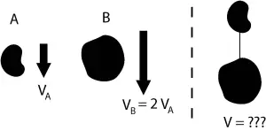

Slope Experiment 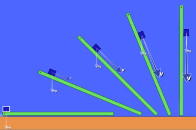

Slope Experiment 2 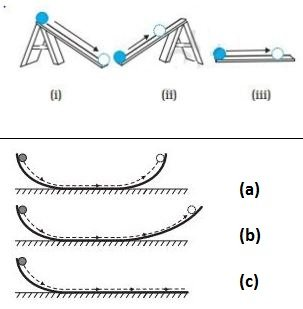

Copernicus’s Mistake:

The Sun near the *center of the Universe, motionless*, with Earth and the other planets rotating around it in circular paths modified by epicycles and at uniform speeds.

The planets orbit the sun *circularly*.

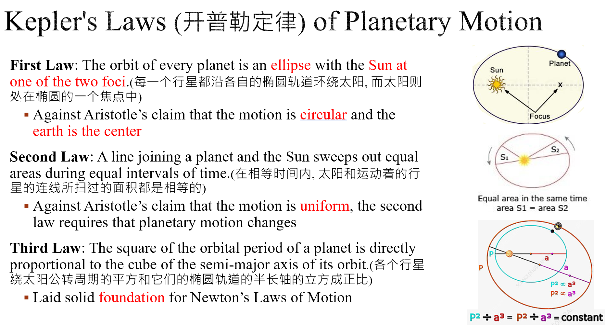

哈雷：

哈雷彗星 returns every 75.5 years

Paradigm Shift (范式转移)

a fundamental change in the basic concepts and experimental practices of a scientific discipline

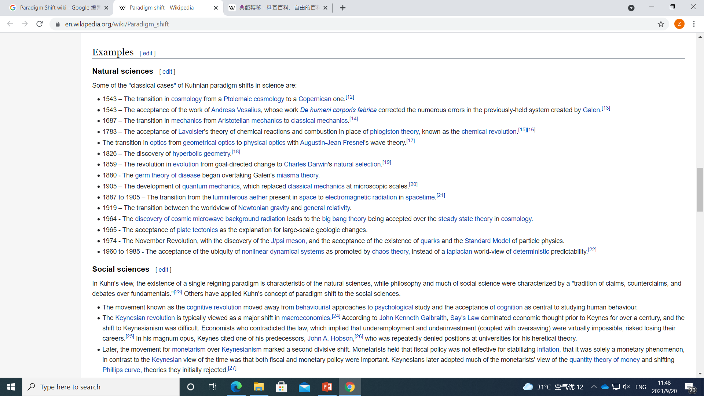

L4 Darwin达尔文

-Darwin - He was crazy for beetles(甲虫)

-Charles Lyell’s Principles Of Geology

1.反对 **catastrophism(灾变说)**

2.地球是由今天仍在运作的<u>缓慢移动的力量塑造</u>的。

3.地质变化是<u>微小变化</u>在极长的时间跨度内稳定<u>积累</u>。

4.**化石** 为 gradualism(渐进主义) 提供了证据

-Darwin Became Suspicious 达尔文...怀疑

1.批评<u>圣经</u>关于**creationism神创论**的故事。

2.批判物种**transmutation of species嬗变理论**，这是<u>以前的进化思想</u>。

3.<u>亚里士多德</u>的“**spontaneous generation自发生成**”+<u>拉马克</u>的“**innate life force先天生命力**”

-Thomas Malthus(马尔萨斯)’ The Principle Of Population (《人口论》)

人口规模的增长速度可能快于其生产食物的能力。\
→ 1.人口过剩\
→ 2.为生存而奋斗

启发达尔文的自然选择

-Emergence of the idea of evolution theory

Observations

> 种群呈指数级增长（繁殖）
>
> 支持一个地区人口的有限能力
>
> 群体中成员的健康状况变化

Deductions

人口之间的竞争

> 适者生存的变体将幸存下来
>
> 适应性进化

-The Origin of Species, 1859

第一章 驯化下的变异

> 第二章 自然变化

第三章 生存斗争

第四章 自然选择

第五章 变化规律

…………

-What is evolution?

定义：生物种群在连续几代中可遗传特征的变化

-Evolution evidence

1.Variation under domestication 驯化下的变异

2.Comparative anatomy 比较解剖学

3.Fossil record/Paleontology 化石记录/古生物学

4.Embryonic development 胚胎发育

5.Biogeographical distribution (marsupials such as kangaroos)

> 生物地理分布（袋鼠等有袋类动物）

…

-Evolution Explanation

-Natural selection (Darwin)

-Struggle for Existence

环境变化→competition for food→the struggle for existence

→The most adaptable species will be preserved.

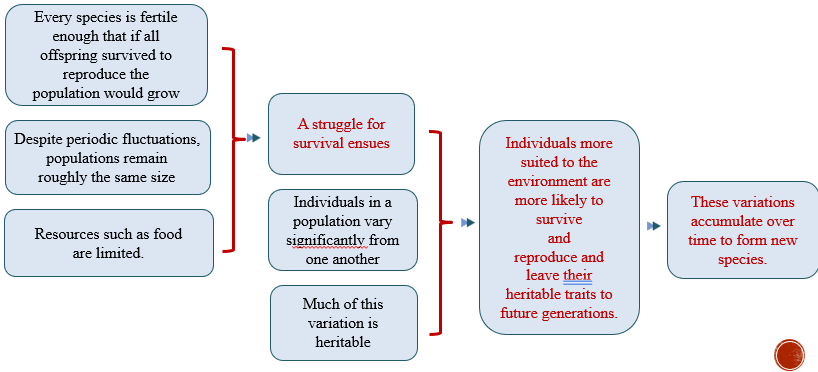

-Natural selection

大自然可以通过**environmental changes**环境变化进行与人类相同的选择。

-Laws of Nature

牛顿原理（1687）

达尔文的《物种起源》

-Against Creationism

1.相信宇宙是由上帝创造的

2.人类是上帝形象的特殊创造物

3.来自启示和圣经的证据

-Against **Deism自然神论** and Argument from **Design设计论**

威廉·佩利（1743-1805）《神灵的存在和属性的自然神学》

如果你在海滩上发现了一块手表，你会理性地假设设计师。

自然的复杂性迫使我们理性地假设一个设计师。

-Negative Reactions

Adam Sedgwick

-Positive Reactions

Thomas Huxley

Karl Marx

L5 Watson沃森

\-

DNA base pair DNA的碱基对

Chromosome染色体

Experiments with fruit fly (eye colors) : 证明：萨顿-博维里的染色体遗传理论

> 与孟德尔提出的“特定因素”相关的染色体

-Gregor Mendel’s work

进行植物**crossbreed杂交**，并进行统计分析 → 定量研究

-Where are the factors?

Chromosome染色体 —— a long stretch of DNA and proteins in the cell nucleus

\- Chromosome

1号染色体（Chromosome 1）

> 最大的人类染色体。
>
> 由2.47亿个DNA碱基对组成
>
> 890种已知与该染色体有关的疾病，如耳聋、阿尔茨海默病、青光眼和乳腺癌等。

Sutton-Boveri

> 1.染色体遗传理论
>
> 2.与孟德尔提出的“specific factors特定因素”相关的染色体

T. H. Morgan

> 1.果蝇实验（眼睛颜色）
>
> 2.证明了Sutton-Boveri理论
>
> 3.发现了一个“sex-linkage性别联系”的例子，其中特定特征在一种性别中的比例不成比例。
>
> 如何解释自然界的变化？
>
> Sex linkage + Recombination 性别联动+重组

证明萨顿-博维里理论

> 发现性联系
>
> 3.Recombination重組
>
> 染色体在sperms精子和egg cells卵细胞的产生过程中break apart分解并re-form重新形成
>
> 4.Gene mapping 基因图谱

根据遗传模式确定染色体上genetic markers遗传标记之间的顺序和相对距离。

-What is Life?

Erwin Schrödinger

> 薛定谔认为，生命可以被认为是存储和传递生物信息。..为了理解生命，我们必须识别这些分子，并破解它们的密码。...
>
> 就我自己而言，薛定谔之所以引起共鸣，是因为我也对生命的本质很感兴趣。...生命可以通过刻在密码中的说明书来延续的想法吸引了我。...什么样的分子技巧可以确保每次染色体重复时代码都被精确复制？

DNA: Exclusively on chromosome, 4 subunits

Protein: 20 different building blocks

-Fred Griffith的实验 (1928)

Pneumonia（肺炎）：他研究了2种Streptococcus pneumoniae (Pneumococcus)肺炎链球菌

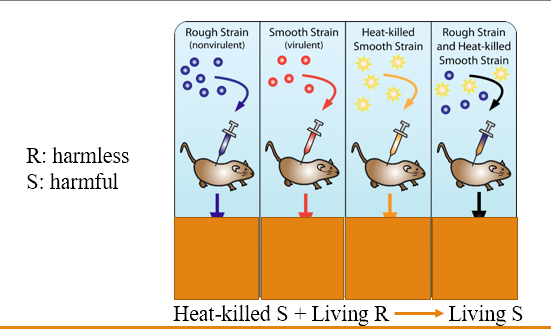 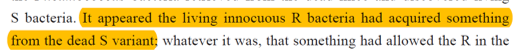

-Avery (埃弗里)-MacLeod-McCarty的实验 (1944)

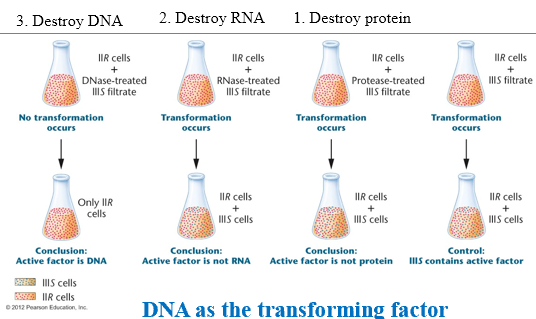

DNA作为the transforming factor

后来由Hershey and Chase（1952）证实

-X-Ray Diffraction衍射 (XRD)

-光具有wave properties波特性

-光的interference干涉

-X射线：波长与晶体中的原子距离相当

-晶体结构具有regular规则的interference patterns干涉图案

-数学：从from interference patterns干涉图案到crystal structures晶体结构的倒退

通过X射线晶体学求解分子结构

-Erwin Chargaff’s rule (1950)

（人类DNA的比例） 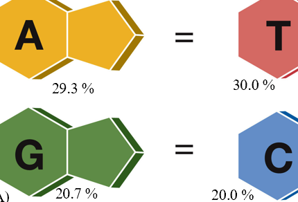

-A and B forms of DNA (1953)

分子结构的差异是由与每个DNA分子相关的水量的差异引起的。分子结构的差异是由与每个DNA分子相关的水量的差异引起的。分子结构的差异是由与每个DNA分子相关的水量的差异引起的。

-A Jigsaw Puzzle of DNA

The two chains of the double helix structure is anti parallel, where they go in opposite directions but they bridge with these nitrogenous bases pairing with each other.

**double helix structure双螺旋结构**的两条链是**anti parallel反向平行**的，它们的方向相反，但它们与这些pairing with each other相互配对的**nitrogenous bases含氮碱基**桥接。

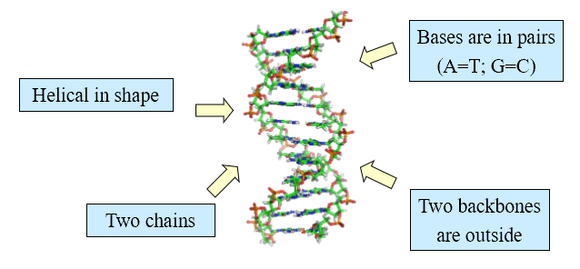 **backbones (p.l.)骨架**

-How does DNA replicate?

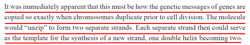

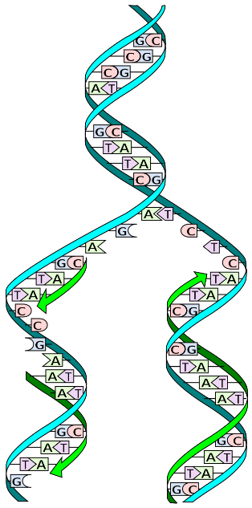

-Meselson-Stahl experiment (1958) (梅瑟生-史达实验)

Operate by spinning at high speed (e.g. 14,000 times per min)

Top layer: less dense (light); Bottom layer: denser (heavy)

Nitrogen atoms (two forms: heavy 15N and light 14N) are a component of DNA.

Bacteria were first grown in media with 15N.

Then a sample was taken and cultured in a media only contain 14N.

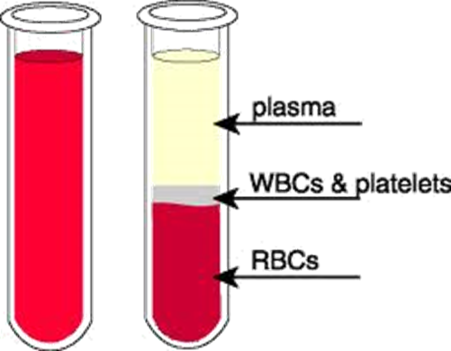

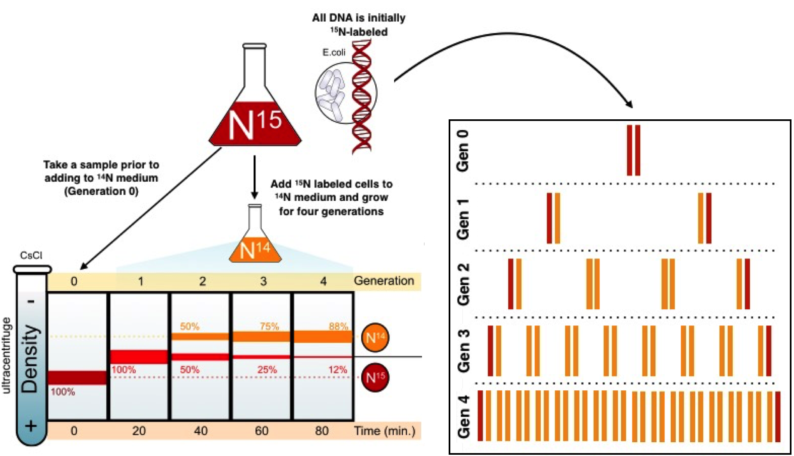

Ch9

Ch10

Why did Modern Science not Emerge in China?

李约瑟的回答

“总而言之，我相信中国和西欧之间社会和经济模式的可分析差异最终将阐明......既有中国科学技术的早期优势，也有现代科学后来在欧洲的兴起。（SCC7：2，第23页）

李约瑟认为，从15世纪开始，西欧资产阶级（拥有财产的富人）的崛起才产生了科学

四个崩溃：封建秩序，国家，教会和蒙古帝国

资产阶级在做生意方面有更多的自由

Development of Mathematics for Transactions （交易）

活字印刷书籍是用白话（白话）语言印刷的

数学化成为一种普遍做法

普通人可以接受教育

社会变得知识渊博

批判性思维是“合理的反思性思维，专注于决定相信什么或做什么。（罗伯特·恩尼斯）它用于解决问题和决策。

批判性思维是对现有事实、证据、观察和论据的分析，以形成判断。

Core critical thinking skills

认知技能

解释

分析

评估

推理

解释

自动调节

...

精神倾向

好奇心

求真

思想开放

系统性

自信

认知成熟度

...

本文提出了两个结论。首先，为什么中国没有发生科学革命，这不是历史研究可以回答的问题。当人们找到导致人们提出这个问题的谬误时，它就成为一个有用的问题。其次，按照科学史学家的标准，科学革命确实发生在十八世纪的中国。然而，它并没有产生我们假设的科学革命将产生的社会后果。（第1段）

第二个问题：为什么在公元前1世纪到公元15世纪之间，中国文明在将人类自然知识应用于人类实际需求方面比西方文明更有效率？

中国科学技术的早期优势：

两个假设：

中国科学在日常生活中的应用

中国科学相对于西方科学的优越性

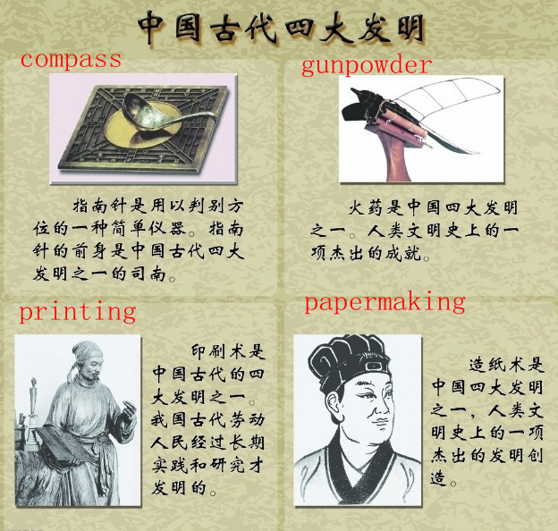

“应用于人类需要的自然知识不是我们通常所说的中国科学”（第4段）

“早期技术的成功或失败并不取决于它如何应用早期科学的见解”（第5段）

“一个方面是，在从事这些科学研究的人的头脑中，所有科学之间似乎没有系统的联系”（第10段）

“我不得不说，我没能找到我在沈娟心目中寻找的中国科学的内在统一性”（第17段）

（梦溪笔谈）

Examples of three categories

Technical and Artful Skills 技艺：

Including mathematics, architecture, games and their winning strategies, and good skills of various kinds.

total number of possible situations in chess 棋局

moveable type printing 活版印刷

Strange Occurrences 异事：

“strange objects” , “change” 变化

the rainbow 虹

Fossil 化石

Tornado 龙卷风

Miscellaneous 杂志：

Things couldn’t be classified or categorized.

Transformation of the land and the sea 海路变迁

the compass 指南针

Petroleum 石油

“They had sciences but no science, no single conception or word for the overarching sum of all of them.”

Why something did NOT happen?

没有直接答案（或无限多的答案）

heuristic question 启发式的问题

启发式问题具有紧迫性，源于摇摇欲坠的假设

这个问题背后的不稳定假设：

A1： 每个人都应该有科学革命（每一种文化：包括中国！

A2：每个人都想进行科学革命（现代科学是一件好事：中国人想要！

A3：西方的科学革命模式是所有有能力的文明的标准模式。它将导致类似的制度和社会变革（西欧是典范！其他文化也应该有类似的后果）

A4：欧洲文明具有一些内在的适应性（欧洲人的优越性：智力、想象力、才能、美德）

A5： 科学是普遍的、客观的、无价值的

通用且免费？痴心妄想

“数学方程式可能是普遍的，但人类努力在自然知识的可能性中的分配却不是。（第27段）

历史推理：三个谬误

F1：文化早期的情况与必要条件混为一谈）

F2：没有发生继之而来的应当发生的状况与抑制因素混为一谈）

F3：有些历史学家只看智力因素，有些历史学家只看社会经济因素

谬误1：对应用技术科学不感兴趣

没有现代科学

谬误2：没有现代科学，因为中国人对《易经》感到满意

Sivin对李约瑟问题的回答：

西文批评将一个文明中的整个古代科学技术与另一个文明进行比较，因为它太笼统了。

应用于人类需求的自然知识不是我们通常所说的中国科学。

早期技术的成功或失败并不取决于它如何应用早期科学的见解。

早期技术与早期科学

早期技术：工匠（工匠）私下传给子女和学徒（学徒）的工艺（工艺）和制造技能的问题。

早期科学：中国受过教育的小班成员，他们从事科学研究，并在书本上传授他们的理解。

“在实践这些科学的人的头脑中，所有科学之间没有系统的联系”，因为有

没有自然哲学的整合，

没有科学方法论的发展，

没有像西欧科学院和大学那样的科学活动组织，这些科学院和大学是科学革命的先驱。
