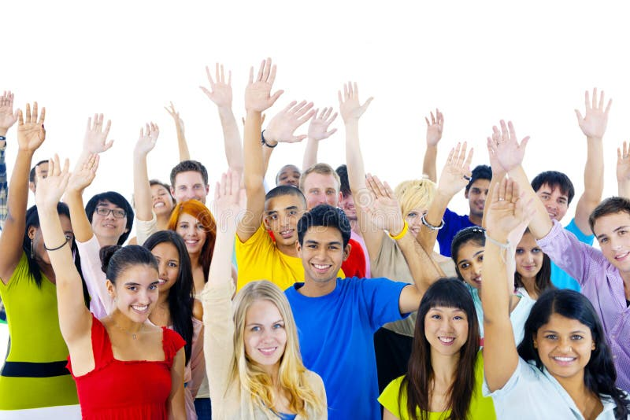

Looking back at my experience in LAS 100 and the different topics we explored, I decided to focus on mental health and social identity. These topics are personally important to me and have helped me better understand the world around me. The images I chose captured the main ideas of these topics and helped me see their importance on a deeper level.

The first topic I focused on was mental health. Mental health is about our emotional, psychological, and social well-being. It affects how we think, feel, and act, and it plays a big role in how we handle stress, get along with others, and make decisions. Mental health affects every part of our lives, including our school performance, relationships, and overall happiness.

I chose this topic because mental health has become more important in my life. As a university student, the pressures of school, social expectations, and planning for the future can be overwhelming. I see friends struggling with anxiety and depression, and I also struggle to keep a balanced mindset. Mental health is not only important for personal well-being, but it is also important for creating a supportive community where everyone can succeed. When we focus on mental health, we are better able to help each other and create a positive environment for everyone.

The image of a person meditating by a calm lake at sunrise symbolizes peace and self-reflection. The calm environment represents the inner peace we all want in our busy lives. Meditation is a form of mindfulness and self-care, which is important for good mental health. This image helped me understand how important it is to take time to stop, reflect, and recharge. It reminded me that mental health is an ongoing journey that needs regular care and attention. Just like physical health, mental health needs ongoing work and nurturing.

In our LAS 100 class, we talked about how important mental health is in college. We learned how common stress and burnout are for students and how important it is to recognize the signs of mental health issues. One of our video material Debunking *Myths about Mental Health* discussed how social pressures can harm mental health, especially when the pressure to succeed becomes too much. We also talked about cultural views of mental health and how stigma can stop people from seeking help. This has motivated me to encourage more open conversations about mental health and help others feel comfortable seeking help without fear of being judged.

If I had \$100,000 to increase mental health awareness and support, I would create a mental health program on campus. This program would include a wellness center that offers free counseling, stress management workshops, and activities like yoga and meditation. For international students who may face extra challenges like cultural adjustment and language barriers, this program would create a supportive environment that helps everyone on campus improve their well-being and succeed academically. By creating safe spaces for students to talk about their challenges and seek help, we can reduce barriers that stop people from focusing on mental health.

The second topic I chose was social identity. Social identities are the different groups we belong to, based on things like race, ethnicity, gender, sexual orientation, religion, and nationality. These identities shape our experiences, how we see the world, and how we interact with others. Our social identities influence how we understand ourselves and how others see us, which can have a big impact on our lives.

I chose this topic because understanding social identity is important in our diverse society. As someone who has experienced different cultural environments, I understand how our backgrounds shape our perspectives. This topic is important to me because it encourages empathy and helps us recognize and challenge stereotypes and prejudices.

The image of a group of diverse people holding hands around a globe symbolizes unity in diversity. It shows that even though we come from different backgrounds, we are all connected and share similar emotions. This image helped me understand the importance of embracing diversity and promoting inclusion. It shows that our unique identities make our communities stronger and that working together across differences can lead to greater understanding and progress. This image also reminds me that our shared humanity is more important than our differences and that connecting with others can help break down prejudice and discrimination. By celebrating diversity, we can create an environment where everyone feels valued and respected.

In LAS 100, we learned about the complexity of social identity and how it affects individuals and groups. We discussed theories of how identities are formed and how overlapping identities can affect someone’s experience of privilege or discrimination. One of our readings *International Education and Cosmopolitan Identities* was about intersectionality, which explains how different parts of our identities can combine to create more complex experiences of discrimination or privilege. Our discussions got us thinking about our own identities and how they shape the way we interact with others. For example, we talked about how a person might have privilege in one part of their identity, like socioeconomic status, but face discrimination in another, like gender or race. This deeper understanding of identity has helped me become more aware of people’s different experiences and more committed to supporting social justice.

If I had \$100,000, I would create a club advocating for diversity, which would be a platform for students to share their stories and cultural experiences through art, writing, and multimedia. The project would also include a multicultural festival that features traditions, cuisine, and performances from different cultures on campus. Workshops and panel discussions would encourage conversations about identity, inclusion, and social justice. For international students, this project would give them the opportunity to share their culture and build stronger connections with the campus community. The overall goal is to create a more inclusive environment that celebrates diversity and promotes understanding. I would also use some of the funds to create educational resources that teach students about the importance of diversity and the value of different perspectives, ensuring that our campus community continues to grow in understanding and acceptance of others.

Reflecting on mental health and social identity has been very helpful. These topics have made me realize the importance of self-care and the value of diversity. Through LAS 100, I have learned that engaging with these topics is essential for personal growth and for building a more understanding and inclusive society. I hope to use what I have learned in my daily life to create a more caring and supportive community on and off campus by focusing on mental health and embracing the diversity around us.
