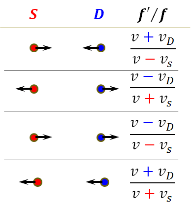

$`r_{COM} = \frac{1}{M}\sum_{}^{}{m_{i}r_{i}^{2}}`$

Right-Hand Rule右手定则 用于 判断 <u>角速度ω</u>和<u>角加速度α</u> 的<u>方向</u>)

Counterclockwise - Positive(+) (反之亦然)

线性加速度 的 径向分量: $`a_{r} = \frac{v^{2}}{r} = \omega^{2}r`$

线性加速度 的 切向分量: $`a_{t} = \frac{dv}{dt} = \frac{d\omega}{dt}r = \alpha r`$

$`I = \sum_{}^{}{m_{i}r_{i}^{2}} = \int_{}^{}{r^{2}\ dm}\  = \int_{}^{}{{(a^{2} + b^{2})}^{2}\ dm} = Mh^{2}`$

(?? 此处dm可写为 ? dr 的形式，然后在对于r的积分上，下边是相对于旋转轴的负坐标，上边是相对于旋转轴的正坐标 ?)

**==Ch 11 滚动、力矩、角动量==**

滚动中的平移: $`s = \theta R`$; $`v_{com} = \omega R`$

滚动+平移: $`\vec{v} = {\vec{v}}_{com} + {\vec{v}}_{t}`$; $`v_{t} = \omega R`$ (此处$`{\vec{v}}_{com}`$为平移，不同于上行；$`v_{t} = \omega R`$为边缘滚动)

$`v_{top} = 2v_{com} = {2\omega}_{com}R`$

Rolling about 底部点P: $`\omega_{P} = \frac{v_{top}}{2R} = \omega_{COM}`$

一点上的线速度: $`\vec{v} = {\vec{v}}_{com} + {\vec{v}}_{t}`$

(注: COM可能不在物体上）

Smooth Rolling中: $`\tau_{net} = I_{com}\alpha = I_{com}\frac{a_{com}}{R}`$

滚动中的动能: $`K = \frac{1}{2}I_{com}\omega^{2} + \frac{1}{2}Mv_{com}^{2}`$

角动量 $`\vec{l} = \vec{r} \times \vec{p} = m\ (\vec{r} \times \vec{v})`$

刚体绕固定轴旋转: $`L = I\ \omega`$

角动量守恒:

$`\overrightarrow{L_{i}} = \overrightarrow{L_{f}}\ ;\ \ I_{i}\omega_{i} = I_{f}\omega_{f}`$ (closed, isolated system)

$`\sum_{}^{}\vec{\tau} = \overrightarrow{\mathbf{\tau}_{\mathbf{net}}} = \frac{d\vec{l}}{dt} = I\ \alpha`$<span class="mark">;</span>

$`\tau_{z,net} = \frac{dL_{z}}{dt} = 0\  \rightarrow \ \ L_{z}\ is\ a\ constant`$

Precession of a Gyroscope: $`\Omega = \frac{d\varnothing}{dt} = \frac{Mgr}{I\omega}`$

$`d\varnothing = \frac{dL}{L} = \frac{\tau\ dt}{I\omega} = \frac{Mgr\ dt}{I\omega}`$ (Ω是大写的ω)

**==Ch12 Equilibrium and Elasticity==**

-Elasticity 弹性 deformation(n.)形变

-Modulus of Elasticity 弹性模量

$`Stress应力 = Modulus模量\  \times Strain应变`$

-Tensile Stress 拉伸应力 —— (E ( or Y ))

Tension (n.)拉伸 & Compression (n.)压缩

产生的单位形变$`\frac{\mathrm{\Delta}L}{L}`$

$`\frac{F}{A} = E\frac{\mathrm{\Delta}L}{L}`$; (E or Y: Young’s Modulus杨氏模量)

(?)模量(?)E的Unit单位：N/m<sup>2</sup>=Pa

Yield Strenth 屈服强度: 材料从弹性变形转变为塑性变形的临界点

stress\<yield Strength→应力与应变为线性关系

stress\>yield Strength→永久性变形&无法恢复

ultimate strength 极限强度: 材料断裂/破裂

(拉伸和压缩的 极限强度 可能不同)

-shearing stress 剪切应力 —— (G ( or S ))

$`\frac{F}{A} = G\frac{\mathrm{\Delta}x}{L}`$ (G: Shear Modulus 剪切模量)

-hydraulic stress 液压应力 —— (B)

Stress: $`p = B\frac{\mathrm{\Delta}V}{V}`$ (B: Bulk Modulus 体积模量)

Strain: $`\frac{\mathrm{\Delta}V}{V}`$ ($`\mathrm{\Delta}V`$: absolute)

$`B_{solid} \gg B_{liquid} \gg B_{gas}`$

-Stability 稳定性: equilibrium & elasticity

-Static Equilibrium 静态平衡:

$`\vec{P} = 0`$ → $`\sum_{}^{}F = 0`$ & $`\vec{L} = 0`$ → $`\sum_{}^{}\tau = 0`$

-center of gravity 重心: $`(x_{cog} = x_{com}`$ ←

如果物体的所有element的$`\vec{g}`$ 都相同)

-at rest=at equilibrium state

→ $`{\vec{\tau}}_{net} = 0`$ & $`{\vec{F}}_{net} = 0`$：

(设原点一次消除多个力矩→力平衡方程求解)

\- Non-Inertia Reference Frame非惯性参考系

$`作用在物体上的非惯性力{\vec{F}}_{NI}\ (AP) = {\vec{F}}_{I} + {\vec{F}}_{o}`$

$`{\vec{F}}_{I}`$: Inertia Force: $`m_{P}{\vec{a}}_{PG}`$

$`{\vec{F}}_{o}`$: Pseudo Force: 在非惯性参考系中出现的力，用来解释物体的运动; $`{\vec{F}}_{o} = - m_{P}{\vec{a}}_{AG}`$

**==Ch13 Gravitation==**

$`F = G\frac{m_{1}m_{2}}{r^{2}}`$ (Between two particles (no size))

$`\vec{F} = G\frac{m_{1}m_{2}}{r^{2}}\hat{r}`$ ($`\hat{r}`$: The radial unit vector:)

$`G = 6.67 \times 10^{- 11}\ N \bullet \frac{m^{2}}{{kg}^{2}}`$(or $`\frac{m^{3}}{{kg \bullet s}^{2}}`$)

\-**Shell Theorem**: A uniform spherical shell吸引外部的粒子时: act like a particle

**Principle of Superposition叠加原理**:

``` math
{\vec{F}}_{1,\ net} = {\vec{F}}_{12} + {\vec{F}}_{13} + {\vec{F}}_{14} + \ldots + {\vec{F}}_{1n} = \sum_{i = 2}^{n}{\vec{F}}_{1i}
```

($`{\vec{F}}_{12} = {\vec{F}}_{1,\ net} - {\vec{F}}_{13} - {\vec{F}}_{14} - \ldots - {\vec{F}}_{1n}`$)

-Gravitation Near Earth’s Surface

$`a_{g} = \frac{F}{m} = G\frac{M}{r^{2}}`$; $`g = a_{g} - \omega^{2}R`$

**free-fall acceleration (g)**

**gravitational acceleration (**$`\mathbf{a}_{\mathbf{g}}`$**)**

**centripetal acceleration (**$`\mathbf{\omega}^{\mathbf{2}}\mathbf{R}`$**)**

**magnitude of the gravitational force (**$`\mathbf{m}\mathbf{a}_{\mathbf{g}}`$**)**

均匀的物质壳不会对位于其内部的粒子施加净引力。($`F_{g}`$不会消失——向量的总和为零! )

对于多个粒子，依次考虑每对粒子。计算该对的U，就好像其他粒子不存在一样。

$`U = - (\frac{Gm_{1}m_{2}}{r_{12}} + \frac{Gm_{1}m_{3}}{r_{13}} + \frac{Gm_{2}m_{3}}{r_{23}})`$

$`\mathrm{\Delta}U = - W`$ 重力势能 $`U = - \frac{GMm}{r}`$

(Earth) escape speed: $`v = \sqrt{\frac{2GM}{R}}`$

(v可利用地球的自转速度)

-Kepler’s Laws 开普勒定律

1\. 质量为m的行星在围绕太阳M为焦点的椭圆轨道上移动。 (For Earth’s orbit, 𝑒=0.0167)

2\. 等价于角动量守恒定律: 连接行星和太阳的线以相等的时间间隔扫除行星轨道平面相等面积: dA/dt 是恒定的。

$`\mathrm{\Delta}A \approx \frac{1}{2}r \cdot r\mathrm{\Delta}\theta = \frac{1}{2}r^{2}\mathrm{\Delta}\theta`$; (L与dA/dt同为常数)

角动量$`L = rp_{\bot} = mr^{2}\omega`$

→ $`\frac{dA}{dt} = \frac{1}{2}r^{2}\omega = \frac{L}{2m}`$ (是连线的$`\omega`$)

**semimajor axis半长轴(a)**

**eccentricity离心率(e)**

3\. planetary orbit—period周期: $`T^{2} = \frac{{4\pi}^{2}}{GM}r^{3}`$

satellites卫星: 动能$`K = \frac{1}{2}mv^{2} = \frac{GMm}{2r}`$; (圆轨)

(总)机械能 $`E = K + U = - \frac{GMm}{2r} = - K`$

elliptical orbit椭圆轨道(半长轴为a) 上的卫星 的机械能: $`E = - \frac{GMm}{2a}`$

**Principle of Equivalence等效原理: Gravitation & acceleration are equivalent. (?)**

**==Ch14 Fluid==**

$`1\ atm = 1.01 \times 10^{5}Pa = 760\ torr = 14.7\ lb/{in}^{2}`$

hydrostatic pressure静水压强:

由静止的流体引起的压强; $`p = p_{0} + \rho_{fluid}gh`$

atmospheric pressure大气中的压强:

$`p = p_{0}{- \rho}_{fluid}gd`$ (此处fluid为air)

$`p_{0}`$: 大气压强(通常是海平面处的(?))

**gauge pressure表压**: (与h成正比&可正可负)

$`p_{g} = \rho_{fluid}gh`$ =$`绝对压强p - 大气压强p_{0}`$

-Pascal’s Principle 帕斯卡原理

施加在封闭的不可压缩流体上的 压力的变化

会毫不减弱地 传递到 流体的每个部分 及其 容器壁。

$`p = p - \rho gh = p_{ext}`$

Hydraulic Lever 液压杆

$`\mathrm{\Delta}p = \frac{F_{i}}{A_{i}} = \frac{F_{o}}{A_{o}}`$ → $`V = A_{i}d_{i} = A_{o}d_{o}`$

→ $`W = F_{o}d_{o} = F_{i}d_{i}`$

Buoyant force 浮力 ($`F_{b}`$)

$`F_{b} = F_{g} = m_{f}g`$(被物体置换的流体的重量)

<span class="mark">(apparent weight表观重量) = (实际重量–浮力)</span>

理想流体 的 4个假设: Steady Flow, Incompressible Flow, Nonviscous Flow, Irrotational Flow: 稳态流(各点v=)、不可压缩流、非粘性流、无旋流(不会绕着其质心旋转)

viscosity: 粘度&粘性

-Streamline (n.)流线:

(流体的)速度的方向与流线相切

(任意)两条流线 永不 相交: 不可能在它们交叉点同时具有两个不同的速度

Incompressible flow→$`\mathrm{\Delta}V不变`$→$`\ A_{1}v_{1} = A_{2}v_{2}`$

Volume Flow Rate $`R_{V} = Av = constant`$ (m<sup>3</sup>/s)

Mass Flow Rate $`R_{m} = \rho Av = constant`$ (kg/s)

-Bernoulli’s Equation 伯努利方程

$`p + \frac{1}{2}\rho v^{2} + \rho gy = constant`$ (i=1,2,…均相等)

→ Ideal fluid flows at a steady rate: (i=1 = i=2)

(<span class="mark">pressure压强↓，speed速度↑，反之亦然</span>)

**Fluid’s Kinetic energy density**: $`\frac{1}{2}\rho v^{2}`$

**==Ch15 Oscillations==**

对于SHM:

$`x(t) = x_{m}\cos(\omega t + \varnothing)`$ (or …sin…)

$`a(t) = \frac{dv(t)}{dt} = - \omega\hat{}2\ x(t)`$ ; $`\omega = \frac{2\pi}{T} = 2\pi f`$

-Linear simple harmonic oscillator 线性简谐振子 e.g.: 弹簧

胡克定律: $`F = ma = - kx`$ <span class="mark">; (</span>$`k = m\omega^{2}`$<span class="mark">)</span>

→ $`T = 2\pi\sqrt{\frac{m}{k}}`$ ; $`\omega = \sqrt{\frac{k}{m}}`$

势能$`U(t) = \frac{1}{2}kx^{2}`$ ; 动能$`K(t) = \frac{1}{2}mv^{2}`$

总机械能$`E = U + K = \frac{1}{2}kx_{m}^{2}`$: is conserve守恒

(<u>SHM</u>中，只有<u>守恒力</u>，因此<u>能量守恒</u>)

-Angular Simple Harmonic Oscillator角谐振子

e.g.: Torsion Pendulum 扭摆

**Restoring Torque回复力矩**: $`\tau = - \kappa\theta`$

**𝜅: Torsion constant 扭转常数**: ($`\kappa = \frac{\tau}{\theta}`$)

← (取决于(wire)长度、(disk)直径、(disk)材料)

→ $`T = 2\pi\sqrt{\frac{I}{\kappa}}`$ ; $`\omega = \sqrt{\frac{\kappa}{I}}`$

(Find I from T ←→ Find T from I)

-The Simple Pendulum 简单摆(单摆)

回复力矩 $`\mathbf{\tau\ } = \ \mathbf{- L}\left( \mathbf{mg\ sin\theta} \right) = \tau = I\mathbf{\alpha}`$

角加速度 $`\mathbf{a\  = \ }\frac{\mathbf{\tau}}{\mathbf{I}} = - \frac{mgL}{I}sin\theta \approx \mathbf{-}\frac{\mathbf{mgL}}{\mathbf{I}}\mathbf{\theta} = \alpha = - \mathbf{\omega}^{2}\theta`$ (τ, α随θ变)

角频率 $`\mathbf{\omega}\  = \ \sqrt{\frac{\alpha}{- \theta}} = \sqrt{\frac{\mathbf{mgL}}{\mathbf{I}}} = \omega = \frac{2\pi}{\mathbf{T}}`$

周期 $`\mathbf{T}\  = \ \frac{2\pi}{\omega} = \mathbf{2\pi}\sqrt{\frac{\mathbf{I}}{\mathbf{mgL}}}`$ (ω, T恒定不变)

**旋转惯量:** $`\mathbf{I} = mL^{2}`$

→ $`T = 2\pi\sqrt{\frac{L}{g}}`$; $`\alpha = - \frac{mgL}{mL^{2}}\theta = - \frac{g}{L}\theta`$<span class="mark">;</span> $`\omega = \sqrt{\frac{g}{L}}`$

-Physical Pendulum 物理摆

$`\mathbf{T} = \mathbf{2\pi}\sqrt{\frac{\mathbf{I}}{\mathbf{mgh}}}`$; (点O(旋转轴所在点)不一定是悬挂的点! !!, 可能是物体上任意一点)

用周期: 通过测量L和T, 得到特定位置上的g

If 使物体所有质量 汇聚到center of oscillation 振动中心, 其 period周期 仍 不变;

物体悬挂位置变化，振动中心也会变化

-SHM是UCM的投影: $`\mathbf{R =}\mathbf{x}_{\mathbf{m}}`$

UCM:$`\theta(t) = \omega t + \varnothing`$; (对应SHM:$`x(t)`$)

**-Damping Force阻尼力:** $`{\vec{\mathbf{F}}}_{\mathbf{d}}\mathbf{= - bv}`$

𝑏: damping constant 阻尼常数 (单位: kg/s)

$`F_{d} + F_{spring} = ma\  \rightarrow \  - bv - kx = ma`$

$`x(t) = x_{m}e^{- \frac{bt}{2m}}\cos(\omega't + \varnothing)`$

角速度: $`\omega' = \sqrt{\frac{k}{m} - \frac{b^{2}}{{4m}^{2}}}`$ ; 速度$`v = \frac{dx}{dt}`$

Damped Energy: $`E(t) \approx \frac{1}{2}kx_{m}^{2}e^{- \frac{bt}{m}}`$ (随t减小)

-Forced Oscillation受迫振动

$`\omega_{d}`$: 与driving force驱动力 的角频率 相同

$`x(t) = x_{m}cos(\omega_{d}t + \varnothing)`$

Natural frequency固有频率$`\omega = \sqrt{\frac{k}{m}}`$

Resonance共振: 当$`\omega_{d} = \omega`$(固有频率)

<span class="mark">共振时，</span>$`x_{m}`$<span class="mark">最大 且</span> $`v_{m}`$<span class="mark">最大</span>

-通用: $`x_{g} = x_{0}\cos\omega_{0}t + \frac{F_{0}}{m(\omega_{0}^{2} - \omega_{d}^{2})}\cos\omega_{d}t`$

**==Ch16 Wave-I==**

-横波: $`y(x,t) = y_{m}\sin(kx - \omega t + \varnothing)`$

At time t, $`y = h(x \pm vt) = h(kx \pm \omega t)`$

**Angular Wave Number**: <span class="mark">**𝑘**=</span>$`\frac{2\pi}{\lambda}`$

相位常数$`\varnothing`$: **+**$`\mathbf{\varnothing}`$**←→-x; -**$`\mathbf{\varnothing}`$**←→+x**

$`v = - \frac{\omega}{k}`$ (← $`kx + \omega t = constant`$)

**The linear mass density**: $`\mathbf{\mu} = \frac{m}{l}`$

↓ $`\vec{\mathbf{\tau}}`$**:** Force (magnitude): element端上的的切向力

**任意波的波速**: $`v = \sqrt{\frac{\tau}{\mu}}`$; 对横波: $`\frac{\partial^{2}y}{\partial t^{2}} = v^{2}\frac{\partial^{2}y}{\partial x^{2}}`$

($`\mu = \frac{dm}{dx}`$; $`\ \ \tau = \sqrt{{F_{2x}}^{2} + {F_{2y}}^{2}} \approx F_{2x}`$)

average power of a wave: $`P_{avg} = \frac{1}{2}\mu v\omega^{2}y_{m}^{2}`$

对正弦横波 动能:

$`\mathbf{dK} = = \frac{1}{2}\mu\omega^{2}y_{m}^{2}\cos^{2}(kx - \omega t)dx`$

势能: (t=0时, 动能与势能最大)

$`\mathbf{dU} = \tau \times \frac{dx}{2} \times \left( \frac{\partial y}{\partial x} \right)^{2} = (同上) = \mathbf{dK}`$

叠加原理: $`y' = y_{1}(x,\ t) + y_{2}(x,\ t)`$

-Interference干涉

如果两个**<u>相同振幅和波长(k和ω相同)</u>**的**<u>正弦波</u>**沿着拉伸的弦沿同一方向传播

$`y' = \left\lbrack 2y_{m}\cos\left( \frac{1}{2}\varnothing \right) \right\rbrack sin(kx - \omega t + \frac{1}{2}\varnothing)`$

($`\varnothing`$: 两波之间的相位差)

($`sinA + sinB = 2sin\lbrack\frac{1}{2}(A + B)\rbrack cos\lbrack\frac{1}{2}(A + B)\rbrack`$)

**Standing waves驻波**: 若~以相反的方向传播,其干涉产生驻波 ; 振幅: $`2y_{m}sin(kx)`$

Node (振幅=0): $`x = n\frac{\lambda}{2}`$ (势能max, 动能=0)

Antinodes (振幅max): $`x = (n + \frac{1}{2})\frac{\lambda}{2}`$

(势能=0, 动能max)

当波**在边界处反射**时: 若为”hard”硬边界则为node, 若为“free”软边界则可能为(?)

如果波在两端的硬边界处反射，则反射波和入射波会相互干扰, <u>若为共振频率则形成共振</u>

2个硬边之间的驻波:

2硬边间距: $`L = n\frac{\lambda}{2}`$ ; (**…nth harmonic**)

resonance frequencies $`f = \frac{v}{\lambda} = n\frac{v}{2L}`$

1硬边和1软边: $`L = n\frac{\lambda}{4}`$ ; $`f = \frac{v}{\lambda} = n\frac{v}{4L}`$

2个软边: $`L = n\frac{\lambda}{2}`$ ; $`f = \frac{v}{\lambda} = n\frac{v}{2L}`$

**==Ch17 Wave-II==**

Transverse wave 横波Longitudinal wave 纵波

Wavefront(s) 波阵面: 相位相同

Rays: 垂直波阵面的定向线:波阵面的行进方向

→ the speed of sound声速: $`v = \sqrt{\frac{B}{\rho}}`$ (Y也可?)

→ Sound Speed: $`v_{solid} \gg v_{liquid} \gg v_{gas}`$

-对于longitudinal wave纵波:

$`s(x,\ t) = s_{m}\cos(kx - \omega t)`$

$`s_{m}`$: Displacement amplitude: 可能是在Compression(处) 或者Expansion(处)

-(粒子在的) the equilibrium position: no sound wave present ;扩展 and 压缩 的 midway

\-**The Pressure Variation** (! 纵波中的压力)

$`\mathrm{\Delta}p(x,t) = \mathrm{\Delta}p_{m}sin(kx - \omega t)`$

$`\mathrm{\Delta}p_{m}( = Bks_{m} = v^{2}\rho ks_{m}) = v\rho\omega s_{m}`$

-Interference 干涉

Resultant Wave:

$`s'(x,\ t) = {2s}_{m}\cos(\frac{\varnothing}{2})\cos\left( kx - \omega t + \frac{\varnothing}{2} \right)`$

$`\varnothing = 2\pi\frac{\mathrm{\Delta}L}{\lambda}`$ (← $`\frac{\varnothing}{2\pi} = \frac{\mathrm{\Delta}L}{\lambda}`$), $`\mathrm{\Delta}L = |L_{2} - L_{1}|`$

Fully Constructive (左)

← $`\mathrm{\Delta}L = n\lambda\ \ \ \ \ (n = 0,1,2\ldots)`$

Fully Destructive (右)

← $`\mathrm{\Delta}L = \left( n + \frac{1}{2} \right)\lambda\ \ \ \ (n = 0,1,2\ldots)`$


-Intensity of Sound (I) 声音强度

$`I = \frac{P(功率)}{A} = \frac{1}{2}\rho v\omega^{2}s_{m}^{2}`$

-管道中的 驻波

2 open ends: $`n = 1,\ 2,\ 3\ldots`$

$`L = \frac{n}{2}\lambda`$ <span class="mark">;</span> $`\lambda = \frac{2L}{n}`$ <span class="mark">;</span> $`f = \frac{v}{\lambda} = \frac{nv}{2L}`$

1 open end (& 1 closed end): $`n = 1,\ 3,\ 5\ldots`$

$`L = \frac{n}{4}\lambda`$ <span class="mark">;</span> $`\lambda = \frac{4L}{n}`$ <span class="mark">;</span> $`f = \frac{v}{\lambda} = \frac{nv}{4L}`$

-Beats 节拍: 振幅相同, 频率稍微不同

$`f_{beat} = |f_{1} - f_{2}|`$ <span class="mark"> **<u>(</u>**</span>$`\mathbf{\omega \gg \omega'}`$**<span class="mark"><u>)</u></span>**

$`s' = s_{1} + s_{2} = \mathbf{2}\mathbf{s}_{\mathbf{m}}\mathbf{\cos}{\mathbf{\omega}^{\mathbf{'}}\mathbf{t}}{cos(kx +}{\omega t})`$<span class="mark">,</span>

$`\omega' = \frac{1}{2}(\omega_{1} - \omega_{2})`$ <span class="mark">&</span> $`\omega = \frac{1}{2}(\omega_{1} + \omega_{2})`$

$`\omega_{beat} = 2\omega' = |\omega_{1} - \omega_{2}|`$

-The Doppler Effect多普勒效应

$`f' = f\frac{v \pm v_{D}}{v \pm v_{s}}`$ v: (空气中)声速

$`v_{D}`$: detector的速度 ; $`v_{s}`$: source的速度

(Choose the right sign)



若$`v < v_{s}`$, 则Supersonic超声速, 此方程无用

sonic boom 音爆

Mach cone马赫锥上存在shock wave冲击波

$`\sin\theta = \frac{vt}{v_{s}t} = \frac{v}{v_{s}} = \frac{1}{M}`$

$`\theta`$: Mach cone angle ; M: Mach number
