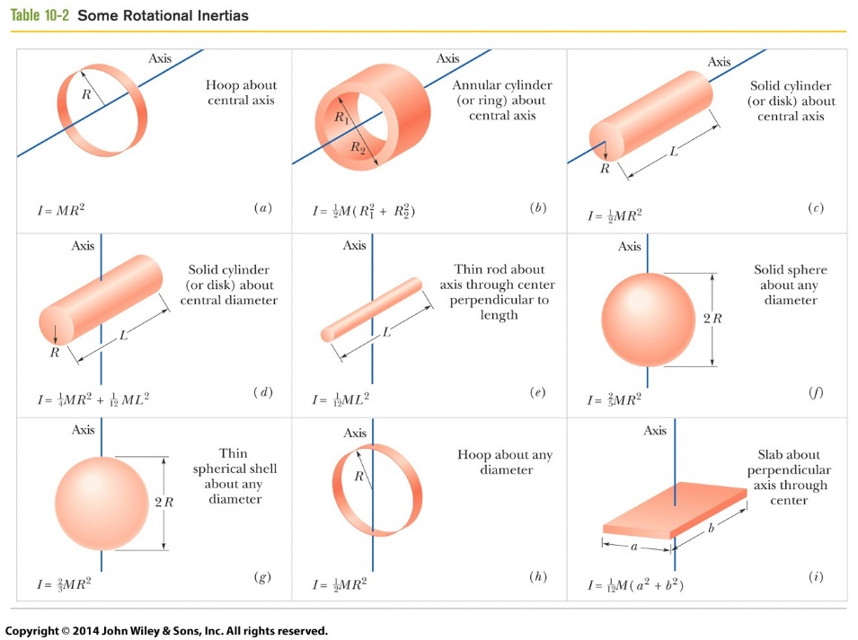

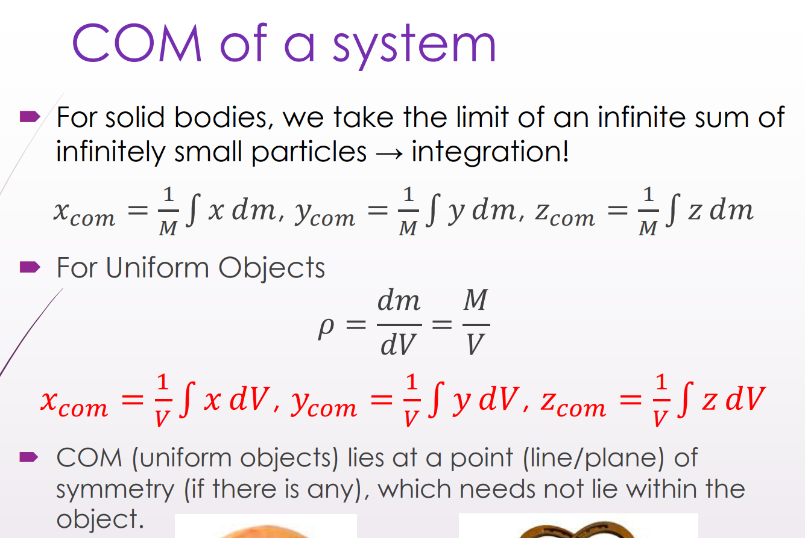

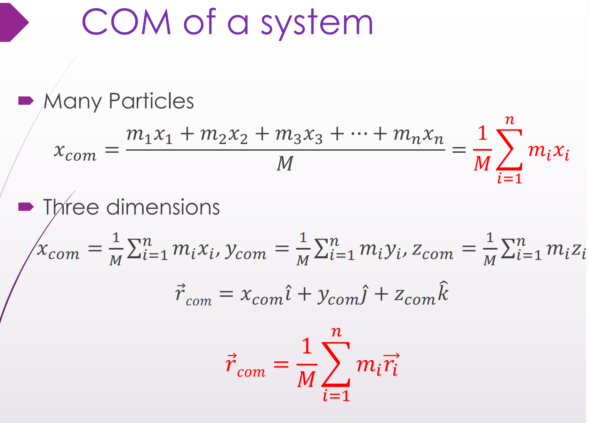

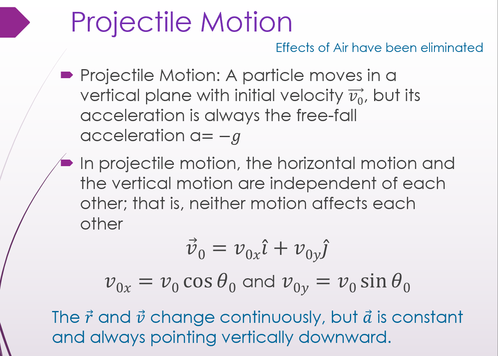

\
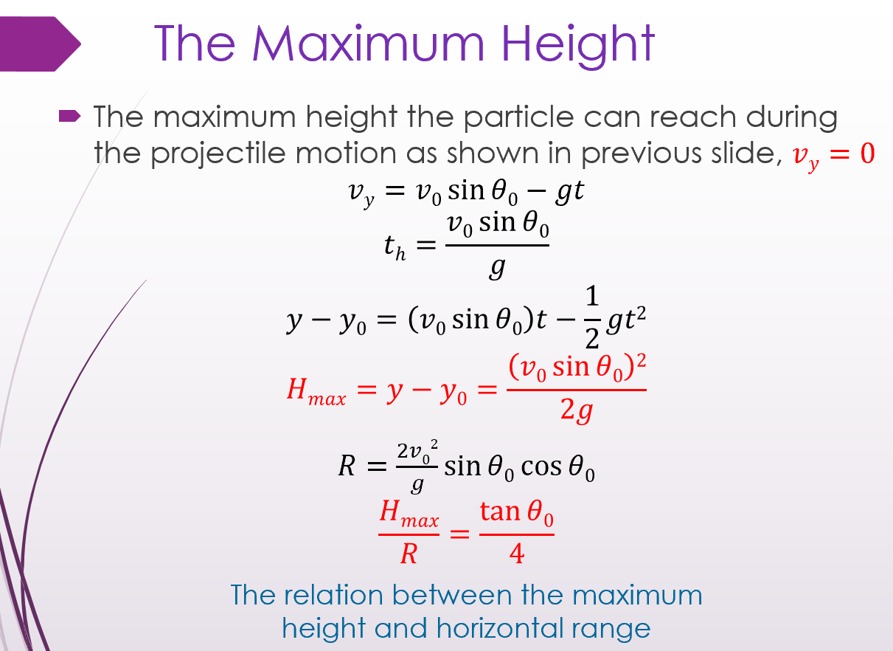

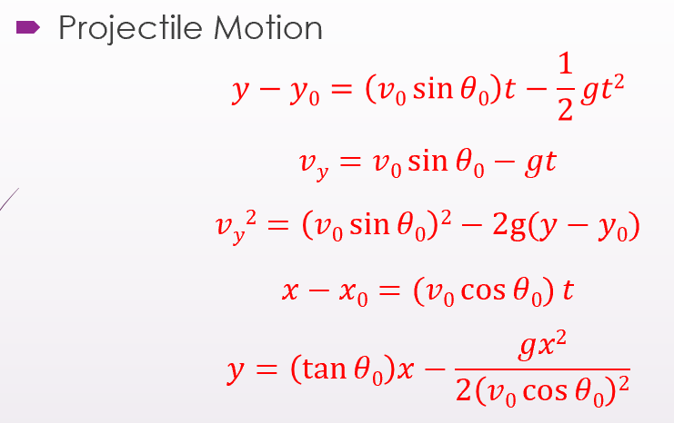\
**周期 T**: The **period of revolution** or simply **period**

<u>\
</u>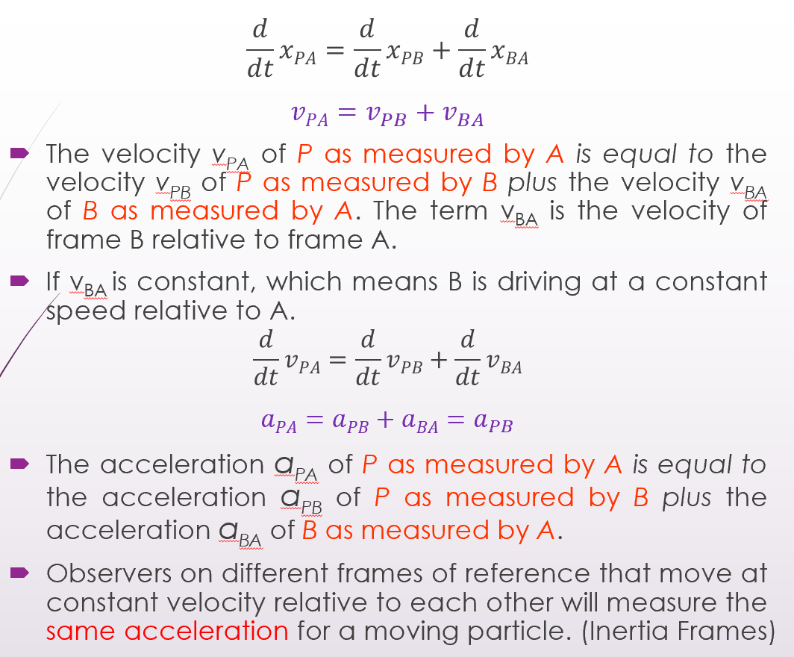<u>\
</u>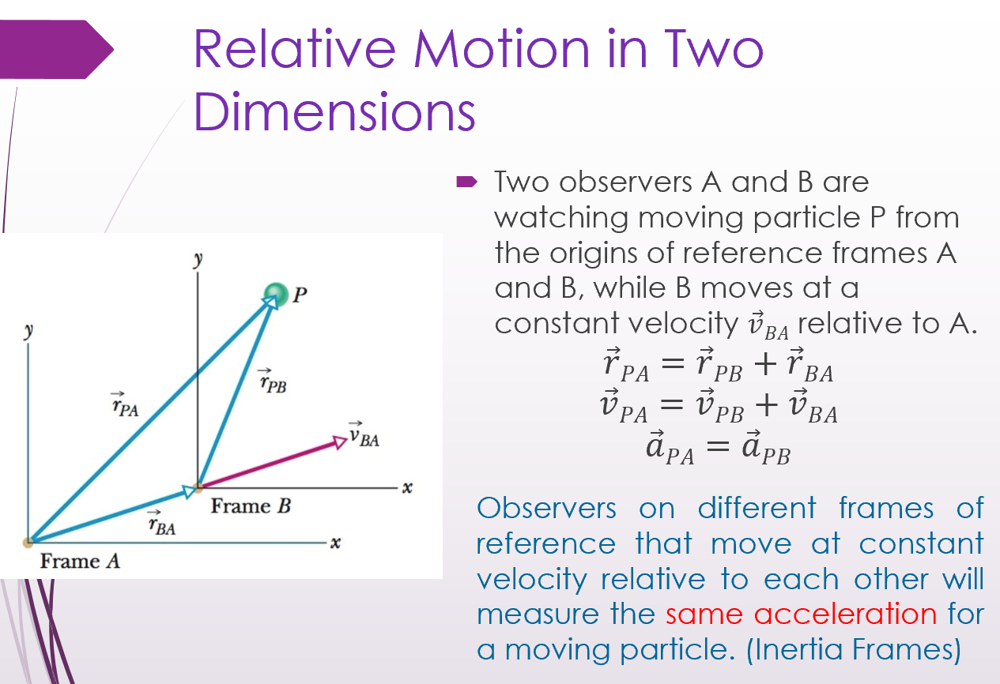\
\

**Drag Force (**$`\vec{\mathbf{D}}`$**) 拖拽力**

<u>Def</u>.: When there is a relative velocity between a fluid and a body, the body experiences a drag force.

<u>Direction</u>: Opposes the relative motion and points in the direction in which the fluid flows relative to the body.

·$`D = \frac{1}{2}\ C\ \rho\ A\ v^{2}`$

C: drag coefficient

(C: Typical values range from 0.4 to 1.0; and we use it as constant here. )

ρ: air density

A: effective cross-sectional area

(perpendicular to the velocity)

v: relative speed

( Drag force是指当一个物体相对于周围流体运动时，与其相反的作用力。这种力可以存在于两个流体层（或表面）之间，也可以存在于流体和固体表面之间。当物体在流体中移动时，流体会产生阻力，称为拖曳力或拖曳。它与物体的运动方向相反，并由固体物体和流体之间的相对速度产生。 )

\-**Terminal Speed (vt) 终端速度**

Def.: When a blunt body falls from rest through air, If \|D\| = \|mg\|, then the body’s speed is constant (<u>the acceleration *a=0*</u>),

which is called **terminal speed vt**

 (a=0)

-Uniform Circular Motions

Centripetal force 向心力

<u>Magnitude</u>: (F=ma, Magnitude of the acceleration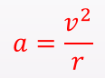)

<u>The direction</u>: Pointing to the center of the circle all the time

\

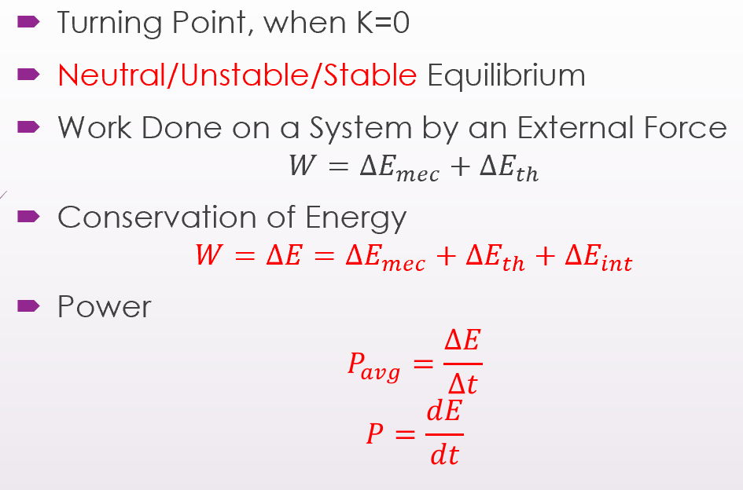

∆E_mec机械能变化量、∆E_th热能变化量、∆E_int内能变化量

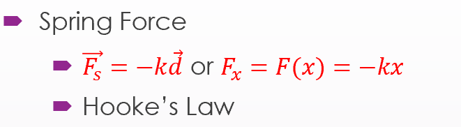

-System with Varying Mass: A Rocket

The ejection of mass from the rocket's rear increases the rocket's speed.

$`(a)`$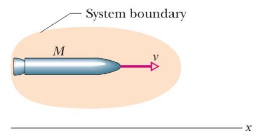

$`(b)`$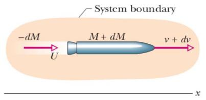

(a)从惯性参考系看，在时间t处质量为M的加速火箭。

\(b\) 相同，但在时间 t+dt。图中显示了间隔 dt 期间释放的排气产物。- 火箭和排气产品形成一个孤立的系统

-Conserve Momentum

· $`Mv = - dMU + (M + dM)(v + dv)`$

<u>U: velocity of products relative to frame</u>

dM:-ve

Use <u>relative speed</u> $`\left( v_{rel} \right)`$ <u>: velocity of rocket relative to products</u>

· $`\begin{matrix}
 & v + dv = v_{rel} + U \\
 & U = \mathbf{v + dv}\ \ \mathbf{-}\mathbf{v}_{\mathbf{rel}} \\
 & \  - dMv_{rel} = Mdv
\end{matrix}`$

-Rocket Equations

For rockets releasing products:

· $`- \frac{dM}{dt}v_{rel} = M\frac{dv}{dt}`$

R: Mass rate of fuel consumption $`- \frac{dM}{dt} = R;`$

$`T = Rv_{rel} = Ma`$ 

First Rocket Equation

R $`v_{\text{rel~}}`$ : the Thrust of the rocket engine (T)

· $`\begin{matrix}
dv = - v_{rel}\frac{dM}{M} \\
\int_{v_{i}}^{v_{f}}\mspace{2mu}\mspace{2mu} dv = - v_{rel}\int_{M_{i}}^{M_{f}}\mspace{2mu}\mspace{2mu}\frac{dM}{M} \\
v_{f} - v_{i} = v_{rel}ln\frac{M_{i}}{M_{f}}
\end{matrix}`$

The velocity change for a given consumption of fuel as the second rocket equation.

**零角位置**. · $`\theta = \frac{s}{r}`$ \* θ必须使用弧度制

· $`\omega_{avg} = \frac{\theta_{2} - \theta_{1}}{t_{2} - t_{1}} = \frac{\Delta\theta}{\Delta t}`$ ($`\Delta\theta = \theta_{2} - \theta_{1}`$ **仅**对**刚体**成立)

·$`\omega = \lim_{\Delta t \rightarrow 0}\frac{\Delta\theta}{\Delta t} = \frac{d\theta}{dt}`$

$`\alpha_{avg} = \frac{\omega_{2} - \omega_{1}}{t_{2} - t_{1}} = \frac{\Delta\omega}{\Delta t}`$对任意物体都成立

(!!! Right-Hand Rule**右手定则** 用于 **判断** **<u>角速度ω</u>和<u>角加速度α</u> 的<u>方向</u>**)

For <u>fixed rotational axis</u>,

only <u>two ways of rotation</u>:

Counterclockwise - Positive(+)

Clockwise - Negative(-)

For rotations about **<u>different</u> axes**: $`\overrightarrow{\theta_{1}} + \overrightarrow{\theta_{2}} \neq \overrightarrow{\theta_{2}} + \overrightarrow{\theta_{1}}`$

For **rotations about <u>a fixed</u> axis**: $`\theta_{1} + \theta_{2} = \theta_{2} + \theta_{1}`$

**ar: 线性加速度 的 径向分量**

· $`a_{r} = \frac{v^{2}}{r} = \omega^{2}r\ \ (radian\ measure)`$

**at: 线性加速度 的 切向分量**

**·** $`a_{t} = \frac{dv}{dt} = \frac{d\omega}{dt}r = \alpha r\ \ (radian\ measure)`$

**旋转动能**$`K = \sum_{}^{}{\frac{1}{2}m_{i}}v_{i}^{2} = \frac{1}{2}(\sum_{}^{}{\mathbf{m}_{\mathbf{i}}\mathbf{r}_{\mathbf{i}}^{\mathbf{2}}})\omega^{2} = \frac{1}{2}I\omega^{2}`$

$`I = \sum_{}^{}{m_{i}r_{i}^{2}} = \int_{}^{}{r^{2}\ dm}`$xis

(?? 此处dm可写为 ? dr 的形式，然后在对于r的积分上，下边是相对于旋转轴的负坐标，上边是相对于旋转轴的正坐标 ?)

\-**The Parallel-Axis Theorem 平行轴定理**

<u>Have known</u> the moment of inertia for the center of mass axis (*Icom*)

→ <u>Find</u> the moment of inertia for a parallel axis (*I*)

· $`I = I_{com} + Mh^{2}`$

h: the perpendicular distance

between the axis that we need & the axis through the center of mass

(these <u>two axes</u> <u>must be parallel</u>; <u>not valid</u> for two arbitrary axes)

M: 物体的总质量

*I*: 物体绕 任意轴(所需求*I*的轴) 的转动惯量

*Icom*: 物体绕 过其重心的轴 旋转时的转动惯量

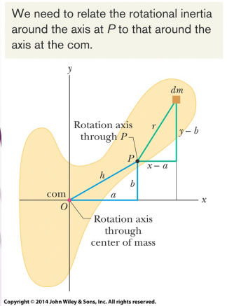

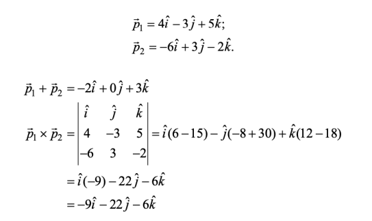
