\-

\
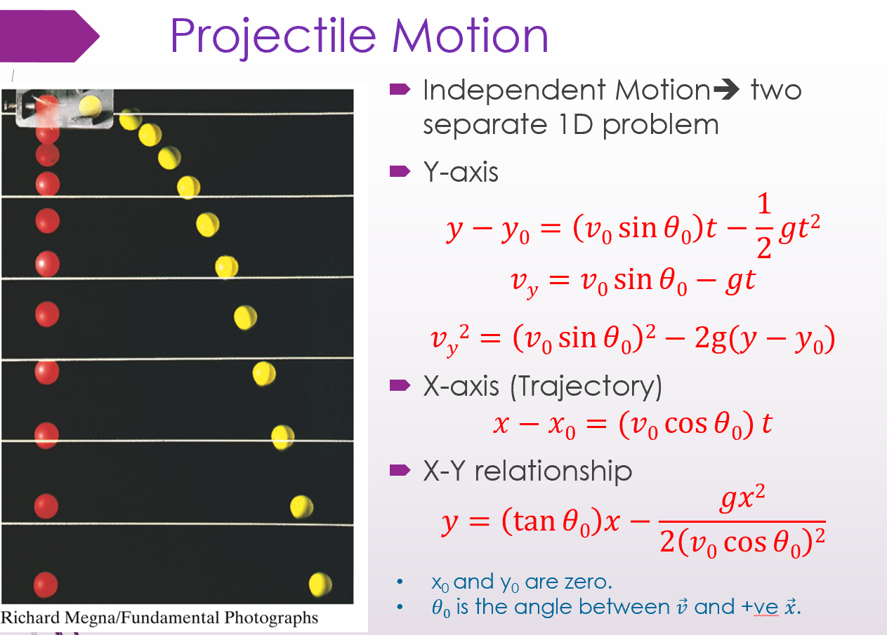\
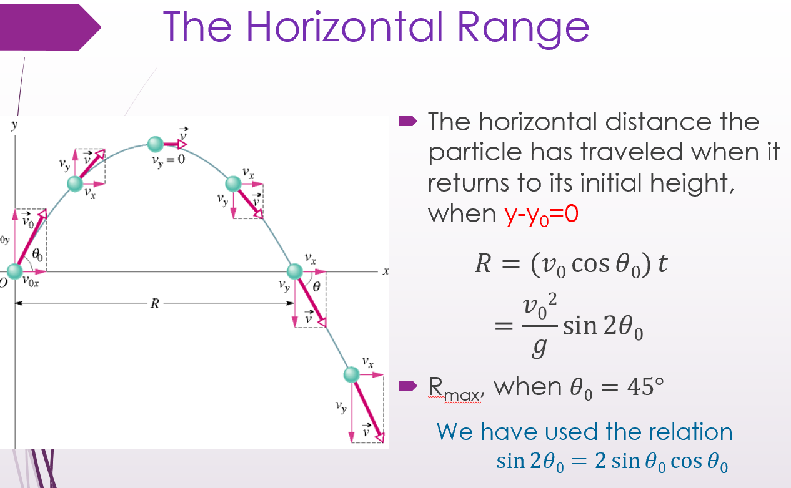\


\
**周期 T**: The **period of revolution** or simply **period**

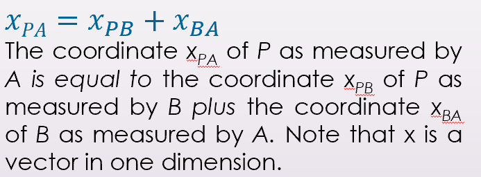<u>\
</u><u>\
</u>

\-\
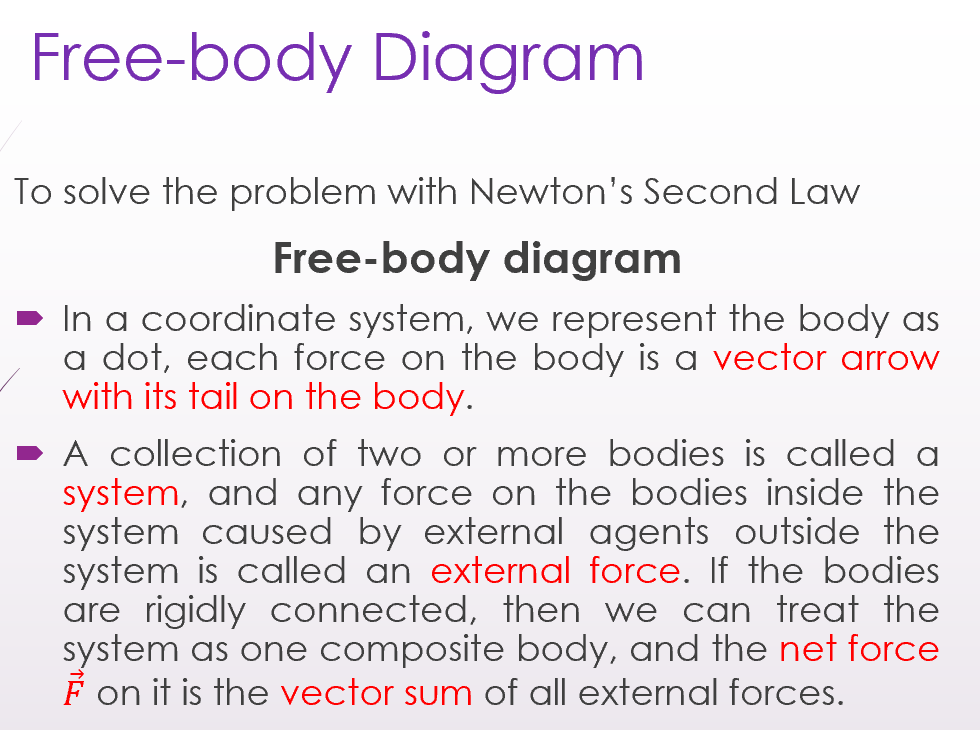\
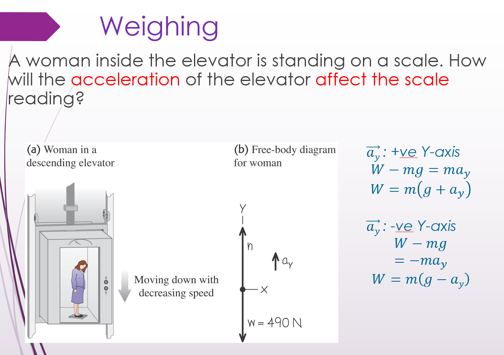

Ch6 Force and Motion-II

——Friction, The Drag Force, Terminal Speed, Uniform Circular Motions

-Friction 摩擦

When a force $`\vec{F}`$ tends to slide a body <u>along a surface</u>, a frictional force $`\vec{f}`$ from the surface acts on the body. The frictional force is <u>parallel</u> to the surface and directed so as to <u>oppose</u> the sliding. It is due to the bonding between the body and the surface

-Static Frictional Force $`\overrightarrow{f_{s}}`$ 静摩擦力

> 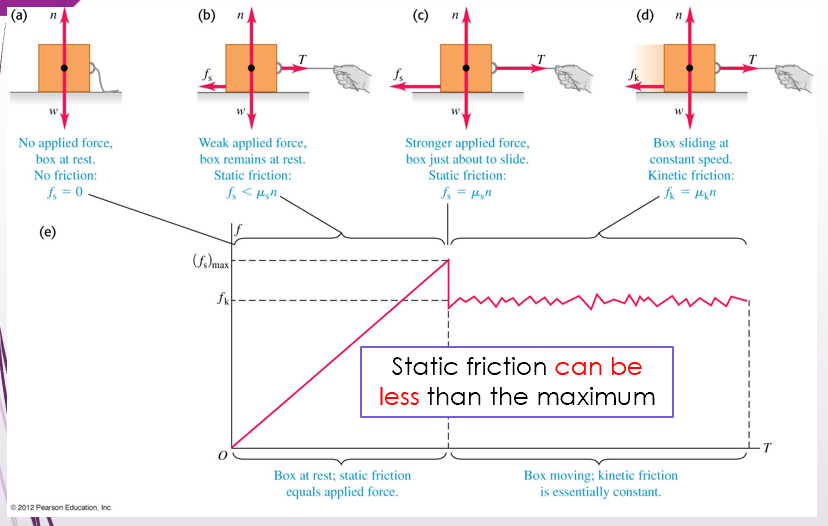

-Kinetic Frictional Force $`\overrightarrow{f_{k}}`$ 动摩擦力

> 

-Microscopic View of Friction

-Cold-Weld

> 3D Surface profile of a-well polished metal by AFM
>
> Far from being flat in atomic scale
>
> Covered with metal oxide layer
>
> -...

-Properties of Friction

> 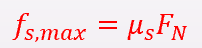 μ_s: Coefficient of static friction; F_N: Normal Force
>
> 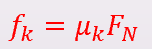 μ_k: Coefficient of kinetic friction; F_N: Normal Force
>
> F_N: How firmly the body presses against the surface.
>
> F_CB=-F_BC
>
> •The harder you press, the larger the Normal Force
>
> •(F_N ) ⃗ ⊥ (f_s ) ⃗/(f_k ) ⃗
>
> μ_s/μ_k: Dimensionless, must be determined experimentally
>
> •<u>Depends on</u> the <u>body</u> and <u>surface</u>
>
> •μ_k: Assume the value doesn‘t depends on the speed at which the body slides along the surface
>
> -Friction in Horizontal Motion

-The Drag Force 拖拽力

Fluid 流体

> Def.: Anything that can flow, either gas or liquid.
>
> e.g. Air / Water

**Drag Force (**$`\vec{\mathbf{D}}`$**) 拖拽力**

> Def.: When there is a relative velocity between a fluid and a body, the body experiences a drag force.
>
> e.g. Blunt body and fast relative motion in air
>
> Direction: Opposes the relative motion and points in the direction in which the fluid flows relative to the body.
>
> ·$`D = \frac{1}{2}\ C\ \rho\ A\ v^{2}`$
>
> C: drag coefficient
>
> (C: Typical values range from 0.4 to 1.0; and we use it as constant here. )
>
> ρ: air density
>
> A: effective cross-sectional area (perpendicular to the velocity)
>
> v: relative speed
>
> ( Drag force是指当一个物体相对于周围流体运动时，与其相反的作用力。这种力可以存在于两个流体层（或表面）之间，也可以存在于流体和固体表面之间。当物体在流体中移动时，流体会产生阻力，称为拖曳力或拖曳。它与物体的运动方向相反，并由固体物体和流体之间的相对速度产生。 )

\-**Terminal Speed (v<sub>t</sub>) 终端速度**

> Def.: When a blunt body falls from rest through air,
>
> If \|D\| = \|mg\|,
>
> then the body’s speed is constant (<u>the acceleration *a=0*</u>),
>
> which is called **terminal speed v<sub>t</sub>**
>
> 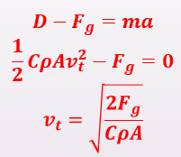
>
> ( Terminal Speed是指物体在流体（最常见的例子是空气）中下落时能达到的最大速度。当拖曳力（D）和浮力之和等于物体上的重力（F<sub>g</sub>）向下的力时，就会发生这种情况。由于物体上的净力为零，所以物体的加速度为零 )

-Uniform Circular Motions

centripetal (adj.) 向心的

Centripetal force 向心力

> A centripetal force accelerates a body by changing the direction of the body’s velocity without changing the body’s speed.
>
> The centripetal force
>
> Magnitude: 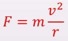 (F=ma, Magnitude of the acceleration)
>
> The direction: Pointing to the center of the circle all the time

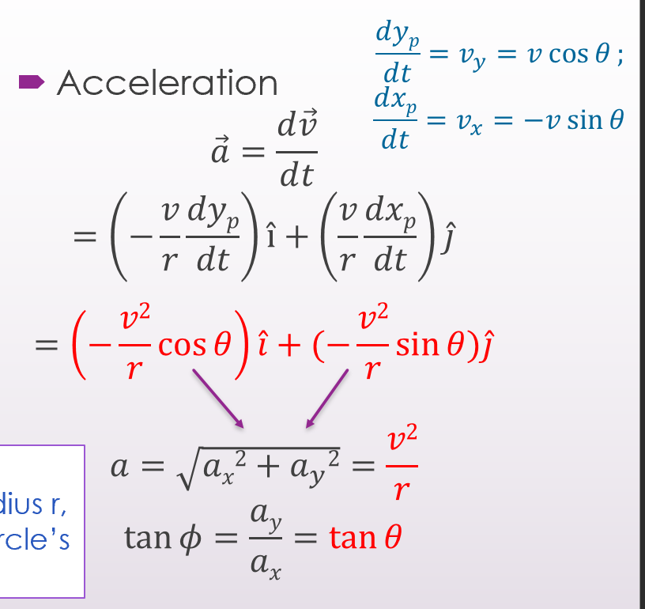

Ch8\
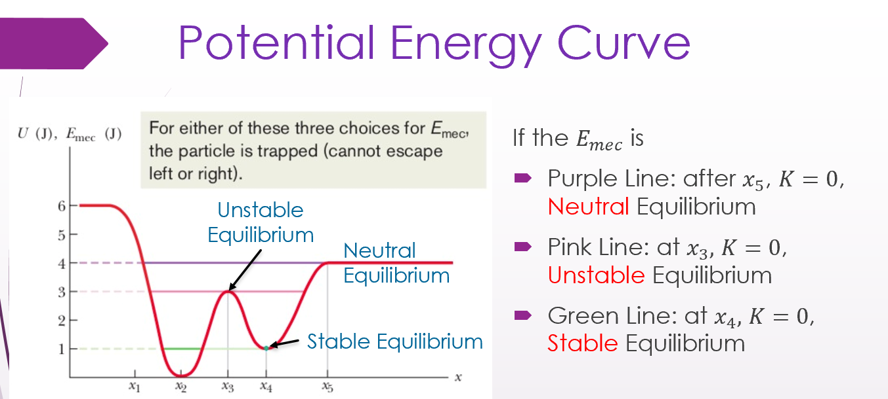

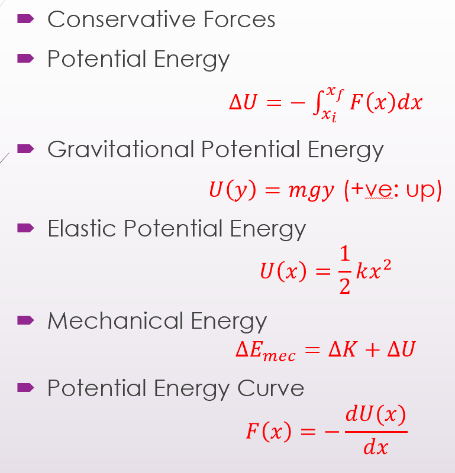


∆E_mec机械能变化量、∆E_th热能变化量、∆E_int内能变化量

Ch9

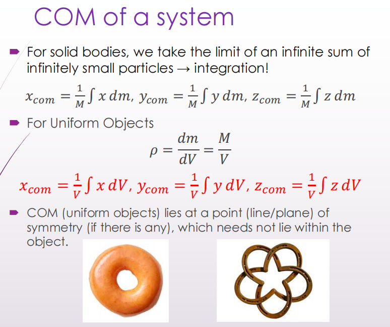\
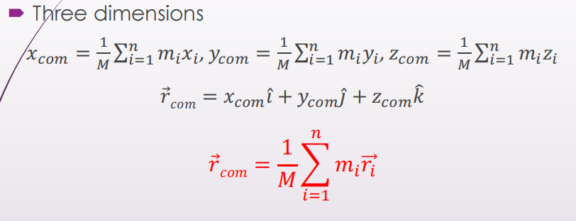

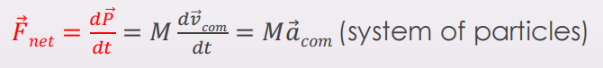

Elastic (adj.)弹性的

Elastic Collisions 弹性碰撞

Inelastic (adj.)非弹性的

Inelastic Collisions非弹性碰撞

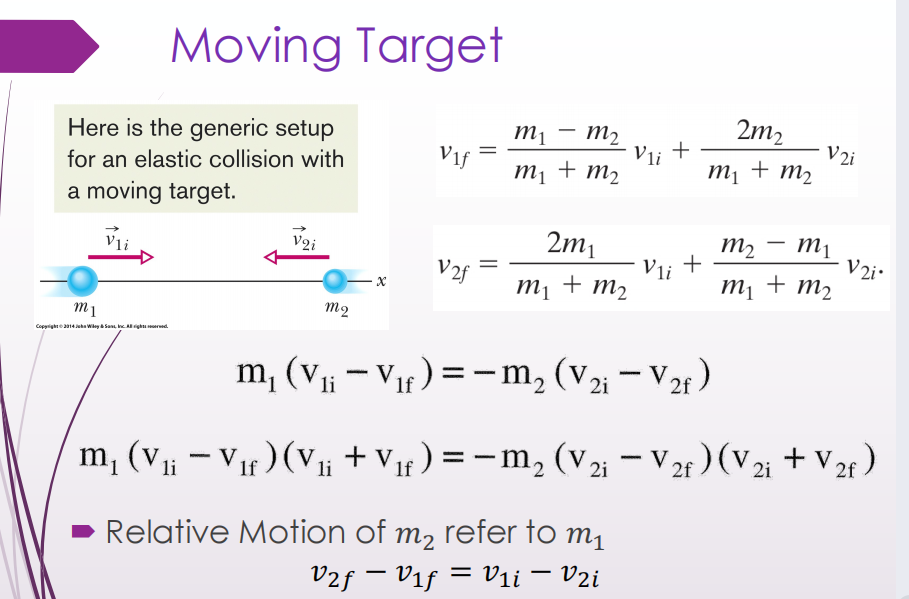

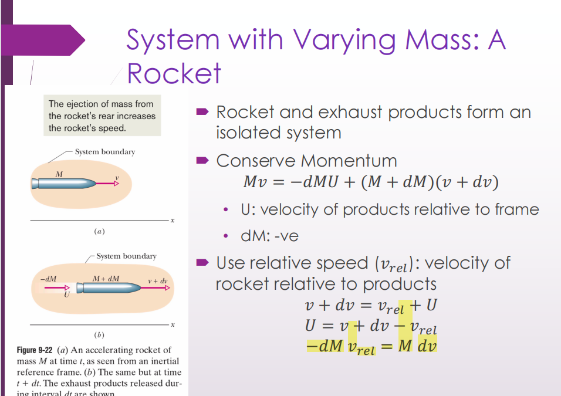

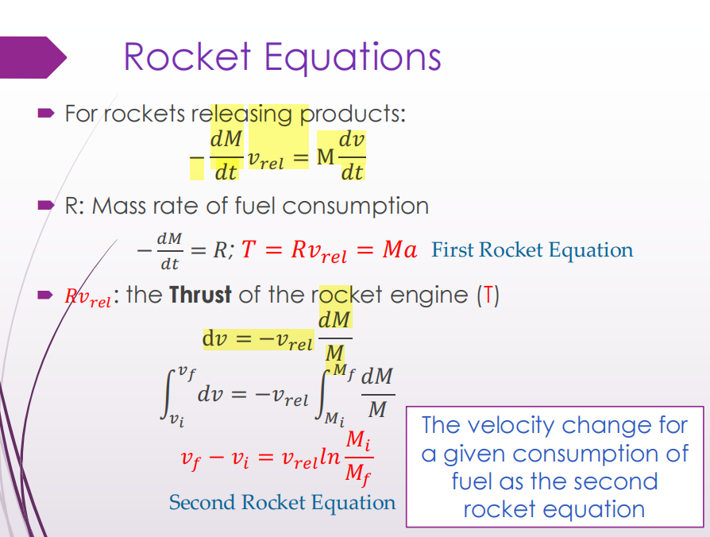 R=-dM/dt (!!!)

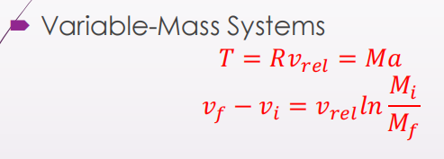

-System with Varying Mass: A Rocket

The ejection of mass from the rocket's rear increases the rocket's speed.

$`(a)`$ $`(b)`$

Figure 9-22

1)  An accelerating rocket of mass $`M`$ at time $`t`$, as seen from an inertial reference frame.

2)  The same but at time $`t + dt`$. The exhaust products released during interval $`dt`$ are shown. - Rocket and exhaust products form an isolated system

-Conserve Momentum

> · $`Mv = - dMU + (M + dM)(v + dv)`$
>
> <u>U: velocity of products relative to frame</u>
>
> dM:-ve
>
> Use <u>relative speed</u> $`\left( v_{rel} \right)`$ <u>: velocity of rocket relative to products</u>
>
> · $`\begin{matrix}
>  & v + dv = v_{rel} + U \\
>  & U = \mathbf{v + dv}\ \ \mathbf{-}\mathbf{v}_{\mathbf{rel}} \\
>  & \  - dMv_{rel} = Mdv
> \end{matrix}`$

-Rocket Equations

> For rockets releasing products:
>
> · $`- \frac{dM}{dt}v_{rel} = M\frac{dv}{dt}`$
>
> R: Mass rate of fuel consumption $`- \frac{dM}{dt} = R;`$
>
> $`T = Rv_{rel} = Ma`$ <span class="mark"></span>
>
> First Rocket Equation
>
> R $`v_{\text{rel~}}`$ : the Thrust of the rocket engine (T)
>
> · $`\begin{matrix}
> dv = - v_{rel}\frac{dM}{M} \\
> \int_{v_{i}}^{v_{f}}\mspace{2mu}\mspace{2mu} dv = - v_{rel}\int_{M_{i}}^{M_{f}}\mspace{2mu}\mspace{2mu}\frac{dM}{M} \\
> v_{f} - v_{i} = v_{rel}ln\frac{M_{i}}{M_{f}}
> \end{matrix}`$
>
> The velocity change for a given consumption of fuel as the second rocket equation

Chapter10 Rotation

-Rotational Motion 旋转运动

**Motion of Translation 平移运动**

> ·move without spinning
>
> ·move along a straight <u>or curved line</u>
>
> (Pure Translation 纯平移)

**Motion of Rotation 旋转运动**

> ·spin about <u>an axis</u> (rolling wheels)

\-**Rotational Variables 旋转变量**

**Rigid Body 刚体**

> Def.: A body can <u>rotate</u> with all its parts locked together and <u>without any change in its shape</u>

A Fixed Axis 固定轴

> Def.: The rotation occurs about an axis that does not move, which is the axis of rotation (or rotation axis)

**Pure Rotational 纯旋转**

> Def.: Every point moves <u>in a circle</u> whose center lies on the axis of rotation, and every point moves <u>through the same angle during a particular time interval</u>.

**(Reference line参考线**: <u>垂直于</u>r**otational axis旋转轴**)

\-**Angular Position (θ) 角坐标**

Angular Position of the reference line 参考线的角坐标

> <u>The angle θ of this line</u>
>
> relative to <u>a fixed direction</u>, which we take as the **zero angular position零角位置**.
>
> · $`\theta = \frac{s}{r}`$
>
> θ: the angle of this line
>
> s: the circular arc / The length of the point moves along an arc
>
> r: the radius of the circle / Perpendicular distance from the rotational axis
>
> <span class="mark">\* θ必须使用弧度制</span>

For a circle:

· $`1rev = 360{^\circ} = \frac{2\pi r}{r} = 2\pi\ rad`$

· $`1rad = 57.3{^\circ} = 0.159rev`$

\-**Angular Displacement (Δθ)角位移**

Def.: if the object rotates about the axis, <u>changing the angular position of the reference line</u> from θ1 to θ2

For **<u>rigid body</u>**: $`\Delta\theta = \theta_{2} - \theta_{1}`$ **仅**对**刚体**成立

> Δθ is positive为正 ( <span class="mark">Δθ \> 0</span> ) - <span class="mark">Counterclockwise逆时针</span>
>
> Δθ is negative为负 ( <span class="mark">Δθ \< 0</span> ) - <span class="mark">Clockwise顺时针</span>

-Angular Velocity (ω) 角速度

Def.: Angular Displacement during a time interval

Average Angular Velocity (ω<sub>avg</sub>) 平均角速度:

· $`\omega_{avg} = \frac{\theta_{2} - \theta_{1}}{t_{2} - t_{1}} = \frac{\Delta\theta}{\Delta t}`$ ($`\Delta\theta = \theta_{2} - \theta_{1}`$ **仅**对**刚体**成立)

(Instantaneous) Angular Velocity (ω) 瞬时角速度:

> · $`\omega = \lim_{\Delta t \rightarrow 0}\frac{\Delta\theta}{\Delta t} = \frac{d\theta}{dt}`$

<span class="mark">SI-unit 单位: rad/s</span>

Angular Speed角速率(?)

> Magnitude 指角速度ω的大小

-Angular Acceleration (α) 角加速度

Def.: Angular Velocity change during a time interval

Average Angular Acceleration

· $`\alpha_{avg} = \frac{\omega_{2} - \omega_{1}}{t_{2} - t_{1}} = \frac{\Delta\omega}{\Delta t}`$

(Instantaneous) Angular Acceleration

· $`\alpha = \lim_{\Delta t \rightarrow 0}\frac{\Delta\omega}{\Delta t} = \frac{d\omega}{dt}`$

Hold for every particle of the body 以上公式对任意物体都成立

SI-unit 单位: rad/s<sup>2</sup>

-Treat **ω and α** as vectors but **not real vectors**

**Right-Hand Rule右手定则**

> ω and α: <u>Rotate around the Vector</u>, not move along the direction of the vector
>
> (!!! Right-Hand Rule<span class="mark">**右手定则** 用于**判断** **<u>角速度ω</u>和<u>角加速度α</u> 的<u>方向</u>**</span>)
>
> For <u>fixed rotational axis</u>,
>
> only <u>two ways of rotation</u>:
>
> <span class="mark">Counterclockwise - Positive(+)</span>
>
> <span class="mark">Clockwise - Negative(-)</span>
>
> 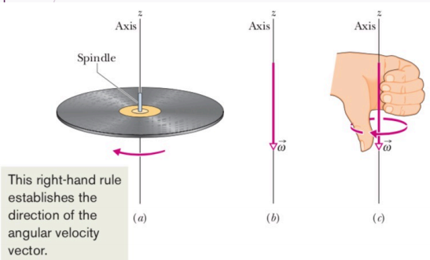

θ cannot be treated as vectors:

> For vectors: $`\vec{a} + \vec{b} = \vec{b} + \vec{a}`$
>
> For <span class="mark">rotations about **<u>different</u> axes**:</span> $`\overrightarrow{\theta_{1}} + \overrightarrow{\theta_{2}} \neq \overrightarrow{\theta_{2}} + \overrightarrow{\theta_{1}}`$
>
> For <span class="mark">**rotations about <u>a fixed</u> axis**:</span> $`\theta_{1} + \theta_{2} = \theta_{2} + \theta_{1}`$

\-<u>Comparison</u> between Linear and Rotational Motion

One dimensional linear motion

> VS. Rotation around a fixed axis
>
> 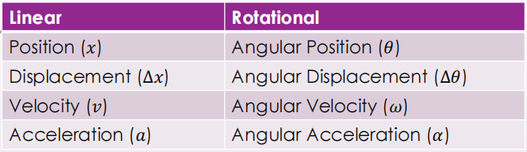

One dimensional linear motion with Constant Acceleration

> VS. Rotation with Constant Acceleration
>
> 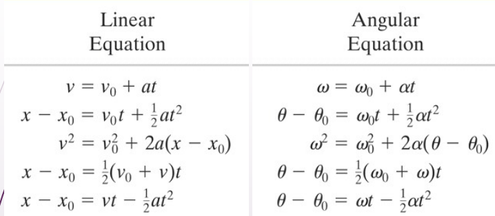

\-<u>Relating</u> Linear and Angular Variables

· $`s = \theta r\ \ (radian\ meaure)`$

> For all the linear-angular unit, must use the **Radian relations弧度关系**
>
> 无论是在何种情况下，如果要进行<u>角度单位的转换或计算</u>，都<u>必须使用弧度制</u>作为标准单位
>
> (**Radian relations弧度关系**: 指在数学和物理学中，用弧度来表示角度的一组相关概念和公式)

· $`v = \omega r\ \ (radian\ measure)`$

r: Constant (Radius); v: Speed; ω: Angular speed

**a<sub>r</sub>: Radial component of linear acceleration 线性加速度 的 径向分量**

> Pointed radially inward towards the center of the path
>
> 指向路径向心的方向
>
> As long as the object is rotating, it is non-zero
>
> even without any angular acceleration. (Uniform Circular Motion)
>
> 只要物体在旋转，即使没有任何角加速度(匀速圆周运动)，它也不为零.
>
> Beacuse $`T = \frac{2\pi r}{v} = \frac{2\pi}{\omega}\ (radian\ measure)`$
>
> → · $`a_{r} = \frac{v^{2}}{r} = \omega^{2}r\ \ (radian\ measure)`$

**a<sub>t</sub>: Tangential component of linear acceleration 线性加速度 的 切向分量**

> Tangential direction to the rotational path
>
> 沿着旋转路径的切向方向
>
> No angular acceleration ($`\omega`$=0), a<sub>t</sub> = 0 (Uniform Circular Motion)
>
> 没有角加速度(ω=0)时(匀速圆周运动)，a<sub>t</sub> = 0
>
> · $`a_{t} = \frac{dv}{dt} = \frac{d\omega}{dt}r = \alpha r\ \ (radian\ measure)`$

\-**Kinetic Energy of Rotation (*K*) 旋转动能**

Treat the rigid body as a collection of particles with different speeds

> 我们将刚体视为具有不同速度的粒子集合

· $`K = \sum_{}^{}{\frac{1}{2}m_{i}}v_{i}^{2} = \frac{1}{2}(\sum_{}^{}{\mathbf{m}_{\mathbf{i}}\mathbf{r}_{\mathbf{i}}^{\mathbf{2}}})\omega^{2} = \frac{1}{2}I\omega^{2}`$

(K: 前-自然单位制 计算；后-弧度制 计算)

m<sub>i</sub>: the mass of the i<sup>th</sup> particle

v<sub>i</sub>: the speed of the i<sup>th</sup> particle

(· <span class="mark"></span>$`v = \omega r`$ - The particle moves with same ω, but different v)

\-**Rotational Inertia (*I*) 转动惯量**

(又名: Moment of inertia (也是)转动惯量)

Rotational Inertia of the body

> *with respect to <u>the axis of rotation</u>*:

Involve both mass and its distribution

· $`I = \sum_{}^{}{m_{i}r_{i}^{2}}`$

Is a constant for a particular body and a particular rotational axis

· For (<u>continuous(?)) rigid body</u>: $`I = \sum_{}^{}{m_{i}r_{i}^{2}} = \int_{}^{}{r^{2}\ dm}`$xis

> (?? 此处dm可写为 ? dr 的形式，然后在对于r的积分上，下边是相对于旋转轴的负坐标，上边是相对于旋转轴的正坐标 ?)

<span class="mark">SI-unit 单位: kg·m<sup>2</sup></span>

> 对于特定物体和特定旋转轴而言，是一个恒量

(**转动惯量 是指**一个物体绕某个轴旋转时，由于该物体的**<u>形状、密度和质量</u>**分布等因素而产生的**<u>抵抗旋转运动的惯性</u>**。它衡量了<u>物体在*旋转时所表现出来的*惯性大小</u>。<u>转动惯量越大</u>，说明物体越难以旋转，<u>需要更大的力矩才能使其旋转</u>。

这就**<u>像线性运动中的质量(m)一样</u>**，质量越大，物体就越难以加速。)

(Moment of Inertia depends on the rotational axis

> 转动惯量 取决于旋转轴
>
> 这意味着**<u>对于同一个物体，当旋转轴改变时，它的转动惯量也会改变</u>**。这是因为**<u>转动惯量衡量了物体质量分布相对于旋转轴的情况</u>**。<u>当旋转轴改变时，物体各部分与旋转轴的距离也会发生变化，从而影响到物体的转动惯量</u>。
>
> e.g., 考虑一个长方形薄片绕其一条边旋转和绕其对角线旋转。由于薄片各部分与两个旋转轴的距离不同，所以它们的转动惯量也不同。)

\-**The Parallel-Axis Theorem 平行轴定理**

<u>Have known</u> the moment of inertia for the center of mass axis (*I<sub>com</sub>*)

> → <u>Find</u> the moment of inertia for a parallel axis (*I*)

· $`I = I_{com} + Mh^{2}`$

h: the perpendicular distance

> between the axis that we need & the axis through the center of mass
>
> (these <u>two axes</u> <u>must be parallel</u>; <u>not valid</u> for two arbitrary axes)

M: 物体的总质量

*I*: 物体绕 任意轴(所需求*I*的轴) 的转动惯量

*I<sub>com</sub>*: 物体绕 过其重心的轴 旋转时的转动惯量

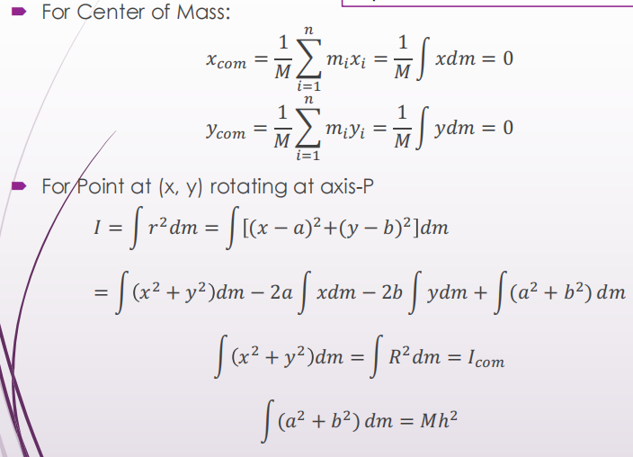

\-**Torque (τ) 扭矩/力矩/矩**

The force necessary to rotate an object depends on

> the angle of the force and where it is applied力的角度和被施加力的位置.
>
> We can resolve the force into components to see how it affects rotation.
>
> · $`\tau = (r)(F\ sin\Phi) = r\ F_{\bot} = (r\ sin\Phi)(F) = r_{\bot}\ F`$
>
> <u>Torque</u> can be treated as ***<u>vectors</u>***:
>
> · $`\vec{\tau} = \vec{r} \times \vec{F}`$
>
> 确定 $`\vec{\tau}`$ 的方向：使用右手定则
>
> Positive (+) direction - Counterclockwise <span class="mark">正方向 ( τ \> 0 ) -逆时针</span>
>
> Negative (-) direction - Clockwise <span class="mark">负方向 ( τ \< 0 ) -顺时针</span>

( <u>The **line of action作用线** (also called **line of application作用线**) of a force (F)</u>

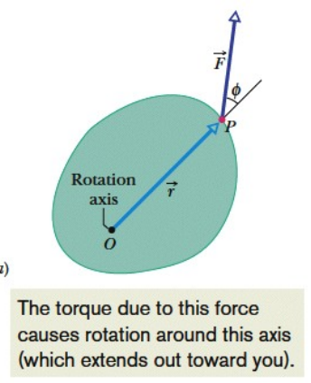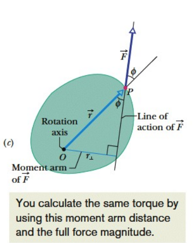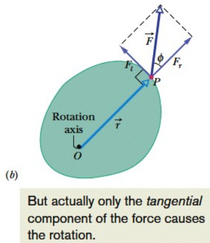

> Def.: It is a geometric representation of how the force is applied. It is the line through the point at which the force is applied in the same direction as the vector $`\vec{F}`$.
>
> <u>力F的作用线</u> 是力F的施加方式的几何表示；是通过力的作用点，并与向量$`\vec{F}`$方向相同的线。 )

**Net torque (τ<sub>net</sub>) 净力矩 (or resultant torque (τ<sub>net</sub>) 合力矩)**

> Def.: is the sum of the individual torques
>
> · $`\tau_{net} = \sum_{}^{}\tau_{i}`$

-Newton’s Second Law for Rotation 牛顿第二定律的旋转形式

Only the <u>tangential component F<sub>t</sub></u> of <u>the applied force F</u> can <u>accelerate the particle along the path</u>

> 只有<u>作用力F</u>的<u>切向分量F<sub>t</sub></u>才能<u>沿着路径加速</u>粒子
>
> · $`a_{t} = \alpha\ r`$
>
> · $`F_{t} = m\ a_{t} = \ m\ \alpha\ r`$
>
> · $`\tau = F_{t}\ r = (m\ \alpha\ r) \times r = m\ \alpha\ r^{2} = (m\ r^{2})\ \alpha = I\alpha`$

For <u>more than one force applied</u> 对于<u>一个以上的作用力</u>:

> · <span class="mark"></span>$`\tau_{net} = I\ \alpha\ \ (radian\ measure)`$

\-**Work and Rotational Kinetic Energy 功与旋转动能**

**Rotational Kinetic Energy旋转动能**: $`\mathbf{K =}\frac{\mathbf{1}}{\mathbf{2}}\mathbf{I}\mathbf{\omega}^{\mathbf{2}}`$

(· $`\Delta K = K_{f} - K_{i} = \frac{1}{2}mv_{f}^{2} - \frac{1}{2}mv_{i}^{2} = W`$

> · ↓ $`v = \omega r`$
>
> · $`\Delta K = \frac{1}{2}m{(\omega_{f}r)}^{2} - \frac{1}{2}m{(\omega_{i}r)}^{2} = W`$
>
> · ↓ $`I = mr^{2}`$
>
> · $`\Delta K = \frac{1}{2}I\omega_{f}^{2} - \frac{1}{2}I\omega_{i}^{2} = W`$
>
> · → $`K = \frac{1}{2}I\omega^{2}`$ )

( For translation motion: $`W = \int_{x_{i}}^{x_{f}}{F\ dx}`$ ;

> Constant Force: $`W = F(x_{f} - x_{i})`$ ;
>
> Power: $`P = \frac{dW}{dt} = F\ v`$ ;

For rotational motion about fixed Axis: $`W = \int_{\theta_{i}}^{\theta_{f}}{\tau\ d\theta}`$ ;

> Constant Torque: $`W = \tau(\theta_{f} - \theta_{i}`$*<span class="mark">)</span> ;*
>
> Power: $`P = \frac{dW}{dt} = \tau\ \frac{d\theta}{dt} = \tau\ \omega`$
>
> ($`ds = r\ d\theta\ ;\ \ \ {dW = F}_{t}\ ds = F_{t}r\ d\theta = \tau\ d\theta`$)

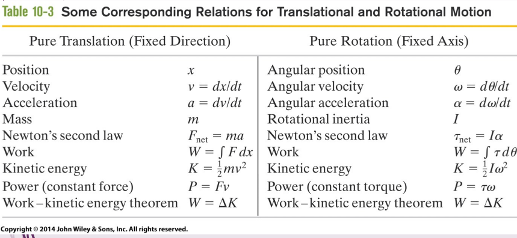

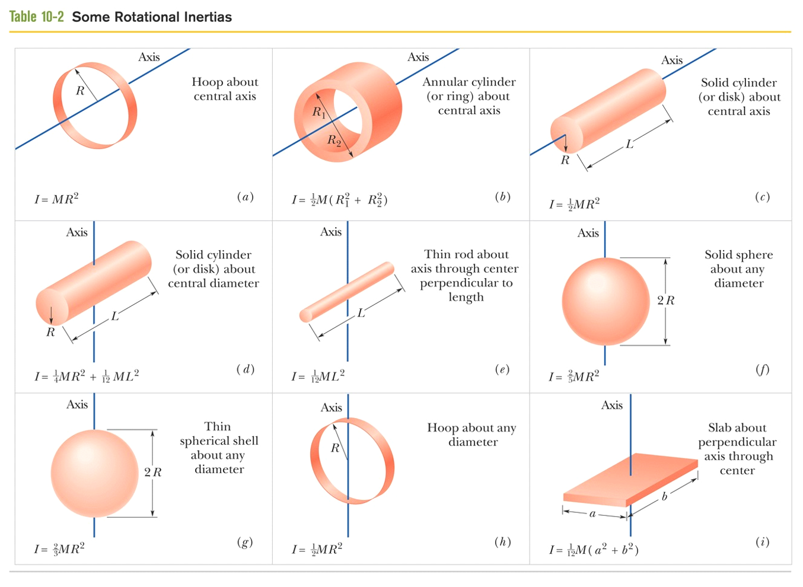

Ch11

-Rolling

-Translation in Rolling

-Rolling as Translation and Rotation Combined

-Rolling as Pure Rotation

-Same Angular Speed

-Direction of the Linear Velocity

-Newton’s 2nd Law for Smooth Rolling

-Torque Applied

-Force Applied

-Car: Connected wheels

-Rolling Down (Force Applied Case)

-Rolling Up (Force Applied Case)

-Kinetic Energy of Rolling

-Energy and Work done for Force Applied case

-Energy and Work done for Torque Applied Case

-Energy and Work done for Rolling along an incline

-The yo-yo

-The yo-yo with slipping

-Rolling and Slipping

-Angular momentum 角动量

· $`\vec{l} = \vec{r} \times \vec{p} = m\ (\vec{r} \times \vec{v})\ \ \ \ (Linear\ momentum\ \vec{p} = m\ \vec{v})`$

-Newton’s Second Law in Angular Form

Translational Motion:

> ·$`\overrightarrow{F_{net}} = \frac{d\vec{p}}{dt}`$

Angular Form:

> ·$`\overrightarrow{\mathbf{\tau}_{\mathbf{net}}} = \frac{d\vec{l}}{dt}`$ ($`\overrightarrow{\tau_{net}} = \sum_{}^{}\vec{\tau}`$ (!!!) )

-Angular Momentum of a System of Particles

-The Angular Momentum of a Rigid Body Rotating about a Fixed Axis

· $`L = I\ \omega`$

-Conservation of Angular Momentum

No external net torque acting on the system

> $`\vec{L}\ is\ a\ constant`$ <u>(closed, isolated system)</u>

Law of Conservation of Angular Momentum

> · $`\overrightarrow{L_{i}} = \overrightarrow{L_{f}}`$ <u>(closed, isolated system)</u>
>
> → $`I_{i}\omega_{i} = I_{f}\omega_{f}`$ <u>(closed, isolated system)</u>
>
> If the component of the net external torque on a system along a certain axis is zero,
>
> then the component of the angular momentum of the system along that axis cannot change, not matter what changes take place within the system.
>
> e.g. $`\tau_{z,net} = \frac{dL_{z}}{dt} = 0\  \rightarrow \ \ L_{z}\ is\ a\ constant`$

-Translation & Rotation

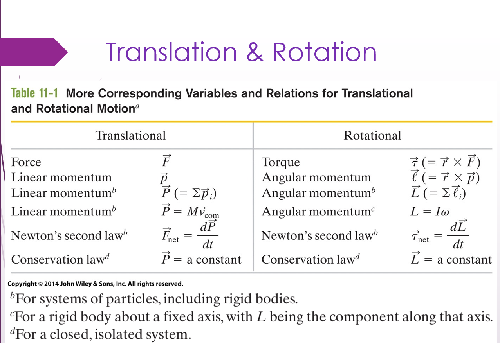

-Precession of a Gyroscope

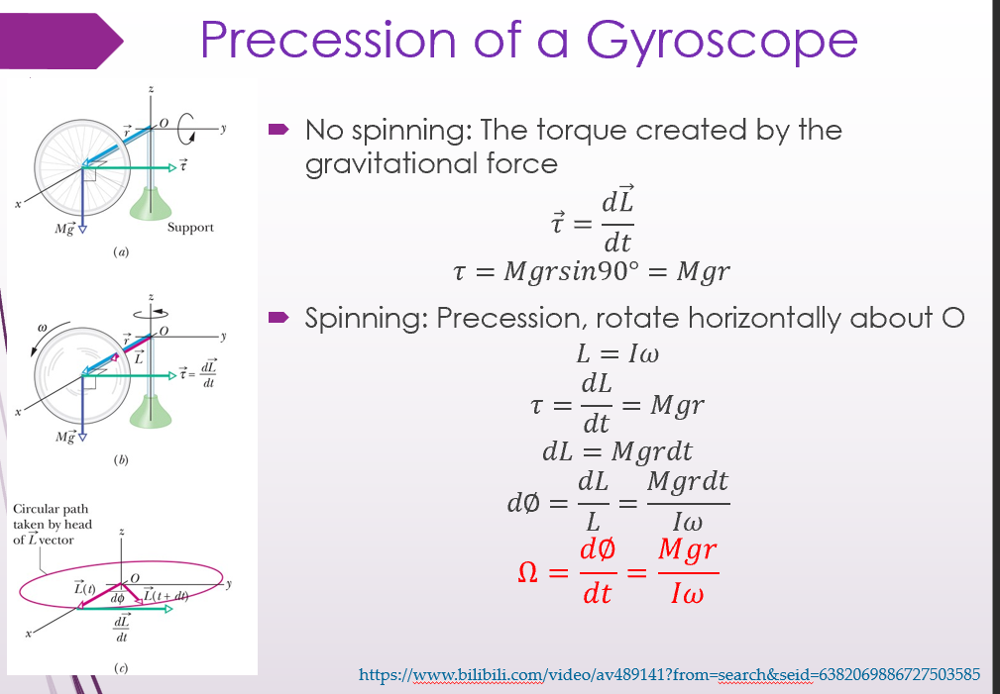

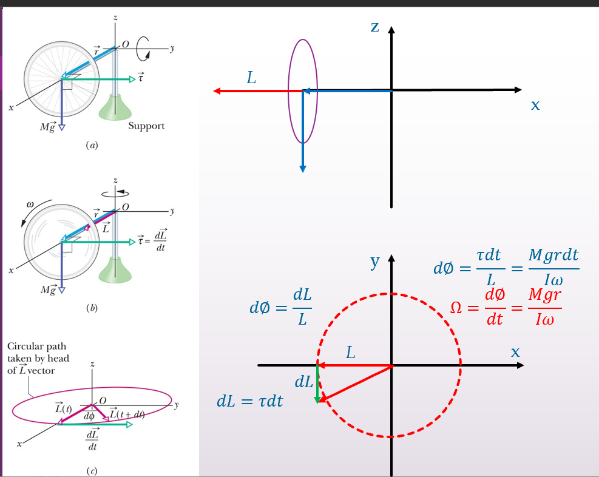

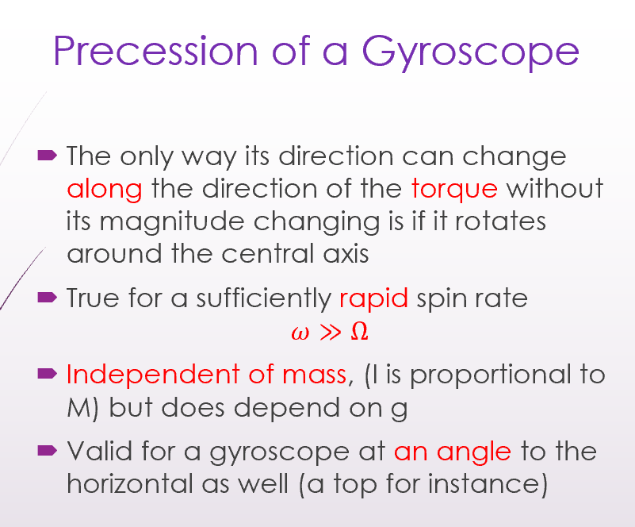

Ch12 Equilibrium and Elasticity

-Elasticity 弹性

Def.:

> Describes how real bodies deform when forces are applied to them.
>
> 描述当对实体施加力时，它们如何变形。
>
> The ability of an object or material to resume its normal shape after being stretched or compressed
>
> 是指物体或材料在拉伸或压缩后恢复正常形状的能力

Rigid body 刚体

No **deformation(n.)形变** when forces applied to them 施加力时不变形

Doesn’t exist in reality

Elastic:

> Deform - Return to its original shape

Rigid -Stiff interatomic springs:

> Not stiff interatomic spring: loosely bound to its neighbors deform easily

当力作用在实体上时，实体可能会改变其尺寸的三种方式。

> 1\. Tensile Stress 拉伸应力
>
> 2\. Shearing stress 剪切应力
>
> 3\. Hydraulic stress 液压应力

**Modulus of Elasticity 弹性模量**

$`Stress = Modulus \times strain`$ <span class="mark"></span>$`应力 = 模量\  \times 应变`$

> **Stress(n.)应力** and **Strain(n.)应变** are proportional to each other应力和应变彼此成正比

\-**Tension (n.)拉伸** & **Compression (n.)压缩**

Stress 应力

> Def.: Force per unit Area $`\frac{F}{A}`$

Strain 应变

Def.: produced unit deformation 产生的单位形变 $`\frac{\mathrm{\Delta}L}{L}`$

> (ratio, dimensionless 是比率，没有量纲)

**Young’s Modulus (E) 杨氏模量**

$`\frac{F}{A} = E\frac{\mathrm{\Delta}L}{L}`$ (应力 = E×应变)

SI-Unit 单位：N/m<sup>2</sup>

Stress vs. Strain Curves 应力与应变曲线

**Yield Strenth 屈服强度**

(是指材料在受到外力作用时，从弹性变形转变为塑性变形的临界点)

> <u>Stress \< Yield Strength 当应力小于屈服强度时:</u>
>
> linear relationship, 应力与应变之间呈线性关系，
>
> can recover after removal of the applied stress (**Elastic Deformation**)
>
> 当去除施加的应力后，材料可以恢复原状（**弹性形变**）。
>
> <u>Stress \> Yield Strength 当应力大于屈服强度时:</u>
>
> Permanent deformation, cannot recover
>
> 材料会发生永久性变形，无法恢复
>
> (**plastic deformation 塑性形变**)
>
> **Ultimate Strength 极限强度**
>
> <u>**Rupture**/**Fracture**</u> <u>材料发生</u><u>**断裂**/**破裂**</u>
>
> <u>may be different for Tension and compression 拉伸和压缩的</u><u>极限强度可能不同</u>
>
> 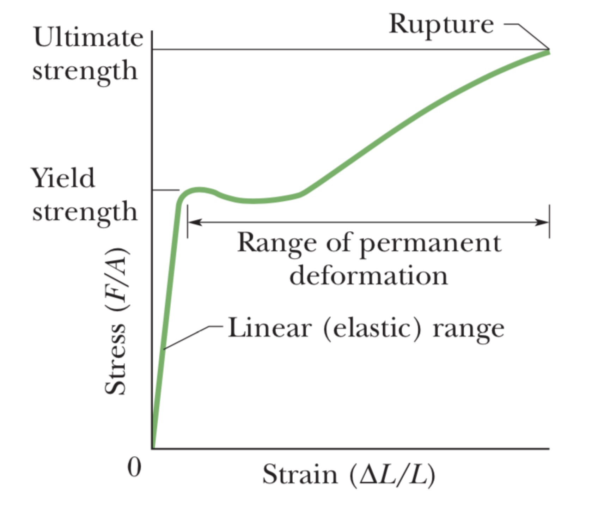

\-**Shearing 剪切**

Stress 应力：$`\frac{F}{A}`$ Def.: The force lies in the plane of the area

Strain 应变：$`\frac{\mathrm{\Delta}x}{L}`$

Shear Modulus (G) 剪切模量

> $`\frac{F}{A} = G\frac{\mathrm{\Delta}x}{L}`$ (应力 = G×应变)

SI-Unit 单位：N/m<sup>2</sup>

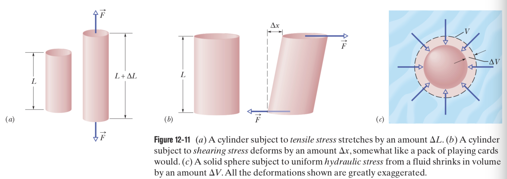

\-**Hydraulic Stress (p) 液压应力**

Def.: fluid pressure on the object 物体上的流体压力

**Strain 应变**

$`\frac{\mathrm{\Delta}V}{V}`$ Def.: <u>*absolute* value of change in volume</u> / <u>original volume</u>

**Bulk Modulus (B) 体积模量**

> · $`p = B\frac{\mathrm{\Delta}V}{V}`$
>
> SI-Unit 单位: N/m<sup>2</sup>


(In general, solids – with their rigid atomic lattices – are <u>less compressible</u> than liquids, in which the atoms or molecules are less tightly couple to their neighbors.)

(一般来说，固体——具有刚性原子晶格——比液体更不可压缩，其中原子或分子与其邻居的耦合程度较低。)

-Equilibrium and Elasticity

Stability 稳定性

Def.: The equilibrium of forces and torques on rigid objects

> 刚体上力和扭矩的<u>equilibrium平衡</u>
>
> & the elasticity of non-rigid body
>
> 非刚体的<u>elasticity弹性</u>

(The construction are supposed to be stable in spite of forces or torque acting on them)

(<u>尽管</u>有力或扭矩作用在结构上，结构应该是<u>stable稳定</u>的)

-Equilibrium 平衡

Equilibrium 平衡

Def.: $`\vec{P} = constant`$ and $`\ \vec{L} = constant`$

> The linear Momentum of its COM is constant
>
> The angular Momentum about its COM *<u>or about any other point</u>* , is also constant.

Static Equilibrium 静态平衡

Def.: $`\vec{P} = 0`$ and $`\ \vec{L} = 0`$

Not moving either in <u>translation</u> or in <u>rotation</u>

在平移或旋转中均不移动

Stable/ Unstable static equilibrium 稳定/不稳定静态平衡

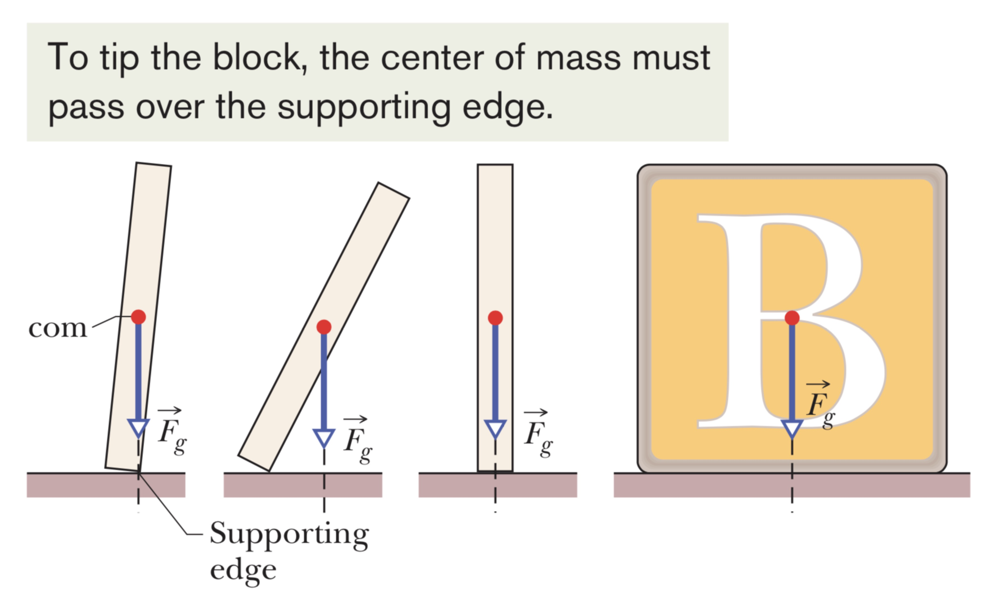

-Requirements of Equilibrium

Translational Equilibrium 平移平衡:

Balance of Forces 作用力平衡

$`\vec{P} = constant`$ <span class="mark">→</span> $`{\vec{F}}_{net} = \frac{d\vec{P}}{dt} = 0`$

> 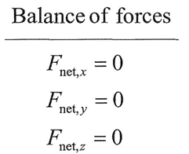
>
> 作用在物体上的所有外力的向量和必须为零

Rotational Equilibrium 旋转平衡:

Balance of Torques 力矩平衡

$`\vec{L} = constant`$ <span class="mark">→</span> $`{\vec{\tau}}_{net} = \frac{d\vec{L}}{dt} = 0`$

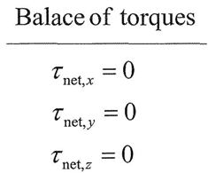

> 作用在物体上的所有外部扭矩的矢量和，measured about any possible point，必须为零

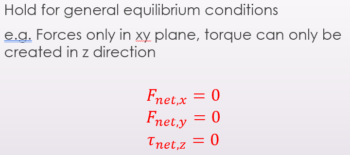

-The Center of Gravity 重心

**Gravitational Forces 引力**

> Def.: the vector sum of the gravitational forces acting on the individual elements (the atoms) of the body
>
> 作用在物体的各个elements（atoms）上的引力的矢量和

**Center of Gravity 重心**

The gravitational Force $`{\vec{F}}_{g}`$ on a body effectively acts at a single point

如果物体的所有element的$`\vec{g}`$ 都相同，则$`x_{cog} = x_{com}`$

(center of gravity (cog) ; center of mass (com).)

(???) Proof: $`\tau = x_{cog}\sum_{}^{}F_{gi} = \sum_{}^{}{x_{i}F_{gi}}`$ → $`x_{cog} = \frac{1}{M}\sum_{}^{}{x_{i}m_{i}} = x_{com}`$

(**is coincident with 重合**)

e.g. $`F_{l} + F_{r} - Mg - mg = 0`$

> 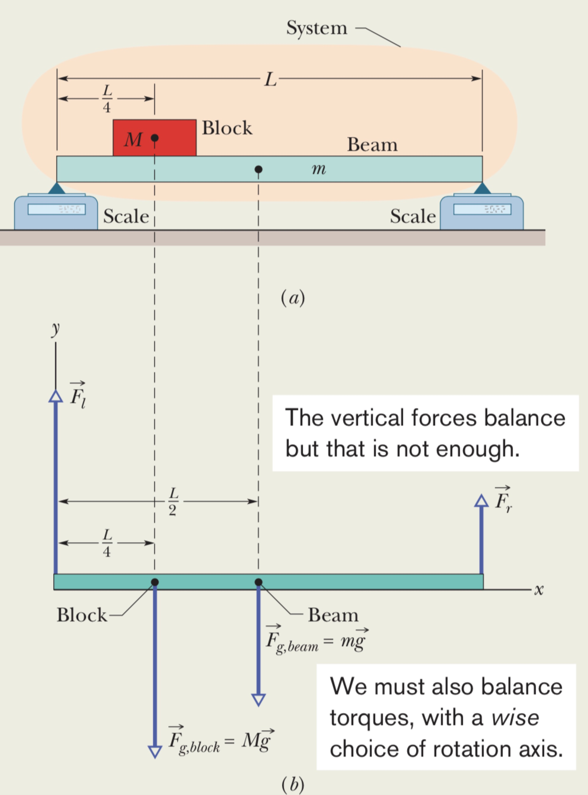
>
> Strategy in the solution:
>
> $`{\vec{\tau}}_{net} = 0`$ *&* $`{\vec{F}}_{net} = 0`$
>
> 在<u>*两个*未知数</u>的情况下，
>
> (???) chose the rotational axis to<u>消除</u>扭矩方程的<u>一个力</u>
>
> 只<u>*剩下一个*未知数</u>，可以通过<u>*力平衡方程*求解</u>

e.g. $`- {h\ F}_{w} + \frac{a}{2}\ Mg + \frac{a}{3}mg + 0{\ F}_{px} + 0{\ F}_{py}\  = 0`$

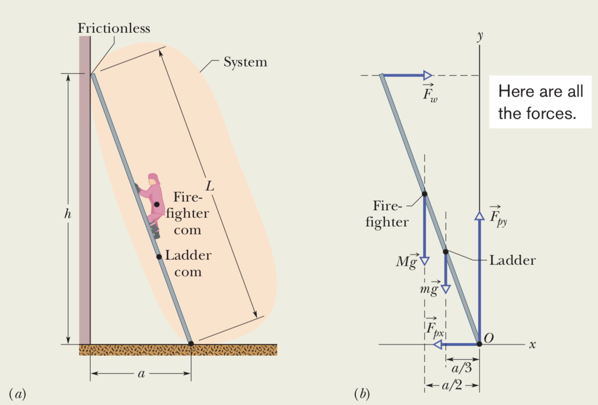 (??? O的选取 ???)

e.g. 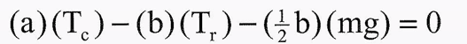 (设原点一次消除多个力矩)

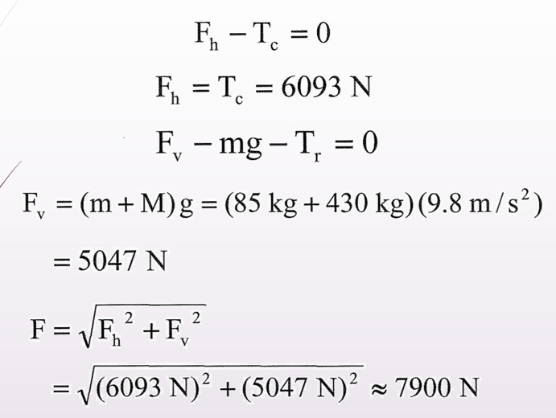 (通过<u>*力平衡方程*求解</u>)

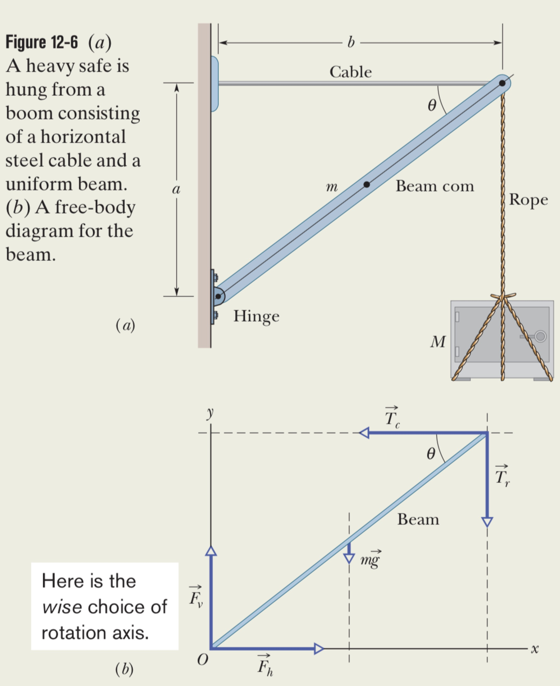

-Equilibrium in Non-Inertia Reference Frame 非惯性参考系中的平衡 (Additional Information)

**Pseudo-Force虚假力(/惯性力)**

Block A is accelerating $`{\vec{a}}_{AG}`$ towards right with respect to ground

> Block P is acceleration $`{\vec{a}}_{PG}`$ with respect to ground,
>
> and $`{\vec{a}}_{PA}`$ respect to A as well


> · $`{\vec{a}}_{PG} = {\vec{a}}_{PA} + {\vec{a}}_{AG}`$
>
> → $`m_{P}{\vec{a}}_{PG} = m_{P}{\vec{a}}_{PA} + m_{P}{\vec{a}}_{AG}`$
>
> → $`{\vec{F}}_{I} = {\vec{F}}_{NI} + m_{P}{\vec{a}}_{AG}`$
>
> → $`{\vec{F}}_{NI} = {\vec{F}}_{I} - m_{P}{\vec{a}}_{AG} = {\vec{F}}_{I} + {\vec{F}}_{o}`$ ($`{\vec{F}}_{NI} = {\vec{F}}_{I} + {\vec{F}}_{o}`$)
>
> → $`{\vec{F}}_{o} = - m_{P}{\vec{a}}_{AG}`$
>
> $`{\vec{F}}_{NI}`$: Non-inertia force acting on the object 作用在物体上的非惯性力
>
> $`{\vec{F}}_{I}`$: Inertia Force 惯性力：物体由于其质量和加速度而产生的力
>
> $`{\vec{F}}_{o}`$: Pseudo Force 虚假力：在非惯性参考系中出现的力，用来解释物体的运动

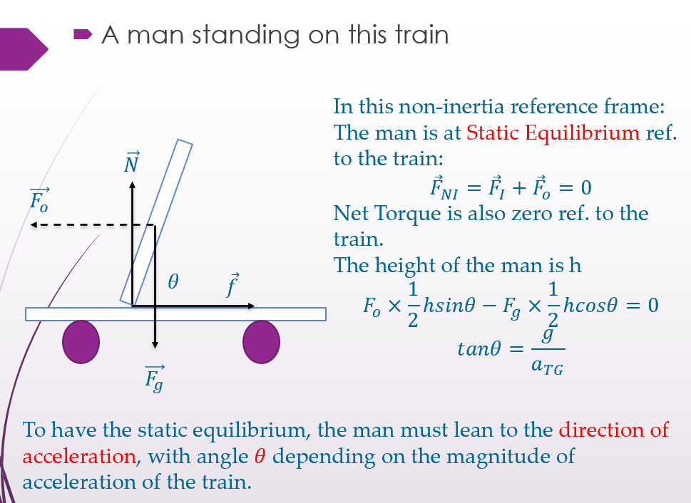

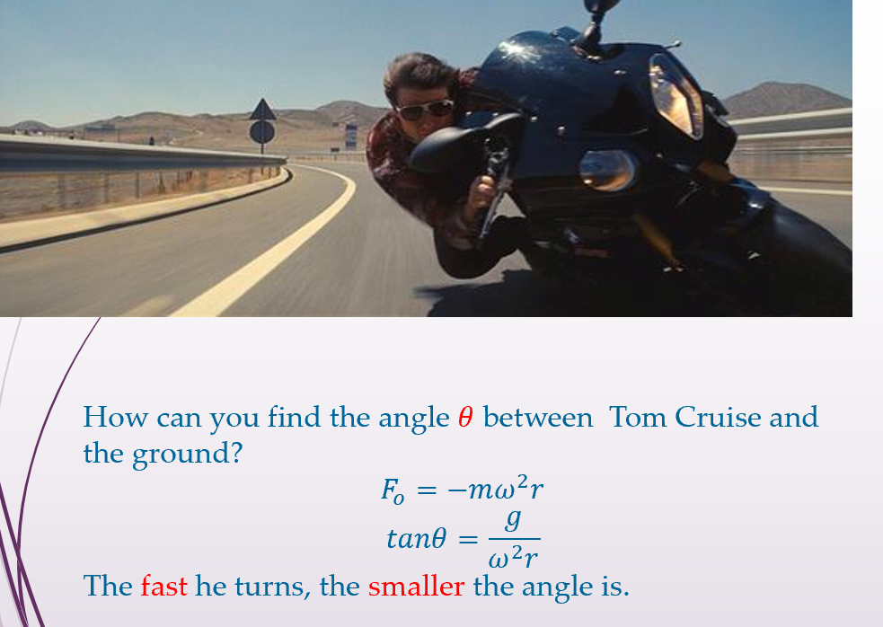

Ch13 Gravitation

-Gravitational Force

Black Holes

> Def.: The gravitational force between all the particles can cause the star to collapse in on itself and thereby to form a black hole.
>
> The G-Force at the surface is so strong that neither particles or light can escape from the surface.

-Newton’s Law of Gravitation 牛顿万有引力定律

Gravition

> Def.: This tendency of bodies to move toward one another is called gravitation.

Newton’s force law between two particles (which has no size)

The magnitude of the gravitational force:

· $`F = G\frac{m_{1}m_{2}}{r^{2}}`$

𝐺: the Gravitational constant

$`G = 6.67 \times 10^{- 11}\ N \bullet \frac{m^{2}}{{kg}^{2}}`$

> <span class="mark"></span>$`= 6.67 \times 10^{- 11}\ \frac{m^{3}}{{kg \bullet s}^{2}}`$

$`m_{1}`$ and $`m_{2}`$: the masses of each particle

> $`r`$: the separation between the two particles
>
> The gravitational force acting on Particle 1 due to particle 2:
>
> · $`\vec{F} = G\frac{m_{1}m_{2}}{r^{2}}\hat{r}`$
>
> $`\hat{r}`$: The radial unit vector:
>
> a dimensionless vector of magnitude 1 along the r axis.

·Not altered by other objects, even if they are located in between.  Cannot Shield!

\-**Shell Theorem**

A uniform spherical shell

(when attracts a particle that is outside the shell)

behave like a particle and the mass concentrated at the center

-Gravitation and **Principle of Superposition**

For n interacting particles,

> the gravitational forces (vector sum) on particle 1:
>
> (by **principle of superposition**)
>
> $`{\vec{F}}_{1,\ net} = {\vec{F}}_{12} + {\vec{F}}_{13} + {\vec{F}}_{14} + \ldots + {\vec{F}}_{1n} = \sum_{i = 2}^{n}{\vec{F}}_{1i}`$
>
> $`{\vec{F}}_{1,\ net}`$: the <u>net force</u> on particle 1 due to the <u>other particles</u>
>
> $`{\vec{F}}_{1n}`$: the force on particle 1 from <u>particle n)</u>
>
> (For <u>a group of particles</u>,
>
> **<u>find the net (or resultant) gravitational force</u>** <u>on</u> **<u>any one of them</u>**
>
> from the others)

↓

The gravitational force on a particle form a real (extended) object:

$`{\vec{F}}_{1} = \int_{}^{}{d\vec{F}}`$ (If:a uniform sphere/a spherical shell: can use the shell theorem)

-Gravitation <u>Near Earth’s Surface</u>

gravitational acceleration $`a_{g} = \frac{F}{m} = G\frac{M}{r^{2}}`$

free-fall acceleration g: $`{g \approx a}_{g}`$

differ from the $`a_{g}`$ for 3 reasons:

Earth’s mass is not uniformly distributed:

> 𝑔 varies from region to region over the surface
>
> Earth is not a sphere: ellipsoid
>
> If you moving at the sea level from the equator toward the north pole or south pole, 𝑔 increases since you are getting closer to the center of earth.
>
> Earth is rotating:
>
> Existence of centripetal acceleration

The <u>difference between</u> $`g\`$<u>and</u> $`a_{g}`$

$`F_{net},r = ma_{r} = mg = ma_{g} - m\omega^{2}R`$

> → $`g = a_{g} - \omega^{2}R`$
>
> (Free-fall acceleration = gravitational acceleration – centripetal acceleration)
>
> $`\omega^{2}R = {(\frac{2\pi\ rad}{24 \times 3600\ s})}^{2} \times 6.37 \times 10^{6}\ m = 0.034\ m/s^{2}\`$ \<\< $`g = 9.8\ m/s^{2}`$
>
> (neglecting the difference between
>
> <u>weight(</u>$`mg`$<u>)</u> and the <u>magnitude of the gravitational force(</u>$`ma_{g}`$<u>)</u>
>
> is also often justified.)

-Gravitation Inside Earth

A uniform shell of matter exerts no net gravitational force on a particle located inside it.

& The $`F_{g}`$ doesn't disappear  vectors’ sum is ZERO!

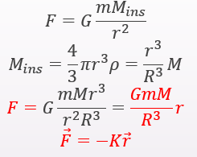

-Gravitation Potential Energy

$`U = mgy`$

For a two-particle system: $`U = \mathbf{-}\frac{GMm}{r}`$;

对于多个粒子，依次考虑每对粒子。计算该对的U，就好像其他粒子不存在一样。$`U = - (\frac{Gm_{1}m_{2}}{r_{12}} + \frac{Gm_{1}m_{3}}{r_{13}} + \frac{Gm_{2}m_{3}}{r_{23}})`$

Proof of U:

> $`W = \int_{R}^{\infty}{\vec{F}(r)} \bullet d\vec{r} = \int_{R}^{\infty}{F(r)dr\cos\varnothing} = - \int_{R}^{\infty}{F(r)dr}`$
>
> $`= - \int_{R}^{\infty}{\frac{GMm}{r^{2}}dr} = - GMm\int_{R}^{\infty}{\frac{1}{r^{2}}dr} = - \frac{GMm}{R}`$
>
> $`\mathrm{\Delta}U = - W`$
>
> → $`\mathrm{\Delta}U = U_{\infty} - U = 0 - U = - W`$
>
> ($`U = W = - \frac{GMm}{R}`$)

\- Potential Energy and Force

$`F = - \frac{dU}{dr} = - \frac{d}{dr}\left( - \frac{GMm}{r} \right) = - G\frac{Mm}{r^{2}}`$: The –ve sign indicate the force on mass m points radially inward, toward mass M

-Escape Speed

(Earth) escape speed $`v`$.

> $`K_{surface} + U_{surface} = K_{infinite} + U_{infinite} = 0 + 0 = 0`$
>
> $`\frac{1}{2}mv^{2} + \left( - \frac{GMm}{R} \right) = 0`$
>
> $`v = \sqrt{\frac{2GM}{R}}`$
>
> v不依赖于从行星发射弹丸的方向。如果弹丸在行星绕轴旋转时向发射场移动的方向发射，则更容易达到此速度。 → 利用地球的自转速度

-Kepler’s Laws

1\. 质量为m的行星在围绕太阳M为焦点的椭圆轨道上移动。

(For Earth’s orbit, 𝑒=0.0167)

2\. 等价于角动量守恒定律: 连接行星和太阳的线以相等的时间间隔扫除行星轨道平面相等面积: dA/dt 是恒定的。

$`\mathrm{\Delta}A \approx \frac{1}{2}r \cdot r\mathrm{\Delta}\theta = \frac{1}{2}r^{2}\mathrm{\Delta}\theta`$; (L与dA/dt同为常数)

角动量$`L = rp_{\bot} = rmv_{\bot} = rm(\omega r) = mr^{2}\omega`$

→ $`\frac{dA}{dt} = \frac{1}{2}r^{2}\omega = \frac{L}{2m}`$ (是连线的$`\omega`$)

semimajor axis半长轴 (a)

eccentricity离心率 (e)

3\. planetary orbit—period周期: $`T^{2} = \frac{{4\pi}^{2}}{GM}r^{3}`$

卫星: 动能$`K = \frac{1}{2}mv^{2} = \frac{GMm}{2r}`$; (circular orbit)

(总)机械能 $`E = K + U = - \frac{GMm}{2r} = - K`$

elliptical orbit椭圆轨道(半长轴为a) 上的卫星 的机械能: $`E = - \frac{GMm}{2a}`$

Principle of Equivalence等效原理: Gravitation and acceleration are equivalent. (?)

Ch14 Fluid

-(Def.:???) a substance that can flow.

1\. Fluids conform to the boundaries of any container in which we put them.

Because: a fluid <u>cannot sustain</u> a force that is <u>tangential</u> to its surface.

流体不能承受与其表面相切的力。

> (It cannot withstand a shearing stress.)（它不能承受剪切应力。）
>
> (Some materials (pitch) take a long time to conform to a container but are still fluids.)

2\. It can exert a force in the direction perpendicular to its surface.

3\. Don’t have **long-range crystalline lattice**. 没有**长程晶格**。

\-**Density (ρ)密度**

Def.: $`\rho = \frac{\mathrm{\Delta}m}{\mathrm{\Delta}V}`$ ; **Uniform Density**: $`\rho = \frac{m}{V}`$

Is a <u>scalar</u> with no direction.

\-**Pressure (p) 压强**

Def.: $`p = \frac{\mathrm{\Delta}F}{\mathrm{\Delta}A}`$ ; If the force is uniform over a flat area A: $`p = \frac{F}{A}`$

无论方向，value值 都相同

Is a <u>scalar</u> with no direction: only involve the Magnitude of the Force.

SI-Unit 单位: pascal -- 1 N/m<sup>2</sup> = 1 Pa

<span class="mark">一个大气压强</span> $`1\ atm = 1.01 \times 10^{5}Pa = 760\ torr = 14.7\ lb/{in}^{2}`$

(**<u>Torr</u>** is one of the widely used units是广泛使用的单位之一: 1 torr = 1 mm Hg)

**Pressure Sensor 压力传感器**: 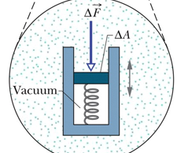

\-**Fluid at Rest 静止时的液体**

The **Hydrostatic pressure** are those caused by fluids at rest (air in the atmosphere, water in a tank) **静水压力**是由静止的流体（大气中的空气，水箱中的水）引起的压力

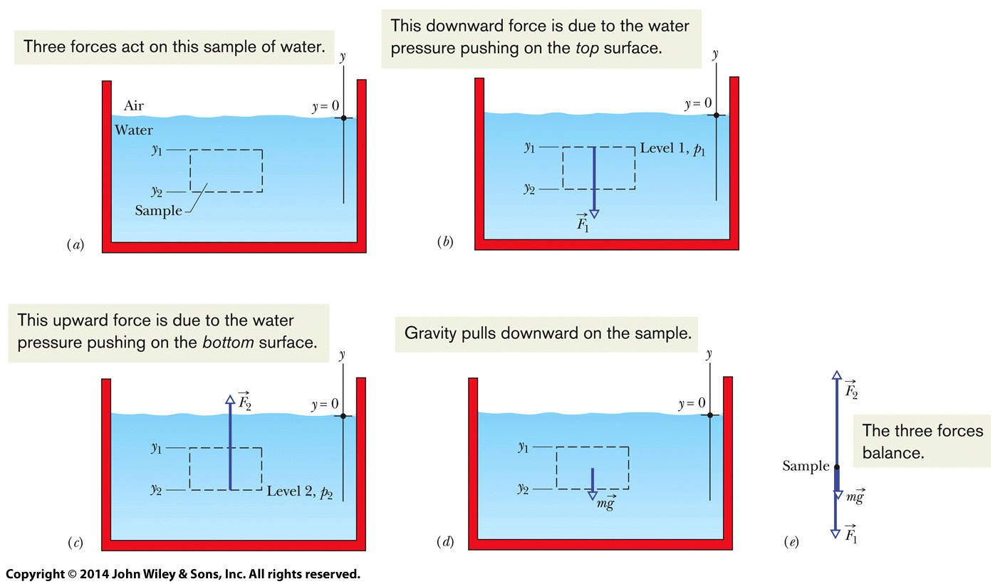

The water is in static equilibrium: $`F_{2} = F_{1} + mg`$ ; ($`F_{1} = p_{1}A`$ ; $`F_{2} = p_{2}A`$)

→Therefore: $`p_{2}A = p_{1}A + mg = p_{1}A + \rho Ag(y_{1} - y_{2})`$

> ↓$`p_{2} = p_{1} + \rho g(y_{1} - y_{2})`$

→$`p = p_{0} + \rho gh`$

The pressure at a point in a fluid in static equilibrium

> depends on the depth of that point
>
> but not on any horizontal dimension of the fluid or its container.

<u>处于 static equilibrium静态平衡 的流体</u>中某一点的压力 取决于<u>该点的</u>depth深度，

> 但 不取决于 流体或其容器的任何水平尺寸
>
> 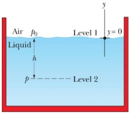any horizontal dimension of the fluid or its container

**Absolute pressure (p) 绝对压强**！

<u>For</u> <u>**atmospheric** pressure</u>: $`p = p_{0} - \rho_{fluid}gd`$

consists of two contributions:

p<sub>0</sub>: The pressure due to atmosphere 大气压强(通常是海平面处的(?))

<span class="mark">𝜌<sub>fluid</sub> g h</span>: The **gauge pressure表压** : (以上fluid为air)

> Def.: the difference between an absolute pressure and an atmospheric pressure 绝对压强 与 大气压强 之差 (指相对于大气压的压力差)

(d: The distance above level 1)

> （由于<u>空气</u>受重力作用，空气密度随高度增加而减小，因此气压也随高度增加而减小，因此此公式中使用<u>减号(-)</u>，但是果是计算<u>液体</u>内某一深度处的绝对压强，那么应该使用<u>加号(+)</u>）

-Measuring Pressure 测量压力

**Mercury Barometer 水银气压计**


大气压 $`p_{0} = \rho gh`$

𝜌: density of mercury

> h: the height difference between air-mercury interface and the mercury level
>
> p<sub>0</sub> Independent of the cross-sectional area
>
> h: is <u>numerically equal to **torr** pressure</u>
>
> only if Barometer is at a place where g has its standard value (9.80665 m/s2)
>
> and Temperature of mercury is 0°C

仅当 g为标准值 且 温度T=0℃ 时，h在数值上 等于 **torr** pressure

> -The Open-Tube Manometer 开管压力计
>
> 
>
> Measure the gauge pressure ($`p_{g}`$) of gas 测量气体的gauge pressure表压
>
> $`p_{g} = p - p_{0} = \rho gh`$
>
> 𝜌: Liquid Density
>
> 1\. p<sub>g</sub>与h成正比
>
> 2\. p<sub>g</sub>可正可负：取决于p与p<sub>0</sub>的相对大小

\-**Pascal’s Principle 帕斯卡原理**

govern (v.)治理

Governs the <u>transmission of pressure</u> through an incompressible fluid

控制 不可压缩流体 的 压力的传递

A change in the pressure applied to an enclosed incompressible fluid

施加在封闭的不可压缩流体上的 压力的变化

> is transmitted undiminished to every portion of the fluid and to the walls of its container.
>
> 会毫不减弱地 传递到 *<u>流体的</u>每个部分 <u>及其 容器壁</u>*。
>
> The pressure at any point in the liquid (p):
>
> $`p = p_{ext} + \rho gh`$
>
> →$`\mathrm{\Delta}p = p - \rho gh = p_{ext}`$ : The pressure change is independent of h
>
> 

e.g. -**Hydraulic Lever 液压杆**

使用液压杆，在给定距离上 施加的 给定力

> 可以转换为 在较小距离上 施加的 更大力
>
> · $`\mathrm{\Delta}p = \frac{F_{i}}{A_{i}} = \frac{F_{o}}{A_{o}}`$
>
> → $`F_{o} = F_{i}\frac{A_{o}}{A_{i}}`$
>
> · $`V = A_{i}d_{i} = A_{o}d_{o}`$
>
> → $`d_{o} = d_{i}\frac{A_{i}}{A_{o}}`$
>
> → $`W = F_{o}d_{o} = F_{i}\frac{A_{o}}{A_{i}} \times d_{i}\frac{A_{i}}{A_{o}} = F_{i}d_{i}`$

\-**Archimedes’ Principle 阿基米德原理**

**Buoyant force 浮力**

Def.: the net upward force on a submerged object by the fluid in which it is submerged

流体 对 浸没在其中 的 物体 的 <u>净</u>向上力

comes from the increase in pressure with depth

来自 压力 随深度 的 增加

> 
>
> 当物体完全或部分浸没在流体中时，来自周围流体的浮力$`{\vec{F}}_{b}`$作用在物体上。
>
> 力是向上的，<u>其大小等于 被物体置换的流体的重量</u>$`\ m_{f}\ g`$。
>
> The buoyant force on a body: $`F_{b} = m_{f}\ g`$
>
> -Floating 漂浮
>
> When a body floats in a fluid,
>
> $`F_{b} = F_{g} = m_{f}g`$

\-**<u>Apparent Weight 表观重量 in a Fluid</u>**

$`{weight}_{app} = weight - F_{b}`$

<span class="mark">(apparent weight表观重量) = (actual weight实际重量) – (buoyant force浮力)</span>

-Ideal Fluids in Motion

4 Assumptions about ideal fluid 关于 理想流体 的 4个假设:

**Steady Flow, Incompressible Flow, Nonviscous Flow, Irrotational Flow**

**稳态流、不可压缩流、非粘性流、无旋流**

1\. **Steady Flow 稳态流**:

The velocity of the moving fluid at any fixed point doesn't change with time

<u>任何固定点的 移动流体 的 速度 不随时间变化</u>

2\. **Incompressible Flow 不可压缩流**:

> As for fluids at rest,
>
> that our ideal fluid is incompressible;
>
> that is, its density has a constant, uniform value.

静止的理想流体 : 是不可压缩的: <u>密度是恒定的、均匀的</u>

> 3\. **Nonviscous Flow 非粘性流**:
>
> No **viscous drag force** 没有**粘性阻力**
>
> ↓ **Viscosity** of a fluid is a measure of how resistive the fluid is to flow
>
> ↓ 流体的**粘度** 是 衡量 流体流动阻力 的 量度
>
> No **resistive force** due to **viscosity** <u>没有由于**粘性**而产生的**阻力**</u>。

4\. **Irrotational Flow 无旋流**:

> In **irrotational flow**, the test body
>
> may (or may not) moves in a circular path,
>
> will **not** rotate about its COM. (like Ferris Wheel)
>
> 在无旋流中，试验物体:
>
> · 可能沿着圆形轨迹移动
>
> · 可能不移动
>
> 但它不会绕着其质心旋转（就像摩天轮一样）。
>
> ( 无旋流（Irrotational flow）是指流体中任意一点的旋度都为零的流动，这意味着流体中的任何一点都没有局部旋转。在这种流动中，流体微团不会绕着自己的质心旋转。因此，在上面这句话中，即使试验物体沿着圆形轨迹移动，它也不会绕着自己的质心旋转。 )
>
> (粘度（Viscosity）
>
> 是流体内部阻力的一种度量，表示流体内部层与层之间的摩擦力。
>
> 粘性（Viscosity）
>
> 是指流体内部分子之间的粘附力，它是导致流体粘度的原因。
>
> 简单来说，粘度是流体的一种物理性质，而粘性是导致这种性质的原因。
>
> 在英文中，粘度和粘性都可以用 Viscosity 来表示。 )

\-**Streamline (n.)流线 ( , (adj.)流线型(的) )**

Def.: the <u>path</u> that a tiny element of the fluid would take as the fluid flows.

流体流动时，流体微团所经过的路径

· The direction of the velocity is tangent to a streamline. (流体的)速度的方向与流线相切

· Two streamlines can never intersect.( (任意)两条流线 永不 相交)

(如果两条流线相交，

> 在它们交叉点的元素将同时具有两个不同的速度：这是不可能的。)

-The Equation of Continuity

Incompressible flow: the volume flow rate through any cross-section must be constant

``` math
\mathrm{\Delta}V = A_{1}v_{1}\mathrm{\Delta}t = A_{2}v_{2}\mathrm{\Delta}t
```

Equation of Continuity:

``` math
A_{1}v_{1} = A_{2}v_{2}
```

Volume Flow Rate $`R_{V}`$

``` math
R_{V} = Av = a\ constant
```

> Volume past a given point per unit time
>
> SI-unit: m<sup>3</sup>/s

Mass Flow Rate $`R_{m}`$

``` math
R_{m} = \rho Av = a\ constant
```

> SI-unit: kg/s

-Bernoulli’s Equation

Ideal fluid flows at a steady rate

> · $`p_{1} + \frac{1}{2}\rho v_{1}^{2} + \rho gy_{1} = p_{2} + \frac{1}{2}\rho v_{2}^{2} + \rho gy_{2}`$

Fluid’s Kinetic energy density:

> · $`\frac{1}{2}\rho v^{2}`$
>
> Bernoulli’s Equation
>
> · $`p + \frac{1}{2}\rho v^{2} + \rho gy = constant`$
>
> If $`v_{1} = v_{2} = 0`$
>
> · $`p_{2} = p_{1} + \rho g{(y}_{2} - y_{1})`$

If $`y_{1} = y_{2}`$

> · $`p_{1} + \frac{1}{2}\rho v_{1}^{2} = p_{2} + \frac{1}{2}\rho v_{2}^{2}`$

-Lift of Airplane

$`p + \frac{1}{2}\rho v^{2} + \rho gy = constant`$

smaller air pressure, faster air speed

Ch15 Oscillations

\-**Oscillation 振动**

Def.: Any motion that repeats itself in a periodic manner

(Objects move back and forth repeatedly)

e.g. **Pendulum (n.)单摆**


The particle oscillating about the origin of an x axis,

repeatedly going left and right by identical amount.


**Frequency (f) 频率**

Def.: the number of times per second that it completes a full oscillation (a cycle).

Unit: Hz (赫兹) ($`1\ hertz = 1\ Hz = 1\ oscillation\ per\ second = 1\ s^{- 1}`$)

**Period (T) 周期**

Def.: the time for one full cycle

Unit: s (秒)

· $`T = \frac{1}{f}`$

\-**Simple Harmonic Motion (SHM) 简谐运动**

Def.: <u>the motion</u> is a **sinusoidal function正弦函数** of time t

> (可能可写为sine/cosine函数的形式)
>
> the motion of a particle
>
> when the force acting on it
>
> is proportional to the particle’s displacement but in opposite direction.
>
> (作用在粒子上的力 与 粒子的位移 成正比 但 方向相反 时粒子的运动。)

<u>Displacement (or position) function 位移函数: (with respect to time t)</u>

> $`x(t) = x_{m}\cos(\omega t + \varnothing)`$ <span class="mark"> or</span> $`x(t) = x_{m}\sin(\omega t + \varnothing)`$
>
> 

**Amplitude振幅 (**$`\mathbf{x}_{\mathbf{m}}`$**)**

The maximum <u>distance of displacement from</u> the **equilibrium point**

距**平衡点**的最大<u>位移距离</u>

> Unit: m

**Angular Frequency角频率 (𝜔)**

(Related with Period of Motion T)

> $`\omega = \frac{2\pi}{T} = 2\pi f`$
>
> Unit: rad/s

**Phase constant相位常数 (**$`\mathbf{\varnothing}`$**)**

Depends on initial condition

> (e.g., When t=0, if $`x = x_{m}\`$, then $`\varnothing = 0\ rad`$)
>
> 
>
> Unit: rad

**Phase 相位 (**$`\mathbf{\omega t + \varnothing}`$**)**


The Velocity of SHM

(!! varies in magnitude and direction !)

> Velocity as a function of t:
>
> · $`\mathbf{v}\left( \mathbf{t} \right) = \frac{dx(t)}{dt}`$
>
> · $`= \frac{d}{dt}\lbrack x_{m}\cos(\omega t + \varnothing)\rbrack`$
>
> · $`\mathbf{=}\mathbf{- \omega x}_{\mathbf{m}}\mathbf{sin}\left( \mathbf{\omega t + \varnothing} \right)\ \ \ (\ \mathbf{=}\mathbf{- v}_{\mathbf{m}}\mathbf{\sin}\left( \mathbf{\omega t + \varnothing} \right)\ )`$
>
> $`v_{m} = {\omega x}_{m}`$: Velocity amplitude
>
> ( <u>The <span class="mark">**phase shift** of the velocity is **π/2**</span></u>,
>
> making the cosine to a negative sine function )
>
> When 𝑥=0, the speed v is maximized.

The Acceleration of SHM

(!! varies in magnitude and direction !)

Acceleration as a function of t:

> · $`a(t) = \frac{dv(t)}{dt}`$
>
> · $`= \frac{d}{dt}\lbrack{- \omega x}_{m}\sin(\omega t + \varnothing)\rbrack`$
>
> · $`= - \omega^{2}x_{m}\cos(\omega t + \varnothing)\ \ \ \ (\ \mathbf{=}\mathbf{- a}_{\mathbf{m}}\mathbf{\cos}\left( \mathbf{\omega t + \varnothing} \right)\ )`$
>
> · $`= - \omega^{2}x(t)`$
>
> (The dynamical equation of the particle is $`\frac{d^{2}x}{dt^{2}} + \omega^{2}x = 0`$)
>
> $`a_{m} = \omega^{2}x_{m}`$: Acceleration Amplitude
>
> ( <u>The <span class="mark">**phase shift** of the acceleration is **π**</span></u>,
>
> making the cosine to a negative cosine function )
>
> The particle’s acceleration a(t) always <u>opposite</u> its displacement x(t)
>
> (The magnitude of 𝑎 and 𝑥 are always related by a constant 𝜔^2)
>
>  ($`\varnothing = 0`$)

-The <u>Force Law</u> for SHM

Newton’s 2nd Law & Hooke’s Law

> The **restoring force 回复力** of the particle：
>
> · $`F = ma\ \ \ \  = \ \ \ \  - m\omega^{2}x = - kx`$ ($`k = m\omega^{2}`$)

SHM: 作用在粒子上的力 与 粒子的位移 成正比 但方向相反

· $`k = m\omega^{2}`$ :

$`\omega = \sqrt{\frac{k}{m}}`$ $`T = 2\pi\sqrt{\frac{m}{k}}`$

> → <span class="mark">k↑，𝜔↑，T↑</span>
>
> Proof:
>
> <u>Let</u> $`\mathbf{x = A}\mathbf{e}^{\mathbf{i(\omega t + \varnothing)}}`$ ($`\ e^{i\theta} = cos\theta + i\ sin\theta\`$) ($`A = x_{m}`$)
>
> → $`v(t) = \frac{dx}{dt} = i\omega Ae^{i(\omega t + \varnothing)}`$
>
> →→ $`a(t) = \frac{d^{2}x}{dt^{2}} = - \omega^{2}Ae^{i(\omega t + \varnothing)}`$
>
> Put it back to $`ma + kx = m\frac{d^{2}x}{dt^{2}} + kx = 0`$:
>
> $`- \omega^{2}Ae^{i(\omega t + \varnothing)} \times m + kAe^{i(\omega t + \varnothing)} = 0`$
>
> → $`\omega = \pm \sqrt{\frac{k}{m}}`$ →→ $`\omega = \sqrt{\frac{k}{m}}`$

**<u>Linear</u> simple harmonic oscillator 线性简谐振子**

> *<u>Linear</u>* : indicates that: $`F`$ is proportional to $`x`$ to the first power
>
> F与x的一次幂成正比 ($`\mathbf{F} = ma\mathbf{= - kx}\ \ \ \  = - m\omega^{2}x`$)
>
> 

\-<u>Energy</u> in SHM

The **<u>potential energy</u>** of a <u>linear oscillator</u> SHM中的 势能:

$`U(t) = \frac{1}{2}kx^{2}`$

> $`= \frac{1}{2}kx_{m}^{2}\ {\ cos}^{2}(\omega t + \varnothing)`$ (associated entirely with the spring)
>
> is **maximized**
>
> when the block is at full extension of the spring
>
> ($`\mathbf{\omega t + \varnothing = \pm k\ \pi}`$**<u>)</u>**

The **<u>kinetic energy</u>** of a <u>linear oscillator</u> SHM中的 动能:

$`K(t) = \frac{1}{2}mv^{2}`$

> $`= \frac{1}{2}m\omega^{2}x_{m}^{2}\sin^{2}(\omega t + \varnothing)`$
>
> $`= \frac{1}{2}kx_{m}^{2}{\ \ sin}^{2}(\omega t + \varnothing)`$
>
> is **maximized**
>
> when the block is moving through the mid-point of the oscillation
>
> ($`\mathbf{\omega t + \varnothing = \pm k\ \pi/2}`$**<u>)</u>**

The **<u>mechanical energy</u>** of a <u>linear oscillator</u> SHM中的 机械能:

> $`E = U(t) + K(t)`$
>
> $`= \frac{1}{2}kx_{m}^{2}\left\lbrack \cos^{2}(\omega t + \varnothing) + \sin^{2}(\omega t + \varnothing) \right\rbrack`$
>
> $`= \frac{1}{2}kx_{m}^{2}`$

**<u>The Total Energy</u>** is **<u>Conserved</u>** **<u>(</u>**$`\mathbf{E =}\frac{\mathbf{1}}{\mathbf{2}}\mathbf{k}\mathbf{x}_{\mathbf{m}}^{\mathbf{2}}`$**<u>)</u>**

仅取决于初始条件（k和x<sub>m</sub>）

> Only conservative forces present,
>
> hence the total energy is conserved.
>
> <u>SHM中</u>，只有**<u>守恒力</u>**，因此**<u>能量守恒</u>**

-Rules to Distinguish SHM


\-**Angular Simple Harmonic Oscillator 角谐振子**

**Torsion Pendulum 扭摆**


with a **<u>suspension wire</u>** instead of a spring

<u>rotate the **disk**</u> by some <u>angular displacement 𝜃</u>

> <u>from its rest position</u> and <u>release it</u>,
>
> it will <u>oscillate about that position</u> in **angular simple harmonic motion**

**Restoring Torque (τ) 回复力矩**

$`\tau = - \kappa\theta`$

**𝜅: Torsion constant 扭转常数**

depends on the <u>length</u>, <u>diameter</u>, and <u>material</u>

取决于<u>(wire)长度</u>、<u>(disk)直径</u>、<u>(disk)材料</u>

-Angular Simple Harmonic Motion 角谐振子运动

$`\mathbf{T = 2\pi}\sqrt{\frac{\mathbf{I}}{\mathbf{\kappa}}}`$ ($`\omega = \sqrt{\frac{\kappa}{I}}`$) (Similarly: (Linear…: )$`\ T = 2\pi\sqrt{\frac{m}{k}}`$)

I: <u>rotational inertia</u> of the <u>oscillating disk</u>

Find I from T ←→ Find T from I

-The **Simple Pendulum 简单摆(单摆)**

Def.: a **particle** of <u>mass m</u>

> is <u>*suspended* from</u>
>
> one end of an <u>unstretchable(rigid?) massless</u> **string** of <u>length L</u>
>
> that is <u>fixed at the other end</u>.


The **restoring torque (τ)** **回复力矩**:

> (<u>when</u> its <u>angular displacement</u> is $`\theta`$) (随所在$`\theta`$改变)

$`\mathbf{\tau\ } = \ \mathbf{- L}\left( \mathbf{mg\ sin\theta} \right) = \tau = I\mathbf{\alpha}`$ (? ← F<sub>g</sub> = mg ??)

↓

The **angular acceleration (α)** **角加速度**: (随所在$`\theta`$改变)

$`\mathbf{\alpha\  = \ }\frac{\mathbf{\tau}}{\mathbf{I}} = - \frac{mgL}{I}sin\theta \approx \mathbf{-}\frac{\mathbf{mgL}}{\mathbf{I}}\mathbf{\theta} = \alpha = - \mathbf{\omega}^{2}\theta`$

> ↓ (↑ $`\lim_{\theta \rightarrow 0}{\frac{sin\theta}{\theta} = 1}`$) → it is a SHM if it <u>swings through</u> only a <u>small angle</u>.

The **angular frequency (ω)** **角频率** (恒定，不变)

$`\mathbf{\omega}\  = \ \sqrt{\frac{\alpha}{- \theta}} = \sqrt{\frac{\mathbf{mgL}}{\mathbf{I}}} = \omega = \frac{2\pi}{\mathbf{T}}`$

The **period (T) 周期** (恒定，不变)

$`\mathbf{T}\  = \ \frac{2\pi}{\omega} = \mathbf{2\pi}\sqrt{\frac{\mathbf{I}}{\mathbf{mgL}}}`$

\* **Rotational inertia** **旋转惯量:** $`\mathbf{I} = mL^{2}`$<u>, **for Simple Pendulum**</u> (We have know)

→ $`T = 2\pi\sqrt{\frac{L}{g}}`$

($`\alpha = - \frac{mgL}{mL^{2}}\theta = - \frac{g}{L}\theta`$)

($`\omega = \sqrt{\frac{g}{L}}`$)

-Small Angle Approximation

Assume that θ\<\< 1 and use the approximation sinθ≈θ.

→ If we keep θ \< 10°, we make less than 1 % error

\-**Physical Pendulum 物理摆**

Complicated distribution of mass.


(For) Small Angle Swing:

The **period (T) 周期**

$`\mathbf{T} = \mathbf{2\pi}\sqrt{\frac{\mathbf{I}}{\mathbf{mgh}}}`$

> <u>**h**: the distance from the COG(重心) to the pivot point O(旋转轴所在点).</u>
>
> (点O(旋转轴所在点)不一定是悬挂的点! !!, 可能是物体上任意一点)
>
> (Only <u>difference with</u> <u>simple pendulum</u> (where **h** is the length **L** of the rope))

**I**: the rotational inertia of the pendulum about O.

e.g.: uniform rod of length L

$`I = I_{com} + Mh^{2} = \frac{1}{12}ML^{2} + Mh^{2}`$

$`T = 2\pi\sqrt{\frac{I}{Mgh}} = 2\pi\sqrt{\frac{\frac{1}{12}ML^{2} + Mh^{2}}{Mgh}} = 2\pi\sqrt{\frac{\frac{1}{12}L^{2} + h^{2}}{gh}}`$

→ <u>Smallest **period (T)**</u> (一致柱体的<u>**周期最小**时</u>): when $`h = \frac{L}{2\sqrt{3}}`$

> → **Find** $`\mathbf{g}`$ <u>at a particular location</u> <u>by measuring</u> $`L\`$<u>and</u> $`T`$.
>
> 通过测量L和T，得到特定位置上的g
>
> e.g. if $`h = \frac{1}{2}L`$, $`T = 2\pi\sqrt{\frac{\frac{1}{12}L^{2} + {\frac{1}{4}L}^{2}}{g\frac{1}{2}L}} = 2\pi\sqrt{\frac{2L}{3g}}`$ → $`g = \frac{8\pi^{2}L}{3T^{2}}`$

**Find <u>the rotational inertia (I)</u>** <u>of different shapes about pivot point</u>

$`I_{com} + Mh^{2} = \frac{T^{2}Mgh}{{4\pi}^{2}}`$

e.g.

> 

**Center of Oscillation 振动中心**

> Def.: a point **<u>on the suspension line</u>** of a compound pendulum
>
> where, if the **<u>entire mass</u>** of the pendulum were **<u>concentrated</u>** there,
>
> the oscillations would have the **<u>same duration (period周期)</u>** as previously.


> ( if you were to imagine that
>
> all of the **<u>mass</u>** of the stick were **<u>concentrated</u>** at point P,
>
> then the stick would <u>still oscillate</u> with the **<u>same period</u>** as it did when it was suspended from point O. )
>
> <u>**Point P** would be **different**</u> <u>for a **different suspension choice**.</u>

-Simple Harmonic Motion & Uniform Circular Motion

简谐运动与匀速圆周运动

Uniform Circular Motion → $`P'`$ moves at <u>constant angular speed</u> $`\omega`$,

> with <u>initial angular position</u> at $`\varnothing`$

→ Simple harmonic motion:

the <u>**projection** of uniform circular motion</u>

> <u>on</u> a <u>diameter</u> of the circle in which the circular motion occurs.


On 𝑥 axis: ($`\mathbf{R =}\mathbf{x}_{\mathbf{m}}`$)

UCM: $`\theta(t) =`$ $`\omega t + \varnothing`$

> → SHM: $`x(t) = x_{m}\cos\lbrack\theta(t)\rbrack = x_{m}\cos(\omega t + \varnothing)`$

UCM: $`v = \omega R = \omega x_{m}`$

→ SHM: $`v_{x} = v(t) = - \omega x_{m}sin\theta = {- \omega x}_{m}\sin(\omega t + \varnothing)`$

UCM: $`a = a_{r} = \frac{v^{2}}{R} = \omega^{2}R = \omega^{2}x_{m}`$

→ SHM: $`a_{x} = a(t) = - \omega^{2}x_{m}cos\theta = - \omega^{2}x_{m}cos(\omega t + \varnothing)`$

\-**<u>Damped</u> Simple Harmonic Motion <u>阻尼</u>简谐运动**

**Damped 阻尼的**

Def.: the <u>motion of an oscillator</u> is <u>reduced by</u> an <u>external force</u>,

> the <u>oscillator</u> and <u>its motion</u> are said to <u>be damped</u>.

**Damping Force** $`{\vec{\mathbf{F}}}_{\mathbf{d}}`$ **阻尼力**

Direction: Opposite direction with the velocity 𝑣

Magnitude: $`F_{d} = - bv`$

𝑏: damping constant 阻尼常数

> Depends on the characteristics of
>
> both 1. the vane叶片的特性 & 2. the liquid液体的特性

SI-unit单位: kg/s

e.g.

> 

\-**Damped Oscillation 阻尼振荡**

Newton’s Second Law牛顿第二定律:

> <u>ignore the gravitational force</u> (???)

$`F_{net} = F_{d} + F_{spring} = ma`$

→ $`- bv - kx = ma`$ → $`m\frac{dx^{2}}{dt^{2}} + b\frac{dx}{dt} + kx = 0`$

→→ $`\mathbf{x(t) =}\mathbf{x}_{\mathbf{m}}\mathbf{e}^{\mathbf{-}\frac{\mathbf{bt}}{\mathbf{2m}}}\mathbf{\cos}\mathbf{(}\mathbf{\omega}^{\mathbf{'}}\mathbf{t + \varnothing)}`$

> e.g.
>
> 


$`\omega = \sqrt{\frac{k}{m}}`$: 阻尼(常数)(b)为0时, (固有?的)角频率


\*:

$`\omega' = \sqrt{\frac{k}{m} - \frac{b^{2}}{{4m}^{2}}}`$

$`E(t) \approx \frac{1}{2}kx_{m}^{2}e^{- \frac{bt}{m}}`$


-Forced Oscillation and Resonance

Forced Oscillation (/Driven Oscillation)

Def.: Oscillations that are <u>subject to</u> <u>a(?)</u> <u>**periodic** applied force</u>.


$`x(t) = x_{m}cos(\omega_{d}t + \varnothing)`$

$`\mathbf{\omega}_{\mathbf{d}}`$: **Driving frequency驱动频率**:

> the **driving force**的angular frequency

**Natural frequency固有频率** $`\mathbf{\omega =}\sqrt{\frac{\mathbf{k}}{\mathbf{m}}}`$

Resonance共振: $`\omega_{d} = \omega`$时，x<sub>m</sub>最大、v<sub>m</sub>最大

-Additional Information-Forced Oscillation for Linear Oscillator

> Newton’s 2<sup>nd</sup> Law and Hooke’s Law

``` math
F_{net} = ma
```

> When the oscillator is driven with a sinusoidal Force

``` math
F(t) = F_{0}\cos(\omega_{d}t)
```

> Then,

``` math
F(t) + ( - kx) = ma
```

``` math
m\frac{d^{2}x}{dt^{2}} + kx = F_{0}\cos(\omega_{d}t)
```

> The general solution is

``` math
x_{g} = x_{c} + x_{d}
```

- Where, $`x_{c}`$ is the (complementary) solution to the equation $`m\frac{d^{2}x}{dt^{2}} + kx = 0`$

- Let’s assume

``` math
x_{c} = x_{0}\cos\omega_{0}t
```

- Where $`\omega_{0}`$ is the natural angular frequency

``` math
\omega_{0} = \sqrt{\frac{k}{m}}
```

- Let’s assume

``` math
x_{d} = Acos\omega_{d}t
```

``` math
\frac{d^{2}x}{dt^{2}} = - A\omega_{d}^{2}\cos\omega_{d}t
```

- Put it back into the differential equation

``` math
m\frac{d^{2}x}{dt^{2}} + kx = F_{0}\cos(\omega_{d}t)
```

``` math
m \times - A\omega_{d}^{2}\cos\omega_{d}t + k \times Acos\omega_{d}t = F_{0}\cos(\omega_{d}t)
```

``` math
\left( k - m\omega_{d}^{2} \right)A = F_{0}
```

``` math
A = \frac{F_{0}}{k - m\omega_{d}^{2}} = \frac{F_{0}}{m(\omega_{0}^{2} - \omega_{d}^{2})}
```

- Thus,

``` math
x_{g} = x_{c} + x_{d} = x_{0}\cos\omega_{0}t + \frac{F_{0}}{m(\omega_{0}^{2} - \omega_{d}^{2})}\cos\omega_{d}t
```

-Additional Information-Driven Damped Angular Harmonic Oscillations

- Example shown in the experiment

``` math
\kappa = \frac{\tau}{\theta}
```

``` math
\frac{d^{2}\theta}{dt^{2}} + \left( \frac{b}{I} \right)\frac{d\theta}{dt} + \left( \frac{\kappa}{I} \right)\theta = 0
```

- The solution to this equation is a damped sine wave: 

``` math
\theta = \theta_{o}e^{- \left( \frac{b}{2I} \right)t}sin(\omega t + \varphi)
```

-  where the angular frequency is given by

``` math
\omega = \sqrt{\frac{\kappa}{I} - \frac{b^{2}}{4I^{2}}}
```

- Continued:  

- When the damped oscillator is driven with a sinusoidal torque, the differential equation describing its motion is

``` math
I\frac{d^{2}\theta}{dt^{2}} + b\frac{d\theta}{dt} + \kappa\theta = \tau_{o}\cos(\omega t)
```

- The solution to this equation is

``` math
\theta = \frac{\frac{\tau_{o}}{I}}{\sqrt{\left( \omega^{2} - \omega_{o}^{2} \right)^{2} + \left( \frac{b}{I} \right)^{2}\omega^{2}}}\cos(\omega t - \varphi)
```

- where the amplitude of the oscillation is

``` math
\theta_{o} = \frac{\frac{\tau_{o}}{I}}{\sqrt{\left( \omega^{2} - \omega_{o}^{2} \right)^{2} + \left( \frac{b}{I} \right)^{2}\omega^{2}}}
```

and

``` math
\varphi = \tan^{- 1}\left( \frac{\omega b/I}{\omega_{o}^{2} - \omega^{2}} \right)
```

(Forced oscillations at resonant frequency may result in rupture or collapse)

Ch16 Waves-I

-Wave

Def.(?): A wave can be any kind of oscillation that travels in space and transfers energy from one place to another place.

-Types of Waves

Electromagnetic Waves

Follow Maxwell’s Equation

Require no medium to travel

and all travel at the same speed 𝑐=299792458 𝑚/𝑠 in vacuum

e.g.: Visible Light, radio waves, X-ray and etc.

Matter Waves:

Follow Schrodinger’s Equation and Dirac’s Equation

> e.g.: Particles in quantum mechanics, like electrons, protons, and other fundamental particles, and even atoms and molecules.

Mechanical Wave:

> Governed by Newton’s Law

Exist only within a materials Medium

> e.g.: Water Wave, Sound Wave, and Seismic Wave;
>
> Transverse and Longitudinal waves:

-Transverse Waves 横波

Def.: has its <u>oscillations perpendicular to</u> the <u>direction the wave moves</u>.

\* The <u>materials</u> are <u>not moves</u> from one end to another.

\- Wave Equation

$`y = h(x,t)`$

y: the transverse displacement of any string element

> x: position of the element along the string at time t

 $`h\left( x' \right) = h(x - vt)`$

> →→ $`y(x,t) = h(x \pm vt)`$ → $`\frac{\partial^{2}y}{\partial x^{2}} = \frac{1}{v^{2}}\frac{\partial^{2}y}{\partial t^{2}}`$
>
> · $`y(x,t) = h(kx \pm \omega t)`$,
>
> h: represents any function

Periodic Wave

Def.: <u>*Spatially* repeats</u> its shape <u>along the direction of wave’s travel</u>.


Wavelength (λ) 波长

> Def.: The <u>*minimum* distance</u> (in parallel to wave’s travel)
>
> between spatial repetitions of a periodic wave

-Sinusoidal Function

> 

$`y(x,t) = y_{m}\sin(kx - \omega t)`$

y<sub>m</sub>: Amplitude:

Magnitude of the <u>maximum displacement</u> of the element

refer to its **equilibrium point平衡点**

**kx-ωt: Phase**: <u>At particular position 𝑥</u>

(the phase changes linearly with time 𝑡)

λ: Wavelength

**𝑘:** **Angular Wave Number**

<span class="mark">𝑘=2𝜋/𝜆</span> \[←$`y(x,0) = y_{m}sinkx`$, $`y_{m}sinkx_{1} = y_{m}sink(x_{1} + \lambda)`$\]

Unit: rad/m

T: Period:

the time any string element takes to move

<u>through *one full oscillation*</u>

𝜔: Angular frequency

$`\omega = \frac{2\pi}{T} = 2\pi f`$

f: Frequency:

a number of oscillations per unit time.

**Phase Constant (**$`\mathbf{\varnothing}`$**)** **相位常数**

> With Phase Constant: $`y(x,t) = y_{m}\sin(kx - \omega t + \varnothing)`$
>
> **<span class="mark">+</span>**$`\mathbf{\varnothing}`$**<span class="mark">←→-x ; -</span>**$`\mathbf{\varnothing}`$**<span class="mark">←→+x</span>**

The effect of the phase constant $`\mathbf{\varnothing}`$ to shift the wave:


The Speed of a Traveling Wave (v)

$`\mathbf{v} = \frac{dx}{dt}\  = \frac{\mathbf{\omega}}{\mathbf{k}}\  = \frac{\frac{2\pi}{T}}{\frac{2\pi}{\lambda}}\  = \frac{\mathbf{\lambda}}{\mathbf{T}}\  = \mathbf{\lambda f}`$

(? $`kx + \omega t = constant`$ → $`v = \frac{dx}{dt} = - \frac{\omega}{k}`$)

The Particle Speed (/The Oscillating Speed?) (u)

> $`u(x,t) = \frac{\partial y}{\partial t}`$; $`u_{m} = {\omega y}_{m}`$
>
> \*different from the wave speed

Wave Speed on a Stretched String

The speed of wave:

> set by the <u>properties of the medium介质的性质</u>
>
> --(?) mass(动能) & elasticity(势能)

The linear mass density (𝜇)

> for a string: $`\mu = \frac{m}{l}`$

Force ($`\vec{\tau}`$) (magnitude)

> = the tension in the string
>
> pulls tangentially
>
> on this element at each end.

Along x-axis:

> the components cancel each other
>
> Along y-axis:
>
> $`\left\{ \begin{array}{r}
> F = 2\tau sin\theta \approx \tau \times 2\theta = \tau\frac{\mathrm{\Delta}l}{R}\  \\
> F = \mathrm{\Delta}m \times a\  = \mu\ \mathrm{\Delta}l \times \frac{v^{2}}{R}
> \end{array} \right.\`$ ($`\mathrm{\Delta}m = \mu\mathrm{\Delta}l,\ a = \frac{v^{2}}{R}`$)
>
> 
>
> $`v = \sqrt{\frac{\tau}{\mu}}`$ ←← $`\tau\frac{\mathrm{\Delta}l}{R} = \mu\ \mathrm{\Delta}l \times \frac{v^{2}}{R}`$ (v: the speed of wave)
>
> 1

Ch17 Waves-II

-Transverse and Longitudinal Waves 横波 和 纵波

**Transverse wave 横波**

Def.: has its <u>oscillations perpendicular to</u> the <u>direction the wave moves</u>.


**Longitudinal wave 纵波**

Def.: has <u>oscillations parallel to</u> the <u>direction the wave moves</u>.


\-**Sound Wave 声波**

S: Point source

**Wavefront(s) 波阵面**

> Def.: surfaces over
>
> which the oscillations
>
> due to the sound wave
>
> have the same value.

(波阵面是一个想象的表面，

> 代表波的相应点在同一时间振动一致。它是介质中所有相位相同的位置的集合。)

**Ray(s)**

> Def.: directed lines perpendicular to the wavefronts
>
> 垂直于波阵面的定向线
>
> that indicate the direction of travel of the wavefronts
>
> 指示波阵面的行进方向

(图中的Double Headed Arrows:

indicates the elements of the medium oscillate parallel to the rays.

表示与rays平行地(?)振荡的介质元素。)

**Speed of Sound 声速**

For *<u>mechanical wave</u>*: depends on the **<u>medium</u>**

$`v = \sqrt{\frac{\tau}{\mu}} = \sqrt{\frac{elastic\ property}{inertia\ property}}`$

For *<u>sound wave through air</u>*:

$`v = \sqrt{\frac{B}{\rho}}`$ <span class="mark"> (<u>the speed of sound</u>)</span>

(↑ **Derivation(n.)推导**: $`\left\{ \begin{array}{r}
\mathrm{\Delta}p = B\frac{\mathrm{\Delta}V}{V} = B\frac{\mathrm{\Delta}v\mathrm{\Delta}tA}{v\mathrm{\Delta}tA} = B\frac{\mathrm{\Delta}v}{v}\ \ ① \\
\mathrm{\Delta}p = \rho v\mathrm{\Delta}v\ \ ②
\end{array} \right.\`$)

> (② ← $`\left\{ \begin{array}{r}
> \mathrm{\Delta}m\frac{\mathrm{\Delta}v}{\mathrm{\Delta}t} = F = (p + \mathrm{\Delta}p)A - pA = \mathrm{\Delta}pA \\
> \mathrm{\Delta}m = \rho A\mathrm{\Delta}x = \rho Av\mathrm{\Delta}t
> \end{array} \right.\`$)

𝐵: the bulk modulus (Pa)

> 𝜌: the density
>
> ↓ **Bulk Modulus** (Ch 12): $`B_{solid} \gg B_{liquid} \gg B_{gas}`$
>
> ↓ (Solid is more incompressible (less compressible) than liquid, …)
>
> Sound Speed: $`v_{solid} \gg v_{liquid} \gg v_{gas}`$
>
>  
>
> (**\*** $`v = \sqrt{\frac{E}{\rho}}`$ ??? ! (E: Young’s modulus, $`\frac{F}{A} = E\frac{\mathrm{\Delta}L}{L}`$))

-Traveling Sound Wave 行进中的声波

A **longitudinal wave纵波**, the <u>particle displacement</u> is <u>in the x-direction</u>.

Replace y(x, t) by s(x, t) （s(x, t) points in the x-direction）

 <u>Sinusoidal Function of Displacements</u>

$`s(x,\ t) = s_{m}\cos(kx - \omega t)`$

> s(x, t)=0 (0 displacement):
>
> 可能是在Compression(处)或者Expansion(处)
>
> velocity速度: $`u(x,t) = \frac{\partial s}{\partial t} = \omega s_{m}\sin(kx - \omega t)`$
>
> acceleration加速度: $`a(x,t) = \frac{\partial u}{\partial t} = - \omega^{2}s_{m}\cos(kx - \omega t)`$

· $`\mathbf{s}_{\mathbf{m}}`$**: Displacement amplitude**

> **T**he maximum displacement of the air element
>
> to either side of its equilibrium place.
>
> (**displacement**:
>
> the movement of an air particle from its original position)
>
> (**the equilibrium position**:
>
> the position where the air particle would be
>
> if there were no sound wave present.)
>
> The displacement of element at origin (x=0)

(is not the equilibrium displacement)

> (?) the midway中途 between Expansion扩展 and Compression压缩

(find 𝑘, 𝜔, 𝜆, 𝑓, 𝑇 and 𝑣 as Transverse waves)

The <u>Pressure Variation</u>

$`\mathrm{\Delta}p(x,t) = \mathrm{\Delta}p_{m}sin(kx - \omega t)`$

· $`\mathbf{\mathrm{\Delta}p}_{\mathbf{m}}`$**: Pressure amplitude** $`\mathrm{\Delta}p_{m}( = Bks_{m} = v^{2}\rho ks_{m}) = v\rho\omega s_{m}`$

Def.: The maximum increase or decrease in pressure

> due to the wave.


\-**Interference 干涉**

2个具有相同amplitude和wavelength的声波

If: traveling in (+x) the positive direction of an x-axis

> with a phase difference $`\varnothing`$:
>
> Wave 1: $`s_{1}(x,\ t) = s_{m}\cos(kx - \omega t)`$
>
> Wave 2: $`s_{2}(x,\ t) = s_{m}\cos(kx - \omega t + \varnothing)`$
>
> ↓
>
> **Resultant Wave**:
>
> $`s'(x,\ t) = {2s}_{m}\cos(\frac{\varnothing}{2})\cos\left( kx - \omega t + \frac{\varnothing}{2} \right)`$
>
> $`\mathbf{s}_{\mathbf{m}}^{\mathbf{'}}`$**: amplitude of the resultant wave**
>
> $`s_{m}' = |{2s}_{m}\cos(\frac{\varnothing}{2})|`$
>
> $`\mathbf{\varnothing}`$**: the phase difference**
>
> $`\varnothing = 2\pi\frac{\mathrm{\Delta}L}{\lambda}`$ (← $`\frac{\varnothing}{2\pi} = \frac{\mathrm{\Delta}L}{\lambda}`$)
>
> $`\mathbf{\mathrm{\Delta}L}`$**: the path length difference:** $`\mathbf{\mathrm{\Delta}L} = |L_{2} - L_{1}|`$
>
> 
>
> <span class="mark"><u>Fully</u> **Constructive** ←</span> $`\mathrm{\Delta}L = n\lambda\ \ \ \ \ (n = 0,1,2\ldots)`$
>
> 
>
> <span class="mark"><u>Fully</u> **Destructive** ←</span> $`\mathrm{\Delta}L = \left( n + \frac{1}{2} \right)\lambda\ \ \ \ (n = 0,1,2\ldots)`$
>
> 

\-**Intensity of Sound (I) 声音强度**

the intensity (I) of a sound wave at a surface

> Def.: the average rate
>
> per unit area
>
> at which energy is transferred
>
> by the wave through or onto the surface.
>
> 波 通过或传递 到表面 的能量 的每单位面积 的(通过或传递的)平均速率。
>
> $`I = \frac{P}{A}\ \ \`$ (P: The power (功率 time rate of *energy <u>transfer</u>*))
>
> $`= \frac{1}{2}\rho v\omega^{2}s_{m}^{2}`$ (if the displacement amplitude of the sound wave is s<sub>m</sub>)
>
> 

e.g.: For an **isotropic各向同性的** **point source点源** with **<u>power</u>** $`\mathbf{P}_{\mathbf{s}}`$:

> $`I = \frac{P_{s}}{4\pi r^{2}}`$ (→ r↑, I↓)
>
> 

\-**Standing Wave** in Pipes 管道中的 **驻波**

Pipe: Two open Ends

$`L = \frac{n}{2}\lambda`$, for $`n = 1,\ 2,\ 3\ldots`$

$`\lambda = \frac{2L}{n}`$

The resonant frequency $`f = \frac{v}{\lambda} = \frac{nv}{2L}`$ ($`n = 1,\ 2,\ 3\ldots\`$)


Pipe: One open End

(One is antinode and one is Node;

> similar to one hard boundary, and one free boundary)

$`L = \frac{n}{4}\lambda`$, ($`n = 1,\ 3,\ 5\ldots\`$)

$`\lambda = \frac{4L}{n}`$

> The resonant frequency $`f = \frac{v}{\lambda} = \frac{nv}{4L}`$ ($`n = 1,\ 3,\ 5\ldots\`$)
>
> 

-Beats 节拍

Beat phenomena:

two almost identical waves

> with the same amplitude
>
> but two frequencies slightly different

their interference →

> a resultant wave with intensity fluctuating
>
> at a frequency equal to
>
> the frequency difference between the two waves
>
> $`f_{beat} = |f_{1} - f_{2}|`$
>
> $`s_{1} = s_{m}\cos{(kx + \omega_{1}t)}`$, $`s_{2} = s_{m}\cos{(kx + \omega_{2}t})`$
>
> → $`s' = s_{1} + s_{2} = 2s_{m}\cos{\omega't}{cos(kx +}{\omega t})`$,
>
> where $`\omega' = \frac{1}{2}(\omega_{1} - \omega_{2})`$ and $`\omega = \frac{1}{2}(\omega_{1} + \omega_{2})`$ **<u>(</u>**$`\mathbf{\omega \gg \omega'}`$**<u>)</u>**
>
> 
>
> → $`s_{m}' = |2s_{m}\cos{\omega't}|`$
>
> $`\omega_{beat} = 2\omega' = |\omega_{1} - \omega_{2}|`$ (?)
>
> $`f_{beat} = |f_{1} - f_{2}|`$
>
> 


-The Doppler Effect

When the <u>source</u> and the <u>detector</u> <u>of a wave</u> have <u>relative motion</u>,

> the frequency 𝑓’ probed (“felt”) by the detector
>
> (i.e., the rate for receiving wavefronts)
>
> is different from the frequency 𝑓 at which the source emits wavefronts.

-Supersonic Speeds

 Moving Source and Stationary detector:

$`f' = f\frac{v}{v - v_{s}}`$

(If $`v = v_{s}`$, the source keep pace with its own spherical wavefronts)

If $`v < v_{s}`$: the general equation doesn't work

outpace its sound waves, creating a sonic boom.

A similar phenomenon: the wake from a boat


-Shock Waves

The Mach cone angle马赫锥角: $`\sin\theta = \frac{vt}{v_{s}t} = \frac{v}{v_{s}} = \frac{1}{M}`$

M: The Mach number (?)


( (???) effective moment arm of the torque r<sub>eƒƒ</sub> = τ/ F ).
