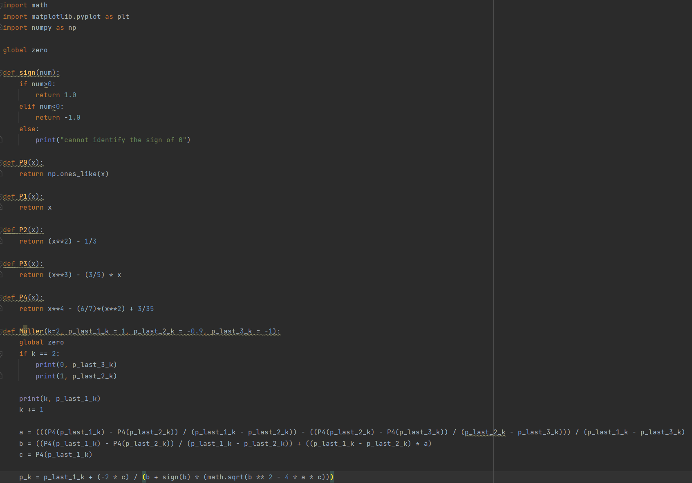
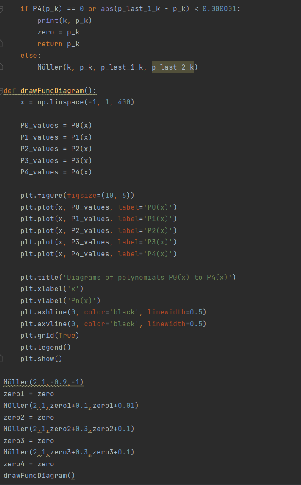
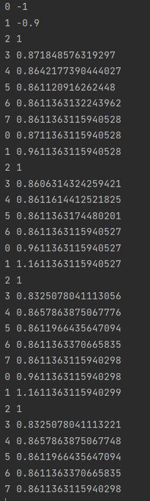
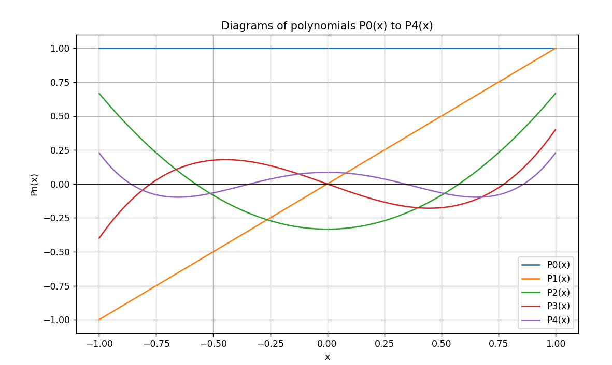

# Assignment 8 — Q5









### `8-q5.py`

```python
import math
import matplotlib.pyplot as plt
import numpy as np

global zero

def sign(num):
    if num>0:
        return 1.0
    elif num<0:
        return -1.0
    else:
        print("cannot identify the sign of 0")

def P0(x):
    return np.ones_like(x)

def P1(x):
    return x

def P2(x):
    return (x**2) - 1/3

def P3(x):
    return (x**3) - (3/5) * x

def P4(x):
    return x**4 - (6/7)*(x**2) + 3/35

def Müller(k=2, p_last_1_k = 1, p_last_2_k = -0.9, p_last_3_k = -1):
    global zero
    if k == 2:
        print(0, p_last_3_k)
        print(1, p_last_2_k)

    print(k, p_last_1_k)
    k += 1

    a = (((P4(p_last_1_k) - P4(p_last_2_k)) / (p_last_1_k - p_last_2_k)) - ((P4(p_last_2_k) - P4(p_last_3_k)) / (p_last_2_k - p_last_3_k))) / (p_last_1_k - p_last_3_k)
    b = ((P4(p_last_1_k) - P4(p_last_2_k)) / (p_last_1_k - p_last_2_k)) + ((p_last_1_k - p_last_2_k) * a)
    c = P4(p_last_1_k)

    p_k = p_last_1_k + (-2 * c) / (b + sign(b) * (math.sqrt(b ** 2 - 4 * a * c)))

    if P4(p_k) == 0 or abs(p_last_1_k - p_k) < 0.000001:
        print(k, p_k)
        zero = p_k
        return p_k
    else:
        Müller(k, p_k, p_last_1_k, p_last_2_k)

def drawFuncDiagram():
    x = np.linspace(-1, 1, 400)

    P0_values = P0(x)
    P1_values = P1(x)
    P2_values = P2(x)
    P3_values = P3(x)
    P4_values = P4(x)

    plt.figure(figsize=(10, 6))
    plt.plot(x, P0_values, label='P0(x)')
    plt.plot(x, P1_values, label='P1(x)')
    plt.plot(x, P2_values, label='P2(x)')
    plt.plot(x, P3_values, label='P3(x)')
    plt.plot(x, P4_values, label='P4(x)')

    plt.title('Diagrams of polynomials P0(x) to P4(x)')
    plt.xlabel('x')
    plt.ylabel('Pn(x)')
    plt.axhline(0, color='black', linewidth=0.5)
    plt.axvline(0, color='black', linewidth=0.5)
    plt.grid(True)
    plt.legend()
    plt.show()

Müller(2,1,-0.9,-1)
zero1 = zero
Müller(2,1,zero1+0.1,zero1+0.01)
zero2 = zero
Müller(2,1,zero2+0.3,zero2+0.1)
zero3 = zero
Müller(2,1,zero3+0.3,zero3+0.1)
zero4 = zero
drawFuncDiagram()
```
