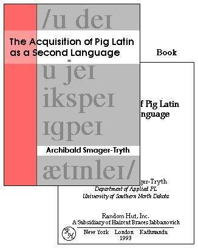
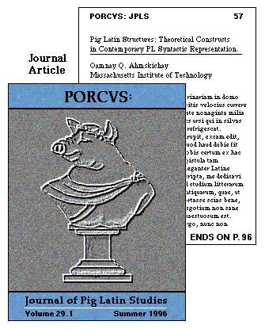
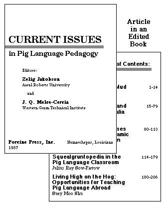

**EXERCISE 1: Writing a reference for a book**

**Answer**:

Smager-Tryth, A. (1993). *The Acquisition of Pig Latin as a Second Language.* New York: Random Hut.

**EXERCISE 2: Writing a reference for a journal article**

**Answer**:

Ahmskichay, O. Q. (1996). Pig Lain structures: Theoretical constructs in contemporary PL syntactic representation. Porcvs: *Journal of Pig Latin Studies,* 29, 57-96.

**EXERCISE 3: Writing a reference for a book chapter**

**Answer**:

Sow-Farrow, J. R. (1987). Squealgruntopedia in the Pig Language classroom. In Z. Jakobson & J. Melce-Cercia (Eds.), *Current issues in Pig* （................）
