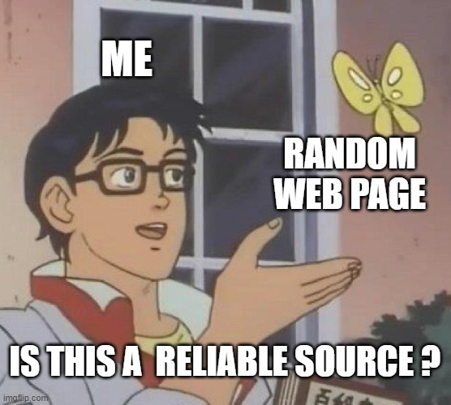

Name: Yanjin Li

Section: J

Date: 4/27/2025

Assignment name: Reflection 2

Before writing, I once again checked the seven major course objectives of ESL 112 one by one: from "topic selection and preliminary research" to "rewriting versions for different audiences". This review allowed me to clearly see my growth trajectory. Compared with the beginning of the semester, I can not only quickly judge whether a piece of information has academic credibility, but also naturally intersperse citations in APA format; from research paper writing to presentation, these goals have been practiced in drafts and feedback cycles. Therefore, this reflection aims to sort out which skills I have firmly mastered, which goal is still the most challenging, and how these experiences will be transferred to other scenarios.

***Is this a pigeon (reliable source)?***

The meme I created uses the format of "Is this a pigeon?" It describes a character (me) looking at a random web page in confusion, with a superimposed text asking: "Is this a reliable source?".

This meme humorously captures my key learning node in ESL 112 - "Evaluating information sources based on reliability and research relevance." At the beginning of research, we tend to search for the most accessible online materials without considering their academic value. The question in the meme symbolizes that I began to apply the evaluation criteria learned in class: examining author qualifications, publication dates, potential biases, and peer review status. These skills were particularly strengthened in the "Finding Reliable Sources" and the library study. The core shift indicated by the meme is from passively receiving information to actively questioning its academic applicability.

Of all the course objectives, I found that applying APA style citation standards in writing, integrating references without plagiarism by paraphrasing, citing, and summarizing should be the most challenging. While it is relatively easy to understand the concepts of citing and summarizing, effective paraphrasing is more difficult. It requires not only changing words, but also reconstructing sentences while retaining the original meaning and citing accurately. For example, when writing a research paper on the German food bank crisis, I had a hard time interpreting the specific impact of inflation from a DW article. I remember that during the outline writing and source synthesis work, I spent quite a bit of time trying different wordings, constantly checking to make sure I hadn’t accidentally plagiarized by following too closely to the original.

The most rewarding skill proved to be learning to “create concise, engaging multimedia presentations that effectively communicate findings from the research process.” While writing a research paper is fundamental, translating detailed work into a presentation felt like an important step in disseminating knowledge. I structured my findings on the German food bank crisis and my proposed hybrid solution into a logical expression with clear visual aids, which forced me to distill the most critical information. Practicing presentations and focusing on engaging the audience highlighted the importance of clear communication, not just words on paper.

The skills learned in ESL 112 can be directly applied outside of the classroom. Emphasizing audience and purpose is something I now consciously apply when writing emails. A formal email requesting information from a professor requires a different tone, structure, and level of detail than a short message coordinating another class project with group members. Learning to tailor your message can make communication more effective. Additionally, the process of finding and evaluating sources of information is essential in my daily life. When researching the German food bank crisis, we had to evaluate the reliability of information sources. Now, when I encounter news articles or information online, I apply similar critical thinking to question the credibility and potential bias of the source before accepting the information, which is essential in today's information-rich environment. These skills in targeted communication and critical information evaluation are tools that I will continue to use in the future.
