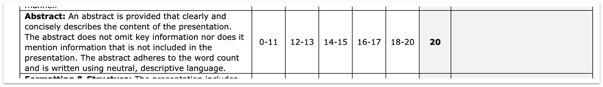

# Writing Presentation Abstracts Activity

### 

### Directions

Write a 75-125 word presentation abstract for your oral presentation. Read and review your unit 1 and unit 2 essays to select the most important information to be included in your abstract. Abstracts should include the following:

- *Background of the Problem/Content of the Presentation*

- *Main Solutions and Critiques*

- *Recommendation and Significance of Solutions*

Remember the 3Cs criteria (*clarity, concision, and completeness) while writing the abstract.*

> Faced with significant pressures from inflation, migration, and declining donations, food banks in Germany are struggling to serve all those in need, which is exacerbating food insecurity and social inequality. This presentation evaluates community fridges and digital coordination platforms as potential assistance strategies. Community fridges provide immediate local assistance but lack scalability and face operational barriers in terms of safety and logistics. Digital platforms improve operational efficiency but face significant challenges in terms of cost, training, and equity. Hybrid models are therefore crucial, and collaboration between food banks, government, and technology partners will be recommended to combine community programs with digital tools. Implementing effective integrated solutions.
