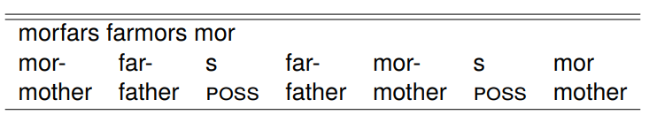
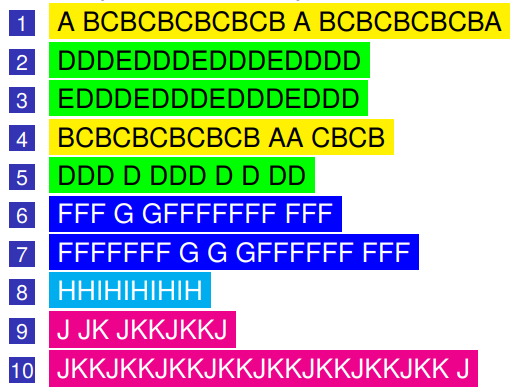
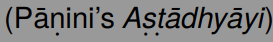
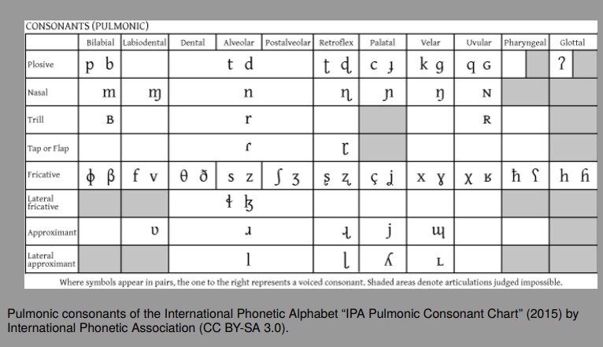
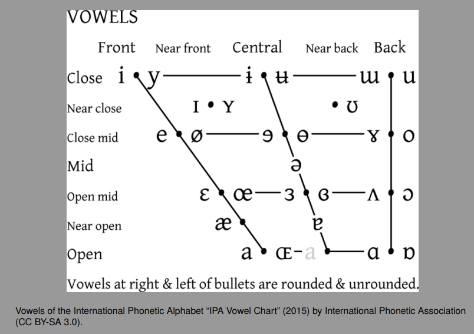
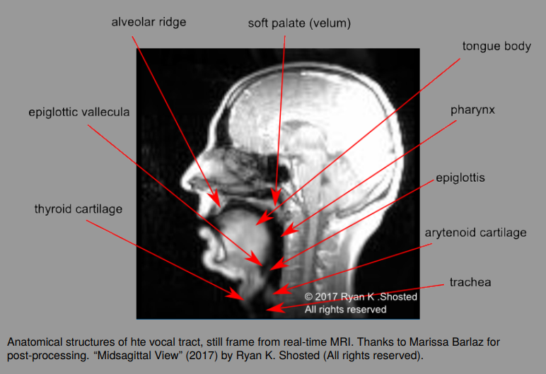
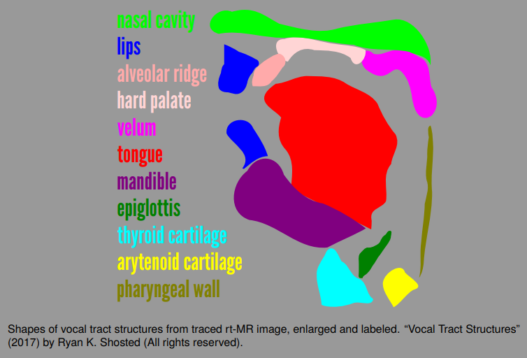

prominence

syllable

morphemes

creakiness

utterances

# L1.1 Is that language?

**-Introduction**

- What is language?

The world around us is full of forms of life that send signals to one another (zoosemiotics); it’s been like this for a very long time.

The signals may be electrical, olfactory, seismic, thermal, visual, gestural, and auditory.

Does a box turtle’s camouflage constitute language? How about a zebrafish changing its color in a courtship display?

Is language more than a signaling system?

If so, what properties differentiate a language from animal signaling systems?

- Seismic communication

The Middle East Blind Mole Rat is a subterranean rodent that shows remarkable adaptation to fossorial life.

It is an extremely solitary species that rapidly taps its head against the roof of its tunnel (head-drumming) in order to communicate with distant conspecifics.

The low frequency signals are received by another mole rat that places its lower jaw on the tunnel wall (jaw-listening).

What are they saying?

- The song of the cardinal

The song is a loud string of clear down-slurred or two-parted whistles, often speeding up and ending in a slow trill. The songs typically last 2 to 3 seconds. Syllables can sound like the bird is singing cheer, cheer, cheer or birdie, birdie, birdie.

Males in particular may sing throughout the year, though the peak of singing is in spring and early summer.

**-Defining properties of language**

- Some “design features” of language

If human language is unique, what makes it so different?

Interchangeability: participants can be both speaker and hearer (× blind mole rats);

Displacement: it is possible to communicate about things outside the present situation (× honeybees);

Productivity: new signs and utterances can be created (× humpback whales);

Semanticity: association between a signal and a particular concept (× vervet monkeys);

Duality of patterning: sounds can be combined into new, meaningful units (× birds, whales).

- Defining properties of language

So if most of the “design properties” are manifested in other species, what really makes language unique?

We are left with two properties.

Human language is uniquely

1 Open-ended

2 Recursive

- Open-ended

Humans can understand an infinite number of different sentences in their language(s) (a good dictionary may be needed for some applications).

<u>Brandi despondently checkmated the mesothoracic tutus.</u>

You may not know what *mesothoracic* means, but you know what role it plays in the sentence.

The idea of someone vanquishing a bunch of tutus—possibly worn by insects— probably conjures a world you never experienced or thought of before.

Human language does that; we have no evidence that nonhuman communication systems can do that.

- Open-ended: Could a mole rat say this?

- Recursion

Generally, recursion is a property whereby instances of a category can be embedded inside instances of that category.

\[Angela thinks that \[Ivanka knows that \[Donald made a crass remark\]\_3\]\_2\]\_1

Here we have two sentences (3, 2) embedded in a larger matrix sentence (1).

Recursion involves the “capacity to keep track of an element of one type while simultaneously processing an element of the same type ‘inside’ it” (Hurford, 2012, p. 70).

Kinship calculation in Swedish predicts properties of unseen entities through nominal (noun) recursion

e.g., \[mor \[fars \[far \[mors \[mor\]5\]4\]3\]2\]1:‘mother’s father’s father’s mother’s mother’ or ‘3rd great grandmother’ or ‘G/G/G grandmother’

An individual typically has (2^5) / 2 = 16 of these.

In Swedish, you know exactly which one is being indexed.

**-The garrulous animal**

- Can nonhuman primates produce language?

Can the great apes learn a human-like sign language?

Evidence suggests that in captivity apes can acquire rudimentary signs and use them for a variety of purposes.

Some argue that this is merely evidence of an advanced apprehension of stimulus and response—not the building blocks of language.

Do the ‘native’ vocalizations of primates provide evidence of language? The jury is still out, but some researchers believe they have found evidence of recursion, e.g., in the calls of wild muriquis (B. hypoxanthus).

Should we be studying primate gestures instead of vocalizations?

- How about other nonhuman animals?

Birds: birdsong is well-studied and highly complex, though evidence of recursion is elusive.

Bees: perform a kind of dance to communicate the distance, direction, and quality of various resources to other individuals in their hive.

Elephants: African forest elephants may be able to communicate a wide range of meanings—more than previously suspected.

Bats: Some mormoopid bats produce 33 different sounds (or syllables) that can be recombined.

Mollusks: Some sepioteuthid squid can change their body color, shape, and texture to communicate.

- The Dance of the honeybee

**-The Appendix**

- How open-ended is animal communication?

Our (understandable) anthropocentrism may make it impossible to ever know for sure.

Researchers interested in the complexity of animal communication point out the one-sided nature of the endeavor: we evaluate animal communication based on those aspects that seem important (or at least possible) in human communication and may never know what is most important, e.g., to whales, because we are not whales.

We also tend to look for communicative elements in a single domain, since so much of our communication is(or at least seems to be) dominated by one domain (the auditory).

- Scandinavian nominal recursion

Note that we can use explicit expressions like <u>mother's father's father's mother's mother</u> in English, too, though it seems too specific and somewhat unnatural.

In Swedish, a general term like ‘grandparents’ must be marked as matrilineal or patrilineal, e.g., *morföräldrar* ‘mother’s parents’.

Compare with Danish: *bedsteforældre*, lit. ‘best parents’ for Eng. ‘grandparents’; *oldeforældre* for ‘great-grandparents’;

Also: Dan. *nevø* ‘nephew’, cf. Swed. *brorson* or *systerson*.

# L1.2 Finding recursion

**-Introduction**

- What is recursion again?

Recursion is the ability of a constituent to embed another constituent of the same type within it.

Last time we saw sentences embedded in larger sentences and nouns embedded in larger nouns.

A more complex example: t<u>he book on the table by the window in the corner of the room</u> is ultimately a kind of... <u>book</u>.

Recursion is supposedly unique to human language.

- Thirty years from now...

Linguists may no longer believe that recursion is unique to human language.

Evidence is gathering that:

Animal communication systems exhibit recursive properties.

Human languages either do not all exhibit recursion or exhibit recursion through a variety of means.

The goal of today’s lecture is to discuss these problems.

Without recursion, we may lack evidence that human language is unique among other zoosemiotic systems.

**-Recursion itself**

- Where does recursion come from?

Humans produce new utterances that can be understood, all the time.

A dominant theory as to why this is true suggests that it is because humans have unique cognitive equipment for producing ‘context-free’ (and more complex) grammars.

Nonhuman animals have the cognitive ability to use ‘finite-state’ grammars only.

Context-free grammars are associated with recursion while finite-state grammars are not.

Therefore if you could prove a nonhuman uses a context-free grammar, you would have shown human language is not unique.

- Finite-state grammars

Presumed by many to be the grammar of animal communication systems.

In such a grammar, it is necessary to ‘know’ the immediately preceding element in order to predict the next element.

A possible finite-state grammar is (AB)n where each capital letter represents some discrete element or class of elements, like a particular kind of vocalization, and n is the number of repetitions.

So, for example, AB and ABAB are possible utterances in this grammar, but not AABB or ABB.

In producing A^n B^n = A A B B one would have to retain the number of A’s in memory while producing the B’s (that’s beyond a finite-state grammar).

- Context-free grammars

A possible context-free grammar is of the type A^n B^n, capable of generating utterances like AABB and AAABBB (this is called center-embedding).

This looks like the formal property of recursion: the number of A’s are related to the number of B’s even though the transition from one element to the next (say from A1 to A2) tells us nothing useful about that pattern.

Consider a good recursive sentence: <u>The dog with the smelly ears got kidnapped.</u>

A human, using a context-free grammar, can figure out who got kidnapped; but if we were relying on a finite-state grammar alone, we might conclude that some smelly ears got kidnapped, instead.

The structure of the sentence (syntax) matters more than the linear order of the words.

Here’s an example of a context-free A^n B^(n+1) grammar

where A = <u>anti</u> and B = <u>missile</u>:

<u>anti-missile missile</u>: a missile designed to take down another missile.

<u>anti- anti-missile missile missile</u>: a missile designed to take down other anti-missile missiles.

<u>anti- anti- anti-missile missile missile missile</u>: a missile designed to take down other antianti-missile missile missiles.

- Context-sensitive grammars

A more complex grammar in which a particular context determines whether or not one element can be substituted for another.

The phonological properties of language are good examples of this.

Also part of human language; human languages are considered ‘mildly context-sensitive’.

There is some emerging evidence that animal communication systems are context-sensitive.

**-The song of the Humpback whale**

- Whale song

Many cetaceans vocalize, but humpbacks produce long (up to 30 mins), complex songs during breeding season.

The songs also change over the course of time and can be picked up by other individuals.

The songs are composed of ‘moans’, ‘snores’, ‘cries’, and ‘chirps’.

We have no clue about the semantics of the songs.

After lots of debate, there is no evidence of recursion.

So what does the structure of whale song look like?

- Whalesong: complex but not recursive

In this song, recorded off Maui in 2010, individual structural elements can be observed; let’s call these elements “syllables”.

In the video (linked below), you will hear the syllables and see them represented graphically; shape (based on the spectral characteristics of the syllables) and color are used to individuate them.

The first “phrase” of the whalesong is notated below with the colors of the syllables as they appear in the video, now recorded as the letters A, B, and C:There are ten phrases separated by silence

These fall into five “themes” that each use a unique set of syllables, e.g., the ‘yellow’ theme (phrases 1 and 4) uses only A, B, and C syllables:

- Whalesong debate

Despite an attempt (Suzuki et al. 2006) to prove that there is mathematical complexity in whalesong akin to that of human language, the debate goes on.

Primarily, this is because we have no way of filling in the semantic content of the songs (what are the whales actually expressing?).

Secondarily, there is no evidence that one song is embedded within another song (phrases inside a song are a different matter) (Hurford 2012).

Despite some permutability over time and across individuals, a single humpback at one time in its life, only sings the same song, repeatedly.

**-The call of the Muriqui**

- Context-sensitive muriqui vocalizatio

The utterance <u>tp tpp tppp tpppp G t</u> with an obligatory increase in the number of p’s requires a context-free grammar to keep track of the number of p’s but also requires a context-sensitive grammar to limit the total number of p’s.

Demolin and colleagues find these kinds of patterns frequently in recordings.

Will muriquis someday be the reason linguists stopped citing recursion as the defining property of human language?

Without semantic information (we don’t know what the muriquis intend to say) it is impossible to know if these complex structures reflect hierarchical, embedded meaning like...

**-Meanwhile, elsewhere in Brazil..**

- The Pirahã

In a few weeks, we will learn more about the Pirahã, a group of people who live by hunting and gathering on the banks of the Maici River in the Amazon rainforest.

Everett has made the controversial claim that the Pirahã language lacks recursion (as well as its own personal pronouns; color terms other than light and dark; numerals; and more)

If true, Everett believes the existence of such a language proves much of modern linguistics wrong.

Others disagree about the facts, as well as their interpretation with respect to linguistic science.

**-The Appendix**

- Autocorrelation

Suzuki et al. (2016) used autocorrelation to automatically identify patterns in whalesong.

Each song contains around 130 bits of information.

Up until this bullet item, the text of this slide contained about as much information as a whale song.

Hurford (2012) compares whalesong to exclusively repeating the poem Requiem by Robert Louis Stevenson, sometimes stuttering over a word.

A poem like this shows weak signs of autocorrelation, like whalesong. Regular human language shows almost no autocorrelation (read more here).

To what extent can you guess the next word someone else is going to say? Your chances are slightly better with a poem (or a whalesong!)

Suzuki et al. (2016) used autocorrelation to automatically identify patterns in whalesong.

Each song contains around 130 bits of information.

Up until this bullet item, the text of this slide contained about as much information as a whale song.

Hurford (2012) compares whalesong to exclusively repeating the poem Requiem by Robert Louis Stevenson, sometimes stuttering over a word.

A poem like this shows weak signs of autocorrelation, like whalesong. Regular human language shows almost no autocorrelation (read more here).

To what extent can you guess the next word someone else is going to say? Your chances are slightly better with a poem (or a whalesong!)

# L2.1 Whence language?

# L3.1 The sounds of human language

-Sounds humans make with their faces

- Vocalization and gesture

For an unknown period of time, our species has made considerable use of vocalization in order to express complex ideas through language.

Vocalization is of course not necessary for linguistic expression (cf. sign language), but vocalization is evidently the most common modality at present.

Some believe manual gesture arose first and vocalization developed later.

For the sake of simplicity, in this course when we talk about language we will typically refer to the speech modality, with no disrespect intended towards the manual gesture modality.

- What is a linguistic sound?

We make a lot of noises; not all of them are integrated into the stream of speech.

Speech is traditionally conceived of as the sounds produced by our vocal tracts, even though snapping,

clapping, or stomping a foot may be an integral part of a given linguistic exchange.

We can further refine what it means to be a linguistic sound by ruling out involuntary sounds produced by the vocal tract (hiccups, belches, sneezes, etc.).

This is potentially problematic because, if one argues that the physiological constraints on our vocal tract are not under our control, one might reason that such well-studied phonetic phenomena as pitch declination and devoicing are in fact involuntary.

- So what is left?

There are some voluntary things we can do with our vocal tracts that don’t happen to be a part of speech in any known language.

Gnashing teeth; (voluntary) snoring; loud coughing; striking the underside of the tongue against the floor of the mouth; there are probably more. . .

Scholars have been studying speech sounds since at least the 4th Century BCE 

The taxonomical part appears simple at first glance: there are points along the vocal tract where we can do things and there are only certain things we can do.

However, we do not do all the possible things at every point in the vocal tract.

The gaps are not always easy to explain.

- Places we do things

To be a little more specific, these are the places where we narrow the vocal tract considerably, perhaps all the way to a complete closure.

These are called ‘places of articulation’

To learn the places of articulation, it helps to know the anatomy of the vocal tract, since the names of the places are typically the names of anatomical structures:

glottal (\<glottis), epiglottal (\<epiglottis), pharyngeal (\<pharynx), etc.

We’ll discuss these anatomical terms later in the lecture.

- Things we do

To be a little more specific, it’s the way we voluntarily control airflow in the vocal tract.

These are typologized roughly in terms of how we narrow the vocal tract and/or the shape of the narrow passage and/or the way air flows through that passage.

These are called ‘manners of articulation’.

Examples include: plosive (stop); fricative; lateral; nasal; approximant (glide).

- Wait, but that’s not all. . .

In addition, we can do quite a bit with our vocal folds声道 while we do other things elsewhere in the vocal tract声带.

This is called **phonation type 发声类型**.

Regular buzzing = voiced; Unconstricted airflow = voiceless; Tight constriction with irregular airflow = creaky; Loose constriction with periodic airflow = breathy.

In addition, we can expel air (egressive) or inhale (ingressive) during a particular speech sound.

The movement of air may be controlled by the lungs (pulmonic) or by some other mechanism: glottalic = ejectives; velaric = clicks.

This is called **airstream mechanism 气流机制**.

- The result

Let’s say you multiply all the levels of the categories—manner, place, airstream mechanism, phonation type—and obtain a list of all the possible sounds of human speech (≈1,500 unique sounds).

The actual set of speech sounds is much smaller.

Why? Real-world human anatomy and harder-to-define, relative factors like effort and audibility intervene to doom some of the combinatory outcomes.

A pharyngeal nasal stop is physically impossible to produce because of the position of the relevant structures in the vocal tract.

Sounds that actually occur in human language and appear to be meaningful (more on that later) get their own symbol in a nineteenth-century device called *The International Phonetic Alphabet* or IPA.

- The IPA

The IPA is the linguist’s Periodic Table of the Elements.

Consonant symbols are generally learned from a grid identifying the places and manners of articulation, along with the voicing characteristics, of the sounds.

Outside the grid, special symbols are provided for sounds with different airstream mechanisms.

Additional diacritic symbols are provided in a loosely-ordered list. These can be combined with any of the more letter-like symbols.

The symbols themselves are a grab-bag of Roman and Greek letters, sometimes modified (capitalization and rotation are common devices); other symbols are invented ex nihilo, e.g., ò, the bilabial velaric ingressive; Ý, the voiced epiglottal fricative.

- The IPA consonant chart

Posture: pɑstʃər

Chemical: kɛmɪkəl

Steward: ~~sdiwərd~~ (?)

Impossibility: ɪmpɑsəbɪlɪti

Reward: ~~rɛwərd~~

Collision: ~~kɑliʃɑn~~

- How about the vowels

Since they all have the same manner of articulation, voicing, and airstream mechanism, vowels are typologized by where they are produced in the mouth.

Note that the term “place of articulation” is usually reserved for consonants, with no widely-accepted cover term for “place” in vowels.

Roughly, vowels are considered in terms of three dimensions having to do with

The height of the tongue in the oral cavity;

The anteriority (frontness) of the tongue in the oral cavity;

The state of the lips—rounded or unrounded.

- The IPA vowel chart

**-Vocal tract anatomy**

- Midsagittal view of the head and neck: rt-MR image

- Midsagittal view of the head and neck: structures

